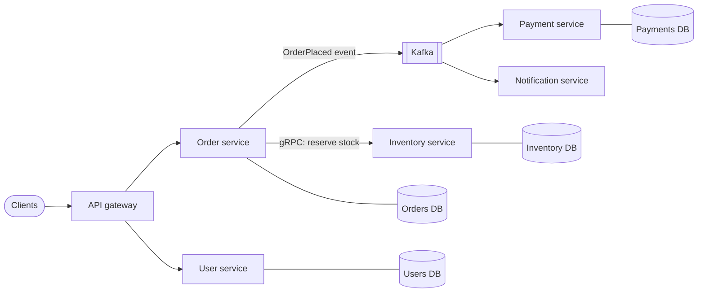

# Microservices

## The problem it solves

A single codebase serves your whole product: users, catalog, checkout, search, notifications. Eighty engineers commit to it. Every deploy ships everything, so one broken search change blocks the checkout fix. The test suite takes 45 minutes. Search needs 40 servers at peak and checkout needs 4, but you scale the whole monolith together. A memory leak in image resizing takes down payments.

Microservices split the system into small services, each owning one business capability and its own data, deployed and scaled independently by the team that owns it. The point is organizational and operational independence, not small code size.

## How it works

1. **Draw boundaries around business capabilities**, not technical layers: an Order service, a Payment service, an Inventory service (often aligned with domain-driven design "bounded contexts").
2. **Each service owns its data.** No other service reads its tables directly; they go through its API or its events. This is what makes independent deploys and schema changes possible.
3. **Communicate over the network**, either synchronously (REST or gRPC request-response) or asynchronously (publishing events to Kafka or a queue that others consume).
4. **Deploy independently**, each with its own pipeline, versioned APIs, and scaling rules.
5. **Add the platform pieces** this requires: an API gateway at the edge, service discovery, centralized logging, distributed tracing, and per-service metrics.

**Sync vs async.** Synchronous calls are simple but couple availability: if Order calls Inventory, which calls Pricing, the chain is only as available as all three combined. Events decouple services in time, so Notification can be down without blocking checkout, at the cost of eventual consistency.

**Transactions across services.** You lose single-database ACID transactions. Multi-step workflows use **sagas**: a sequence of local transactions with compensating actions (if payment fails, release the reserved stock). The **transactional outbox** pattern writes the event to an outbox table in the same local transaction as the state change, and a relay publishes it, so the database and the event stream never disagree.

**Resilience patterns.** Every network call needs a timeout, bounded retries with backoff for idempotent operations, and a circuit breaker that fails fast when a dependency is unhealthy.

## Worked example

Availability of a synchronous call chain. Each service is independently 99.9% available.

| Request path | Services required | Combined availability | Downtime per 30 days |
|---|---|---|---|
| Monolith (one deployable) | 1 | 99.9% | ~43 min |
| Gateway, then Order | 2 | 0.999² ≈ 99.8% | ~86 min |
| Gateway, Order, Inventory, Pricing, User | 5 | 0.999⁵ ≈ 99.5% | ~216 min |
| Same, but Pricing and User served from cache or events | 3 | 0.999³ ≈ 99.7% | ~130 min |

30 days is 43,200 minutes; 0.1% of that is 43.2 minutes. Deep synchronous chains multiply failure, which is why you keep them short and move non-critical work to async events.

## Trade-offs

- **Pros:** teams deploy independently and faster; services scale independently; failure isolation when designed well; freedom to pick the right datastore per service.
- **Cons:** network calls replace function calls (latency, partial failures); no cross-service transactions; distributed debugging needs tracing; duplicated data and eventual consistency; much more infrastructure (CI/CD per service, discovery, observability). A badly split system becomes a "distributed monolith" that must still be deployed together.
- **Alternatives:** a **modular monolith** with strict internal module boundaries, one deployable and one database, which gives most of the code organization benefits without distribution costs. Many teams start there and extract services only where scaling or team boundaries demand it.

## When to use it (and when not)

- **Use it** when many teams need to ship independently, parts of the system have very different scaling or reliability needs (search vs checkout), or a component needs a different technology. It is the default framing in e-commerce, ride-sharing (Uber: trip, matching, pricing, payments) and food-delivery designs.
- **Avoid it** for a small team or a new product whose boundaries aren't yet clear. Interviewers also respect "I'd keep this a monolith for now and split X out first because..."

## In an interview

Say: "I'll split by business capability into Order, Inventory, Payment and Notification services, each owning its database, with synchronous gRPC only on the checkout critical path and Kafka events for everything else." Then be ready to explain how you keep data consistent without distributed transactions (sagas, outbox), how services find each other, and how you trace a request across them.

## Common follow-up questions

### How do you handle a transaction that spans services?
Use a saga: each service does a local transaction and emits an event that triggers the next step, and failures trigger compensating actions in reverse order. It can be choreographed through events or orchestrated by a coordinator service, and it gives eventual rather than immediate consistency.

### Why shouldn't services share a database?
A shared schema couples every service that touches it, so one team's migration can break another's deploy. It also hides dependencies that should be explicit API contracts. Shared databases are the most common cause of distributed monoliths.

### How do you debug a slow request across ten services?
Distributed tracing: the gateway assigns a trace ID that every service propagates and reports spans for, using OpenTelemetry with a backend like Jaeger. Combined with correlated logs, you can see which hop added the latency.

### How big should a service be?
Big enough to own a coherent business capability and its data, small enough that one team can own it fully. Splitting by technical layer or by entity CRUD usually creates chatty services that always change together.
