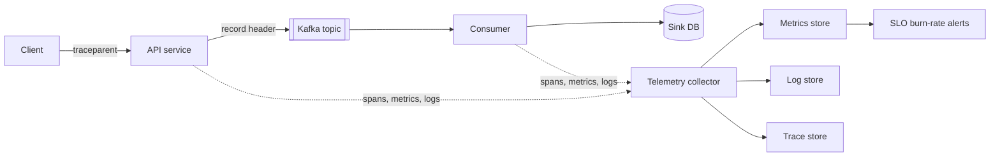

# Observability

## The problem it solves

A user reports "checkout is slow." Is it every user or one region? The database, a downstream API, or a GC pause? Did it start with the last deploy? In a system of dozens of services and a Kafka pipeline in between, you cannot answer by SSH-ing into boxes.

**Monitoring** tells you *that* something is wrong against things you predicted. **Observability** is being able to ask new questions about the system's behavior from the outside, using the telemetry it emits, without shipping new code. It's also how you define "working" precisely enough to make engineering trade-offs: SLOs and error budgets.

## How it works

**The three signals.**

| Signal | What it is | Answers | Cost profile |
|---|---|---|---|
| **Metrics** | Numeric time series with labels (`http_requests_total{route,status}`) | Is something wrong? How much? Trend over weeks? | Cheap per event; cost grows with label cardinality |
| **Logs** | Timestamped records of discrete events | What exactly happened to this request or entity? | Expensive at volume; cost grows with traffic |
| **Traces** | A tree of timed spans for one request across services | Where did the time go? Which hop failed? | Expensive; usually sampled |

A typical investigation: a metric alert says p99 checkout latency doubled, an exemplar or trace shows the time is in the payments call, and logs for those trace IDs show connection-pool timeouts.

**RED and USE.** Two checklists for what to measure:

- **RED** for request-driven services: **R**ate (requests/s), **E**rrors (failed requests/s), **D**uration (latency distribution, as histograms so you can compute p50/p99).
- **USE** for resources (CPU, disk, connection pools, partitions): **U**tilization (% busy), **S**aturation (queued work), **E**rrors.

For a stream pipeline add: produce rate, consume rate, **consumer lag** (messages or seconds behind the latest offset), end-to-end latency (event time to processed time), and DLQ rate.

**Cardinality pitfalls.** Each unique combination of label values is a separate time series. `route × status × region` might be 50 × 5 × 4 = 1,000 series. Add `user_id` with 10 million users and you have 10 billion: the metrics backend falls over or the bill explodes. Keep unbounded values (user IDs, request IDs, raw URLs, emails) out of metric labels; put them in logs and traces instead.

**Structured logging and sampling.** Log JSON with consistent fields (`ts`, `level`, `service`, `trace_id`, `tenant_id`, `event`, `duration_ms`) rather than free text, so you can filter and aggregate. Don't log PII or secrets. At high volume, sample: keep all errors and slow requests, and 1% of successful ones. Logs can flow through Kafka to a search store, which also buffers bursts.

**Distributed tracing and context propagation.** The edge creates a trace ID; every service creates spans and passes the context to the next hop (the W3C `traceparent` HTTP header; for Kafka, a record header on the produced message). Consumers continue or link the trace, so you can follow one event from the API through the topic to the downstream sink. **Head sampling** decides at the start (cheap, but may miss rare errors); **tail sampling** decides after the trace completes so it can keep all errors and slow traces (needs buffering).

**SLIs, SLOs, SLAs.**

- **SLI:** a measured ratio of good events to total. "Fraction of checkout requests that return non-5xx within 300 ms." For a pipeline: "fraction of minutes in which consumer lag is under 30 seconds," or "fraction of events delivered to the sink within 60 s of being produced."
- **SLO:** the target for an SLI over a window: 99.9% over 30 days.
- **SLA:** a contract with customers, with penalties. Set it looser than the SLO so you breach internally first.

**Error budgets.** 100% − SLO is the amount of unreliability you are *allowed*. While budget remains, ship features; when it's exhausted, prioritize reliability work and slow risky releases. It turns reliability arguments into numbers.

**Burn-rate alerting.** Burn rate = how fast you're spending the budget relative to the even pace. Burn rate 1 spends exactly the budget over the window; burn rate 14.4 spends a 30-day budget in 720 / 14.4 = 50 hours. Alert on burn rate over two windows (a long one for significance, a short one so the alert clears quickly once fixed):

| Severity | Burn rate | Long window | Budget consumed by then |
|---|---|---|---|
| Page | 14.4 | 1 hour | 14.4 × 1 / 720 = 2% |
| Page | 6 | 6 hours | 6 × 6 / 720 = 5% |
| Ticket | 1 | 3 days | 1 × 72 / 720 = 10% |

**Alert on symptoms, not causes.** Page on what users feel (error rate, latency, freshness SLO burn), not on "CPU at 85%": high CPU with happy users isn't an emergency, and many causes you didn't predict won't have a cause-based alert. Cause metrics belong on dashboards for diagnosis.

**Dashboards.** One top-level dashboard per service: SLO status and budget remaining, RED panels, then dependencies and resources (USE). Show deploy markers. Keep them few and curated; a wall of 200 graphs hides the one that matters.

## Worked example

SLO: 99.9% of checkout requests succeed over 30 days.

- Time-based view: 30 days = 30 × 24 × 60 = 43,200 minutes; 0.1% of that is **43.2 minutes** of full outage.
- Request-based view: 100 million requests/month allows 0.001 × 100,000,000 = **100,000 failed requests**.

Incident: a bad deploy makes 2% of requests fail. The allowed error rate is 0.1%, so burn rate = 2% / 0.1% = **20**. The page fires because 20 > 14.4 over the last hour (and the 5-minute window confirms it's still happening). If no one acts, the budget lasts 720 / 20 = **36 hours**. The team rolls back after 30 minutes: budget spent = 20 × 0.5 / 720 ≈ **1.4%**, about 1,400 of the 100,000 allowed failures (at an even ~139k requests/hour, 30 minutes is ~69k requests × 2% ≈ 1,390).

Pipeline SLI: lag is sampled every minute; a minute is "good" if lag < 30 s. Over 30 days, 99.5% means at most 0.005 × 43,200 = 216 bad minutes. A consumer that falls behind for 3 hours spends 180 of them, so the team would add consumer instances (up to the partition count) or fix the slow sink.

## Trade-offs

- **Metrics** are cheap and fast but aggregated: you can't drill into one request.
- **Logs** have full detail but cost grows with traffic; sampling saves money but loses some events.
- **Traces** explain latency across services but require instrumentation everywhere and sampling decisions.
- **Tight SLOs** (99.99%) leave tiny budgets and slow delivery; **loose SLOs** let users suffer before anyone acts.
- **Too many alerts** cause fatigue and ignored pages; too few miss incidents.

## When to use it (and when not)

- **Use** RED metrics and structured logs on every service from day one, tracing once you have more than a handful of services or any async hops, and SLOs for anything with users (internal users count).
- **Don't** put unbounded IDs in metric labels, log full request bodies by default, or page on resource metrics that don't affect users. A tiny internal script doesn't need an SLO.

## In an interview

Say: "Each service emits RED metrics, structured JSON logs with a trace ID, and OpenTelemetry-style traces propagated through Kafka headers. The pipeline's key SLIs are consumer lag and end-to-end freshness. We set an SLO like 99.9% of events processed within 60 seconds over 30 days, and page on multi-window burn rate, not on CPU." Do the 43.2-minute arithmetic if asked.

## Common follow-up questions

### What's the difference between monitoring and observability?
Monitoring checks known failure modes with predefined dashboards and alerts. Observability means the telemetry is rich enough (high-detail events, traces, consistent context) to investigate failures you didn't predict, without deploying new instrumentation.

### Why is consumer lag a good SLI for a stream pipeline?
It directly measures freshness, which is what downstream users feel: lag means their data is stale. It catches slow consumers, stuck partitions and slow sinks. Lag in seconds is more meaningful than in messages because message rates vary.

### Why use percentiles instead of averages for latency?
Averages hide the tail: if 99% of requests take 50 ms and 1% take 5 s, the average is about 100 ms, which looks fine while 1 in 100 users waits 5 seconds. Record histograms so percentiles can be computed and aggregated across instances; averaging per-instance p99s is wrong.

### What is a burn-rate alert and why is it better than a threshold?
It fires when the error budget is being consumed much faster than sustainable, for example 14.4× over an hour. Unlike "error rate > 1%," it's tied to the SLO, ignores brief harmless blips, and catches slow leaks via the longer windows.

### How do you trace a request across a Kafka topic?
The producer injects the trace context into a record header; the consumer extracts it and starts a span linked to the producer's span. Because one consumer batch may contain many traces, consumers often use span links rather than a single parent.
