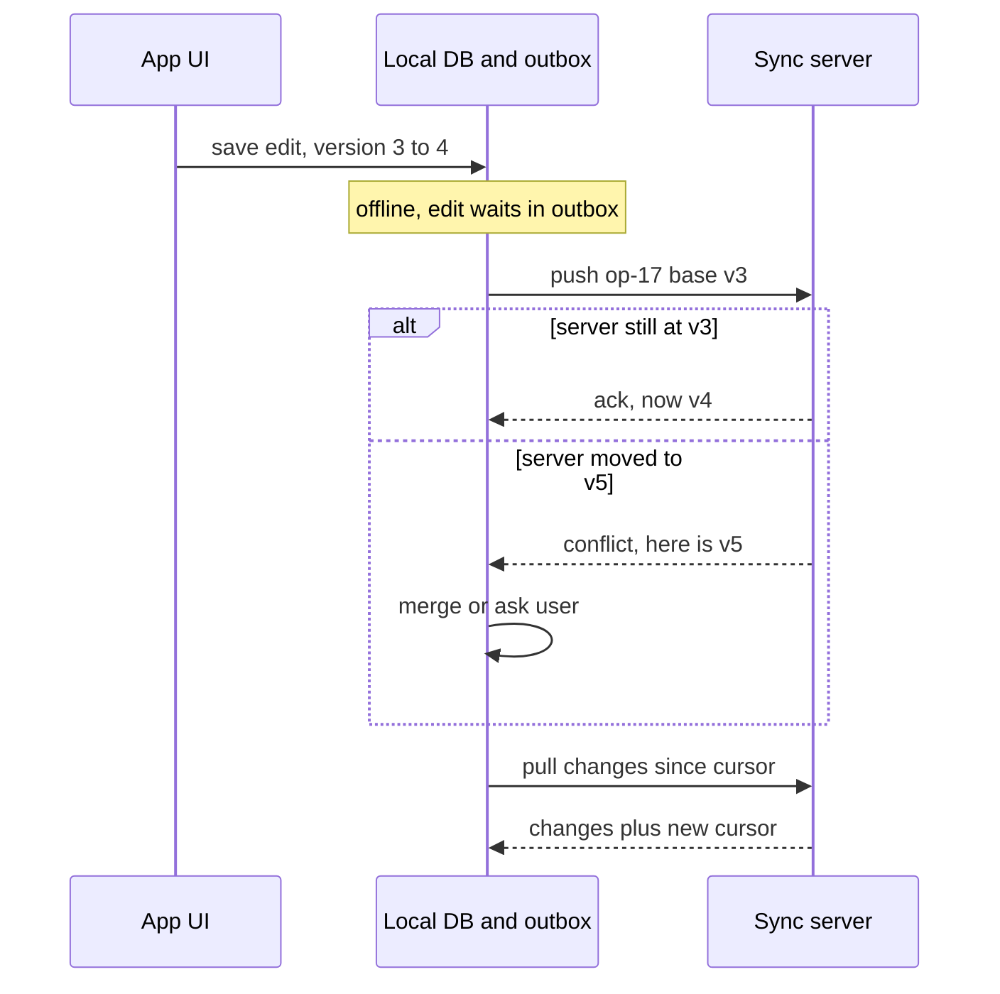

# Offline Sync

## The problem it solves

A field technician fills in a 20-step inspection form in a basement with no signal. If the app needs a network round trip for every save, it shows spinners and errors, and the work is lost when the app is closed. The same goes for a notes app on a plane, a delivery driver marking parcels in a dead zone, or a Google Docs-style editor with flaky Wi-Fi. Users expect the app to keep working and to sort things out when the connection returns.

Offline sync makes the device's local database the place the UI reads and writes, and treats the server as something to reconcile with in the background.

## How it works

1. **Local-first writes.** The app writes to a local store (SQLite, IndexedDB, Realm) and updates the UI immediately.
2. **Outbox.** Each change is also appended to a local outbox queue with a unique operation ID, the entity ID and the base version it was made against.
3. **Push when online.** A sync worker sends outbox entries in order. The server applies each one idempotently (deduplicating by operation ID), detects conflicts, and acknowledges. Acknowledged entries leave the outbox.
4. **Pull changes.** The client asks for everything changed since its last sync cursor (`GET /changes?since=cursor`) and applies those changes locally, then stores the new cursor.
5. **Resolve conflicts.** When the same record was changed on two devices, a policy decides the result.

**Conflict resolution strategies:**

- **Last-writer-wins (LWW):** keep the write with the latest timestamp. Simple, but silently drops one edit, and device clocks can be wrong. Prefer server-assigned order or hybrid logical clocks over raw device time.
- **Field-level merge:** if device A changed `title` and device B changed `due_date`, keep both. Only same-field edits conflict.
- **Ask the user:** show both versions (common for documents and contacts).
- **CRDTs:** conflict-free replicated data types (counters, sets, sequences for text) are designed so concurrent edits merge to the same result on every replica regardless of order. Libraries such as Automerge and Yjs implement them.
- **Domain rules:** e.g. for inventory, apply operations ("decrement by 2") instead of overwriting values ("set to 8").

**Version tracking.** A per-record version number lets the server detect "you edited an old version" (optimistic concurrency). Version vectors track per-device counters so you can tell whether one edit happened after another or concurrently.

## Worked example

A shared to-do item starts at version 3: `{title: "Buy milk", done: false}`. Phone and laptop both go offline.

| Time | Phone | Laptop | Server |
|---|---|---|---|
| 10:00 | sets `done = true` (base v3) | | v3 |
| 10:05 | | sets `title = "Buy oat milk"` (base v3) | v3 |
| 10:20 | reconnects, pushes | | v4: done = true |
| 10:30 | | reconnects, pushes base v3 | conflict: base v3 but server at v4 |

With field-level merge, the server sees the laptop changed only `title` and v4 changed only `done`, so it stores v5: `{title: "Buy oat milk", done: true}`. With whole-record LWW, v5 would be the laptop's copy with `done = false`, losing the phone's edit.

## Trade-offs

- **Pros:** instant UI; works without connectivity; fewer failed requests on bad networks; reduced server load since reads are local.
- **Cons:** conflict resolution is product-specific and hard to get right; local schema migrations; storage limits on devices; security of data at rest on the device; the user may see stale data from other devices.
- **Alternatives:** online-only with retries (simplest, if connectivity is reliable); read-only offline cache (view offline, edit only online); managed sync products (Firebase, Realm/Atlas Device Sync, CouchDB/PouchDB replication) instead of building your own.

## When to use it (and when not)

- **Use it** for note-taking and to-do apps, collaborative editors, field service and delivery apps, mobile email, messaging (queued outgoing messages), and point-of-sale terminals. Interview questions: design Google Docs, design Dropbox or Google Drive, design a notes app, design WhatsApp (offline message queue), design a ride-sharing driver app.
- **Avoid it** when operations must be validated centrally at the moment they happen: booking the last seat, transferring money, or bidding in an auction. You can queue the request offline, but you can't confirm it until the server accepts it.

## In an interview

Say: "The client writes to a local SQLite database and an outbox; a sync worker pushes operations with idempotency keys and base versions, pulls changes since a cursor, and resolves conflicts per field, with CRDTs for the document body." Be ready to explain your conflict policy, how you avoid duplicates on retry, and how the change feed is paginated.

## Common follow-up questions

### How do you avoid applying the same offline operation twice?
Each operation carries a client-generated unique ID. The server records processed IDs (or uses them as a unique key) and returns the original result for repeats, so retrying after a lost acknowledgement is safe.

### Why not just use last-writer-wins everywhere?
LWW silently loses edits, and device clocks drift or are set wrong. It's acceptable for low-value fields like "last opened" but not for user content. Field-level merges or CRDTs keep both users' work.

### How does the server know what to send on pull?
It keeps a monotonically increasing change sequence (or per-user change log) and the client stores the highest sequence it has applied. The pull returns changes after that cursor in pages, and deletes are sent as tombstones so the client knows to remove records.

### What happens if a device is offline for months?
Its cursor may be older than the change log the server retains. The server then tells the client to do a full resync of current state, after first pushing its pending outbox so local edits aren't lost.
