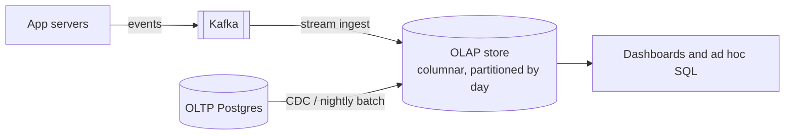

# OLAP Stores

## The problem it solves

Your product team wants a dashboard: "clicks per country per hour for the last 30 days." The events table has 5 billion rows, each with ~40 columns. In a row-oriented OLTP database like Postgres, that query reads every row in full, all 40 columns, even though it only needs `timestamp`, `country` and `event_type`. At ~200 bytes per row that's ~1 TB of disk reads for one chart. It takes minutes and it competes with production traffic for the same disks and buffer cache.

OLAP (online analytical processing) stores are built for this shape of query: scan billions of rows, touch few columns, aggregate them, return in under a second.

## How it works

**1. Columnar storage.** Instead of storing each row together, the store keeps each column in its own file (or block). A query that touches 3 of 40 columns reads roughly 3/40 of the data.

**2. Compression.** Values in one column are similar (the same 200 country codes repeated), so they compress very well with dictionary encoding, run-length encoding and general codecs like LZ4 or ZSTD. Ratios of 5–10× are common, which shrinks the scan further.

**3. Vectorized execution.** The engine processes a batch of thousands of values per column at a time in tight loops that use CPU caches and SIMD instructions well, instead of interpreting one row at a time.

**4. Sorting, partitioning and skipping.** Data is partitioned (usually by day) and sorted by a key such as `(event_type, timestamp)`. Each block stores min/max metadata, so a query with `WHERE ts >= now() - 30d` skips partitions and blocks that can't match.

**5. Pre-aggregation (optional).** Systems like Druid and Pinot can roll up events at ingest time (e.g. counts per minute per dimension combination) or maintain materialized views, trading raw detail for speed.



A typical ClickHouse table:

```sql
CREATE TABLE events (
  ts         DateTime,
  event_type LowCardinality(String),
  country    LowCardinality(String),
  user_id    UInt64,
  ...
) ENGINE = MergeTree
PARTITION BY toYYYYMMDD(ts)
ORDER BY (event_type, ts);

SELECT country, toStartOfHour(ts) AS hour, count()
FROM events
WHERE event_type = 'click' AND ts >= now() - INTERVAL 30 DAY
GROUP BY country, hour;
```

**Common systems:** ClickHouse (general columnar SQL), Apache Druid and Apache Pinot (real-time ingestion from Kafka, low-latency user-facing analytics), and cloud warehouses like BigQuery, Snowflake and Redshift (more batch-oriented, separated storage and compute).

## Worked example

5 billion events, 40 columns, ~200 bytes per row raw. The dashboard query uses 3 columns totaling ~20 bytes per row.

| Step | Data read |
|---|---|
| Row store, full scan | 5B × 200 B = 1 TB |
| Column store, 3 columns only | 5B × 20 B = 100 GB |
| With ~10× compression | ~10 GB |
| Partition pruning to 30 of 365 days (if the table holds a year) | ~10 GB × 30/365 ≈ 0.8 GB |

Reading under 1 GB across a few cores, using vectorized execution, takes on the order of a second instead of many minutes.

## Trade-offs

- **Pros:** fast aggregations over huge datasets; high compression lowers storage cost; isolates analytics load from the production database.
- **Cons:** slow or awkward point updates and deletes (data is written in immutable parts and merged later); poor for fetching one full row by key; weak or no multi-row transactions; joins across large tables are more limited than in a general warehouse, depending on the engine.
- **Alternatives:** a read replica of the OLTP database (fine for small data); precomputed counters in Redis (fast but fixed questions only); a data lake with Parquet files queried by Spark, Trino or Athena (cheap, flexible, slower).

## When to use it (and when not)

- **Use it** for analytics dashboards, ad click aggregation, metrics and observability backends, "top K" reports, and user-facing analytics (e.g. "views of your post this week"). It appears in interview questions like ad click aggregator, metrics monitoring, YouTube or LinkedIn view analytics, and top K trending.
- **Don't use it** as the system of record for transactional data like orders, balances or user profiles, or for workloads dominated by single-row reads and updates. Those belong in an OLTP database, with the OLAP store fed from it.

## In an interview

Say: "Raw click events go through Kafka into a columnar store like ClickHouse or Pinot, partitioned by day and sorted by ad ID and time, so the dashboard queries scan only the columns and days they need." Be ready to explain why columnar storage is faster for aggregations, how data gets in (streaming vs batch), and how you handle late or duplicate events.

## Common follow-up questions

### Why is a column store bad at OLTP workloads?
Reading one full row means touching every column file, and updating a row means rewriting compressed blocks. Writes are batched into immutable parts that get merged in the background, so frequent single-row updates create lots of small parts and merge pressure.

### Should you pre-aggregate at ingest or query raw events?
Pre-aggregating (rollups per minute) makes queries cheap and storage small, but you lose the ability to ask new questions of the raw data. A common compromise is to keep raw events for a short period, or in cheap object storage, and serve dashboards from rollups.

### How do you get data into the OLAP store in near real time?
Stream events from Kafka into Druid, Pinot or ClickHouse, which can ingest continuously and make data queryable within seconds. For data that lives in an OLTP database, use change data capture to stream inserts and updates.

### How do you handle duplicate events from retries?
Give each event a unique ID and deduplicate, either upstream in the stream processor or with engine features like ClickHouse's ReplacingMergeTree, which collapses rows with the same sorting key during merges. Note that such merges are eventual, so exact counts may need deduplication at query time too.
