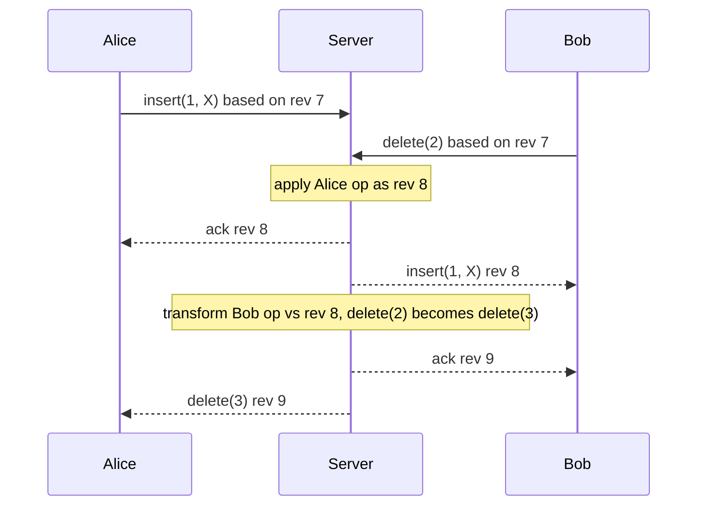

# Operational Transform

## The problem it solves

Two people edit the same document at the same time. The text is "abc". Alice inserts "X" at position 1; Bob, at the same moment, deletes the character at position 2 (the "c"). If each client simply applies the other's operation as received, Alice applies `delete(2)` to "aXbc" and removes the "b", ending with "aXc", while Bob applies `insert(1, "X")` to "ab" and gets "aXb". The two screens now disagree, and Alice lost a character nobody deleted.

**Operational transform (OT)** fixes this by rewriting (transforming) each incoming operation against the concurrent operations it didn't know about, so its positions still point at the intended text. Every replica converges and each user's intent is kept.

## How it works

Operations are small edits with positions: `insert(pos, text)` and `delete(pos, len)`. The core is a transform function `T(op1, op2)` that returns op1 adjusted as if op2 had already been applied.

```
def transform(op, against):
    # both ops were created on the same document version
    if against.kind == "insert":
        if against.pos < op.pos or (against.pos == op.pos and against.site < op.site):
            op.pos += len(against.text)
    elif against.kind == "delete":
        if against.pos < op.pos:
            op.pos -= min(against.len, op.pos - against.pos)
        # overlapping deletes shrink op.len (omitted)
    return op
```

The rules in words:

- **Insert vs insert:** if the other insert is earlier in the document, shift right by its length. If both are at the same position, a tie-break (site ID) decides who goes first, the same way on every replica.
- **Delete vs insert:** an earlier insert shifts the delete right.
- **Insert vs delete:** an earlier delete shifts the insert left.
- **Delete vs delete:** shift left, and if the ranges overlap, drop the part already deleted.

**The central server model.** Peer-to-peer OT is notoriously hard to get right (the transform functions must satisfy properties called TP1 and TP2 for arbitrary orderings). Production systems like Google Docs avoid the hard case with a **central server that defines one total order**:

1. Each client applies its own edits locally right away (so typing feels instant) and sends them tagged with the server revision it was based on.
2. The server keeps a log of operations by revision. When an op arrives based on revision r while the server is at revision n, the server transforms it against ops r+1..n, appends it as revision n+1, and broadcasts it.
3. The client has at most one unacknowledged op in flight and buffers later edits. Incoming ops from the server are transformed against the client's pending ops before being applied.



## Worked example

Document at revision 7: "abc" (positions a=0, b=1, c=2).

| Step | Server | Alice's screen | Bob's screen |
|---|---|---|---|
| Alice types `insert(1,"X")`, Bob types `delete(2)` concurrently | "abc" (rev 7) | "aXbc" | "ab" |
| Server receives Alice first, applies as rev 8 | "aXbc" (rev 8) | "aXbc" | "ab" |
| Server receives Bob's `delete(2)` based on rev 7. Transform against `insert(1)`: 1 < 2, so shift to `delete(3)`. Apply as rev 9 | "aXb" (rev 9) | "aXbc" | "ab" |
| Bob receives rev 8 `insert(1,"X")`, transforms against his pending `delete(2)`: delete is at 2, not before 1, so insert stays at 1 | "aXb" | "aXbc" | "aXb" |
| Alice receives rev 9 `delete(3)`, removes "c" | "aXb" | "aXb" | "aXb" |

All three converge on "aXb": Alice's X is kept and Bob's intended "c" is the one deleted.

**Tie-break case:** both insert at position 1 into "abc", Alice "X" (site A) and Bob "Y" (site B). With the rule "lower site ID goes first", both replicas end with "aXYbc".

## Trade-offs

- **Pros:** compact operations with no per-character metadata; well proven in production editors; the server log gives a natural revision history and undo base; easy to add access control and validation at the server.
- **Cons:** needs a central server per document (a single point of ordering, and edits pause while offline beyond what the client buffers); transform functions get complicated for rich text, tables and tree structures; peer-to-peer OT is error-prone.
- **Alternatives:** **CRDTs** (Yjs, Automerge) embed ordering in unique character IDs so replicas can merge without a server, at the cost of metadata and tombstones; **locking** sections of a document (simple but blocks collaboration); **last-write-wins** on whole fields (fine for forms, wrong for text).

## When to use it (and when not)

- **Use it** for real-time collaborative text editing with a server in the loop: "design Google Docs", collaborative code editors, shared notes. Route all editors of a document to the same server (e.g. consistent hashing on document ID) so one process orders its ops.
- **Not a good fit** for offline-first or peer-to-peer apps (CRDTs fit better), or for structured data where field-level last-write-wins or a CRDT map is enough.

## In an interview

Say: "Each document is owned by one collaboration server that assigns revision numbers; clients apply edits optimistically, send them with their base revision, and the server transforms late ops against everything since that revision before broadcasting." Be ready to walk through one concurrent insert/delete transform, explain how the client handles its pending op, and compare with CRDTs.

## Common follow-up questions

### Why does Google Docs-style OT need a central server?
With a single server assigning a total order, every op only needs transforming against a linear history, which keeps the transform rules simple and provably convergent. Without it, ops can arrive in different orders at different peers, and the transform functions must satisfy much stricter properties that many published algorithms got wrong.

### What happens if the document server crashes?
The op log is persisted (to a database or replicated log) before ops are acknowledged. A new server for the document loads the latest snapshot plus the log, and clients reconnect and resend unacknowledged ops with their base revision, which the server transforms as usual.

### How do you scale to millions of documents?
Shard documents across collaboration servers by document ID, so all editors of one document hit the same server over WebSockets. Each document's load is small; the scaling problem is routing and handling reconnects when a server moves.

### How does cursor position stay correct for other users?
Cursors are transformed the same way as inserts: when a remote op inserts before your cursor, your cursor shifts right by its length. Clients transform remote cursor positions they display as well.
