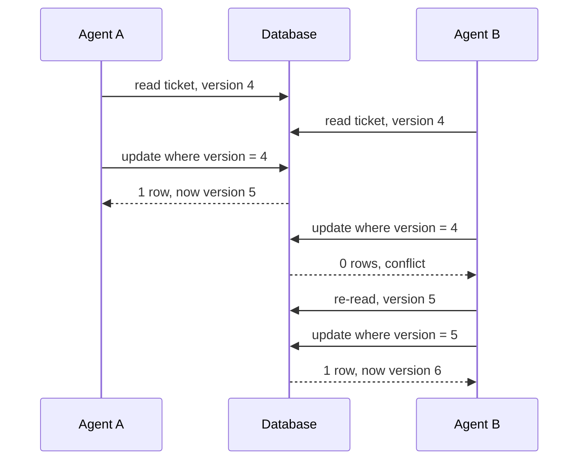

# Optimistic Concurrency

## The problem it solves

Two support agents open the same customer ticket. Agent A changes the status to "resolved." Agent B, still looking at the old version, adds a note and saves the whole ticket. B's save overwrites A's status change, and the ticket silently reopens. This is the **lost update** problem, and it happens whenever someone reads, thinks (or waits on a user for minutes), and writes back.

Pessimistic locking (holding a lock while the user edits) would stop it, but locks held across user think time block everyone else and leak when browsers close. Optimistic concurrency doesn't lock at all: it lets everyone read freely and rejects a write if the data changed since it was read.

## How it works

1. **Every row carries a version** (an integer counter, or an `updated_at` timestamp, or a content hash such as an HTTP ETag).
2. **Read** the row and remember its version.
3. **Write conditionally:** update only if the version is still the one you read, and bump it in the same statement.
4. **Check the result.** If zero rows were updated, someone else got there first. Re-read, reapply or merge your change, and retry, or show the user a conflict.

```sql
-- read
SELECT id, status, notes, version FROM tickets WHERE id = 77;   -- version = 4

-- write
UPDATE tickets
SET    status = 'resolved', version = version + 1
WHERE  id = 77 AND version = 4;
-- 1 row updated: success, now version 5
-- 0 rows updated: conflict, someone else wrote first
```

The same idea in other systems:

- **DynamoDB:** `UpdateItem` with `ConditionExpression: "version = :v"`; a mismatch fails with a conditional check error.
- **HTTP APIs:** the server returns `ETag: "v4"`; the client sends `If-Match: "v4"` on `PUT`; the server responds `412 Precondition Failed` if the ETag changed.
- **Redis:** `WATCH key`, then `MULTI ... EXEC`; `EXEC` aborts if the watched key changed.
- **Compare-and-swap (CAS):** etcd transactions compare a key's modification revision; Memcached has `gets`/`cas`.
- **ORMs:** JPA's `@Version` and Rails' `lock_version` add the condition automatically.



**Retry loop for automated writers:**

```
for attempt in 1..5:
    row = read(id)
    new = apply_change(row)
    if update_where_version(id, new, row.version) == 1: return OK
    sleep(jittered_backoff(attempt))
return CONFLICT
```

For a human editor, don't retry blindly: show what changed and let them merge.

## Worked example

An inventory row for a popular item starts at `stock = 10, version = 1`. Three checkout requests run at the same time, each buying one unit.

| Step | Request X | Request Y | Request Z | Row after |
|---|---|---|---|---|
| 1 | reads 10, v1 | reads 10, v1 | reads 10, v1 | 10, v1 |
| 2 | writes 9 where v = 1: success | | | 9, v2 |
| 3 | | writes 9 where v = 1: 0 rows | writes 9 where v = 1: 0 rows | 9, v2 |
| 4 | | re-reads 9, v2; writes 8 where v = 2: success | re-reads 9, v2 | 8, v3 |
| 5 | | | writes 8 where v = 2: 0 rows; re-reads 8, v3; writes 7: success | 7, v4 |

Final stock is 7, correct for three purchases. Without the version check, all three would have written 9, losing two sales. Note that Z needed three attempts: under heavy contention, retries pile up.

## Trade-offs

- **Pros:** no locks held, so no blocking or deadlocks; works across user think time and stateless HTTP requests; scales well when conflicts are rare; easy to add with one column.
- **Cons:** under high contention, many requests fail and retry, wasting work and adding latency; callers must handle conflicts; doesn't protect invariants across multiple rows unless all are versioned and checked together.
- **Alternatives:** pessimistic locking (`SELECT ... FOR UPDATE`, distributed locks) for hot, high-contention rows; atomic in-place updates (`SET stock = stock - 1 WHERE stock > 0`), which avoid the read entirely when the change can be expressed in one statement; serializable transactions; CRDTs for merges without conflicts.

## When to use it (and when not)

- **Use it** for edits by people (documents, tickets, profiles, wiki pages), REST APIs with ETags, configuration updates, and DynamoDB or other stores without multi-row locks. Interview questions: design a collaborative editor's save path, design a ticketing system's seat hold (with conditional writes), design an inventory system, design a wiki, design Jira.
- **Avoid it** for very hot rows with constant concurrent writes, like a global counter or a flash-sale item, where the retry storm costs more than a lock or an atomic decrement would.

## In an interview

Say: "Each item has a version column, and updates are `UPDATE ... WHERE id = ? AND version = ?`; if no row changed, someone else wrote first and we re-read and retry, so we never silently overwrite." Be ready to compare it with pessimistic locking, explain behavior under high contention, and show the HTTP ETag version.

## Common follow-up questions

### When is pessimistic locking better?
When conflicts are frequent, such as hundreds of buyers on one item, optimistic retries waste work and add latency, while a short lock serializes requests efficiently. Locks also make sense when a retry is expensive, such as after calling an external API.

### Why not use a timestamp instead of a version number?
You can, but two writes within the clock's resolution get the same timestamp, and clock skew between app servers can misorder writes. A counter incremented by the database itself is simpler and unambiguous.

### How do you handle a conflict for a human user?
Show them their changes alongside the current version and let them merge, or merge automatically when they touched different fields. Silently retrying with their stale copy would just reintroduce the lost update.

### Does optimistic concurrency work across services?
Yes, as long as the resource's owner checks the version on write, for example via `If-Match` on its API. It's one of the few concurrency controls that works naturally over HTTP, because it holds nothing between requests.
