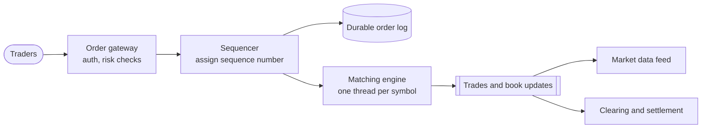

# Order Book

## The problem it solves

A stock exchange or crypto trading venue receives a stream of buy and sell orders for each instrument, potentially hundreds of thousands per second during busy moments. It must decide, deterministically and fairly, which orders trade with which, at what price, and in what order. If two sellers offer the same price, who sells first? If a buyer is willing to pay more than the best ask, what price do they get? Any ambiguity is a fairness and regulatory problem, and any nondeterminism makes the system impossible to audit or replay.

An order book holds all resting orders for one instrument, sorted by price and then arrival time, and a matching engine applies **price-time priority** to every incoming order.

## How it works

**Two sides.** **Bids** (buy orders) sorted by price, highest first; **asks** (sell orders) sorted by price, lowest first. The best bid and best ask are the top of book; the gap between them is the **spread**.

**Price-time priority.** Better price always trades first. At the same price, the earlier order trades first (FIFO within a price level).

**Order types (the core ones).**
- **Limit order:** buy or sell up to a quantity at a stated price or better. Whatever can't match immediately rests on the book.
- **Market order:** trade immediately at the best available prices; never rests.
- **Cancel:** remove a resting order by ID.

**Matching an incoming buy limit order at price P:**
1. While quantity remains and the best ask ≤ P: trade against the oldest order at the best ask level, at **the resting order's price**, for min(both quantities). Remove filled orders; delete empty levels.
2. If quantity remains, add it to the bid side at price P, at the back of that level's queue.

Sells mirror this.

```
def match_buy(order):
    while order.qty > 0 and asks and asks.best_price() <= order.price:
        level = asks.best_level()               # FIFO queue at best price
        resting = level.front()
        fill = min(order.qty, resting.qty)
        emit_trade(price=resting.price, qty=fill, buy=order.id, sell=resting.id)
        order.qty -= fill; resting.qty -= fill
        if resting.qty == 0: level.pop_front(); index.remove(resting.id)
        if level.empty(): asks.remove_level(level)
    if order.qty > 0: bids.add(order)           # rest at the back of its level
```

**Data structures.** Each side is a sorted map of price → price level (a balanced tree or skip list, or an array indexed by tick when prices are bounded), and each level is a doubly linked FIFO queue of orders. A hash map from order ID → node gives O(1) cancels. Best price lookup is O(1) by caching the top.

**Architecture.** Matching for one instrument runs on a **single thread**, which gives a total order without locks. Orders arrive through a **sequencer** that assigns sequence numbers and writes them to a durable log before matching, so the engine is a deterministic state machine: replaying the log rebuilds the book exactly. Different instruments are sharded across engines.



## Worked example

Starting book for one stock:

| Side | Price | Orders (oldest first) |
|---|---|---|
| Ask | 102.00 | S3: 500 |
| Ask | 101.00 | S1: 300, then S2: 200 |
| Bid | 100.00 | B1: 400 |
| Bid | 99.50 | B2: 200 |

Best bid 100.00, best ask 101.00, spread 1.00.

**Event 1: buy limit B3, 600 shares at 101.50.**

| Step | Matches against | Trade | B3 remaining |
|---|---|---|---|
| 1 | S1 (101.00, older) | 300 @ 101.00 | 300 |
| 2 | S2 (101.00) | 200 @ 101.00 | 100 |
| 3 | next ask 102.00 > 101.50 | stop | 100 rests as a bid at 101.50 |

B3 bought 500 shares at 101.00, better than its 101.50 limit, because trades happen at the resting order's price. S1 filled before S2 because it arrived first.

**Event 2: market sell, 450 shares.**

| Step | Matches against | Trade | Remaining to sell |
|---|---|---|---|
| 1 | B3 (best bid 101.50) | 100 @ 101.50 | 350 |
| 2 | B1 (100.00) | 350 @ 100.00 | 0 |

Final book: asks 102.00 (S3: 500); bids 100.00 (B1: 50), 99.50 (B2: 200). Spread is now 2.00. The seller received 100 × 101.50 + 350 × 100.00 = 10,150 + 35,000 = 45,150, an average of about 100.33 per share: a market order "walks the book" and gets worse prices as it consumes liquidity.

## Trade-offs

- **Pros:** fair and transparent (price, then time); deterministic, so it can be replayed and audited; simple, cache-friendly single-threaded processing per instrument.
- **Cons:** one instrument can't be parallelized beyond one thread, so the engine must be extremely efficient (in-memory, no locks, no allocation on the hot path); time priority rewards speed, which drives a latency arms race; market orders can execute at bad prices in thin books.
- **Alternatives:** **pro-rata matching** (fills at a price level shared in proportion to size, used in some futures markets); **batch auctions** (collect orders for a short interval and clear at one price, used for exchange open and close); **request-for-quote** for illiquid instruments; **automated market makers** in DeFi, which price against a liquidity pool formula instead of a book.

## When to use it (and when not)

- **Use it** in "design a stock exchange", "design a crypto exchange like Coinbase", "design Robinhood" (the brokerage routes to exchanges but may keep an internal book), ad exchanges with bids and asks, and marketplace matching where many buyers and sellers trade a fungible item.
- **Not the right model** for one-to-one matching of non-fungible things (ride-hailing matches by location and ETA, not price levels) or for fixed-price inventory like ticket sales, which need reservations and locks instead.

## In an interview

Say: "Each symbol has an in-memory order book, bids and asks as sorted price levels with a FIFO queue per level, matched with price-time priority by a single-threaded engine; a sequencer writes every order to a durable log first, so the book can be rebuilt deterministically by replay." Be ready to walk through a match, explain why trades execute at the resting price, and discuss how you'd survive an engine crash.

## Common follow-up questions

### Why is the matching engine single-threaded?
Matching for one instrument is inherently sequential: every order's outcome depends on the book state left by the previous one. A single thread gives a total order with no locks and very predictable latency. Throughput comes from efficient in-memory code and from sharding different instruments onto different engines.

### How do you recover if the matching engine crashes?
Every order is sequenced and durably logged before matching, and the engine is deterministic. A standby replica consumes the same log and holds an identical book, so it can take over; otherwise restart from a snapshot and replay the log after it.

### At what price does a trade execute?
At the resting order's price, the one that was already on the book. The incoming order gets that price or better relative to its limit, which rewards the trader who provided liquidity first and keeps execution predictable.

### How are cancels handled efficiently?
A hash map from order ID to its node in the level's doubly linked list makes a cancel O(1): look up the node and unlink it, removing the level if it becomes empty. Cancels go through the sequencer like any other order so their ordering relative to matches is well-defined.
