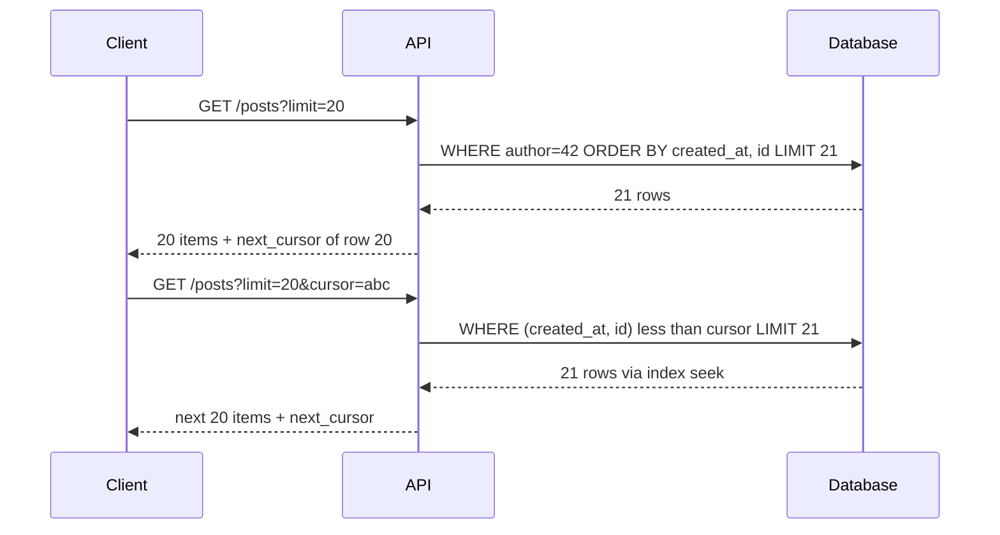

# Pagination

## The problem it solves

A user's feed, an order history, or a search result can contain millions of rows. Returning them all in one response would take seconds, use gigabytes of memory, and send data the user will never scroll to. So you return a page of, say, 20 items and let the client ask for more.

The hard part is asking for "more" efficiently and correctly. The obvious approach, `OFFSET 100000 LIMIT 20`, makes the database read and throw away 100,000 rows to return 20, and it shows duplicates or skips items when new rows are inserted while the user scrolls.

## How it works

**Offset pagination** uses a page number or offset:

```sql
SELECT id, created_at, title
FROM posts
WHERE author_id = 42
ORDER BY created_at DESC, id DESC
LIMIT 20 OFFSET 40;          -- page 3
```

It is simple and supports "jump to page 57," but the database still walks all skipped rows, so cost grows linearly with the offset. If a new post is inserted at the top between page requests, every row shifts down by one and the user sees the last item of page 2 again at the top of page 3.

**Cursor (keyset) pagination** remembers where the last page ended and asks for rows after that point:

```sql
-- first page
SELECT id, created_at, title FROM posts
WHERE author_id = 42
ORDER BY created_at DESC, id DESC
LIMIT 20;

-- next page: last row of previous page was (2026-10-30 12:00:05, 9182)
SELECT id, created_at, title FROM posts
WHERE author_id = 42
  AND (created_at, id) < ('2026-10-30 12:00:05', 9182)
ORDER BY created_at DESC, id DESC
LIMIT 20;
```

With an index on `(author_id, created_at DESC, id DESC)`, the database seeks directly to the cursor position and reads 20 rows, so page 5,000 costs the same as page 1. The `id` tiebreaker is essential: without it, rows sharing a timestamp can be skipped or repeated.

The API usually hides the cursor as an opaque, base64-encoded token so clients can't depend on its contents:

```
GET /v1/users/42/posts?limit=20&cursor=eyJ0IjoiMjAyNi0xMC0zMFQxMjowMDowNSIsImlkIjo5MTgyfQ
→ { "items": [...], "next_cursor": "eyJ0Ijoi...", "has_more": true }
```

Fetch `limit + 1` rows to know whether `has_more` is true without a separate count query.



**Other variants.** Some datastores paginate with their own tokens: DynamoDB returns a `LastEvaluatedKey`, Cassandra a paging state, and Elasticsearch offers `search_after` (keyset-style) because deep `from/size` paging is expensive.

## Worked example

A table of 10M posts for a popular author, 20 per page, with an index on `(author_id, created_at, id)`.

| Request | Offset: rows the DB reads | Keyset: rows the DB reads |
|---|---|---|
| Page 1 | 20 | 20 |
| Page 100 (offset 1,980) | 2,000 | 20 |
| Page 50,000 (offset 999,980) | 1,000,000 | 20 |

Consistency while scrolling: the user has loaded page 1 (posts 1–20) and 3 new posts arrive.

| Method | Page 2 shows | Problem |
|---|---|---|
| Offset 20 | Old posts 18–37 | Posts 18, 19, 20 appear twice |
| Cursor after post 20 | Posts 21–40 | Correct; new posts appear on next refresh |

## Trade-offs

- **Offset pros:** trivial to implement; random access to any page; easy total page count.
- **Offset cons:** slow at deep offsets; duplicates and gaps when data changes.
- **Cursor pros:** constant cost per page; stable under inserts and deletes; works with infinite scroll and sharded stores.
- **Cursor cons:** no jumping to page N; requires a unique, indexed sort key; changing sort order needs a new cursor format; total counts need a separate (often approximate) query.

## When to use it (and when not)

- **Use cursor pagination** for feeds and timelines (news feed, Twitter), chat history (scroll back in a conversation), activity logs, notifications, and any public API over large or fast-changing data.
- **Use offset** for small, slow-changing datasets or admin tables where users really want numbered pages and the total is in the thousands, not millions.
- Pagination doesn't fix a query that is slow because it lacks an index; the sort key must be indexed either way.

## In an interview

Say: "The feed API uses cursor pagination on (created_at, post_id) with an opaque next_cursor token, so every page is an index seek and new posts don't cause duplicates while scrolling." Then be ready to write the keyset SQL, explain the tiebreaker, and describe how the cursor works when the feed is merged from several shards.

## Common follow-up questions

### Why does the cursor need a tiebreaker column?
Many rows can share the same timestamp. If the cursor is only `created_at`, rows with the same value as the last row are either skipped (with `<`) or repeated (with `<=`). Adding the unique `id` makes the ordering total.

### How do you show "page 3 of 120" with cursors?
You usually don't. Show "load more" or infinite scroll instead. If a count is needed, compute it separately and cache it, or show an approximation, because exact counts over millions of rows are expensive.

### How do you paginate across shards?
Query each shard for the top N rows after the cursor, merge them in the application by the sort key, return the first N, and encode the position of the last returned row as the cursor. Each shard then seeks from that same position next time.

### Should the cursor be opaque?
Yes. Encoding it lets you change its contents (add fields, switch sort keys) without breaking clients, and you can sign it to prevent tampering.
