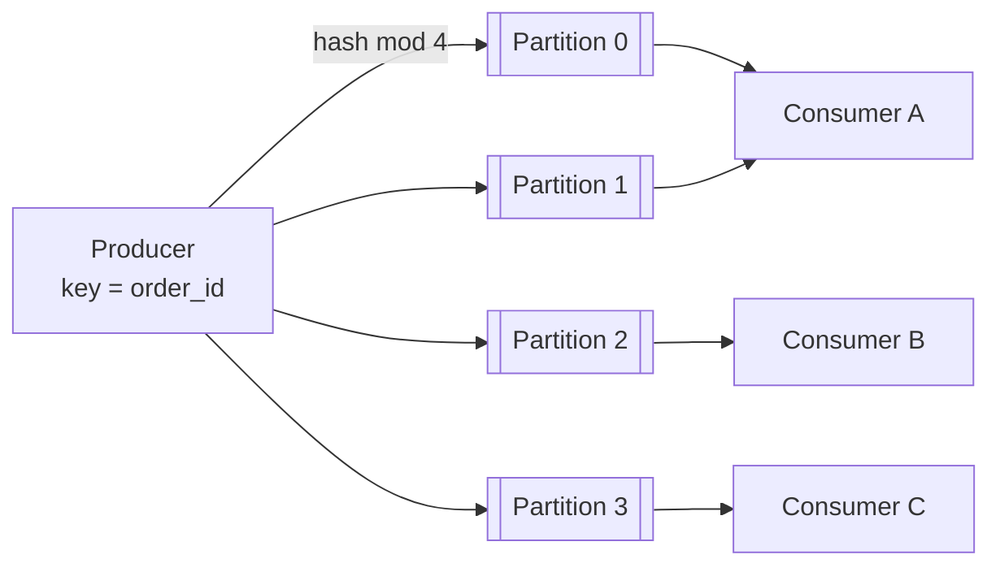

# Partitioning (Logs/Topics)

## The problem it solves

An order service publishes 50,000 events per second to a stream, and a consumer that updates inventory can process about 5,000 per second. With a single queue consumed in order by one consumer, a backlog grows by 45,000 events every second. If you instead let many consumers pull from one shared queue, you get throughput but lose ordering: "order created" and "order cancelled" for the same order can be processed in the wrong order.

Partitioning splits a topic into independent ordered logs. Events with the same key always go to the same partition, so ordering is preserved per key while different partitions are processed in parallel.

## How it works

1. **A topic has P partitions.** Each partition is an append-only log; each record gets an increasing **offset** within its partition. Kafka, Amazon Kinesis (shards), Apache Pulsar and Redpanda all use this model.
2. **Producers choose the partition by key.** `partition = hash(key) mod P`. All events for `order_id = 991` land in the same partition, in the order they were produced. Records without a key are spread across partitions.
3. **Consumer groups divide partitions.** Within a group, each partition is assigned to exactly one consumer at a time. A consumer may own several partitions. With P partitions, at most P consumers in a group do useful work.
4. **Offsets track progress.** Each consumer commits the offset it has processed per partition. After a crash or rebalance, the new owner resumes from the last committed offset.
5. **Different groups are independent.** The inventory group and the analytics group each read every partition at their own pace.

**Ordering guarantee.** Order is guaranteed only within a partition. Two events for different keys can be processed in any relative order. If you need order across an entity's related events (order and its payment), give them the same key.

**Rebalancing.** When a consumer joins, leaves or stops heartbeating, the group coordinator reassigns partitions. Processing pauses briefly for affected partitions, and records processed but not yet committed get reprocessed, so consumers must be idempotent (at-least-once delivery).

**Choosing P.** Pick enough partitions for peak throughput and future consumer count: `P ≥ peak rate / per-consumer rate`, with headroom. Increasing P later changes `hash(key) mod P` for existing keys, which breaks per-key ordering across the change. So over-provision up front, within reason; each partition costs broker file handles, memory and leader-election work.

**Hot partitions.** A single very active key (one huge merchant) pins its partition and its consumer. Options: a finer key (`merchant_id + order_id`) if per-merchant order isn't needed, or salting the key across several partitions and merging downstream.

## Worked example

50,000 events/s peak, one consumer handles 5,000 events/s, target 2× headroom.

| Partitions | Max useful consumers | Max throughput | Result at 50k/s |
|---|---|---|---|
| 1 | 1 | 5,000/s | Backlog grows 45,000/s |
| 8 | 8 | 40,000/s | Backlog grows 10,000/s |
| 10 | 10 | 50,000/s | Just keeps up, no headroom |
| 20 | 20 | 100,000/s | Keeps up with 2× headroom |

Choose 20 partitions (or more, for growth). Start with 10 consumers if that's enough today, each owning 2 partitions, and scale to 20 consumers without changing the topic.

## Trade-offs

- **Pros:** parallelism scales with partitions; per-key ordering; replay from any offset; consumer groups give independent fan-out to many downstream systems.
- **Cons:** no global ordering; partition count is hard to change without disturbing key mapping; hot keys bottleneck a single consumer; rebalances cause pauses and reprocessing.
- **Alternatives:** a traditional queue (SQS, RabbitMQ) with competing consumers when ordering doesn't matter; SQS FIFO with message group IDs, which gives per-group ordering similar to partition keys; a single partition when total throughput is low and global order matters.

## When to use it (and when not)

- **Use it** for event pipelines, change data capture, activity and click streams, chat message fan-out, notification pipelines and order processing. Interview questions: ad click aggregator, design Kafka or a distributed message queue, notification system, Uber location updates, metrics ingestion.
- **Not needed** for low-volume work queues where any worker can take any job in any order; a simple queue is easier to run.

## In an interview

Say: "I'll partition the events topic by `order_id` into 32 partitions, so each order's events stay ordered and up to 32 consumers can process in parallel." Be ready to explain why ordering is only per partition, what happens during a consumer rebalance, and how to deal with a hot key.

## Common follow-up questions

### What happens when a consumer crashes?
Its group misses heartbeats, the coordinator reassigns its partitions to other consumers, and they resume from the last committed offsets. Anything processed after the last commit is processed again, so handlers must be idempotent.

### Why can't you just add partitions later?
You can, but `hash(key) mod P` changes for many keys, so new events for an existing key may go to a different partition than its older events. During the transition, order for that key isn't guaranteed, which matters for stateful consumers.

### How do you get exactly-once processing?
Delivery is at-least-once, so make processing idempotent (dedupe by event ID, or upsert). Kafka also offers transactions that atomically write output records and commit input offsets, giving exactly-once semantics within Kafka-to-Kafka pipelines.

### Should you have more consumers than partitions?
No useful gain: extra consumers in the group sit idle. They can act as warm standbys, but if you need more parallelism, add partitions or parallelize work within each consumer while preserving per-key order.
