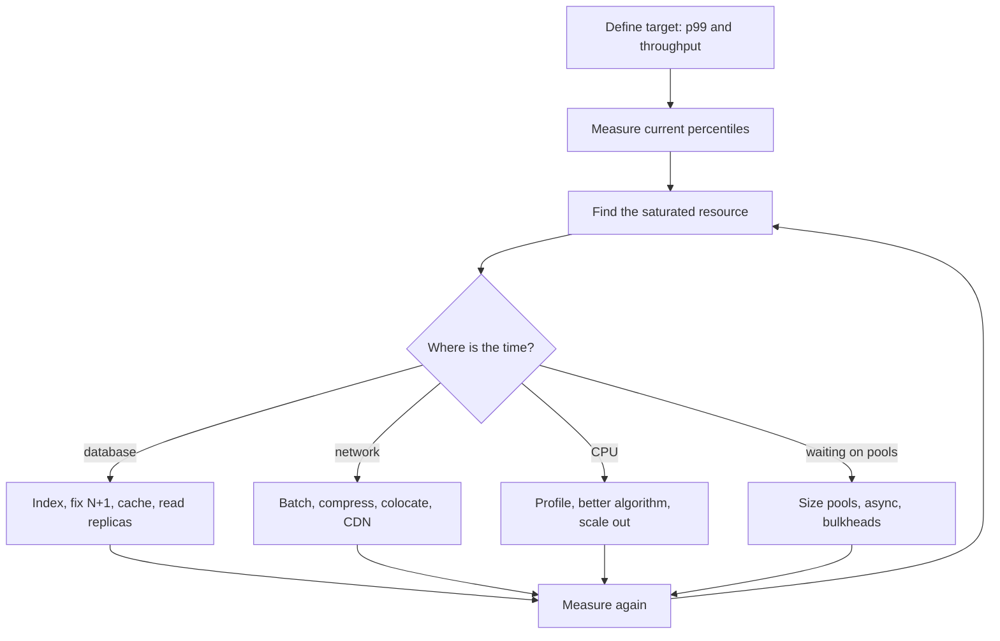

# Performance Optimization

## The problem it solves

"Make it faster" is not a plan. Systems get slow for specific reasons: a missing index, a query in a loop, a saturated connection pool, a chatty network protocol, one slow shard dragging the tail. Engineers who optimize by intuition often speed up code that wasn't the bottleneck and add complexity for nothing.

Performance work is a loop: **measure, find the bottleneck, fix that one thing, measure again.** The techniques below are the standard fixes, each with a cost. In an interview, showing that loop, and doing the capacity arithmetic, matters more than listing tricks.

## How it works

**Measure with percentiles.** Report latency as p50, p95, p99 (and p99.9 at scale), never just the average. **Tail latency** matters more than it looks: a page that fans out to 100 backends, each with a 1% chance of being slow, is slow whenever *any* one is: 1 − 0.99¹⁰⁰ ≈ 63% of page loads hit at least one p99-slow call. Tail causes include GC pauses, queueing, noisy neighbors, cache misses and retries.

**Little's law.** For any stable system: **L = λ × W** (items in the system = arrival rate × time each spends there). It connects throughput, latency and concurrency, and is the fastest way to size pools, threads and partitions.

**Find the bottleneck.** Use the USE method on each resource (CPU, memory, disk, network, connection pools, locks, partitions) and profile the hot path (CPU profiles, flame graphs, traces). The bottleneck is the resource that saturates first; improving anything else changes nothing.

**The standard fixes.**

- **Indexing and query plans.** Run `EXPLAIN` (or `EXPLAIN ANALYZE`) and look for full table scans, bad join orders and sorts on disk. Add indexes that match the `WHERE` and `ORDER BY` columns; a composite index on `(tenant_id, created_at)` serves "latest orders for a tenant." Every index slows writes and uses storage, so don't index everything.
- **N+1 queries.** Fetching 50 orders, then running one query per order for its items, is 51 round trips. Use a join or a single `WHERE order_id IN (...)` query: 2 round trips. ORMs make this easy to do by accident.
- **Caching.** Serve repeated reads from memory; see the **caching** concept for strategies, invalidation and stampedes.
- **Batching.** Amortize per-request overhead (round trips, syscalls, fsyncs, headers) over many items. The trade-off is latency: items wait for the batch to fill or a timer to fire. Kafka producers expose exactly this trade with `linger.ms` (how long to wait for more records) and `batch.size` (max bytes per partition batch): a few milliseconds of linger can multiply throughput.
- **Connection pooling.** Opening a TCP + TLS connection and authenticating per request costs milliseconds. Pool connections, and size the pool with Little's law rather than guessing. Too large a pool overloads the database with concurrent queries and context switching.
- **Compression.** Fewer bytes on the wire and disk at the cost of CPU. Fast codecs (LZ4, Snappy, zstd at low levels) usually win on network-bound paths; compressing already-compressed data (images, video) wastes CPU. Compression works better on larger batches, which is why it pairs with batching.
- **Async processing.** Move work the user doesn't need to wait for (emails, thumbnails, search indexing, analytics) off the request path onto a queue or Kafka topic. Response time drops to "accepted"; the cost is eventual consistency and a pipeline to operate.
- **Pagination.** Never return unbounded result sets. Prefer cursor (keyset) pagination over large `OFFSET`s, which make the database scan and discard rows; see **pagination**.
- **Hedged requests.** For idempotent reads, if the first request hasn't answered by roughly its p95 latency, send a second to another replica and take whichever returns first. Cuts tail latency for ~5% extra load.
- **CDN.** Serve static and cacheable content from edge locations near users, removing both backend load and long-distance round trips; see **CDN**.

**Throughput vs latency.** They often pull in opposite directions. Batching, larger buffers and higher utilization raise throughput but add queueing delay. As utilization approaches 100%, queueing delay grows sharply (in simple queueing models it scales with 1 / (1 − utilization)), which is why services are run at maybe 50–70% utilization when latency matters.

## Worked example

An API serves 2,000 requests/s. Each request runs one 5 ms database query and spends 50 ms total in the service.

**Concurrency (Little's law):** L = 2,000/s × 0.050 s = **100 requests in flight** across the fleet. With 10 instances, each has ~10 concurrent requests, so a 200-thread pool per instance is far more than needed.

**Database pool:** queries in flight = 2,000/s × 0.005 s = **10 connections busy on average** across the fleet. Allow headroom for bursts (×2–3): about 20–30 total, so **2–3 per instance**, not the 50-per-instance default, which would allow 500 connections against a database that performs best with a few dozen.

**N+1 fix:** an endpoint lists 50 orders and fetches items one by one. At 1 ms per round trip that's 51 ms of database waiting; a single `IN` query makes it 2 round trips ≈ 2 ms (plus slightly more work per query).

**Batching trade-off:** a producer sends 50,000 small events/s. Sending each alone at ~1 ms per request would need 50 requests in flight just to keep up (50,000 × 0.001). With `linger.ms=5`, a busy partition accumulates up to ~5 ms of records per batch, so requests drop by orders of magnitude and compression gets better ratios, at the cost of up to 5 ms extra latency per event.

**Tail latency:** p99 for the product page is 900 ms because it fans out to 20 services. Probability that at least one of 20 calls hits its own p99: 1 − 0.99²⁰ ≈ 18%. Hedging the three slowest read calls and caching two others brings the page p99 down without touching the median.

## Trade-offs

| Technique | Gain | Cost |
|---|---|---|
| Index | Fast reads | Slower writes, storage |
| Cache | Low latency, offloads DB | Staleness, invalidation, cold-start stampedes |
| Batching | Throughput, efficiency | Added latency per item |
| Compression | Bandwidth, storage | CPU |
| Async | Fast responses | Eventual consistency, more infrastructure |
| Hedging | Lower tail latency | Extra load, needs idempotent reads |
| Bigger pools | More concurrency | Can overload the shared resource |

The general rule: every optimization adds complexity, so make it only where measurement shows it pays off.

## When to use it (and when not)

- **Optimize** when you have a target (an SLO, a cost limit, a capacity forecast) and measurements showing you miss it. Start with the cheap, high-leverage fixes: indexes, N+1, caching hot reads, right-sized pools.
- **Don't** optimize code paths that aren't on the critical path, micro-tune before fixing architecture (one extra cross-region hop costs more than any code tweak), or add caches and async pipelines "just in case."

## In an interview

Show the loop: "First I'd set the target, say p99 under 200 ms at 10,000 requests/s. I'd look at traces to see where the time goes. If it's the database I'd check query plans and N+1 patterns, then cache hot reads. On the write path I'd batch into Kafka with a small linger and compression, accepting a few milliseconds of latency for throughput." Use Little's law to size pools or consumers out loud.

## Common follow-up questions

### How do you size a connection pool?
Use Little's law: connections needed ≈ query rate × query duration, plus headroom for bursts. Then cap the total across all instances at what the database handles well, and prefer queueing in the app over overloading the database.

### What's the trade-off of batching?
Higher throughput and efficiency (fewer round trips, better compression) in exchange for latency, because items wait for the batch. Bound it with both a size limit and a time limit, like Kafka's `batch.size` and `linger.ms`.

### What are hedged requests and when are they unsafe?
Sending a duplicate request to another replica after a delay and using the first response. They cut tail latency but add load, so trigger them only after a high percentile and cancel the loser. They are unsafe for non-idempotent operations.

### How do you find the bottleneck in a slow pipeline?
Measure throughput and saturation at each stage. In a Kafka pipeline, the stage whose consumer lag grows is behind; check whether it's CPU-bound, waiting on its sink, or limited by partition count (one consumer per partition per group).

### When does adding more servers not help?
When the bottleneck is shared: a single database primary, a hot partition or key, a lock, or a downstream rate limit. More instances just add contention. Fix the shared bottleneck by sharding, caching or redesigning first.
