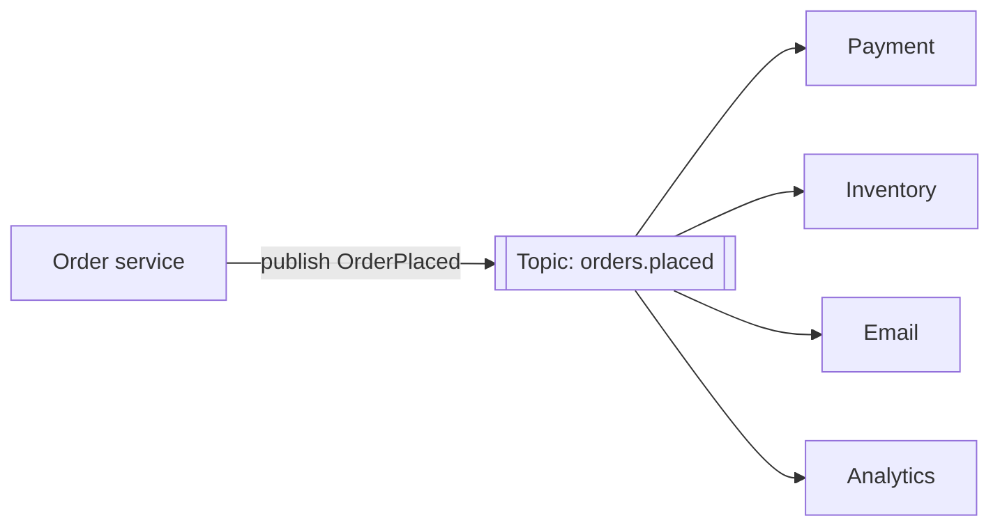

# Pub/Sub

## The problem it solves

When a user places an order, five things must happen: charge the card, reserve inventory, send a confirmation email, update analytics, and notify the warehouse. If the order service calls each one directly, it has to know all five, wait on all five, and fail if any is down. Adding a sixth consumer (fraud scoring) means changing and redeploying the order service. And if the email service takes 2 seconds, checkout takes at least 2 seconds.

**Publish/subscribe** decouples them: the order service publishes one `OrderPlaced` message to a **topic**, and every interested service subscribes. The publisher doesn't know who's listening, and new subscribers can be added without touching it.

## How it works

1. A **publisher** sends a message to a named **topic** (`orders.placed`).
2. The **broker** delivers a copy to every **subscription** on that topic.
3. Each **subscriber** processes its copy independently, at its own pace.

**Fan-out vs competing consumers.** Pub/sub copies each message to every *subscription*. Within one subscription, several instances of the same service usually share the work, each message going to only one instance. Kafka calls this a **consumer group**: each partition of a topic is read by exactly one consumer in the group, and each group gets every message. So "fan-out across services, load-balance within a service".

**The main flavors (they behave very differently):**

| System | Persistence | Delivery | Notes |
|---|---|---|---|
| Redis pub/sub | None: subscribers offline at publish time miss the message | At most once | Very low latency; good for ephemeral signals like presence or cache invalidation hints. Redis Streams adds persistence and consumer groups. |
| Kafka | Durable, replicated log with configurable retention | At least once by default; exactly-once within Kafka using transactions | Consumers track offsets and can replay history; ordering is per partition. |
| AWS SNS | Pushes to endpoints, retries, but doesn't store for later reading | At least once | Often fanned out into one SQS queue per subscriber so each gets durable buffering. |
| Google Cloud Pub/Sub | Durable, acked per message | At least once (exactly-once option) | Push or pull subscriptions. |

**Message design.** Publish facts (`OrderPlaced` with order ID, items, totals), not commands to specific services. Include an event ID so subscribers can deduplicate, and a schema version.

**Topic-based vs content-based.** Most systems route by topic name. Some support filters (SNS filter policies, RabbitMQ topic exchanges with patterns like `orders.*.eu`) so subscribers receive only matching messages.

## Worked example

Checkout with direct synchronous calls vs pub/sub. Call latencies: payment 300 ms, inventory 50 ms, email 2,000 ms, analytics 100 ms, warehouse 150 ms.

| Design | Checkout latency | If email is down |
|---|---|---|
| Sequential calls | 300 + 50 + 2,000 + 100 + 150 = 2,600 ms | Checkout fails or needs custom retry code |
| Parallel calls | max = 2,000 ms | Checkout still fails or must handle partial failure |
| Pay synchronously, publish the rest | 300 ms + ~5 ms publish ≈ 305 ms | Email messages wait in the subscription and are sent when it recovers |

Payment stays synchronous here because the user needs to know whether the charge succeeded. Everything else reacts to the event.

Fan-out arithmetic: 1,000 orders/s published to a topic with 5 subscriptions is 5,000 deliveries/s from the broker. If the email subscription has 10 consumer instances, each handles about 100 messages/s.

## Trade-offs

- **Pros:** loose coupling, so publishers and subscribers deploy and scale independently; easy to add consumers; absorbs bursts; one slow subscriber doesn't slow the others (with durable subscriptions).
- **Cons:** eventual consistency, since subscribers act later; harder to trace a request end to end (use correlation IDs and tracing); at-least-once delivery means duplicates, so subscribers must be idempotent; ordering is only guaranteed within a partition or key; schema changes affect unknown consumers.
- **Alternatives:** **direct RPC** when the caller needs the answer now; a **point-to-point message queue** when exactly one worker should do the job; **webhooks** to notify external systems; **change data capture** to publish database changes without dual writes.

## When to use it (and when not)

- **Use it** for fan-out of domain events (order placed, user signed up), notification systems ("design a notification service"), news feed fan-out, chat message routing between WebSocket gateways ("design WhatsApp"), cache invalidation across nodes, and real-time dashboards.
- **Avoid it** when the caller needs a synchronous result (authorization checks, payment success), or when there's exactly one consumer and a plain queue is clearer.

## In an interview

Say: "The order service publishes an `OrderPlaced` event to a Kafka topic keyed by order ID; inventory, email, analytics and warehouse each have their own consumer group, so they scale and fail independently, and all handlers are idempotent on the event ID." Be ready to explain fan-out vs consumer groups, delivery guarantees, ordering, and how to publish reliably alongside a database write (transactional outbox).

## Common follow-up questions

### How do you make sure the event is published if the database write succeeds?
Writing to the database and then the broker can fail halfway. Use a transactional outbox: insert the event into an outbox table in the same transaction as the business write, and have a relay (or CDC like Debezium) publish rows from it. Delivery becomes at-least-once, so consumers dedupe.

### What's the difference between pub/sub and a message queue?
A queue delivers each message to one consumer, which is right for distributing work. Pub/sub delivers each message to every subscription, which is right for broadcasting events. Kafka and SNS+SQS combine both: fan-out across groups, competing consumers within a group.

### Why is Redis pub/sub risky for important messages?
It doesn't store messages. A subscriber that's disconnected or slow at publish time simply misses them, and there are no acks. Use it for signals you can afford to lose, and use Kafka, Redis Streams or a managed service when every message matters.

### How do you keep messages for one entity in order?
Use the entity ID as the partition key, so all its events go to one partition and are read in order by one consumer. There's no global order across partitions, so don't design anything that needs it.
