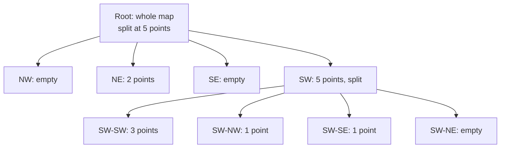

# Quadtree

## The problem it solves

A Yelp-style service stores 200M businesses and answers "show the 20 closest coffee shops". Location density varies enormously: one city block in Manhattan can hold hundreds of businesses while a 50 km stretch of desert holds none. A fixed grid (or a fixed-length geohash) picks one cell size for the whole planet. Small cells leave rural searches empty and force many expanding lookups; large cells put thousands of points in a downtown cell that must all be distance-checked.

A quadtree adapts the cell size to the data: it splits a cell only when it gets crowded, so every leaf holds a manageable number of points whether it covers 100 m or 100 km.

## How it works

1. Start with one node covering the whole map, with a **capacity** (e.g. 100 points).
2. **Insert:** walk down to the leaf whose box contains the point and add it. If the leaf now exceeds capacity, **split** it into 4 equal quadrants (NW, NE, SW, SE) and push its points down into the children.
3. **Range query** ("everything inside this box or circle"): start at the root; skip any child whose box doesn't intersect the query area; at the leaves, check each point's exact distance.
4. **k-nearest:** visit nodes in order of their distance from the target (a priority queue keyed by the box's minimum distance), and stop once you have k points closer than the next unvisited box.
5. **Delete / move:** remove from the leaf; if siblings together fall below capacity, optionally merge them back.



```
def insert(node, p):
    if not node.box.contains(p): return False
    if node.is_leaf:
        node.points.append(p)
        if len(node.points) > CAPACITY and node.depth < MAX_DEPTH:
            node.split()                       # create 4 children, move points down
        return True
    return any(insert(child, p) for child in node.children)

def query(node, area, out):
    if not node.box.intersects(area): return   # prune whole subtree
    if node.is_leaf:
        out += [p for p in node.points if area.contains(p)]
    else:
        for child in node.children: query(child, area, out)
```

A **max depth** stops infinite splitting when many points share the same coordinates (a mall with 300 shops at one address).

## Worked example

Map is 100 × 100 units, capacity 4. Points: A(10,10), B(20,15), C(15,30), D(30,20), E(12,22), F(80,80), G(70,60). "SW" means x < midpoint and y < midpoint.

| Step | Insert | What happens | Leaves after |
|---|---|---|---|
| 1 | A, B, C, D | Root holds 4 points, at capacity | Root: A B C D |
| 2 | E | Root has 5 > 4, split at (50,50); all 5 fall into SW | SW: A B C D E, others empty |
| 3 | (cascade) | SW has 5 > 4, split at (25,25) | SW-SW: A B E; SW-NW: C; SW-SE: D |
| 4 | F, G | Both land in NE (x ≥ 50, y ≥ 50) | NE: F G |

**Query:** all points in the box [0,25) × [0,25). The root's NE, NW and SE quadrants don't intersect the box and are skipped. Inside SW, only SW-SW intersects. The search checks 3 points (A, B, E) instead of 7. At real scale the effect is large: 200M businesses with capacity 100 gives about 2M leaves, about 11 levels deep if the data were uniform (log₄ 2,000,000 ≈ 10.5), so a lookup touches a handful of nodes. Storing ID plus coordinates (~24 bytes each) for 200M points is ~4.8 GB, which fits in memory on one server.

## Trade-offs

- **Pros:** cells adapt to density, so leaves stay evenly loaded; efficient range and k-nearest queries; simple to implement; fits in memory for hundreds of millions of static points.
- **Cons:** an in-memory structure, not a database index, so you build it, replicate it and rebuild it yourself; moving points (200k driver updates per second) mean constant removes, inserts, splits and merges, plus locking; deep, unbalanced branches where many points cluster; harder to shard than a string key.
- **Alternatives:** **geohash** (fixed grid, works in any sorted store, cheap updates, better for moving objects); **R-tree** (bounding rectangles, handles shapes and polygons, used by PostGIS); **S2 / H3** cell systems (hierarchical cells with stable IDs that can be stored in regular indexes); **k-d trees** (split on alternating axes at the median, good for static nearest-neighbor).

## When to use it (and when not)

- **Use it** for mostly static points with uneven density: Yelp / Google Places "nearby businesses", map tile rendering, collision detection in games, image compression.
- **Avoid it** for highly dynamic data like Uber drivers or delivery couriers, where geohash or H3 keys in Redis handle the write rate far more cheaply. Avoid hand-building one when PostGIS or Elasticsearch geo queries meet the latency target.

## In an interview

Say: "Businesses rarely move, so I'll build an in-memory quadtree that splits any cell over 100 points; dense downtowns get small cells and rural areas big ones, and each server holds the whole ~5 GB tree, rebuilt nightly with updates applied in between." Be ready to explain splitting, how a k-nearest search prunes, and why you wouldn't use it for moving drivers.

## Common follow-up questions

### How do you update the quadtree when a new business is added?
Insert it into the in-memory tree on every replica (via an update stream like Kafka), splitting the leaf if needed. Writes are rare compared to reads for business data, so it's fine to also rebuild the tree from the database periodically as a consistency backstop.

### What happens when a server holding the quadtree restarts?
It rebuilds the tree from the database or loads a serialized snapshot, which takes from seconds to minutes for hundreds of millions of points. It should report healthy only after loading, so the load balancer routes around it in the meantime.

### How do you find the k nearest points rather than points in a box?
Use a best-first search: a priority queue of nodes ordered by the minimum distance from the target to each node's box. Pop the closest, expand it, and add points to a max-heap of the best k so far. Stop when the next box is farther than the kth best point.

### Why not use a quadtree for Uber drivers?
Each location update would move a point between leaves, causing removals, inserts and possibly splits or merges, all needing synchronization at ~200k updates per second. A geohash key update is a single overwrite in a sorted set, which is far cheaper.
