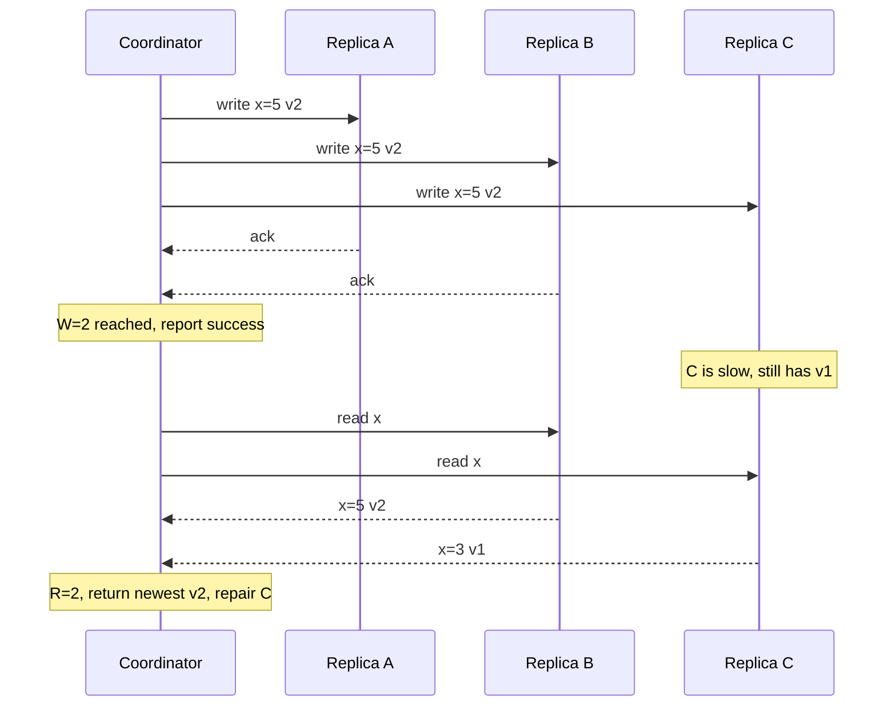

# Quorum (N/R/W)

## The problem it solves

You store each key on 3 replicas so you survive a machine failure. Now each write has a choice. Wait for all 3 acknowledgements, and a single slow or dead replica blocks every write. Wait for just 1, and a later read might hit one of the two replicas that hasn't received the write yet, returning stale data even though the write "succeeded."

Quorums give you a dial between these extremes. Wait for enough replicas on writes (W) and on reads (R) that every read set overlaps every write set, and a read is guaranteed to contact at least one replica with the latest acknowledged write.

## How it works

- **N:** number of replicas for each key (replication factor).
- **W:** number of replicas that must acknowledge a write before it's reported successful.
- **R:** number of replicas that must respond to a read.

**The rule: if R + W > N, every read quorum overlaps every write quorum** in at least one node. The read collects R responses, compares versions (timestamps or version vectors), and returns the newest.



The coordinator still sends the write to all N replicas; W is just how many it waits for. Replicas that missed a write are fixed by:

- **Read repair:** when a read sees an older version on some replica, it writes the newest back to it.
- **Hinted handoff:** if a replica is down, another node stores the write with a hint and delivers it when the replica returns.
- **Anti-entropy:** background comparison of replicas (often with Merkle trees) to find and fix differences.

**Sloppy quorums.** Dynamo-style systems may accept writes on nodes outside the key's normal N replicas when those are unreachable, to stay available. That breaks the overlap guarantee until hinted handoff completes.

**Caveats.** R + W > N gives overlap, not full linearizability. Concurrent writes, a write that failed partway (reached some replicas but not W), sloppy quorums, and clock-based last-writer-wins can still produce surprising reads. Linearizable behavior needs extra machinery such as read repair before returning, or consensus.

```
# Cassandra example, replication factor 3
CONSISTENCY QUORUM;      -- 2 of 3 for this session's reads and writes
INSERT INTO users (id, email) VALUES (42, 'a@x.com');
SELECT email FROM users WHERE id = 42;
```

## Worked example

N = 3 throughout.

| Config | R + W > N? | Tolerates for writes | Tolerates for reads | Behavior |
|---|---|---|---|---|
| W=3, R=1 | 4 > 3, yes | 0 failures | 2 failures | Fast reads, writes fail if any replica is down |
| W=2, R=2 | 4 > 3, yes | 1 failure | 1 failure | Balanced; common default ("QUORUM") |
| W=1, R=3 | 4 > 3, yes | 2 failures | 0 failures | Fast writes, reads fail if any replica is down |
| W=1, R=1 | 2 > 3, no | 2 failures | 2 failures | Fastest and most available; reads may be stale |

With N = 5 and majority quorums, W = 3 and R = 3, so 6 > 5 and the system tolerates 2 failed replicas for both reads and writes. Majority is `floor(N/2) + 1`.

Latency: with W = 2 of 3, a write waits for the second-fastest replica, so one slow replica doesn't slow writes. With W = 3, every write waits for the slowest.

## Trade-offs

- **Pros:** tunable per operation between consistency, latency and availability; no single leader to fail over; tolerates slow replicas.
- **Cons:** more network traffic per operation; overlap is not the same as linearizability; conflict resolution is still needed for concurrent writes; read repair and anti-entropy add background load.
- **Alternatives:** single-leader replication (one authoritative copy, simpler reasoning, failover needed); consensus protocols like Raft (majority quorums plus a leader and log ordering, giving linearizability).

## When to use it (and when not)

- **Use it** in leaderless key-value and wide-column stores where you want availability and per-query tuning: Cassandra, Riak, ScyllaDB, and similar Dynamo-style designs. Interview questions: design a distributed key-value store, design a shopping cart, design a messaging store with high write volume, design a metrics store.
- **Avoid relying on it alone** for operations that need strict uniqueness or check-then-act correctness (booking the last seat, a balance check). Use a consensus-backed store or conditional writes on a single leader instead.

## In an interview

Say: "Replication factor 3 with quorum reads and writes, W = 2 and R = 2, so any read overlaps the latest successful write and we tolerate one replica down; for the view counter I'll drop to W = 1, R = 1 since staleness is fine." Be ready to explain why R + W > N works, what read repair and hinted handoff do, and where quorums fall short of strong consistency.

## Common follow-up questions

### Why does R + W > N guarantee overlap?
If the write set has W nodes and the read set has R nodes out of N, and R + W > N, they can't be disjoint: by the pigeonhole principle at least one node is in both. That node has the latest acknowledged write.

### How does the reader know which response is newest?
Each value carries a version: a timestamp (last-writer-wins) or a version vector. With version vectors, the reader can detect concurrent writes and return both siblings for the application to merge, instead of silently dropping one.

### What happens if a write reaches only 1 of the required 2 replicas?
The client gets an error, but the write may still exist on that one replica and can later spread via read repair. Quorum systems don't roll back partial writes, so clients should retry idempotently.

### Why use W = 1 at all?
For data where losing an occasional write or reading stale values is acceptable, such as metrics, view counts or logs. Writes return after the fastest replica responds and succeed even when two of three replicas are down.
