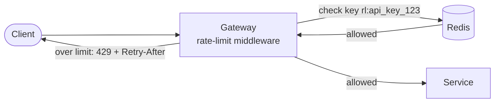

# Rate Limiting

## The problem it solves

Your API handles 10,000 requests per second comfortably. One customer's buggy script retries in a tight loop and sends 8,000 per second by itself. Everyone else's latency spikes, the database connection pool runs out, and a single client has caused an outage. The same happens with scrapers, credential-stuffing bots, or a partner who launches a batch job at noon.

A rate limiter caps how many requests each client (by API key, user, IP or tenant) can make in a time window and rejects the excess early, usually with HTTP 429, before it costs backend work.

## How it works

The limiter runs before the business logic, usually in the API gateway or as middleware, and keeps a small amount of state per client in a shared store such as Redis.



**The main algorithms:**

- **Fixed window counter:** count requests per calendar minute with `INCR` and a TTL. Simple, but allows up to 2× the limit at a window boundary (100 at 12:00:59 plus 100 at 12:01:00).
- **Sliding window log:** store a timestamp per request and count those in the last 60 s. Exact, but memory grows with the limit.
- **Sliding window counter:** weight the previous window's count by how much of it overlaps the last 60 s. Close to exact with two counters.
- **Token bucket:** a bucket holds up to `capacity` tokens and refills at `rate` per second. Each request takes a token or is rejected. Allows short bursts up to capacity while enforcing the average rate. The most common choice.
- **Leaky bucket:** requests enter a queue that drains at a fixed rate. Smooths output completely, good for protecting a fragile downstream.

```
def allow(key, now, rate=10, capacity=20):
    tokens, last = redis.hmget(key, "tokens", "last") or (capacity, now)
    tokens = min(capacity, tokens + (now - last) * rate)   # refill
    if tokens < 1:
        return False
    redis.hset(key, tokens=tokens - 1, last=now)
    redis.expire(key, 60)                                    # idle clients vanish
    return True
```

In production this read-modify-write must be atomic, so it runs as a Redis Lua script; otherwise two gateway nodes can both spend the last token.

**What to tell the client.** Return `429 Too Many Requests` with `Retry-After` and `X-RateLimit-Remaining` headers so well-behaved clients back off instead of retrying immediately.

**Distributed limits.** With many gateway nodes, a central Redis gives accurate global counts at the cost of one round trip per request. Alternatives: local per-node limits (limit ÷ node count, no network hop, less accurate), or local counters synced to Redis periodically.

## Worked example

Token bucket with capacity 5 and refill rate 1 token per second. A client sends a burst, then waits.

| Time (s) | Event | Tokens before | Result | Tokens after |
|---|---|---|---|---|
| 0.0 | 5 requests | 5 | all 5 allowed | 0 |
| 0.5 | 1 request | 0 + 0.5 = 0.5 | rejected (429) | 0.5 |
| 2.0 | 1 request | 0.5 + 1.5 = 2.0 | allowed | 1.0 |
| 2.0 | 1 request | 1.0 | allowed | 0.0 |
| 10.0 | 1 request | min(5, 0 + 8) = 5 | allowed | 4 |

The client got a burst of 5, then was held to 1 per second on average, and idle time refilled the bucket only up to the capacity of 5.

## Trade-offs

- **Pros:** protects shared resources from single noisy clients; enforces pricing tiers; blunts abuse such as brute-force logins and scraping; cheap to check.
- **Cons:** an extra dependency (Redis) on the hot path; inaccurate under partitions or with local-only counters; hard to pick limits that block abuse without hurting legitimate bursts; IP-based keys penalize users behind shared NAT.
- **Alternatives and complements:** load shedding (reject by server load rather than per client); queues to absorb bursts; autoscaling; circuit breakers on the client side; CAPTCHAs for suspected bots.

## When to use it (and when not)

- **Use it** on public APIs, login and OTP endpoints, expensive operations (search, exports), per-tenant fairness in SaaS, and outbound calls to third-party APIs with their own quotas. It is the whole subject of "design a rate limiter" and a standard add-on in URL shortener, payments and notification designs.
- **Don't use it** as your only defense against volumetric DDoS (that needs network-level protection and a CDN), or for internal batch traffic you control better with queues and backpressure.

## In an interview

Say: "The gateway enforces a token bucket per API key, 100 requests per minute with bursts up to 20, stored in Redis and updated atomically with a Lua script, and returns 429 with Retry-After when exceeded." Then be ready to compare algorithms, explain the race condition without atomicity, and say what happens if Redis is unavailable.

## Common follow-up questions

### What happens if Redis is down?
Choose fail-open or fail-closed deliberately. Most APIs fail open (allow traffic, maybe with a conservative local limit) because blocking all users is worse than briefly losing protection. Login and payment endpoints may fail closed.

### Why token bucket over fixed window?
Fixed windows let a client send double the limit across a boundary, and everyone's counters reset at the same instant. Token bucket enforces a smooth average while still allowing a configurable burst, using just two numbers per client.

### How do you rate limit by user when requests hit many servers?
Keep the counter in a shared store keyed by user ID, so every server checks the same bucket. Shard Redis by key so load spreads, and accept a small round-trip cost, or use local approximate limits if that cost is too high.

### How do you choose the key?
Prefer the most specific identity available: API key, then authenticated user ID, then IP as a fallback for anonymous traffic. Often you apply several limits at once, such as per user and per endpoint, plus a global ceiling.
