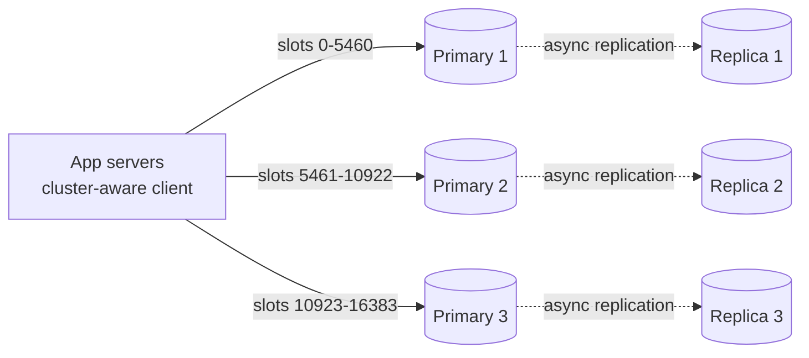

# Redis

## The problem it solves

A product page reads the same user profile, cart and inventory rows thousands of times per second. Each read from Postgres costs a few milliseconds and some database CPU, and at 50,000 reads per second the database becomes the bottleneck. Beyond caching, many systems need fast shared data structures that a relational database handles poorly: a leaderboard re-sorted on every score change, a per-user rate-limit counter updated on every request, a lock that expires automatically, the set of drivers near a point.

Redis is an in-memory data structure server. Operations typically complete in well under a millisecond on the server, and one instance commonly handles on the order of 100,000 operations per second, with richer types than a plain key-value cache.

## How it works

**Data structures.** Every key maps to a typed value, and commands operate on the structure server-side:

| Type | Example commands | Typical use |
|---|---|---|
| String | `GET`, `SET key v EX 60 NX`, `INCR` | Cache entries, counters, simple locks |
| Hash | `HSET`, `HGETALL` | Objects (user session, bucket state) |
| List | `LPUSH`, `RPOP`, `BLPOP` | Simple queues, recent-items lists |
| Set | `SADD`, `SISMEMBER`, `SINTER` | Tags, unique visitors, mutual friends |
| Sorted set | `ZADD`, `ZINCRBY`, `ZREVRANGE`, `ZRANK` | Leaderboards, timelines, delayed jobs |
| Stream | `XADD`, `XREADGROUP`, `XACK` | Append-only log with consumer groups |
| Geo | `GEOADD`, `GEOSEARCH` | Nearby search (a sorted set scored by geohash) |
| HyperLogLog, bitmap | `PFADD`/`PFCOUNT`, `SETBIT` | Approximate distinct counts, flags |

Sorted sets are implemented with a skip list plus a hash table, so updates and rank queries are O(log n). Keys can have a TTL (`EXPIRE`), and when memory hits `maxmemory`, an eviction policy such as `allkeys-lru` (approximate LRU by sampling) or `allkeys-lfu` removes keys.

**Single-threaded execution.** Commands are executed one at a time by a single thread with an event loop. That's why every individual command is atomic and there are no locks inside Redis. Since Redis 6, optional I/O threads can handle socket reads and writes, but command execution stays single-threaded. The consequence: one slow command (`KEYS *`, `HGETALL` on a million-field hash, a long Lua script) blocks every other client. Multi-step atomic logic goes in a **Lua script** (`EVAL`/`EVALSHA`) or a `MULTI`/`EXEC` transaction.

**Persistence.** Memory is volatile, so Redis offers two mechanisms, often used together:
- **RDB snapshots:** periodically `fork()` and write the whole dataset to a compact file, using copy-on-write so the parent keeps serving. Fast restarts, but you lose writes since the last snapshot.
- **AOF (append-only file):** log every write command. `appendfsync everysec` (the common setting) loses at most about a second of writes on a crash; `always` fsyncs every write and is much slower. The AOF is periodically rewritten in the background to stay compact.

**Replication and failover.** A primary streams its write commands to replicas **asynchronously**. Replicas serve reads and act as hot standbys. **Redis Sentinel** monitors primaries and promotes a replica when one fails. Because replication is async, a failover can lose the last writes acknowledged by the old primary; `WAIT n timeout` blocks until n replicas acknowledge, which reduces but doesn't eliminate that risk.

**Redis Cluster.** Sharding across many primaries. The key space is split into **16,384 hash slots**: `slot = CRC16(key) mod 16384`, and each primary owns a range of slots. Clients cache the slot map and send each command straight to the owner; a `MOVED` reply tells them the map changed. Multi-key commands and Lua scripts only work when all keys are in one slot, which **hash tags** guarantee: only the part inside `{}` is hashed, so `cart:{u42}` and `wishlist:{u42}` land together. Resharding moves slots between nodes online.



Common patterns:

```
GET user:42                                   # cache-aside: on miss, read DB then
SET user:42 "<json>" EX 300                   # populate with a TTL
SET lock:order:9 <token> NX PX 10000          # lock: only if absent, auto-expires
ZINCRBY leaderboard 50 alice                  # leaderboard update
ZREVRANGE leaderboard 0 9 WITHSCORES          # top 10
```

## Worked example

A game leaderboard in one sorted set. Each row is one command; the state column shows the set ordered by score, highest first.

| Step | Command | Return | Sorted set after |
|---|---|---|---|
| 1 | `ZADD lb 100 alice 80 bob 120 carol` | 3 (added) | carol 120, alice 100, bob 80 |
| 2 | `ZINCRBY lb 50 bob` | 130 | bob 130, carol 120, alice 100 |
| 3 | `ZREVRANK lb alice` | 2 (0-based, so 3rd place) | unchanged |
| 4 | `ZINCRBY lb 25 alice` | 125 | bob 130, alice 125, carol 120 |
| 5 | `ZREVRANGE lb 0 1 WITHSCORES` | bob 130, alice 125 | unchanged |

Each update and rank query is O(log n). For 10M players, a sorted set entry costs on the order of 100 bytes with overhead, so about 1 GB, which fits comfortably on one node. The same thing in SQL needs `ORDER BY score` with an index and a `COUNT(*)` of higher scores for every rank lookup.

## Trade-offs

- **Pros:** sub-millisecond latency; rich atomic operations on data structures; simple to run; versatile (cache, counters, locks, leaderboards, geo, queues, pub/sub).
- **Cons:** dataset limited by RAM and therefore costly at scale; async replication can lose recent writes on failover; single-threaded execution means one slow command stalls everyone; Cluster restricts multi-key operations to one slot; not a system of record for data you can't afford to lose.
- **Alternatives:** **Memcached** (multi-threaded, plain key-value cache, no persistence or rich types); **DynamoDB/Cassandra** for durable large-scale key-value storage; **Kafka** instead of Redis pub/sub or streams when you need durable, replayable, high-volume logs; **ZooKeeper/etcd** for locks that require strong correctness.

## When to use it (and when not)

- **Use it** for caching in front of a database (almost every design), rate limiter counters, session storage, leaderboards, Twitter-style home timelines (lists of tweet IDs), Uber driver locations (`GEOADD`/`GEOSEARCH`), seat holds with TTLs in Ticketmaster, distributed locks with expiry, presence and pub/sub fan-out for chat.
- **Avoid it** as the only copy of important data (orders, payments), for datasets far larger than memory, for complex queries and joins, and for locks where a double grant would corrupt data (use fencing tokens with a consensus-based store).

## In an interview

Say: "Hot reads go through Redis cache-aside with a TTL, and the leaderboard is a sorted set, so updates and rank queries are O(log n); it's a Redis Cluster sharded by hash slot, with replicas and the understanding that async replication can drop the last writes on failover." Be ready to explain single-threaded atomicity, RDB vs AOF, hash slots and hash tags, and what happens during a primary failure.

## Common follow-up questions

### Why is Redis fast if it's single-threaded?
All data is in memory, commands are simple operations on efficient structures, and an event loop handles thousands of connections without context switches or locks. The bottleneck is usually the network, not the CPU. You scale beyond one core by running more shards.

### What is lost if a Redis node crashes?
With AOF `everysec`, up to about one second of writes on that node. With only RDB, everything since the last snapshot. If a replica is promoted, writes the old primary acknowledged but hadn't replicated are lost too, so treat Redis as a cache or rebuildable store unless you accept that window.

### How do you avoid a cache stampede when a hot key expires?
Many requests miss at once and all hit the database. Fixes: let one request rebuild while others wait or serve stale data (a short lock with `SET NX`), refresh hot keys before they expire, and add random jitter to TTLs so keys don't expire together.

### Is a Redis lock safe for mutual exclusion?
`SET key token NX PX` with a token check on release is fine for efficiency (avoiding duplicate work). For correctness, a paused process can hold an expired lock and still write, so protected resources should check a monotonically increasing fencing token, or use a consensus-based lock service like ZooKeeper or etcd.

### How does Redis Cluster route a multi-key operation?
It only allows multi-key commands and scripts when all keys hash to the same slot; otherwise it returns a `CROSSSLOT` error. Use hash tags like `{user42}` in key names to place related keys in one slot.
