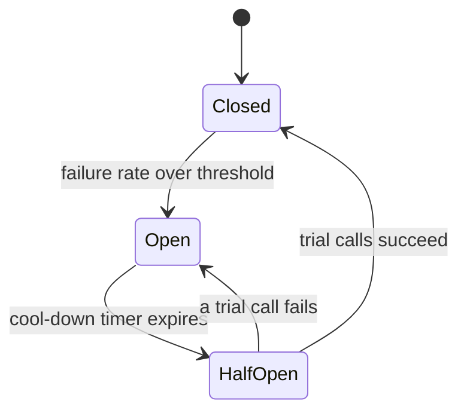

# Reliability Patterns

## The problem it solves

In a distributed system something is always failing: a pod restarting, a slow disk, a GC pause, a dependency that is up but answering in 8 seconds instead of 80 ms. The dangerous failures are rarely clean crashes. They are **slow** failures that tie up threads, connections and memory in every caller, until the callers fall over too. One sick service becomes a **cascading failure** across the whole call graph.

Reliability patterns are a toolkit for containing failure: bound how long you wait, retry carefully, stop calling things that are broken, isolate resources so one bad dependency can't starve the rest, reject work you can't finish, and degrade instead of erroring. None of them is enough alone; together they turn "the recommendation service is down" into "the home page shows a generic list" instead of "the site is down."

## How it works

**Timeouts and deadline propagation.** Every network call needs a timeout, set from the dependency's real latency (e.g. a bit above its p99.9), not a library default of 30 s or infinity. Better still, pass a **deadline** down the chain: the edge gives the request 1 s total, and each hop forwards the *remaining* time (gRPC does this with deadlines in request metadata). A service that receives a request with 5 ms left should not start a 50 ms query.

**Retries with exponential backoff, jitter and budgets.** Retry only transient errors, with `sleep = random(0, min(cap, base * 2^attempt))`, cap retries at ~10% of traffic, and retry at one layer only. The **retries** concept covers this in depth.

**Idempotency.** Retries are only safe if repeating an operation has the same effect as doing it once. Use idempotency keys for mutations (see the **idempotency** concept). Kafka's idempotent producer is the same idea: the broker de-duplicates retried sends using a producer ID and sequence numbers.

**Circuit breakers.** Wrap calls to a dependency in a state machine that stops calling it once it is clearly failing:



- **Closed:** calls flow; the breaker counts failures (including timeouts) over a sliding window.
- **Open:** calls fail immediately (or go to a fallback) without touching the dependency. This gives it room to recover and frees caller threads.
- **Half-open:** after a cool-down (e.g. 30 s), let a few trial calls through. Success closes the breaker; failure re-opens it.

Typical thresholds: open when ≥ 50% of calls fail in a 10 s window, *with a minimum volume* (e.g. 20 calls) so two failures at 3 a.m. don't trip it.

**Bulkheads.** Partition resources so one dependency can't consume everything. Give each downstream its own connection pool or thread pool (e.g. 20 threads for payments, 10 for recommendations). If recommendations hang, only its 10 threads are stuck. The same idea applies at larger scale: separate clusters per tenant tier, or separate Kafka consumer groups for critical and best-effort pipelines.

**Load shedding and backpressure.** When a server is over capacity, accepting more work makes *everyone* slow. **Load shedding** rejects excess requests early and cheaply (HTTP 503 or 429), ideally dropping low-priority traffic first and rejecting requests whose deadline has already passed. **Backpressure** pushes the signal upstream so producers slow down: bounded queues that block or reject when full, TCP flow control, reactive streams. Kafka is pull-based, so consumers get natural backpressure: they fetch only as fast as they process, and the backlog shows up as consumer lag instead of crashing the consumer.

**Graceful degradation and fallbacks.** Decide in advance what a feature does when its dependency is gone: serve a cached or stale value, a default (generic recommendations), a reduced feature (hide the "people also bought" widget), or queue the write for later. Mark critical vs non-critical dependencies explicitly.

**Health checks.** Distinguish two questions:

| Check | Question | On failure |
|---|---|---|
| **Liveness** | Is the process stuck beyond repair? | Restart it |
| **Readiness** | Can it serve traffic right now? | Remove from load balancer, don't restart |

Liveness should be shallow (the process responds). Don't make liveness depend on the database: if the database blips, every pod restarts at once and you've turned a small outage into a large one. Readiness can check warm caches, loaded config and critical connections.

**Dead-letter queues.** For async consumers, after N failed attempts park a poison message in a DLQ so it doesn't block the partition or burn workers forever; alert on DLQ depth and redrive after a fix.

## Worked example

An order service gets a 1 s deadline at the API gateway and calls inventory, then payments, then (optionally) recommendations.

```
deadline = now + 1000ms
inventory(timeout = min(150ms, remaining))      # p99.9 ≈ 120 ms
payments (timeout = min(400ms, remaining), idempotency_key = order_id)
recs     (timeout = min(100ms, remaining), breaker = recs_cb,
          fallback = top_sellers_cache)
```

Recommendations starts timing out. Without protection: the service handles 500 req/s and each recs call now hangs for the default 30 s, so by Little's law 500 × 30 = 15,000 threads would be stuck waiting. With a 200-thread pool the service is saturated in well under a second and orders fail too.

With the patterns:

- The 100 ms timeout caps each stuck call: 500 × 0.1 = 50 concurrent waits at most.
- The bulkhead limits recs to 10 threads, so excess recs calls fail fast instead of borrowing order threads.
- The circuit breaker sees > 50% failures over 10 s (well above the 20-call minimum at 500 req/s) and opens. Recs calls now cost ~0 ms and return cached top sellers.
- Every 30 s it half-opens, sends a few trial calls, and closes once recs recovers.

Orders keep succeeding at normal latency; users just see generic recommendations.

## Trade-offs

- **Timeouts:** too short and you fail requests that would have succeeded (and trigger retries); too long and threads pile up. Tune from measured percentiles and revisit.
- **Retries:** recover blips but add latency and amplify load; need idempotency.
- **Circuit breakers:** protect both sides but add tuning knobs; a breaker on a shared dependency can trip for all users because one tenant's calls fail. Per-host or per-endpoint breakers are more precise but more state.
- **Bulkheads:** isolation costs efficiency: dedicated pools sit idle while others are busy.
- **Load shedding:** some users get errors by design; requires priorities to shed the *right* work.
- **Fallbacks:** stale or reduced answers may confuse users, and fallback paths that rarely run tend to be broken when you need them. Test them.

## When to use it (and when not)

- **Use** timeouts everywhere, always. Use breakers and bulkheads around every remote dependency of a user-facing service, especially non-critical ones. Use load shedding on any service that can be overloaded by traffic spikes. Use readiness/liveness probes on every orchestrated service.
- **Be careful** with fallbacks for correctness-critical paths: a payment service should fail clearly, not "fall back" to assuming success. Don't add breakers in front of a local, in-process call, and don't retry inside a breaker that's open.

## In an interview

Say: "Every call has a timeout derived from a propagated deadline. We retry idempotent calls once or twice with jittered backoff under a retry budget. Non-critical dependencies like recommendations sit behind a circuit breaker and their own bulkhead, with a cached fallback. Under overload the service sheds low-priority requests with 503s, and consumers rely on Kafka's pull model for backpressure, with a DLQ for poison messages." Then walk through what happens when one dependency gets slow, hop by hop.

## Common follow-up questions

### How do you choose a timeout value?
Start from the dependency's measured latency distribution: a bit above its p99 or p99.9, so you only cut off genuinely stuck calls. Then make sure the sum along the call chain fits inside the caller's deadline, and prefer propagating the remaining deadline over fixed per-hop values.

### What's the difference between a circuit breaker and a retry budget?
A retry budget limits *extra* attempts as a fraction of traffic, so retries can't multiply load. A circuit breaker stops *all* calls (first attempts included) once failure is sustained, and probes for recovery. They are complementary.

### What's the difference between load shedding and backpressure?
Load shedding drops work at the overloaded server. Backpressure tells the producer to slow down so work isn't produced faster than it can be consumed. Backpressure needs a cooperating producer; shedding works even against clients you don't control.

### Why shouldn't a liveness probe check the database?
If the database has a brief outage, every pod fails liveness and gets restarted simultaneously, causing cold starts and a thundering herd on recovery. Restarting the app can't fix the database anyway. Put dependency checks in readiness, or nowhere.

### How does a stream consumer handle a slow downstream sink?
It processes and commits offsets only as fast as the sink accepts writes, so lag grows instead of memory. Add a bounded in-memory buffer, pause fetching (Kafka consumers can pause partitions) when it's full, alert on lag, and scale consumers up to the partition count if the sink can take more.
