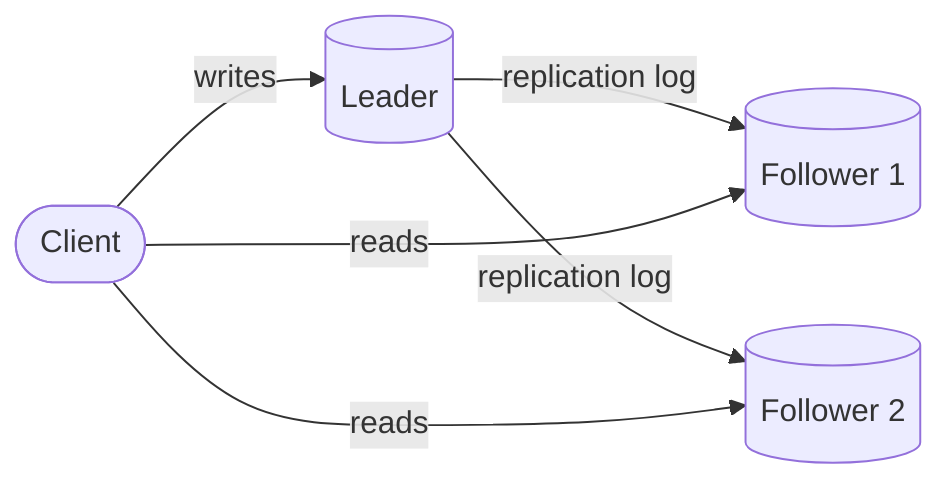

# Replication

## The problem it solves

A single database server is a single point of failure and a single throughput limit. When its disk dies, you lose every write since the last backup, maybe hours of orders. When it's down for a kernel patch, the whole product is down. And when read traffic grows to 50,000 queries per second, one machine can't serve it no matter how well indexed.

Replication keeps copies of the same data on several machines, so you survive failures, serve reads from more nodes, and can put copies close to users in other regions.

## How it works

**Leader-follower (primary-replica).** One node accepts all writes and appends them to a replication log (Postgres WAL, MySQL binlog). Followers apply the log in order and serve reads. If the leader fails, a follower is promoted. This is the default in Postgres, MySQL, MongoDB replica sets and Redis.

**Multi-leader.** Several nodes, typically one per region, accept writes and replicate to each other. Writes are fast locally and each region keeps working if the link between regions breaks. The cost is **write conflicts**: two regions can change the same row concurrently, so you need a resolution rule (last-writer-wins, merge, CRDTs, or application logic).

**Leaderless.** Clients (or a coordinator node) send each write to several replicas and read from several, using quorums (R + W > N) to overlap. Stale replicas are fixed by read repair and background anti-entropy. This is the Dynamo model used by Cassandra and Riak.

**Synchronous vs asynchronous.**

- **Synchronous:** the leader waits for a follower to confirm before acknowledging the client. No acknowledged write is lost if the leader dies, but every write pays the follower's latency, and a slow follower stalls writes.
- **Asynchronous:** the leader acknowledges immediately and ships the log afterwards. Fast, but if the leader dies, writes not yet shipped are lost.
- **Semi-synchronous:** wait for one follower (or a quorum), not all. A common middle ground, available in MySQL and in Postgres via `synchronous_standby_names`.

**Replication lag anomalies** (with async followers):

- **Read-your-writes violation:** a user updates their profile, the next page load reads a follower that hasn't caught up, and the old profile appears. Fix: read your own recent writes from the leader, or wait until the follower has reached the write's log position.
- **Non-monotonic reads:** two reads hit two followers with different lag, so a comment appears and then disappears. Fix: pin each user to one follower.
- **Causality violations:** a reply is visible before the question it answers, because they replicated through different paths. Fix: causal consistency, or keep related writes in one partition.

**Failover.** Detect a dead leader (missed heartbeats), elect the most up-to-date follower, redirect writes, and stop the old leader from accepting writes if it comes back (fencing). Done wrong, this causes split brain or lost writes.

## Worked example

A leader with two async followers. Average lag is 200 ms. A user changes their display name at t = 0.

| Time | Leader | Follower 1 | Follower 2 | User's read |
|---|---|---|---|---|
| 0 ms | name = "Sam" (log position 1001) | 1000, old name | 1000, old name | |
| 50 ms | 1001 | 1000 | 1000 | Reads F1: old name (read-your-writes violation) |
| 200 ms | 1001 | 1001 | 1000 | Reads F1: "Sam" |
| 300 ms | 1001 | 1001 | 1000 | Reads F2: old name again (non-monotonic read) |
| 400 ms | 1001 | 1001 | 1001 | All replicas agree |

If the leader crashes at 100 ms and Follower 1 is promoted, the rename is lost even though the user saw a success response. That's the price of async replication.

## Trade-offs

- **Pros:** high availability through failover; read scaling; geographic locality; durability against disk or machine loss.
- **Cons:** replication lag and stale reads; failover complexity and split-brain risk; sync replication adds write latency; multi-leader and leaderless need conflict handling.
- **Alternatives:** consensus-based replication (Raft or Paxos, as in etcd, CockroachDB and Spanner) gives strongly consistent replicas with automatic failover, at the cost of a majority round trip per write. Backups alone protect against data loss but not downtime.

## When to use it (and when not)

- **Use it** in nearly every production database for availability. Leader-follower with read replicas fits read-heavy systems: news feeds, product catalogs, URL shorteners. Multi-leader fits multi-region writes and offline clients. Leaderless fits high write volume with tunable consistency (messaging stores, time series). It comes up in almost every interview question once you discuss availability.
- **Avoid reading from async followers** for data that must be fresh: an account balance before a withdrawal, inventory at checkout, or a user's own just-submitted post.

## In an interview

Say: "Postgres with one leader and two followers: one semi-synchronous follower in another availability zone so we don't lose acknowledged writes on failover, and async replicas for read scaling, with users reading their own recent writes from the leader." Be ready to explain replication lag anomalies, how failover works, and what happens to writes that hadn't replicated when the leader died.

## Common follow-up questions

### How do you avoid split brain during failover?
Use a consensus system or quorum to decide who the leader is, so only one node can win. Fence the old leader with a generation number or epoch that storage and followers check, or cut it off from clients (STONITH, revoking its virtual IP).

### Why not make all replication synchronous?
Every write would wait for the slowest replica, and any replica outage would block writes entirely. Most systems wait for one nearby replica or a majority, which keeps durability without tying availability to every node.

### How do you handle conflicts in multi-leader replication?
Avoid them where possible by routing all writes for a record to one home region. Otherwise pick a rule: last-writer-wins by timestamp (simple, loses data), merge fields, CRDTs, or keep both versions and let the application or user resolve them.

### How does a new replica catch up?
It takes a consistent snapshot of the leader, records the log position the snapshot corresponds to, loads it, then replays the log from that position until it's caught up and can serve reads.
