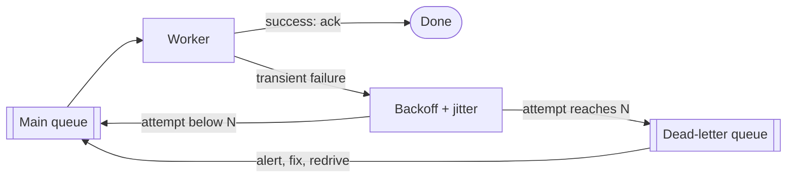

# Retries & DLQ

## The problem it solves

Networks drop packets, servers restart during deploys, and databases briefly hit connection limits. Many failures are **transient**: the same request a moment later would succeed. Without retries, users see errors for blips that lasted 200 ms.

But naive retries cause outages. If 10,000 clients all retry immediately when a database hiccups, it receives a wall of traffic right when it's weakest, fails again, and everyone retries again in lockstep. Stack three service layers that each try 3 times, and one user request can turn into 3 × 3 × 3 = **27** calls at the bottom. Good retry design recovers from blips without turning a small failure into a big one, and puts messages that will never succeed somewhere safe instead of retrying them forever.

## How it works

**1. Only retry what's safe and retryable.**

- Retry: timeouts, connection resets, 429, 502, 503, 504.
- Don't retry: 400, 401, 403, 404, validation errors. They'll fail the same way.
- Only retry operations that are **idempotent**, or make them idempotent with an **idempotency key**: the client sends a unique key (`Idempotency-Key: 7f3a...`) and the server stores the result of the first request under it, returning the same result for repeats. That's how a retried "charge card" doesn't charge twice.

**2. Exponential backoff.** Wait longer after each failure, up to a cap:

```
delay = min(cap, base * 2 ** attempt)
```

**3. Jitter.** Pure exponential backoff still synchronizes clients that failed at the same moment: they all retry at 100 ms, 200 ms, 400 ms. Randomizing spreads them out. "Full jitter" picks uniformly between zero and the backoff:

```
def backoff(attempt, base=0.1, cap=10.0):
    return random.uniform(0, min(cap, base * 2 ** attempt))

for attempt in range(max_attempts):
    try:
        return call()
    except Retryable:
        if attempt == max_attempts - 1 or not budget.allow():
            raise
        sleep(backoff(attempt))
```

Honor `Retry-After` headers when the server sends them.

**4. Retry budgets.** Cap retries as a fraction of traffic, for example "retries may be at most 10% of requests over the last minute". When a dependency is truly down, the budget runs out and you fail fast instead of tripling its load. Also retry at **one layer** only (usually the outermost or the one closest to the failure), not at every layer. A **circuit breaker** complements this: after many failures it stops calling the dependency for a cooling-off period.

**5. Dead-letter queues (DLQ).** In asynchronous processing, a message that fails every time (bad data, a bug) is a **poison message**. After N attempts, move it to a DLQ so it stops blocking or consuming workers. Alert on DLQ depth, inspect messages, fix the bug, then **redrive** them back to the main queue.



In SQS this is a redrive policy (`maxReceiveCount`). In Kafka, consumers usually publish failures to retry topics with increasing delays and finally a DLQ topic, because a failing message would otherwise block its partition.

## Worked example

Backoff with base 100 ms, cap 10 s, full jitter:

| Attempt (retry #) | base × 2^attempt | Capped ceiling | Actual sleep (uniform in) |
|---|---|---|---|
| 0 | 100 ms | 100 ms | 0–100 ms |
| 1 | 200 ms | 200 ms | 0–200 ms |
| 2 | 400 ms | 400 ms | 0–400 ms |
| 3 | 800 ms | 800 ms | 0–800 ms |
| 4 | 1,600 ms | 1,600 ms | 0–1,600 ms |
| 5 | 3,200 ms | 3,200 ms | 0–3,200 ms |
| 6 | 6,400 ms | 6,400 ms | 0–6,400 ms |
| 7 | 12,800 ms | 10,000 ms | 0–10,000 ms |

Thundering herd: 10,000 clients fail at once. With no jitter, all 10,000 retry at exactly 100 ms. With full jitter on retry 3, they spread uniformly across 800 ms, about 10,000 / 0.8 s = 12,500 requests per second instead of a single spike of 10,000 in the same instant.

Retry budget: a service sends 5,000 requests/s with a 10% budget, so at most 500 retries/s. If the dependency is fully down, total load on it is 5,500/s instead of up to 15,000/s with 3 attempts each.

## Trade-offs

- **Pros:** hides transient failures from users; DLQs keep poison messages from blocking work and preserve them for debugging; backoff and jitter protect struggling dependencies.
- **Cons:** retries add latency (a user waiting through 4 retries may already have given up); retrying non-idempotent operations causes duplicates; retries at many layers amplify load; DLQs need owners, alerts and a redrive process or they become a graveyard.
- **Alternatives and complements:** **circuit breakers** to stop calling a dead dependency; **hedged requests** (send a second request after the p95 latency, take the first answer) for tail latency on idempotent reads; **load shedding** on the server; failing fast and letting the user retry.

## When to use it (and when not)

- **Use it** in every client of a remote service, in queue consumers, in payment flows with idempotency keys ("design a payment system"), webhook delivery ("design Stripe webhooks"), notification sending, and job schedulers.
- **Don't retry** non-retryable errors, non-idempotent operations without a key, or in tight interactive paths where the user would rather see an error quickly. Don't retry at every layer of a deep call chain.

## In an interview

Say: "Clients retry only retryable errors, with exponential backoff and full jitter capped at 10 seconds, under a 10% retry budget, and every mutating call carries an idempotency key; queue consumers move a message to a DLQ after five failures and we alert on DLQ depth." Be ready to give the backoff formula, explain why jitter matters, and how idempotency keys are stored.

## Common follow-up questions

### Why add jitter to exponential backoff?
Clients that failed at the same moment would otherwise retry at the same moments, hitting the server in synchronized waves. Randomizing the delay spreads retries over the interval, so the recovering service sees a smooth load instead of spikes.

### How does an idempotency key work on the server?
The server stores the key with the request's result, inside the same transaction as the side effect, or with a "processing" marker to block concurrent duplicates. A repeat request with the same key returns the stored result instead of redoing the work. Keys expire after a window such as 24 hours.

### What do you do with messages in the DLQ?
Alert when it's non-empty, inspect messages to find the cause, fix the bug or data, and redrive them to the main queue. Messages that are truly invalid get archived or discarded deliberately, with a record of why.

### How do retries cause cascading failures?
When a dependency slows down, every caller retries, multiplying its load right when it has the least capacity, and each layer of retries multiplies again. Retry budgets, retrying at a single layer, circuit breakers and server-side load shedding prevent the spiral.
