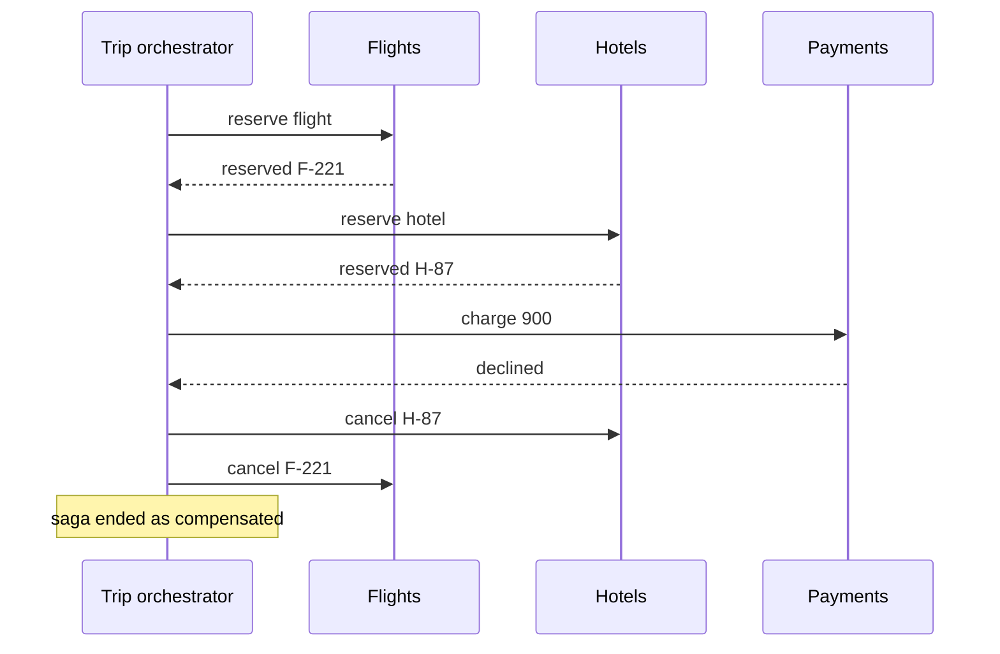
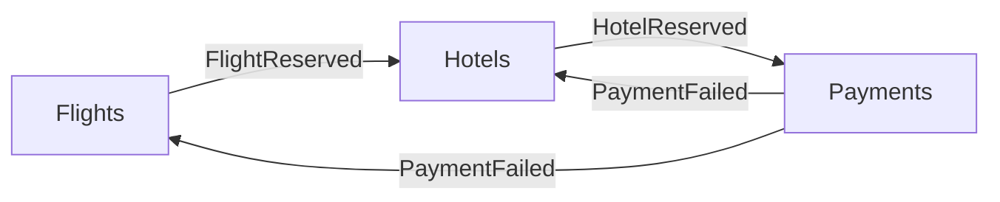

# Saga Pattern

## The problem it solves

Booking a trip touches three services, each with its own database: flights, hotels and payments. If the flight is booked, the hotel is booked, and then the payment is declined, you're left holding a flight and a hotel nobody paid for. A single ACID transaction can't span three databases, and two-phase commit would lock rows in all three services while waiting on each other (and on an external card processor that doesn't support it).

A saga breaks the business transaction into a sequence of local transactions, one per service. If a step fails, the saga runs **compensating transactions** that undo the earlier steps' effects.

## How it works

1. Split the workflow into steps T1, T2, ..., Tn. Each is a local ACID transaction in one service, followed by an event or reply.
2. For every step that can be followed by a failure, define a compensation C1, C2, ..., which semantically undoes it: cancel the reservation, refund the payment.
3. Run steps in order. If step Tk fails, run Ck−1, ..., C1 in reverse order.

**Orchestration.** A central orchestrator (a saga state machine) tells each service what to do and reacts to replies. Logic lives in one place, which is easy to follow and monitor. Workflow engines like Temporal, AWS Step Functions and Camunda are often used for this.

**Choreography.** No central controller. Each service listens for events and publishes its own: `FlightReserved` triggers the hotel service, `HotelReserved` triggers payment, `PaymentFailed` triggers hotel and flight cancellations. Fewer moving parts for short flows, but the overall workflow is spread across services, which makes it harder to understand, test and change as steps are added.

**Designing steps and compensations:**

- **Compensations are business actions, not rollbacks.** You can't un-send an email; you send a correction. A refund is a new ledger entry, not a deleted charge.
- **Order steps by risk.** Put steps most likely to fail, and steps that can't be compensated, last. Payment capture or shipping is often the **pivot**: after it succeeds, the saga only moves forward, retrying the remaining steps until they succeed.
- **Make every step and compensation idempotent**, since messages are retried and may arrive twice.
- **Persist saga state** (current step, IDs of created resources) so the orchestrator can resume after a crash.
- **Publish events reliably** with the transactional outbox: write the state change and the outgoing event in one local transaction, then relay the event.

**Lack of isolation.** Other transactions can see intermediate states, such as a reserved seat that's about to be cancelled. Countermeasures: semantic locks (mark records `PENDING` so others treat them carefully), reserve-then-confirm steps, and rechecking values before acting.

## Worked example

Trip costing $900: flight $600 and hotel $300. Payment is declined.

| Step | Action | Result | Flight state | Hotel state | Charged |
|---|---|---|---|---|---|
| T1 | Reserve flight | ok | PENDING F-221 | | $0 |
| T2 | Reserve hotel | ok | PENDING F-221 | PENDING H-87 | $0 |
| T3 | Charge $900 | declined | PENDING | PENDING | $0 |
| C2 | Cancel hotel | ok | PENDING | CANCELLED | $0 |
| C1 | Cancel flight | ok | CANCELLED | CANCELLED | $0 |

End state: nothing booked, nothing charged. If the payment had succeeded, a final step would confirm both reservations (PENDING to CONFIRMED). If confirming the hotel then failed temporarily, the saga would retry it rather than refund, because payment was the pivot.

## Trade-offs

- **Pros:** works across services and external APIs; no distributed locks, so services stay loosely coupled and available; each step is a fast local transaction; failures are handled explicitly in business terms.
- **Cons:** only eventual consistency, and intermediate states are visible; writing correct compensations is real work; some actions can't be undone; debugging is harder, especially with choreography; requires idempotency and reliable messaging everywhere.
- **Alternatives:** two-phase commit when all participants are databases you control and short locks are acceptable; keeping the data in one service and one database so a local transaction suffices; a reservation pattern with expiring holds (leases) that time out instead of needing compensation.

## When to use it (and when not)

- **Use it** for workflows across microservices: order placement (inventory, payment, shipping), travel booking, ride-hailing trip lifecycle, money transfers between services, user onboarding across systems. Interview questions: e-commerce checkout, design Uber or DoorDash order flow, hotel or airline booking, payment system with cross-service transfers.
- **Avoid it** when the data can live in one database (use a normal transaction), or when temporarily inconsistent intermediate states are unacceptable to users or regulators and you can't hide them.

## In an interview

Say: "Checkout is an orchestrated saga: reserve inventory, charge payment, create shipment; each step is a local transaction with an idempotent compensation, and the orchestrator persists its state so it resumes after a crash." Be ready to compare orchestration and choreography, explain the pivot step, and show how you handle the lack of isolation.

## Common follow-up questions

### What if a compensation fails?
Retry it with backoff, since compensations must be idempotent and eventually succeed. If it keeps failing, for example because an external system is down for hours, park the saga in a failed state and alert a human; an operations queue for stuck sagas is a normal part of the design.

### Orchestration or choreography?
Choreography suits short flows of two or three steps owned by few teams. Orchestration is better once the flow has more steps, branches or timeouts, because one place shows the whole workflow and its current state.

### How do you prevent users from seeing half-finished sagas?
Use semantic locks: create records in a `PENDING` state and only show them as confirmed at the end. Hold inventory as a reservation rather than a sale, and design the UI to show "processing" until the saga completes.

### How do you guarantee each step's event is published?
Use the transactional outbox: the service writes its state change and the event to an outbox table in the same local transaction, and a relay or CDC process publishes events from that table. That avoids committing the change but losing the event, or the reverse.
