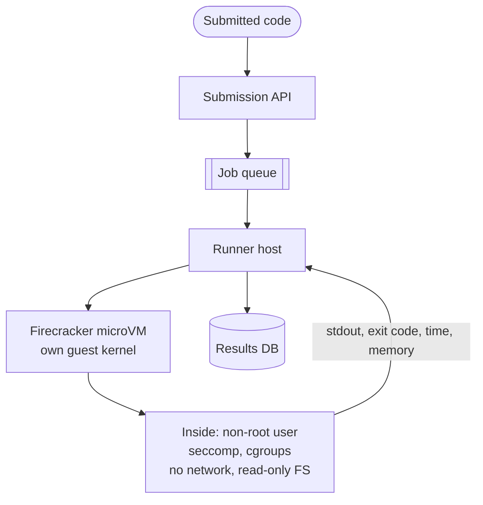

# Sandboxing

## The problem it solves

An online judge runs code that strangers submit. One submission is `while True: pass`, another allocates 64 GB of memory, another forks until the process table fills, another reads `/etc/passwd` and the cloud metadata endpoint to steal credentials, and another tries a kernel exploit to escape onto the host. If submissions run as ordinary processes on your servers, any one of these can take down the machine, leak other users' code, or compromise your infrastructure.

**Sandboxing** runs untrusted code inside an isolation boundary that limits what it can see (files, network, other processes), what it can do (system calls), and how much it can use (CPU, memory, time), so a malicious or buggy program can only hurt itself.

## How it works

Isolation comes in layers, from lighter and faster to stronger and heavier.

**1. Process-level restrictions (the building blocks of containers):**

- **Namespaces** give the process its own view of PIDs, mounts, network, users and hostname. It can't see or signal host processes.
- **cgroups** cap CPU, memory, number of processes (`pids.max` stops fork bombs) and I/O.
- **seccomp** filters system calls: allow `read`, `write`, `exit`, deny `mount`, `ptrace`, `kexec_load` and others. Fewer reachable syscalls means less kernel attack surface.
- **Capabilities dropped**, a non-root user, a read-only root filesystem and no network.

**2. Containers** (Docker, containerd) package those together. All containers still share the **host kernel**, so a kernel vulnerability can allow an escape. Fine for semi-trusted code, risky alone for hostile code.

**3. gVisor** places a user-space kernel (written in Go) between the application and the host. It intercepts the app's system calls and implements them itself, and only a small, filtered set of host syscalls is used. An exploit must break gVisor and then the host kernel. The cost is overhead on syscall-heavy and I/O-heavy workloads.

**4. MicroVMs** like **Firecracker** run each workload in a minimal virtual machine with its own guest kernel, isolated by hardware virtualization (KVM). Firecracker strips the device model down to a few virtual devices and starts VMs in a fraction of a second; AWS built it for Lambda and Fargate. Isolation is VM-strength with near-container startup.

**5. Language-level sandboxes:** WebAssembly runtimes and V8 isolates (used by edge platforms such as Cloudflare Workers) run code in a memory-safe VM inside one process, starting in milliseconds. They limit you to code compiled for that runtime.



A container-level example with Docker flags:

```
docker run --rm --network=none --read-only \
  --memory=256m --memory-swap=256m --cpus=1 --pids-limit=64 \
  --cap-drop=ALL --security-opt no-new-privileges \
  --user 65534:65534 --tmpfs /tmp:size=16m \
  judge-python:3.12 timeout 5s python3 /code/solution.py
```

**Operational practices:** enforce a wall-clock timeout from outside the sandbox and kill the whole sandbox, not just the process; never mount secrets or the Docker socket; block egress (especially `169.254.169.254`, the cloud metadata address); destroy the sandbox after each run rather than reusing it; keep a **warm pool** of pre-booted sandboxes so startup doesn't add latency; and run runners in a separate account or network segment from core systems.

## Worked example

Limits for a judge submission, and what each one stops:

| Attack | Without sandbox | Defense | Result in sandbox |
|---|---|---|---|
| Infinite loop | Burns a core forever | `--cpus=1`, 5 s wall-clock timeout | Killed at 5 s, verdict "Time Limit Exceeded" |
| Allocate 64 GB | Host swaps or OOM-kills other processes | cgroup memory 256 MB, no swap | Sandbox OOM-killed, "Memory Limit Exceeded" |
| Fork bomb | Process table fills, host unresponsive | `pids.max = 64` | `fork` fails after 64 processes |
| Read host files, steal credentials | Reads `/etc`, calls metadata endpoint | Separate mount namespace, read-only image, no network | Sees only its own files, no network route |
| Kernel exploit | Root on host | Seccomp, plus microVM with its own kernel | Must also break the hypervisor boundary |

Capacity: at a peak of 10,000 submissions per minute, each using up to 2 CPU-seconds, demand is 10,000 × 2 / 60 ≈ 333 CPU cores busy on average. With 16-core runner hosts, that's about 21 hosts, plus headroom and a warm pool.

## Trade-offs

- **Pros:** contains crashes, resource abuse and many exploits; lets you safely offer code execution as a feature; per-run limits give fair, measurable resource usage.
- **Cons:** each stronger layer adds overhead (gVisor on syscalls, VMs on memory and startup); no sandbox is perfect, so defense in depth and patching still matter; operational complexity of runner fleets and warm pools; language sandboxes restrict what code can run.
- **Alternatives:** **containers alone** for trusted internal workloads; **full VMs per tenant** for maximum isolation with slower startup; **managed services** (serverless functions) that provide isolation for you; **static restrictions** such as only allowing a safe subset of a language, which is fragile.

## When to use it (and when not)

- **Use it** for "design LeetCode" or an online judge, "design a code playground" or notebook service, serverless function platforms ("design AWS Lambda"), CI runners executing pull requests from forks, plugin systems running third-party extensions, and processing untrusted files (media decoders, document converters).
- **Not needed** for your own trusted services, where ordinary containers with sensible limits are enough.

## In an interview

Say: "Submissions run in a fresh Firecracker microVM from a warm pool, with no network, a read-only image, a non-root user, seccomp, and cgroup limits of 256 MB, one CPU and a 5-second wall clock enforced from outside; the VM is destroyed after each run." Be ready to compare containers, gVisor and microVMs, explain what each limit stops, and size the runner fleet.

## Common follow-up questions

### Why isn't a Docker container enough for untrusted code?
Containers share the host kernel, so a kernel bug reachable through an allowed syscall can let code escape to the host. For hostile code, add a stronger boundary: gVisor's user-space kernel or a microVM with its own guest kernel.

### How do you keep sandbox startup from adding latency?
Maintain a warm pool of pre-booted sandboxes and hand one to each job, replacing it after use. MicroVMs can also be restored from snapshots, which is faster than booting from scratch.

### How do you measure time and memory fairly?
Use CPU time from cgroup accounting for the verdict, with a looser wall-clock limit to catch sleeping or blocked programs. Read peak memory from the cgroup, and run on dedicated cores to reduce noise from neighbors.

### How do you stop code from attacking your internal network?
Give the sandbox no network interface at all, or route egress through a proxy with an allowlist. Always block the cloud metadata endpoint and run runners in an isolated network segment and cloud account.
