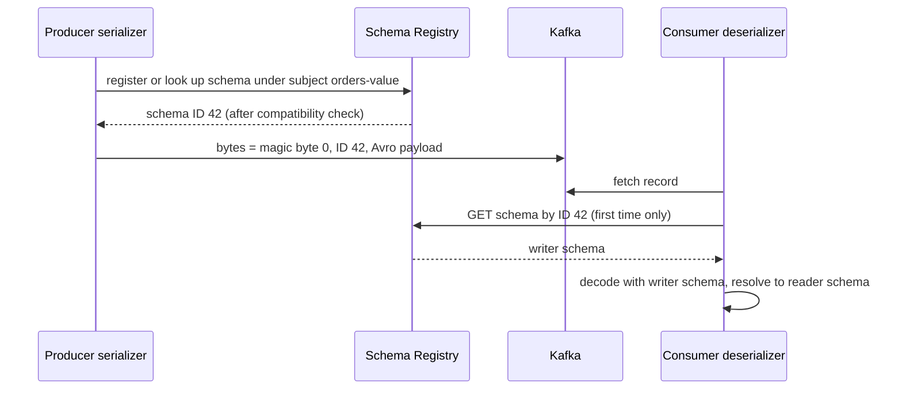

# Schema Registry & Evolution

## The problem it solves

A Kafka topic is just bytes. The producer team decides what those bytes mean, and dozens of consumer teams, some of whom the producer has never met, decode them. If the producer renames `amount` to `amount_cents` on a Friday, every consumer that expected `amount` breaks, and because Kafka retains data, old messages with the old shape sit next to new ones in the same topic.

Producers and consumers need a **data contract**: an agreed schema, a rule for how it may change, and enforcement *before* a bad message reaches the topic. A schema registry is the central service that stores schemas, assigns them IDs and checks every new version against the compatibility rules.

## How it works

**Schema formats.**

| Format | Notes |
|---|---|
| **Avro** | Compact binary, no field names on the wire, reader and writer schemas resolved at read time; defaults make evolution easy. The traditional Kafka choice |
| **Protobuf** | Fields identified by numbers; compact; great codegen; never reuse or change a field number |
| **JSON Schema** | Human-readable payloads, larger and slower; compatibility rules are trickier (open vs closed content models) |

**Registering and resolving.**



- **Wire format.** Confluent serializers prefix each serialized key or value with a small header inside the payload bytes: one **magic byte** (`0`), then the **4-byte schema ID** (big-endian), then the encoded data. Protobuf adds a short list of message indexes identifying which message type in the file was used. Note this lives in the key/value bytes, not in Kafka record headers. (Newer client versions can also carry the ID in record headers; check your version.)
- **Subjects and versions.** Schemas are registered under a **subject**, and each subject has an ordered list of versions (1, 2, 3...). The schema ID is globally unique and immutable; the same schema text registered under two subjects gets the same ID.
- **Caching.** Clients cache subject-to-ID and ID-to-schema lookups. Since IDs are immutable, a consumer calls the registry once per new ID, not once per message. The registry is out of the hot path in steady state, but producers registering a *new* schema need it up.
- **Storage.** Confluent Schema Registry stores its data in a compacted Kafka topic (`_schemas` by default), with one primary node handling writes and any node serving reads.

**Subject naming strategies** decide which subject a schema is checked against:

| Strategy | Subject | Use when |
|---|---|---|
| `TopicNameStrategy` (default) | `<topic>-key`, `<topic>-value` | One event type per topic |
| `RecordNameStrategy` | Fully qualified record name | Same type used in many topics, multiple types per topic |
| `TopicRecordNameStrategy` | `<topic>-<record name>` | Multiple types per topic, evolved separately per topic |

**Compatibility modes** (set globally or per subject; default `BACKWARD`):

| Mode | Guarantee | Safe changes (Avro) | Upgrade first |
|---|---|---|---|
| `BACKWARD` | New schema can read data written with the previous version | Delete fields, add fields **with defaults** | Consumers |
| `FORWARD` | Previous schema can read data written with the new version | Add fields, delete fields **that had defaults** | Producers |
| `FULL` | Both | Add or delete only fields with defaults | Either order |
| `NONE` | No check | Anything | Coordinate manually |

The `_TRANSITIVE` variants (`BACKWARD_TRANSITIVE`, `FORWARD_TRANSITIVE`, `FULL_TRANSITIVE`) check against **all** previous versions, not just the latest. That matters for Kafka because a consumer replaying from the start of a topic may meet version 1 data with a version 5 reader. Non-transitive checks can allow v1 to v2 and v2 to v3 while v1 to v3 is incompatible.

## Worked example

Version 1 of `orders-value` (Avro):

```
record Order { string order_id; long amount_cents; string currency; }
```

Proposed changes and whether the registry accepts them:

| Change | BACKWARD | FORWARD | FULL | Why |
|---|---|---|---|---|
| Add `string channel` with default `"web"` | Yes | Yes | Yes | New readers fill the default for old data; old readers ignore the new field |
| Add `string channel` with no default | No | Yes | No | New readers can't fill it when reading v1 data |
| Delete `currency` (it has no default) | Yes | No | No | New readers ignore it; old readers expect it and find nothing |
| Rename `amount_cents` to `amount` | No | No | No | Equivalent to delete plus add without default (Avro aliases can help readers) |
| Change `amount_cents` from `int` to `long` | Yes | No | No | Avro promotes int to long for the reader, not the reverse |

Under the default `BACKWARD` mode, the rollout for "add `channel` with default" is: deploy consumers with v2 first (they can read v1 and v2), then deploy producers. Under `FORWARD`, deploy producers first, since old consumers can already read the new data. Under `FULL`, order doesn't matter, which is why many teams pick `FULL_TRANSITIVE` for shared topics and accept the narrower set of allowed changes.

**Handling a breaking change** (say, changing the key from `user_id` to `account_id`):

1. Create a new topic, `orders.v2`, with its own subject.
2. Dual-publish: either the producer writes both, or a stream processor (Kafka Streams, Flink) translates v1 to v2.
3. Migrate consumers one by one to `orders.v2`.
4. Stop v1 once its consumer lag is zero and no consumer groups remain; let retention expire it.

Never flip a subject to `NONE` to force a breaking change into an existing topic.

## Trade-offs

- **Pros:** contract enforced at produce time, compact payloads (no field names per message in Avro/Protobuf), self-describing data for replay, codegen, and documented ownership.
- **Cons:** another critical service (producers registering new schemas fail if it's down), coordination on upgrades, and a learning curve for evolution rules.
- **Avro vs Protobuf:** Avro's reader/writer resolution and defaults suit evolving data pipelines; Protobuf fits teams already using gRPC. JSON Schema is easiest to debug but biggest on the wire.
- **Strict vs loose modes:** transitive full compatibility is safest but blocks some changes; `NONE` invites outages.

## When to use it (and when not)

- **Use it** for any topic consumed by more than one team, any long-retention or compacted topic, CDC streams, and anything feeding a data lake where old data will be reread.
- **Skip or relax it** for a private topic between two services owned by one team deployed together, or for short-lived prototypes. Even then, a schema in the repo helps.

## In an interview

Say: "Every topic has an Avro or Protobuf schema in the registry under the topic-value subject, with `FULL_TRANSITIVE` compatibility for shared topics. Producers have auto-registration disabled in production; schemas are registered by CI, which runs the compatibility check on pull requests. Serializers embed the 4-byte schema ID, and clients cache schemas, so the registry is off the hot path. Breaking changes go to a new topic with a migration period." That shows contracts, enforcement point, performance and a migration story.

## Common follow-up questions

### What happens if the Schema Registry is down?
Producers and consumers with cached schemas keep working. A producer with a new schema can't register it, and a consumer meeting an unseen ID can't decode. Run several registry nodes and monitor it like any tier-1 dependency.

### Why not just use JSON without a registry?
JSON has no enforced contract, so mistakes surface in consumers, often days later. Field names repeat in every message, so payloads are larger. Replaying old data requires guessing which shape it had.

### BACKWARD vs FORWARD: which should I pick?
`BACKWARD` (the default) fits when consumers are upgraded before producers, for example a topic replayed by many consumers. `FORWARD` fits when one producer moves faster than many consumers. `FULL` avoids ordering constraints. Use the transitive variant if consumers replay old data.

### How does the consumer know which schema to use?
It reads the schema ID from the first bytes of the payload, fetches the writer schema from the registry (cached after the first time) and, for Avro, resolves it to the reader schema compiled into the application.

### How do data contracts go beyond schemas?
They add ownership metadata, field-level tags (e.g. PII), and validation rules such as "amount_cents >= 0," checked in the client serializer; failed records can be rejected or routed to a DLQ. Confluent supports rule sets for this; the general idea is enforcing semantics, not just shape.

### Can two event types share one topic?
Yes, with `RecordNameStrategy` or `TopicRecordNameStrategy`, or with an Avro union or Protobuf `oneof` under the default strategy. Do it when the events must stay ordered relative to each other, such as all events for one account.
