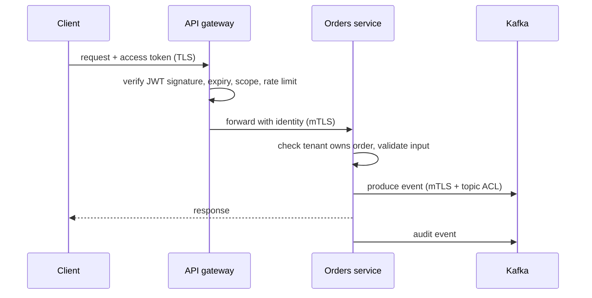

# Security by Design

## The problem it solves

Real systems get breached through the boring gaps: an internal service that trusts any caller, a leaked API key that never expires, a tenant who can read another tenant's data by changing an ID in the URL, a log file full of credit card numbers.

Security by design means building the controls into the architecture from the start: every request is **authenticated** (who are you?), **authorized** (are you allowed to do this to this resource?), **encrypted** in transit and at rest, **audited**, and limited to the **least privilege** it needs.

## How it works

**Authentication (authN).**

- **Sessions:** after login the server stores a session record and gives the browser an opaque random cookie (`HttpOnly`, `Secure`, `SameSite`). Easy to revoke (delete the record), but every request needs a session-store lookup.
- **OAuth 2.0 / OpenID Connect:** OAuth 2.0 is a framework for *delegated authorization*: a client gets an access token to call an API on a user's behalf. OIDC adds an identity layer on top (an ID token saying who the user is), which is what "Sign in with Google" uses. Use authorization code flow with PKCE for browser and mobile apps; use client credentials for machine-to-machine.
- **JWTs:** signed, self-contained tokens (`header.payload.signature`) carrying claims like `sub`, `tenant`, `scope`, `exp`. **Pros:** any service can verify the signature locally with the issuer's public key, with no lookup. **Cons:** you can't easily revoke one before it expires, the payload is readable (signed, not encrypted), and they grow large with many claims. The common answer: short-lived access tokens (5–15 minutes) plus refresh tokens that *can* be revoked.
- **mTLS for service-to-service:** both sides present certificates, so the server knows exactly which service is calling. A service mesh can issue short-lived certificates per workload and rotate them automatically. Kafka supports TLS client authentication as well as SASL mechanisms (SCRAM, Kerberos/GSSAPI, OAUTHBEARER) for clients and brokers.

**Authorization (authZ).**

- **RBAC:** permissions attach to roles (`admin`, `viewer`) and users get roles. Simple and auditable; can explode into hundreds of roles.
- **ABAC:** decisions use attributes of the user, resource and context (`user.tenant == resource.tenant and user.region == "EU"`). Flexible, harder to reason about.
- **ACLs:** a list per resource of who can do what. Kafka uses ACLs on topics, consumer groups and clusters (`User:billing-svc` may `Read` topic `payments`).
- **Where to enforce:** the **API gateway** is good for coarse checks (valid token, rate limits, "has scope `orders:write`"). The **owning service** must still enforce fine-grained checks ("does this order belong to this user's tenant?"), because only it knows the resource, and internal callers can bypass the gateway. Defense in depth means both.

**Multi-tenant isolation.** Every row, object and event carries a `tenant_id`, and every query filters on it. Enforce it in a shared data-access layer or with database row-level security, not in each handler by hand. Stronger isolation tiers: schema per tenant, database per tenant, or dedicated clusters for large or regulated customers. In Kafka, prefix topics per tenant and use prefixed ACLs, plus quotas so one tenant can't starve the brokers.

**Encryption in transit and at rest.** TLS (1.2 or later, ideally 1.3) on every hop, including internal ones; "the internal network is trusted" is how lateral movement works. At rest, encrypt disks, databases, backups and object storage.

**Envelope encryption and KMS.** You can't send terabytes through a KMS, so:

1. Generate a random **data encryption key (DEK)** per object, file or tenant.
2. Encrypt the data locally with the DEK (e.g. AES-256-GCM).
3. Ask the KMS to encrypt the DEK with a **key encryption key (KEK)** that never leaves the KMS.
4. Store the encrypted DEK next to the ciphertext; throw away the plaintext DEK.

To read, send the small encrypted DEK to KMS, get it decrypted, and decrypt locally. Rotating the KEK only requires re-wrapping DEKs, not re-encrypting data. Per-tenant keys allow **crypto-shredding**: delete a tenant's key and their data becomes unreadable.

**Secrets management and rotation.** No secrets in code, images or plain environment files in git. Store them in a secrets manager, fetch at startup or mount them, and prefer short-lived, automatically issued credentials (dynamic database users, workload identity) over long-lived keys. Rotation should be routine and automated, with overlapping validity so two keys work during the switch.

**Audit logs.** Record who did what to which resource, when, from where, and the outcome. Keep them append-only and tamper-evident, in a separate account, for the required retention.

**PII minimization.** Don't collect what you don't need; tokenize or hash identifiers; keep PII out of logs, metrics labels and event payloads where possible (send `user_id`, not email). Know where PII lives so you can serve deletion requests; for immutable logs, crypto-shredding or short retention helps.

**Input validation.** Validate type, size and format at every trust boundary; use parameterized queries (SQL injection), output encoding (XSS), allow-lists for URLs fetched server-side (SSRF), and size limits on uploads and messages.

**Rate limiting and abuse.** Per-user, per-IP and per-tenant limits (see **rate limiting**), CAPTCHAs on sign-up and login, and backoff lockouts against password guessing.

**Least privilege.** Each service gets only the permissions it needs: its own database user, read-only where possible, topic ACLs for exactly the topics it produces and consumes, and narrowly scoped cloud IAM roles. Humans get just-in-time admin access, not standing admin.

## Worked example

A multi-tenant event-ingestion API, where customers send events that land in Kafka.

| Concern | Design |
|---|---|
| Customer authN | API keys per tenant, stored hashed; or OAuth client credentials issuing 10-minute JWTs |
| Gateway | Verifies token, maps it to `tenant_id`, enforces 1,000 events/s per tenant with a token bucket |
| Service authN | mTLS between gateway, ingestion service and brokers |
| AuthZ | Ingestion service may only `Write` to `events.<tenant>.*`; each tenant's consumers may only `Read` their prefix |
| Data at rest | Broker disks encrypted; payload fields with PII encrypted with a per-tenant DEK wrapped by KMS |
| Secrets | Broker credentials in a secrets manager, rotated every 30 days with overlap |
| Audit | Admin actions (ACL changes, key creation) emitted to an append-only audit topic |

If one tenant's API key leaks: the attacker can only write to that tenant's topics, at most 1,000 events/s; revoke the key, and the audit log shows exactly what it did.

## Trade-offs

- **JWTs vs sessions:** stateless verification and scale vs easy revocation. Short expiry narrows but doesn't close the gap.
- **mTLS everywhere:** strong identity but certificate management overhead; a mesh automates it at the cost of another moving part.
- **Encryption:** CPU cost is small with modern hardware, but key management complexity and KMS latency/availability are real; cache decrypted DEKs briefly.
- **Stronger tenant isolation** (dedicated databases or clusters) is safer but costs more and is harder to operate than shared infrastructure with row-level filtering.

## When to use it (and when not)

- **Always:** TLS, authN on every endpoint, authZ in the owning service, secrets out of code, least privilege, audit logs for admin actions.
- **Scale it with risk:** envelope encryption with per-tenant keys, dedicated tenant infrastructure, and field-level encryption are for sensitive or regulated data.

## In an interview

Say this checklist out loud in a minute:

1. "Users authenticate via OIDC; services get short-lived JWTs, and service-to-service traffic uses mTLS."
2. "The gateway does coarse checks and rate limiting; each service enforces resource-level authorization, including tenant ownership."
3. "Every record and event carries `tenant_id`, enforced in the data layer."
4. "TLS everywhere; data encrypted at rest with envelope encryption via KMS."
5. "Secrets live in a secrets manager and rotate automatically."
6. "Least-privilege IAM and Kafka ACLs per service."
7. "PII is minimized and kept out of logs; admin actions go to an append-only audit log."
8. "Inputs validated at every boundary; abuse limited with rate limits and quotas."

## Common follow-up questions

### How do you revoke a JWT before it expires?
Keep access tokens short-lived (minutes) and revoke the refresh token, so no new access tokens are issued. For immediate revocation, maintain a small deny-list of token IDs (`jti`) checked by the gateway, or switch to opaque tokens checked against the issuer.

### Why enforce authorization in the service if the gateway already checks?
The gateway doesn't know whether order 123 belongs to tenant A, and internal callers, batch jobs or a compromised service may reach the service without passing the gateway. Authorization must live where the resource lives.

### What is envelope encryption and why use it?
Data is encrypted locally with a per-object data key, and only that small data key is encrypted by a master key held in KMS. It keeps bulk data out of the KMS, makes master-key rotation cheap, and enables per-tenant keys and crypto-shredding.

### How do you stop one tenant from reading another's data?
Tag every record with `tenant_id`, derive the tenant from the authenticated identity (never from a request parameter), filter on it in a shared data-access layer or row-level security, and test for cross-tenant access explicitly. For high-risk tenants, isolate physically.

### How would you secure a Kafka cluster?
TLS for all client and inter-broker traffic, client authentication via mTLS or SASL, ACLs granting each service principal only its topics and consumer groups, quotas per client, encrypted disks, and audit of ACL and config changes. Sensitive payload fields can be encrypted by producers so brokers never see plaintext.
