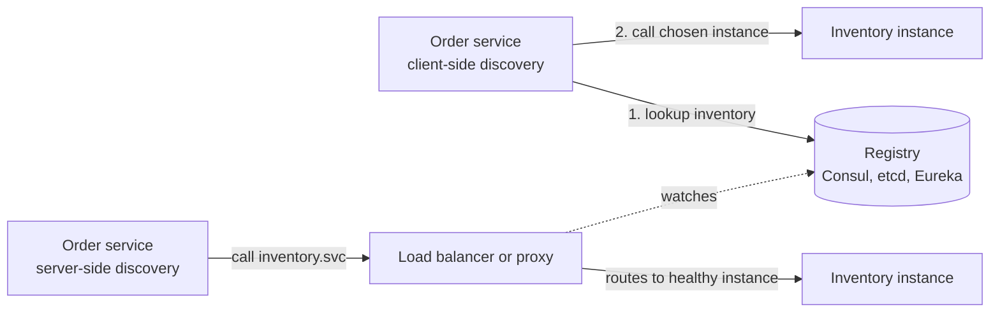

# Service Discovery

## The problem it solves

Your Order service needs to call the Inventory service. In a static world you'd put `10.0.3.17:8080` in a config file. But Inventory runs 6 to 40 instances depending on load, autoscaling adds and removes them every few minutes, deploys replace every instance, and a crashed instance gets a new IP when it restarts. A hardcoded list is wrong within an hour, and calls to dead IPs fail until someone edits config.

Service discovery is the mechanism that lets a service find the current, healthy network locations of another service by name, automatically.

## How it works

There are three parts: **registration** (instances announce themselves), a **registry** (the source of truth), and **lookup** (callers find instances).

**Registration.**

- **Self-registration:** the instance registers with the registry on startup and sends heartbeats; if heartbeats stop, the registry removes it after a TTL.
- **Third-party registration:** the platform registers instances for you. Kubernetes does this: when a pod passes its readiness probe, it is added to the Service's endpoints automatically.

**Lookup patterns.**



- **Client-side discovery:** the caller queries the registry (and caches the result), then load-balances across instances itself. One fewer hop and smarter balancing, but every language needs a client library. Netflix Eureka with Ribbon is the classic example; gRPC clients do this with name resolvers.
- **Server-side discovery:** the caller hits a stable address (a load balancer or a virtual IP), which looks up the registry and forwards. Callers stay simple. Kubernetes Services work this way: `inventory.default.svc.cluster.local` resolves to a stable cluster IP, and kube-proxy routes to a healthy pod.
- **DNS-based:** the registry serves DNS, returning instance IPs as A records or host and port as SRV records (Consul supports this). Works with any client, but DNS caching delays updates, so TTLs must be short.
- **Sidecar / service mesh:** a proxy (Envoy) runs next to every instance. The app calls `localhost`, and the sidecar gets the endpoint list from the mesh control plane (Istio, Linkerd) and handles balancing, retries and mTLS. This is client-side discovery without a library in each language.

**The registry itself** must be highly available and consistent enough. Consul, etcd and ZooKeeper use consensus (Raft or ZAB) across 3 or 5 nodes. Eureka chose availability instead, letting each node serve possibly stale data during partitions, on the reasoning that a slightly stale list beats no list.

**Health.** Discovery is only as good as its health information. Combine registry health (heartbeats, readiness probes) with caller-side outlier detection: if an instance keeps timing out, stop sending to it even if the registry still lists it.

```yaml
# Kubernetes: callers just use http://inventory:8080
apiVersion: v1
kind: Service
metadata: { name: inventory }
spec:
  selector: { app: inventory }
  ports: [{ port: 8080, targetPort: 8080 }]
```

## Worked example

Inventory scales from 3 to 5 instances, then one crashes. Heartbeats every 5 s, instance removed after 15 s without one, clients refresh their cache every 10 s.

| Time | Event | Registry list | Order service's cached list |
|---|---|---|---|
| 0 s | steady state | A, B, C | A, B, C |
| 20 s | D and E start and register | A–E | A, B, C (stale) |
| 30 s | client refresh | A–E | A–E |
| 60 s | C crashes | A–E | A–E |
| 75 s | no heartbeat for 15 s, C removed | A, B, D, E | A–E (calls to C fail, retried elsewhere) |
| 80 s | client refresh | A, B, D, E | A, B, D, E |

Worst-case window of calls to the dead instance: 15 s detection + 10 s refresh = 25 s, which is why callers also need retries and outlier ejection.

## Trade-offs

- **Pros:** instances can come and go freely; enables autoscaling, rolling deploys and failover without config changes; a natural place for health information.
- **Cons:** the registry is critical infrastructure; stale entries cause errors during the propagation window; client-side approaches need libraries per language; meshes add latency and operational complexity.
- **Alternatives:** static config for a few long-lived hosts; a plain load balancer per service with a fixed DNS name (server-side discovery without a registry you manage).

## When to use it (and when not)

- **Use it** in any microservice or container-based design, especially with autoscaling; for stateful systems that need membership (a chat system finding which gateway server holds a user's WebSocket, or cache clients learning the node list for consistent hashing).
- **Skip a dedicated registry** if your platform already provides one (Kubernetes Services, cloud load balancers), or if you have a handful of fixed hosts.

## In an interview

Say: "Services find each other through Kubernetes DNS names, which resolve to healthy pods based on readiness probes, so autoscaling and deploys need no config changes." Then be ready to compare client-side and server-side discovery, describe what happens in the window after an instance dies, and explain how the registry stays available.

## Common follow-up questions

### Client-side or server-side discovery?
Server-side keeps clients simple and language-agnostic, at the cost of an extra hop. Client-side removes the hop and allows smarter balancing but needs a library everywhere. A service mesh sidecar gives client-side behavior without the per-language library.

### What happens if the registry goes down?
Callers keep using their cached endpoint lists, so existing traffic continues, but new instances can't be discovered and dead ones aren't removed. That's why registries run as replicated clusters and clients cache aggressively.

### Why not just use DNS?
You can, and many systems do. The limits are caching (clients and resolvers may hold old answers past the TTL), no health information beyond what the DNS server knows, and only basic balancing. Short TTLs and caller-side retries make it workable.

### How does this relate to load balancing?
Discovery answers "which instances exist and are healthy," and load balancing answers "which one gets this request." Server-side discovery puts both in the proxy; client-side puts both in the caller.
