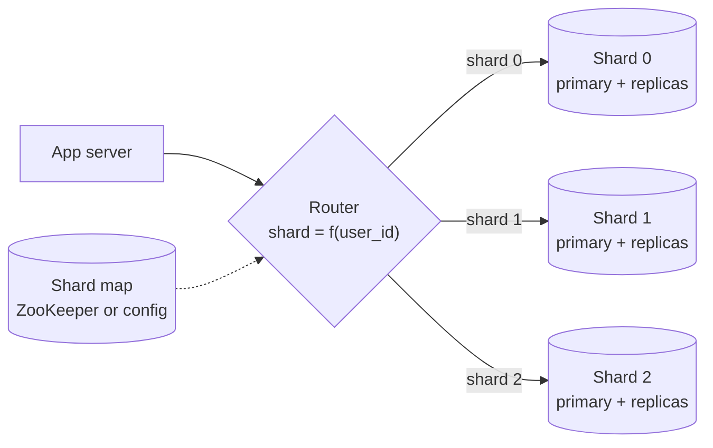

# Sharding / Partitioning

## The problem it solves

One Postgres primary on a large machine can handle a lot, but not everything. Suppose you store 20 TB of messages and take 200k writes per second at peak. A single node runs out of disk, its write throughput (which replicas don't help with) saturates, and index rebuilds and backups take days. Adding read replicas helps reads, but every replica still holds all 20 TB and every write still goes through one primary.

Sharding splits the data across many independent nodes by a key, so each node holds and writes only its fraction: 20 shards means ~1 TB and ~10k writes per second each.

## How it works

1. **Pick a shard key**, a field present on every row and in most queries (e.g. `user_id`, `tenant_id`, `chat_id`).
2. **Map the key to a shard** with one of three strategies.
3. **Route each request**: the application, a proxy (Vitess, a Citus coordinator, mongos) or a smart client computes the shard and sends the query there.

**Range sharding.** Each shard owns a contiguous key range (`A–F`, `G–M`, or timestamps by month). Range scans are efficient ("all orders from March"), and splitting a hot range is natural. The risk: sequential keys like timestamps or auto-increment IDs send *all* new writes to the last range. Used by HBase, Bigtable, Spanner and CockroachDB, which split ranges automatically as they grow.

**Hash sharding.** `shard = hash(key) mod N`, or better, consistent hashing or a fixed number of hash slots. Spreads keys evenly and kills sequential hotspots, but range queries must hit every shard. Cassandra, DynamoDB and Redis Cluster hash keys.

**Directory (lookup) sharding.** A lookup table maps each key, or each tenant, to a shard. Maximum flexibility (move one big tenant to its own shard), at the cost of an extra lookup, which you cache, and a directory service that must be highly available.

**Choosing a shard key.** Good keys have high cardinality, spread load evenly, and keep data that is queried together on one shard. For a chat app, `chat_id` keeps a conversation's messages together, so "load the last 50 messages" hits one shard. Bad keys: `country` (low cardinality, US dominates), `created_at` (all writes hit one range), or anything most queries don't include, which turns every read into a scatter-gather across all shards.

**Hot partitions.** Even with a good key, one celebrity user or one huge tenant can overload a shard. Fixes: add a suffix to spread a hot key (`user123#0..9`) and merge on read, give large tenants dedicated shards via a directory, or cache hot reads in front.

**Resharding.** With `hash mod N`, changing N moves nearly all data. Instead, create many more logical partitions than machines (e.g. 1,024 logical shards on 16 nodes) and move whole logical shards between nodes as you grow. Moving a shard means copying a snapshot, streaming changes to catch up, then flipping the routing entry during a brief write pause.

**Cross-shard operations.** Joins, unique constraints and transactions across shards are expensive or unsupported. Design the key so common operations stay on one shard, and use sagas or two-phase commit for the rare cross-shard writes.

## Worked example

An orders table, 12 million orders, 4 shards. Order IDs are auto-incrementing and new orders arrive at 4,000 per second.

| Strategy | Data distribution | Where new writes go | "Orders for user 42" |
|---|---|---|---|
| Range on `order_id` (3M IDs per shard) | 3M per shard | All 4,000/s hit shard 3 (highest range) | All 4 shards (user's orders scattered) |
| Hash on `order_id` | ~3M per shard | ~1,000/s per shard | All 4 shards |
| Hash on `user_id` | ~3M per shard, if no huge users | ~1,000/s per shard | 1 shard |

Hashing on `user_id` balances writes and makes the most common query a single-shard read. The price: "orders placed in the last hour" now queries all four shards.

## Trade-offs

- **Pros:** horizontal scaling of storage and write throughput; smaller indexes and faster backups per node; failure of one shard affects only its slice of users.
- **Cons:** cross-shard queries, joins and transactions are slow or unavailable; resharding is operationally heavy; uneven keys create hotspots; more machines and more operational complexity.
- **Alternatives:** scale vertically first (a large modern server goes a long way); read replicas for read-heavy load; caching; archiving cold data; or a distributed database (Spanner, CockroachDB, DynamoDB, Cassandra) that shards for you.

## When to use it (and when not)

- **Use it** when data or write throughput exceeds one node. Interview questions: design Twitter or Instagram (posts by user ID), WhatsApp or Messenger (messages by chat ID), URL shortener at scale (by short code), Uber (by city or geohash), a multi-tenant SaaS (by tenant ID).
- **Avoid it** while one node with replicas still fits with headroom. Sharding too early adds complexity for no gain, so give a back-of-envelope reason when you introduce it.

## In an interview

Say: "At 20 TB and 200k writes per second we outgrow one primary, so I'll hash-shard messages by `chat_id` across 1,024 logical shards mapped onto physical nodes, which keeps each conversation on one shard." Be ready to justify the shard key, describe what happens with a hot key, and explain how you'd add nodes without downtime.

## Common follow-up questions

### How do you query by something other than the shard key?
Either scatter-gather across all shards and merge, which is fine for rare queries, or maintain a secondary index sharded by the other field, such as a `username → user_id` table. Global secondary indexes are usually updated asynchronously, so they can be briefly stale.

### How do you add shards without downtime?
Use many logical shards from the start and move them between physical nodes. For each move: copy a snapshot, replicate ongoing changes until the copy catches up, pause writes for that shard briefly, flip the routing map, then resume.

### How do you generate unique IDs across shards?
Don't use per-shard auto-increment. Use UUIDs or a Snowflake-style ID (timestamp + machine ID + sequence), which are unique without coordination and roughly time-sortable.

### What's the difference between sharding and partitioning?
They're often used interchangeably. "Partitioning" can also mean splitting a table inside one database (Postgres declarative partitioning by month), which helps pruning and maintenance but not capacity; "sharding" usually means partitions on different machines.
