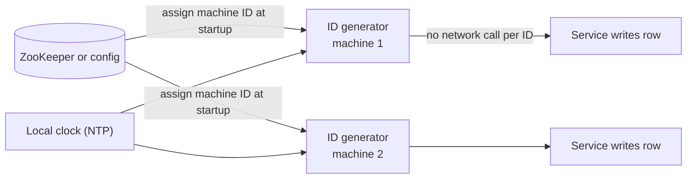

# Snowflake IDs

## The problem it solves

A social network creates ~20,000 posts per second across thousands of servers, and every post needs an ID that is unique, fits in a 64-bit integer column, and sorts by creation time so timelines can paginate with `WHERE id < cursor`. A database auto-increment means every insert goes through one sequence: a bottleneck and a single point of failure, and it doesn't work across shards. A random UUIDv4 needs no coordination, but it's 128 bits and random, so it doesn't sort by time and scatters inserts across a B-tree index, which hurts write locality.

Snowflake IDs, introduced by Twitter, give unique, roughly time-ordered 64-bit IDs that each server can generate on its own.

## How it works

A Snowflake ID packs three fields into a 64-bit integer:

| Bits | Field | Meaning |
|---|---|---|
| 1 | sign | Always 0, so IDs are positive |
| 41 | timestamp | Milliseconds since a custom epoch → 2⁴¹ ms ≈ **69 years** |
| 10 | machine ID | Up to **1,024** generators (often 5 bits datacenter + 5 bits worker) |
| 12 | sequence | Counter within the same millisecond → **4,096 IDs per ms per machine** |

```
id = (now_ms - EPOCH) << 22 | machine_id << 12 | sequence
```

The generator on each machine runs this loop:

```
def next_id():
    now = current_ms()
    if now < last_ms:                       # clock moved backwards
        wait_until(last_ms)                 # or raise an error
        now = last_ms
    if now == last_ms:
        seq = (seq + 1) & 0xFFF             # 12-bit wrap
        if seq == 0:                        # 4,096 used this ms
            now = wait_until(last_ms + 1)
    else:
        seq = 0
    last_ms = now
    return (now - EPOCH) << 22 | machine_id << 12 | seq
```



- **Unique:** two machines differ in machine ID; on one machine, two IDs differ in timestamp or sequence.
- **Sortable:** the timestamp sits in the high bits, so ordering by ID is ordering by creation time (to the millisecond, and only roughly across machines whose clocks differ slightly).
- **No coordination per ID:** the only shared state is the machine ID, handed out once at startup.

The generator can be a library inside each service or a small standalone service. Using a custom epoch (Twitter's is in November 2010) instead of 1970 gives the 41-bit timestamp its full 69 years from the system's launch.

## Worked example

Use a toy epoch so the numbers stay readable. Machine 5 generates IDs at `now - EPOCH` = 1,000 ms. `1000 << 22` = 1,000 × 4,194,304 = 4,194,304,000, and `5 << 12` = 20,480.

| Event | ms since epoch | Machine | Sequence | ID |
|---|---|---|---|---|
| 1st ID | 1,000 | 5 | 0 | 4,194,304,000 + 20,480 + 0 = **4,194,324,480** |
| 2nd ID, same ms | 1,000 | 5 | 1 | 4,194,324,481 |
| ID from machine 6, same ms | 1,000 | 6 | 0 | 4,194,304,000 + 24,576 = 4,194,328,576 |
| Next ms on machine 5 | 1,001 | 5 | 0 | 4,198,498,304 + 20,480 = 4,198,518,784 |

Decoding goes the other way: `id >> 22` gives the timestamp, `(id >> 12) & 0x3FF` the machine and `id & 0xFFF` the sequence. All IDs from millisecond 1,001 are larger than any from millisecond 1,000, whichever machine made them. Capacity per machine is 4,096 × 1,000 = ~4.1M IDs per second, far beyond any single service's write rate.

## Trade-offs

- **Pros:** 64-bit, fits a `BIGINT`; time-sortable, so IDs double as pagination cursors and you can often skip a `created_at` index; no network call per ID; inserts append to the right side of a B-tree.
- **Cons:** depends on clocks (a backwards jump must be handled); machine IDs must be unique and managed; IDs leak creation time and rough volume; ordering across machines is only approximate (ms resolution plus clock skew).
- **Alternatives:** **UUIDv7** (48-bit ms timestamp + random bits, 128 bits, time-ordered, no machine ID needed); **ULID** (similar idea, 26-character string); **database ticket servers** (Flickr used two MySQL servers with odd/even auto-increments); **block-reserved counters** for short public codes.

## When to use it (and when not)

- **Use it** for high-volume entities that need time ordering: tweets and posts (Twitter, news feed), chat messages (Discord uses Snowflake IDs; WhatsApp-style message ordering per conversation), orders, events.
- **Don't use it** when IDs must be short and human-facing (a URL shortener wants 7 characters, a Snowflake ID is ~11 base62 characters), when strict gap-free sequencing matters (invoice numbers), or when you'd rather not leak creation time.

## In an interview

Say: "IDs are Snowflake-style: 41 bits of millisecond timestamp, 10 bits of machine ID and a 12-bit sequence, so every server mints unique, time-sortable 64-bit IDs locally, and the feed paginates with `id < cursor`." Be ready to explain the bit budget (69 years, 1,024 machines, 4,096 per ms) and what happens when a clock goes backwards.

## Common follow-up questions

### What happens if the clock goes backwards?
An NTP correction could make the generator reuse a timestamp it already issued IDs for, which could repeat IDs. The generator remembers the last timestamp it used and either waits until the clock passes it or refuses to issue IDs and alerts. Running NTP in slew mode (gradual adjustment) avoids most backward jumps.

### How are machine IDs assigned without collisions?
At startup, each generator claims an ID from a coordination service, for example an ephemeral sequential node in ZooKeeper or a lease in etcd, or gets one from deployment config. Leases make sure a crashed machine's ID isn't reused while the old process might still be running.

### Are Snowflake IDs strictly ordered across machines?
No. Two machines whose clocks differ by 3 ms can produce IDs out of real-time order by up to 3 ms. That's fine for feeds and pagination. If you need a strict total order, for example per chat conversation, use a per-conversation sequence number assigned by the owner of that conversation.

### Why not just use UUIDs?
Random UUIDv4s are 128 bits, unsortable and cause random B-tree inserts that hurt write performance. UUIDv7 fixes the ordering and is a good choice when 128 bits is acceptable. Snowflake wins when you want compact 64-bit integers.
