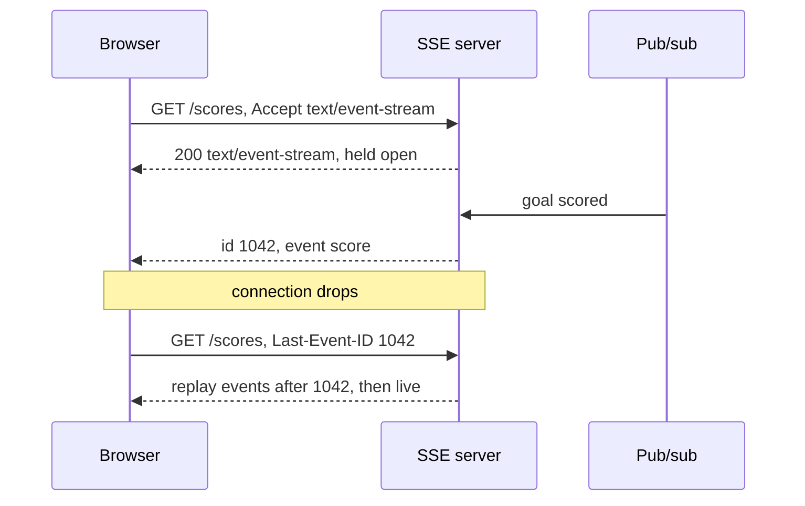

# Server-Sent Events

## The problem it solves

A sports app shows live scores to 2 million viewers during a final. Updates only flow one way, from server to browser, a few times a minute. Polling every 5 seconds costs 400,000 requests per second, most returning "no change", and still shows goals up to 5 seconds late. WebSockets would work, but they bring a custom protocol, upgrade handling, and your own reconnect logic for traffic that never needs to go client-to-server.

**Server-Sent Events (SSE)** is a standard for the server to push a stream of text events over one ordinary, long-lived HTTP response. The browser's built-in `EventSource` API parses events and reconnects automatically.

## How it works

1. The client opens a normal HTTP GET. In the browser: `new EventSource("/scores")`.
2. The server responds with `Content-Type: text/event-stream` and keeps the response open, never sending a final length.
3. The server writes events as plain text blocks separated by a blank line.
4. If the connection drops, the browser reconnects after the `retry` delay and sends a `Last-Event-ID` header with the last `id` it received, so the server can resend anything missed.

The wire format:

```
HTTP/1.1 200 OK
Content-Type: text/event-stream
Cache-Control: no-cache

retry: 3000

id: 1041
event: score
data: {"match":"final","home":1,"away":0}

id: 1042
event: score
data: {"match":"final","home":1,"away":1}

: keep-alive comment, ignored by the client
```

Client side:

```
const es = new EventSource("/scores?match=final");
es.addEventListener("score", e => render(JSON.parse(e.data)));
es.onerror = () => { /* browser retries on its own */ };
```



**Details that matter:**

- **Text only.** Data is UTF-8; send JSON. Binary needs base64 or a different transport.
- **Heartbeats.** Send a comment line (`: ping`) every 15–30 seconds so proxies and load balancers don't close an idle connection.
- **Proxy buffering.** Disable response buffering at the reverse proxy (for example `X-Accel-Buffering: no` for nginx) or events arrive in bursts.
- **Connection limits.** Over HTTP/1.1, browsers allow only about 6 connections per origin, so several SSE tabs can starve other requests. HTTP/2 multiplexes streams over one connection, which removes the problem.
- **Fan-out at scale.** SSE servers are stateful like WebSocket gateways: each server subscribes to a pub/sub topic and writes each message to its local open responses. Client-to-server messages go over normal HTTP POSTs.

## Worked example

2,000,000 viewers, 1 score update every 30 seconds on average, each SSE server holding 50,000 open streams (a planning assumption):

| Approach | Requests or connections | Update delay |
|---|---|---|
| Poll every 5 s | 2,000,000 / 5 = 400,000 req/s | 0–5 s, average 2.5 s |
| SSE | 2,000,000 open streams on 2,000,000 / 50,000 = 40 servers | Typically well under a second (one hop through pub/sub) |
| SSE heartbeats every 20 s | 2,000,000 / 20 = 100,000 tiny writes/s fleet-wide, 2,500 per server | — |

When one SSE server restarts, its 50,000 clients reconnect with `Last-Event-ID`, and the server replays from a short buffer of recent events (for example the last 5 minutes kept in Redis or a log).

## Trade-offs

- **Pros:** plain HTTP, so it works with existing auth, cookies, load balancers and HTTP/2; automatic reconnect and resume built into browsers; simple text protocol that's easy to debug with `curl -N`; simpler server code than WebSockets.
- **Cons:** one direction only; text only; the HTTP/1.1 per-origin connection limit; still a long-lived stateful connection that complicates deploys; `EventSource` can't set custom request headers (use cookies or a query-string token, or a fetch-based client).
- **Alternatives:** **WebSockets** for bidirectional or binary traffic; **long polling** for very old clients; **mobile push** (APNs/FCM) when the app isn't open; plain **polling** when updates are rare and latency doesn't matter.

## When to use it (and when not)

- **Use it** for live feeds and dashboards, notifications, live scores and comment streams ("design a live comments system", "design a news feed with real-time updates"), job progress bars, and streaming LLM responses token by token (several LLM APIs stream over SSE).
- **Not a fit** for chat, games or collaborative editing where the client sends frequent messages (use WebSockets), or for binary media streams.

## In an interview

Say: "Updates only go server to client, so I'll use SSE over HTTP/2: each edge server subscribes to the match's pub/sub topic and writes events to its open streams, and clients resume with Last-Event-ID after a reconnect." Be ready to compare SSE with WebSockets and long polling, and explain how missed events are replayed.

## Common follow-up questions

### SSE or WebSockets?
Choose SSE when the data flows mostly server to client and is text, because it rides on normal HTTP and gets reconnects for free. Choose WebSockets when clients also send frequent messages or you need binary frames. Both hold one long-lived connection per client, so the scaling story is similar.

### How does a client avoid missing events during a reconnect?
Give every event an `id`. On reconnect the browser sends `Last-Event-ID`, and the server replays events after that ID from a recent buffer or durable log. If the gap is too old for the buffer, tell the client to refetch a full snapshot.

### How do you scale fan-out to millions of clients?
Run a tier of SSE servers that each hold tens of thousands of streams and subscribe to the relevant pub/sub topics. A publish reaches each server once, and each server writes to its local subscribers, so the publisher doesn't need to know about individual connections.

### Why do events sometimes arrive in bursts instead of one by one?
A proxy or framework is buffering the response until it fills a buffer. Disable buffering on the proxy and flush after each event in the server code.
