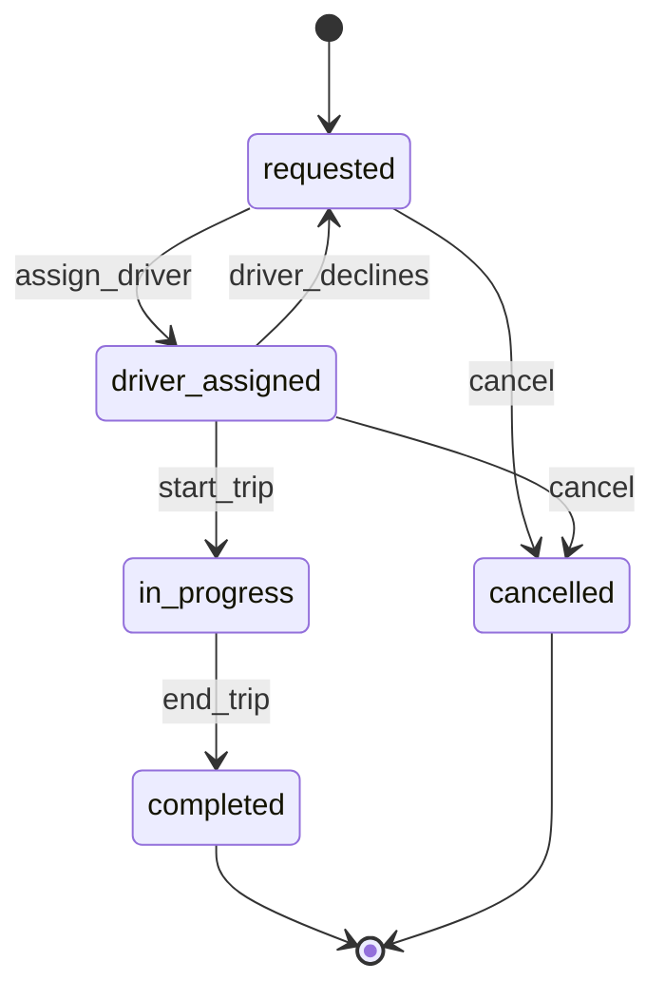

# State Machines

## The problem it solves

A ride-hailing `rides` table has a `status` column, and over two years a dozen services write to it. One day a driver's app retries a "complete ride" request after the rider already cancelled, and the ride flips from `cancelled` back to `completed`, charging the rider for a trip that never happened. Another bug moves an order from `pending` straight to `shipped`, skipping payment. Each service had its own `if` checks, and none of them agreed.

A **state machine** makes the lifecycle explicit: a fixed set of states, a fixed set of allowed transitions between them, and one place in the code that enforces them. Illegal moves like `cancelled → completed` are rejected, no matter who asks.

## How it works

1. **List the states** an entity can be in (`requested`, `driver_assigned`, `in_progress`, `completed`, `cancelled`).
2. **List the events** that move it (`assign_driver`, `start_trip`, `end_trip`, `cancel`).
3. **Define a transition table:** (current state, event) → next state. Anything not in the table is illegal.
4. **Mark terminal states** (`completed`, `cancelled`) that have no outgoing transitions.
5. **Enforce transitions atomically** in the database, so two concurrent events can't both succeed.
6. **Run side effects on transitions** (charge the card on `completed`, notify the driver on `cancelled`), usually by emitting an event.



The transition table and the atomic update:

```
TRANSITIONS = {
  ("requested",       "assign_driver"):   "driver_assigned",
  ("requested",       "cancel"):          "cancelled",
  ("driver_assigned", "start_trip"):      "in_progress",
  ("driver_assigned", "cancel"):          "cancelled",
  ("driver_assigned", "driver_declines"): "requested",
  ("in_progress",     "end_trip"):        "completed",
}

def apply(ride_id, event):
    ride = db.get(ride_id)
    nxt = TRANSITIONS.get((ride.status, event))
    if nxt is None:
        raise IllegalTransition(ride.status, event)
    # compare-and-set: succeeds only if nobody changed it meanwhile
    rows = db.execute("UPDATE rides SET status=%s, version=version+1 "
                      "WHERE id=%s AND status=%s AND version=%s",
                      nxt, ride_id, ride.status, ride.version)
    if rows == 0:
        raise ConcurrentModification   # reload and re-evaluate
    outbox.emit(ride_id, event, nxt)   # same transaction
```

**Important details:**

- **Compare-and-set** on the current state (or a version column) prevents two events racing. Only one `UPDATE ... WHERE status='driver_assigned'` can win.
- **Idempotency:** if the same event is retried and the entity is already in the target state, return success rather than an error, so client retries are harmless.
- **Transactional outbox:** write the state change and the outgoing event in one transaction, so a crash can't leave a ride `completed` without a payment event.
- **Timeouts** are transitions too. A scheduled job fires `timeout` if a ride sits in `requested` for 5 minutes.
- **Audit:** store each transition in a history table, which gives you a mini event log.
- For long multi-step workflows across services, **workflow engines** (Temporal, AWS Step Functions) run durable state machines with retries and timers built in.

## Worked example

Two events hit ride 881 at the same time: the rider taps cancel and the driver taps start trip. The ride is in `driver_assigned` at version 4.

| Time | Request | SQL condition | Result | Row after |
|---|---|---|---|---|
| t0 | — | — | — | driver_assigned, v4 |
| t1 | cancel | `status='driver_assigned' AND version=4` | 1 row updated | cancelled, v5 |
| t2 | start_trip | `status='driver_assigned' AND version=4` | 0 rows updated | cancelled, v5 |
| t3 | start_trip reloads, looks up (cancelled, start_trip) | not in table | rejected: IllegalTransition | cancelled, v5 |
| t4 | cancel retried by flaky network | already cancelled | idempotent success | cancelled, v5 |

Without the condition on the current state, the second update would have moved the ride to `in_progress` after cancellation.

## Trade-offs

- **Pros:** illegal states become impossible rather than just unlikely; one source of truth for lifecycle rules; easy to reason about, test (every row in the table is a test case) and draw for stakeholders; transitions are natural hooks for events and audits.
- **Cons:** the table needs updating as the business evolves, and existing entities may sit in states that a new version removed; complex flows can explode into many states (hierarchical or parallel states help); cross-service lifecycles need sagas or a workflow engine, not a single row.
- **Alternatives:** ad-hoc status checks scattered across services (what you're trying to escape); **event sourcing**, where state is derived from events and the state machine validates each new event; workflow engines for long-running orchestration.

## When to use it (and when not)

- **Use it** whenever an entity has a lifecycle: orders and payments ("design Amazon checkout", "design a payment system"), rides ("design Uber"), food delivery, ticket bookings ("design Ticketmaster": `held → paid` or `held → expired`), job queues (`queued → running → succeeded/failed`), and connection or TCP-style protocols.
- **Overkill** for entities with no meaningful lifecycle, like user profiles or settings, or a simple boolean flag.

## In an interview

Say: "I'll model the order as an explicit state machine with a transition table, and every transition is a compare-and-set on the current state plus an outbox event in the same transaction, so concurrent or retried requests can't put it in an illegal state." Be ready to draw the diagram, explain the race between two transitions, and say how timeouts and side effects are triggered.

## Common follow-up questions

### How do you stop two concurrent requests from both transitioning the entity?
Make the update conditional on the state you read: `UPDATE ... WHERE id=? AND status=?` (or a version number). The database applies only one; the loser sees zero rows updated, reloads, and re-evaluates against the new state.

### How do you handle a state that should expire, like an unpaid seat hold?
Treat expiry as an event. Schedule a delayed job (or store `expires_at` and have a sweeper query for overdue rows) that fires `expire`, which only succeeds if the entity is still in `held`. If payment won the race, the conditional update makes the expiry a no-op.

### Where do side effects like charging a card happen?
After the transition commits, triggered by an event written through a transactional outbox. The consumer must be idempotent (use the order ID as an idempotency key with the payment provider) because events can be delivered more than once.

### What if a workflow spans several services?
No single row can hold the state, so use a saga: each step is a local transaction with a compensating action, coordinated by an orchestrator that is itself a state machine. Workflow engines like Temporal persist that orchestrator state for you.
