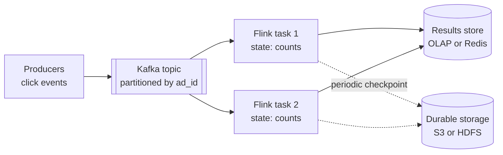

# Stream Processing

## The problem it solves

An ad platform must show advertisers how many clicks each ad got per minute, and a fraud system must block a card after 5 declined attempts in 10 minutes. A nightly batch job over the day's logs answers these questions 12–24 hours too late. Querying the raw events table on every dashboard refresh doesn't scale at hundreds of thousands of events per second.

**Stream processing** computes results continuously as events arrive: it reads an unbounded stream (usually from Kafka or Kinesis), keeps running state such as per-ad counts, and emits updated results within seconds. Frameworks like Apache Flink, Kafka Streams and Spark Structured Streaming handle the hard parts: windows, late data, state, and recovery.

## How it works



**Event time vs processing time.** Event time is when the click happened (a timestamp in the event). Processing time is when the processor sees it. They differ because of network delays, offline phones and backlogs: a click at 12:00:58 may arrive at 12:01:30. Windowing by processing time is simple but puts that click in the wrong minute; windowing by event time is correct but means you must decide how long to wait for stragglers.

**Windows.**

- **Tumbling:** fixed size, no overlap. 1-minute windows [12:00, 12:01), [12:01, 12:02). Each event belongs to exactly one.
- **Sliding (hopping):** fixed size, overlapping, advancing by a slide interval. 10-minute windows every 1 minute; each event belongs to size / slide = 10 windows. Good for "last 10 minutes" metrics.
- **Session:** per key, a window that stays open while events keep arriving and closes after a gap of inactivity (e.g. 30 minutes). Sizes vary. Good for user sessions.

**Watermarks.** A watermark is the processor's assertion "I don't expect any more events with event time earlier than T". A common strategy is `watermark = max event time seen − allowed lateness` (for example 10 seconds). When the watermark passes a window's end, the window fires and emits its result. Events that arrive after that are **late**: drop them, send them to a side output, or allow updates to an already-emitted result for an extra lateness period.

**State.** Aggregations need state (counts per ad per window). It's kept locally per task, partitioned by key so each key lives on one task (often in RocksDB for large state), not in a remote database per event.

**Exactly-once via checkpoints.** Flink periodically injects checkpoint barriers into the stream. When a task has seen the barrier on all inputs, it snapshots its state to durable storage, together with the Kafka offsets it had read up to. On failure, every task restores the last completed checkpoint and the sources rewind to those offsets, so each event affects state exactly once. Making output exactly-once too needs a transactional sink (two-phase commit, e.g. Kafka transactions) or idempotent writes (upserts keyed by window and ad).

```
clicks
  .assignTimestampsAndWatermarks(maxOutOfOrderness = 10s)
  .keyBy(e -> e.adId)
  .window(TumblingEventTimeWindows.of(1 minute))
  .aggregate(count)
  .sinkTo(upsert(table="ad_clicks_per_minute", key=(adId, windowStart)))
```

## Worked example

Tumbling 1-minute event-time windows for ad 42, watermark = max event time − 10 s.

| Arrives (processing time) | Event time | Max event time seen | Watermark | What happens |
|---|---|---|---|---|
| 12:00:20 | 12:00:15 | 12:00:15 | 12:00:05 | Window [12:00,12:01) count = 1 |
| 12:00:59 | 12:00:55 | 12:00:55 | 12:00:45 | count = 2 |
| 12:01:05 | 12:00:58 (delayed) | 12:00:58 | 12:00:48 | count = 3, still on time |
| 12:01:08 | 12:01:04 | 12:01:04 | 12:00:54 | Window [12:01,12:02) count = 1 |
| 12:01:15 | 12:01:12 | 12:01:12 | 12:01:02 | Watermark passed 12:01, so [12:00,12:01) fires with **3** |
| 12:01:20 | 12:00:50 | 12:01:12 | 12:01:02 | Late: window already fired; side output or update |

A processing-time window would have counted only 2 clicks in the 12:00 minute, putting the 12:00:58 click into 12:01.

Sliding window check: window size 10 minutes sliding every 1 minute means each event updates 10 windows. Session check: user events at 09:00, 09:10, 09:25, then 10:30 with a 30-minute gap give two sessions, 09:00–09:25 and one starting at 10:30.

## Trade-offs

- **Pros:** results in seconds rather than hours; handles out-of-order data correctly with event time and watermarks; scales horizontally by key; exactly-once state with checkpoints.
- **Cons:** harder to build, test and operate than batch; the watermark delay is a direct trade-off between latency and completeness; large state needs careful tuning; reprocessing history after a bug means replaying the log, which needs long retention.
- **Alternatives:** **batch processing** when hours of delay are fine; **micro-batching** (Spark Structured Streaming's default mode) as a middle ground; **real-time OLAP databases** (Druid, Pinot, ClickHouse) that ingest raw events and aggregate at query time; the **lambda architecture** (stream for fresh approximate results, batch to correct them) or **kappa** (stream only, replay for corrections).

## When to use it (and when not)

- **Use it** for "design an ad click aggregator", real-time leaderboards ("top K trending"), fraud and anomaly detection, live metrics dashboards, surge pricing from recent supply and demand in "design Uber", and building materialized views from CDC streams.
- **Not needed** when daily or hourly reports are fine (batch is cheaper and simpler), or when the event rate is low enough that a database query on demand works.

## In an interview

Say: "Clicks go to Kafka keyed by ad ID; Flink aggregates into 1-minute tumbling event-time windows with a 10-second watermark and checkpoints state with offsets for exactly-once, writing results as idempotent upserts keyed by ad and window." Be ready to explain event time vs processing time, what watermarks do, how late events are handled, and how recovery works.

## Common follow-up questions

### What happens to events that arrive after the watermark?
They're late for a window that already fired. You can drop them, route them to a side output for a correcting batch job, or configure allowed lateness so the window re-fires with an updated result, which the sink must handle as an upsert.

### How does Flink achieve exactly-once?
It takes consistent distributed snapshots: barriers flow through the stream, and each operator saves its state when the barrier passes, along with the source offsets. On failure it restores the snapshot and replays from those offsets. End-to-end exactly-once also needs a transactional or idempotent sink.

### How do you choose the watermark delay?
Measure how late events actually arrive and pick a delay that covers most of them, such as the 99th percentile of lateness. A longer delay gives more complete results but later output; route the rest to a late-data path.

### How do you handle a hot key like one viral ad?
Pre-aggregate before the keyed step: add a random salt to the key, count per salted key, then sum across salts in a second stage. This spreads one key's load across several tasks.
