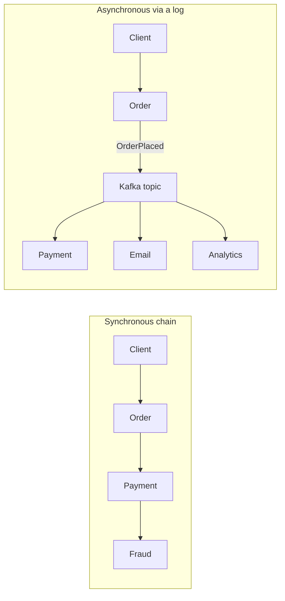

# Sync vs Async Communication

## The problem it solves

Services have to talk to each other. The simplest way is to call and wait for an answer. That works until the call chain gets long: every service in the chain must be up, fast and not overloaded *at the same moment*, or the user gets an error. Asynchronous communication breaks that coupling by putting a durable buffer (a queue or log) between sender and receiver, at the price of eventual consistency and harder debugging.

Choosing between them, per interaction, is one of the most common decisions in a system design interview, and at a streaming company it is the central one.

## How it works

**Four styles:**

| Style | Shape | Example tech | Sender waits for |
|---|---|---|---|
| Request-response | One caller, one callee, reply needed now | REST, gRPC | The result |
| Queue (point-to-point) | Work items, each processed by one worker | SQS, RabbitMQ (see **Message Queue**) | Only the broker's ack |
| Event stream | Ordered, retained, replayable log; many independent consumer groups | Kafka (see **Kafka**) | Only the broker's ack |
| Pub-sub | Broadcast to all current subscribers, often not retained | Redis pub/sub, SNS, Google Pub/Sub (see **Pub-Sub**) | Only the broker's ack |



**Temporal coupling and availability math.** In a sync chain the request succeeds only if every hop succeeds. If each of 5 services is 99.9% available, the chain is about 0.999^5 ≈ 99.5% available. Over a 30-day month (43,200 minutes) that is roughly 216 minutes of failure instead of 43. With async, the order service only needs itself and the broker; downstream outages turn into lag, not errors.

**Latency.** Sync latency adds up along the chain: four serial 50 ms hops is 200 ms before any retries. Async makes the *user-facing* latency the time to write to the broker (a few ms with `acks=all` in-region), while the end-to-end processing time grows and becomes variable.

**Backpressure.** A sync callee under load slows everyone upstream, which then needs timeouts, circuit breakers and load shedding (see **Reliability Patterns**). A queue or log absorbs bursts: Kafka consumers pull at their own pace, and overload shows up as consumer lag you can alert on and scale against.

**Ordering.** Sync calls are naturally ordered per caller. Queues with competing consumers usually aren't. Kafka guarantees order *within a partition*, so key by the entity whose events must stay ordered (order ID, account ID).

**Error handling.** Sync: the caller sees the error immediately and can retry or tell the user. Async: the consumer retries with backoff; after N failures the message goes to a **dead-letter queue** so it doesn't block the partition. Both require **idempotency**, because retries and at-least-once delivery cause duplicates.

**Eventual consistency in the UI.** After an async write, the user's next read may not reflect it. Common fixes: return `202 Accepted` with a status URL, show the optimistic value locally, read your own writes from the source of truth, or push the final result over **WebSockets** or **SSE**.

**Choreography vs orchestration.** With choreography, each service reacts to events and emits its own (OrderPlaced → PaymentCaptured → Shipped); no central brain, loose coupling, but the end-to-end flow is hard to see. With orchestration, a coordinator (a workflow engine like Temporal, or a **Saga** orchestrator) sends commands and tracks state; easier to reason about and to add timeouts and compensations, but the orchestrator is a dependency every flow touches.

**Request-reply over a queue.** When you need an answer but want broker buffering, the requester sends a message with a `correlation_id` and `reply_to` destination, then waits (with a timeout) for the matching reply. It works, but it keeps the temporal coupling of sync and adds broker latency; use it for long-running jobs, not for user requests that need a 100 ms answer.

**The dual-write problem and the outbox.** A handler that writes to its database and then publishes to Kafka can crash in between, leaving one without the other. The fix is the **transactional outbox**: write the business row and an event row in one local transaction, and let a relay or **Change Data Capture** connector publish the event row. Delivery becomes at-least-once, so consumers deduplicate by event ID.

```
BEGIN;
  INSERT INTO orders (id, user_id, total) VALUES (:id, :uid, :total);
  INSERT INTO outbox (event_id, topic, key, payload)
    VALUES (:eid, 'orders', :id, :json);
COMMIT;
-- Debezium tails the WAL and publishes outbox rows to Kafka
```

## Worked example

Checkout at 2,000 orders/s peak. The user needs to know the payment was authorized, but nothing else blocks the response.

| Step | Style | Reason |
|---|---|---|
| Validate cart, reserve stock | Sync (gRPC) | User must know immediately if an item is gone |
| Authorize payment | Sync, with idempotency key and 2 s deadline | Result decides what the user sees |
| Order record plus outbox event | Local ACID transaction | Avoid dual write |
| Email, loyalty points, analytics, warehouse pick | Async via `orders` topic, keyed by order ID | Can lag seconds; independent consumer groups |

If the email service is down for 10 minutes, its consumer group falls behind: 2,000 × 600 = 1.2M events of lag, all retained in Kafka and processed on recovery. Checkout never notices. Had email been a sync call, 10 minutes of checkout would have failed or needed a fallback.

## Trade-offs

| Factor | Sync | Async |
|---|---|---|
| Simplicity and debugging | Simple stack traces | Needs tracing across topics, lag dashboards |
| Availability | Product of all hops | Mostly independent |
| User latency | Sum of hops | Broker write only |
| Consistency | Immediate | Eventual |
| Burst handling | Needs shedding and autoscaling | Buffer absorbs it |
| Ordering | Per caller | Per partition or none |
| Failure visibility | Immediate error | Lag, DLQ depth |

Async is not free: a broker is a critical dependency, duplicates are guaranteed eventually, and "it's in the queue" is not "it's done."

## When to use it (and when not)

- **Use sync** when the caller needs the answer to proceed (auth, pricing, payment authorization, reads), the chain is short, and latency budgets are tight.
- **Use async** for side effects, fan-out to many consumers, work that takes longer than a request should, smoothing bursts, and integrating teams that evolve independently. Use an event stream rather than a queue when multiple consumers or replay matter.
- **Avoid** async when the user must see the result immediately and no sensible pending state exists, and avoid long sync chains (more than 3 or 4 hops) on the hot path.

## In an interview

Say: "On the critical path I keep calls synchronous and few: reserve stock and authorize payment, each with deadlines and idempotency keys. Everything else is a side effect, so the order service writes the order and an outbox row in one transaction, CDC publishes `OrderPlaced` to Kafka keyed by order ID, and email, loyalty and analytics consume independently. A downstream outage becomes lag, not checkout errors." Then cover duplicates, ordering per key, and the DLQ.

## Common follow-up questions

### How do you return a result to the user from an async flow?
Respond `202 Accepted` with an operation ID, then let the client poll a status endpoint or receive a push over WebSocket or SSE when the consumer finishes. Store the status in a table keyed by operation ID.

### Kafka or a traditional queue?
Kafka when you need retention, replay, many consumer groups, ordering per key and high throughput. A queue when you want per-message acknowledgement, delays, priorities and simple worker pools. Kafka's share groups (queues for Kafka, KIP-932) narrow this gap.

### How do you guarantee ordering?
Key messages by the entity whose order matters so they land in one partition, and process each partition sequentially. Retries must not reorder: with the idempotent producer, Kafka preserves order even with several in-flight requests.

### Choreography or orchestration?
Choreography for simple, loosely coupled reactions. Orchestration once a flow has more than a few steps, timeouts or compensations, because a single place that knows the state makes failures debuggable.

### What happens when a consumer keeps failing on one message?
Retry a bounded number of times with backoff, then send it to a DLQ (or a retry topic) with the error, commit the offset and continue. Alert on DLQ depth and redrive after fixing the bug.

### Doesn't async just hide failures?
It moves them. You must monitor consumer lag, DLQ depth and end-to-end latency (event time to processed time), and define an SLO on how stale downstream data may be.
