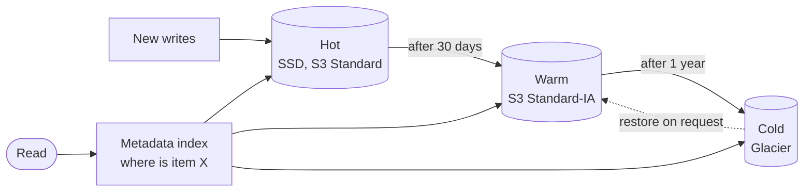

# Tiered Storage

## The problem it solves

A photo service stores 2 PB of images. Photos from the last month get almost all the views; photos from five years ago are opened rarely, maybe once a year, but users expect them to still be there. Keeping all 2 PB on the fastest, most expensive storage means paying premium prices for data that is almost never read. Deleting old data isn't an option.

Tiered storage places data on different classes of storage according to how often and how fast it's accessed: **hot** data on fast, expensive media, **warm** data on cheaper media, and **cold** data on very cheap archival storage. Data moves between tiers automatically as it ages, so cost tracks actual access patterns.

## How it works

1. **Define tiers** with their cost, latency and retrieval characteristics.
2. **Classify data** by age, access frequency, or explicit rules.
3. **Move data** with lifecycle policies or a background mover as it cools.
4. **Keep the index** (metadata saying where each item lives) so reads find the data in any tier.
5. **Serve reads** from whichever tier holds the data, sometimes promoting it back to a hotter tier when it becomes popular again.

Typical tiers:

| Tier | Example media or service | Access latency | Relative cost |
|---|---|---|---|
| Hot | RAM cache, NVMe SSD, primary database | sub-ms to ms | highest |
| Warm | HDD clusters, S3 Standard-IA | ms to tens of ms | medium |
| Cold | S3 Glacier Flexible Retrieval | minutes to hours | low |
| Archive | S3 Glacier Deep Archive, tape | hours (up to about 12 to 48) | lowest |



**Lifecycle rules** in object storage handle the moves without code:

```json
{
  "Rules": [{
    "ID": "photos-aging",
    "Filter": { "Prefix": "photos/" },
    "Status": "Enabled",
    "Transitions": [
      { "Days": 30,  "StorageClass": "STANDARD_IA" },
      { "Days": 365, "StorageClass": "GLACIER" }
    ]
  }]
}
```

S3 Intelligent-Tiering does this automatically based on observed access, for a small monitoring fee per object.

**Beyond object storage**, the same idea appears in many systems:

- **Databases and logs:** Kafka tiered storage keeps recent log segments on broker disks and offloads older segments to object storage, while consumers can still read them. Elasticsearch and OpenSearch use hot-warm-cold node roles with index lifecycle management.
- **Time-series data:** recent raw data on SSD, older downsampled data in object storage.
- **Caches:** a RAM cache in front of SSD in front of the database is tiering for reads.

**Costs to watch.** Cheaper tiers often charge **retrieval fees**, have **minimum storage durations** (S3 Standard-IA bills at least 30 days, Glacier Flexible Retrieval at least 90, Deep Archive at least 180), **minimum billable object sizes**, and **per-request transition charges**. Moving millions of tiny objects to a cold tier can cost more than it saves; batch small files into larger archives first.

## Worked example

2 PB of photos: 100 TB from the last 30 days (hot), 400 TB from 1 to 12 months old (warm), 1,500 TB older than a year (cold). Illustrative prices per GB per month: hot $0.023, warm $0.0125, cold $0.0036. 1 TB = 1,000 GB.

| Layout | Calculation | Monthly storage cost |
|---|---|---|
| Everything hot | 2,000,000 GB × $0.023 | $46,000 |
| Tiered | 100,000 × 0.023 + 400,000 × 0.0125 + 1,500,000 × 0.0036 | $2,300 + $5,000 + $5,400 = $12,700 |

Tiering cuts storage cost by about 72%. Retrieval fees on the cold tier matter only if old photos are read often; if 1% of cold data (15 TB) is restored per month at an illustrative $0.01/GB, that adds 15,000 × 0.01 = $150.

## Trade-offs

- **Pros:** large cost savings for data with skewed access; keeps all data retained without a premium price; automatic with lifecycle policies.
- **Cons:** slow access for cold data (minutes to hours to restore from archival tiers); retrieval and transition fees; minimum duration charges punish moving data too early; added complexity in the read path and metadata; wrong policies can make users wait for data they need.
- **Alternatives:** deletion with retention limits (cheapest, if allowed); compression or downsampling to shrink data in place; a single cheaper tier for everything if access latency barely matters.

## When to use it (and when not)

- **Use it** when data volume is large and access drops sharply with age: photo and video platforms (Instagram, YouTube's long tail), file storage (Dropbox), logs and metrics retention, backups, compliance archives, and Kafka topics with long retention.
- **Avoid it** for small datasets where savings are trivial, data with unpredictable access that needs fast reads (cold restores would hurt users), or many tiny objects where per-object fees dominate.

## In an interview

Say: "Most reads hit recent media, so new uploads live in S3 Standard behind the CDN, lifecycle rules move objects to Infrequent Access after 30 days and to Glacier after a year, and the metadata DB records the tier so the app can show a restore message if needed." Then be ready to estimate the savings, explain retrieval latency and fees, and describe what happens when an old item suddenly goes viral.

## Common follow-up questions

### What happens when cold data suddenly becomes popular?
Reads from a warm tier like Standard-IA still work immediately, just with a retrieval fee, and the CDN absorbs repeated reads. For archival tiers, the system must restore the object first, so either avoid archiving content users may browse, or keep a thumbnail or preview in a hotter tier.

### How do you decide when to move data?
Look at access logs: find the age after which reads fall below the point where the cheaper tier's storage savings exceed its retrieval costs. Also respect minimum storage durations, or early transitions cost more than staying hot.

### How does tiered storage work in Kafka?
Brokers keep recent segments on local disk for fast reads and upload closed segments to object storage. Consumers reading old offsets fetch from the remote tier transparently, which allows long retention without huge broker disks.

### Is a cache a form of tiered storage?
Yes, in the sense that it keeps hot data on faster media in front of slower storage. The difference is that a cache holds a copy and can be dropped, while storage tiers usually hold the only copy and data moves between them.
