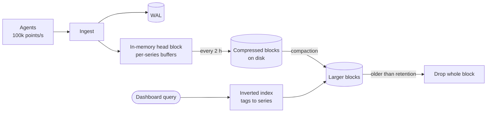

# Time-series DB

## The problem it solves

A metrics platform collects CPU, memory and request counts from 10,000 servers, 100 metrics each, every 10 seconds. That's 1 million series and 100,000 data points per second, about 8.6 billion per day. In a general-purpose row store, each point is a row with an index entry: around 50 to 100 bytes per point after overhead, so roughly 0.5 TB per day, a B-tree index that thrashes under constant inserts, and dashboard queries like "average CPU per service over the last 6 hours" that scan millions of rows.

A time-series database (TSDB) is built for this shape of data: append-mostly writes in time order, values identified by a series name and tags, queries over time ranges with aggregation, and data whose value drops with age. With specialized compression it can store a point in a byte or two and answer range queries by scanning compact, time-ordered blocks.

## How it works

**Data model.** A **series** is identified by a metric name plus tags (labels): `cpu_usage{host="web-17", service="checkout", region="eu"}`. Each series is a sequence of `(timestamp, value)` points.

**Write path** (typical of Prometheus, InfluxDB, VictoriaMetrics, and similar):

1. Incoming points are appended to a **write-ahead log** for durability.
2. They are buffered in memory per series, grouped into a block covering a window of time (Prometheus cuts blocks every 2 hours).
3. Full blocks are compressed and written to disk as immutable files, with an **inverted index** from tag values to series IDs.
4. Background **compaction** merges small blocks into larger ones, and **retention** deletes whole old blocks, which is far cheaper than deleting rows.



**Compression** is the key trick. From Facebook's Gorilla paper (2015), used in various forms by many TSDBs:

- **Timestamps** use delta-of-delta encoding. Points arrive at regular intervals (10, 10, 10 s), so the delta of deltas is usually 0, stored in a single bit.
- **Values** are XORed with the previous value. Slowly changing floats share most bits, so the XOR is mostly zeros and encodes in a few bits.

Gorilla reported an average of about 1.37 bytes per point, versus 16 bytes for a raw timestamp plus float.

**Queries** select series by tags, take a time range, and aggregate:

```
# PromQL: per-service request rate over the last 5 minutes
sum by (service) (rate(http_requests_total[5m]))
```

```sql
-- TimescaleDB (Postgres extension): 1-minute averages
SELECT time_bucket('1 minute', ts) AS minute, host, avg(cpu)
FROM metrics
WHERE ts > now() - interval '6 hours'
GROUP BY minute, host;
```

**Cardinality** is the number of distinct series. Each unique tag combination is a new series with its own index entries and memory buffers. Putting unbounded values like user IDs or request IDs in tags can create millions of series and is the most common way to break a TSDB.

**Retention and downsampling.** Keep raw data for days, then keep rolled-up aggregates (1-minute, 1-hour) for months or years.

## Worked example

1M series, one point every 10 s, so 100,000 points/s and 8.64 billion points per day.

| Storage | Bytes per point | Per day | 30 days |
|---|---|---|---|
| Row store, ~64 bytes with overhead | 64 | ~553 GB | ~16.6 TB |
| Raw (8-byte timestamp + 8-byte float) | 16 | ~138 GB | ~4.1 TB |
| Gorilla-style compression, ~1.37 bytes | 1.37 | ~11.8 GB | ~355 GB |

8.64 billion × 1.37 bytes ≈ 11.8 GB. Compression makes 30 days of raw metrics fit on a single node's SSD instead of a cluster.

## Trade-offs

- **Pros:** very high ingest rates; huge compression; fast time-range aggregations; cheap retention by dropping blocks; built-in functions for rates, percentiles and windows.
- **Cons:** poor at updates and deletes of individual points; limited joins and general queries; high-cardinality tags cause memory and index blowups; out-of-order or very late data may be rejected or costly; clustering and long-term storage often need extra components (Thanos, Cortex, Mimir for Prometheus).
- **Alternatives:** a columnar analytics store (ClickHouse, Druid) for high-cardinality event analytics; a wide-column store (Cassandra) with time-bucketed partitions; Postgres with partitioning or TimescaleDB if you need SQL and joins with business data.

## When to use it (and when not)

- **Use it** for infrastructure and application metrics (design a metrics or monitoring system), IoT sensor data, financial tick data, and real-time dashboards of counters and gauges.
- **Don't use it** for per-event analytics with high-cardinality dimensions like user ID (use a columnar store), for logs (use a log store), or for transactional business data.

## In an interview

Say: "Metrics go into a time-series database keyed by metric name and tags, with Gorilla-style compression so a point costs around a byte or two; raw data is kept for 15 days and downsampled rollups for a year." Then be ready to explain how compression works, why cardinality matters, how you shard ingest, and how you'd handle long retention.

## Common follow-up questions

### Why not just use Postgres or Cassandra?
You can at small scale, and TimescaleDB extends Postgres for this. General stores lack time-series compression and pay per-row index costs, so at millions of points per second they need far more storage and hardware. Cassandra works for writes but you build compression, rollups and query functions yourself.

### What is high cardinality and why is it dangerous?
Cardinality is the number of unique series. Each series costs memory in the head block and index entries, so a tag like `user_id` with millions of values creates millions of series. Keep tags bounded and put per-request data in logs or traces instead.

### How do you scale ingest across nodes?
Shard series by a hash of the series ID (metric name plus tags) so each series lives on one node, and replicate for durability. Queries fan out to the shards holding matching series and merge results.

### How do you handle late or out-of-order points?
Many TSDBs accept points only within a recent window of the head block, since compression assumes time order. Newer versions of some systems allow a configurable out-of-order window; beyond it, data is dropped or written to a separate block.
