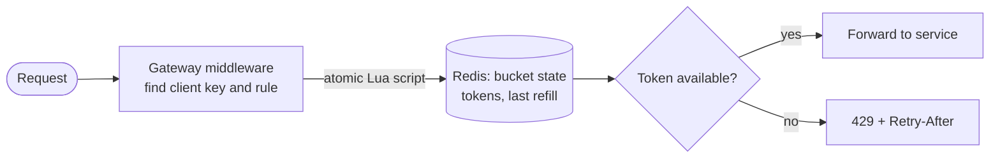

# Rate-limit Algorithms

## The problem it solves

A public API serves 1M requests per second. One misbehaving client with a retry loop sends 50,000 requests per second, and without limits it consumes capacity meant for everyone else, drives up database load and can take the service down. A scraper can download your whole catalog; a credential-stuffing bot can try millions of passwords. You need to cap each client to a fair rate, such as 100 requests per minute, decide on every request in well under a millisecond of compute, and do it consistently across 100 gateway nodes.

Rate-limit algorithms define what "100 per minute" means precisely: how bursts are treated, how much state each client costs, and how accurate the limit is.

## How it works

There are five classic algorithms. All count per client key (API key, user ID or IP) and per rule.

**1. Fixed window counter.** Count requests per calendar window (`key = client:minute`); reject past the limit. One `INCR` + `EXPIRE` in Redis. Flaw: a client can send the full limit at the end of one window and again at the start of the next, **2× the limit in about a second**.

**2. Sliding window log.** Store a timestamp per accepted request (a Redis sorted set). On each request, drop entries older than the window and count the rest. Exact, but memory is O(limit) per client.

**3. Sliding window counter.** Keep the current and previous fixed-window counts and weight the previous one by how much of it still overlaps the rolling window:

```
estimate = prev_count × (1 − elapsed / window) + curr_count
```

Two integers per client, smooths the boundary burst, slightly approximate.

**4. Token bucket.** A bucket holds up to **b** tokens (burst size) and refills at **r** tokens per second (sustained rate). Each request takes a token; an empty bucket means reject. Refill is computed lazily from elapsed time, so there's no background job:

```
tokens = min(b, tokens + (now - last) * r)
last = now
if tokens >= 1: tokens -= 1; allow
else: reject, Retry-After = (1 - tokens) / r
```

**5. Leaky bucket.** Requests enter a FIFO queue of size b and are processed at a constant rate r; when the queue is full, new requests are dropped. Output is perfectly smooth, at the cost of queueing delay. **GCRA** implements the same idea with a single timestamp per client.



In a distributed setup, the check must be atomic: run the read-refill-take-write sequence as one Redis Lua script on the shard that owns the client's key, otherwise two gateways can both read "1 token left" and both allow.

## Worked example

Limit: 10 requests per minute. A client sends 10 requests at 0:59 and another 10 at 1:00. The token bucket uses b = 10, r = 10/60 ≈ 0.167 tokens/s; the leaky bucket has a queue of 10 and leaks 1 request every 6 s.

| Algorithm | 10 requests at 0:59 | 10 requests at 1:00 | Total allowed in ~1 s |
|---|---|---|---|
| Fixed window | all allowed (window 0:00 count 10) | all allowed (new window, count resets) | **20**: double the limit |
| Sliding log | all allowed | log still holds 10 entries from 1 s ago, all rejected | 10 |
| Sliding counter | all allowed | estimate = 10 × (1 − 0/60) + 0 = 10, rejected | 10 |
| Token bucket | bucket full (10), all allowed, 0 left | 0 + 1 s × 0.167 = 0.167 tokens, all rejected | 10 |
| Leaky bucket | 10 queued, 1 processed right away, 9 waiting | queue has room for 1, 9 dropped | 11 accepted, but processed at 1 per 6 s |

The fixed window is the only one that lets 20 through. The token bucket's next request succeeds once a full token has accumulated: 1 / 0.167 = 6 s after 0:59.

## Trade-offs

| Algorithm | State per client | Bursts | Accuracy |
|---|---|---|---|
| Fixed window | 1 counter | Up to 2× at edges | Low at edges |
| Sliding log | O(limit) timestamps | None | Exact |
| Sliding counter | 2 counters | Smoothed | Close (assumes even spread) |
| Token bucket | 2 numbers | Allowed up to b, by design | Exact for its model |
| Leaky bucket / GCRA | Queue or 1 timestamp | Smoothed into a steady rate | Exact for its model |

- **Token bucket** is the usual default: tiny state, tolerates realistic short bursts, two intuitive knobs.
- **Sliding log** suits low limits where exactness matters (5 login attempts per 15 minutes).
- **Leaky bucket** suits traffic shaping toward a downstream with a strict rate (a third-party API that allows 10 QPS).
- **Fixed window** is acceptable for coarse quotas (10,000 calls per day) where the edge burst doesn't matter.

## When to use it (and when not)

- **Use rate limiting** in "design a rate limiter", at the API gateway in almost any public API design, on login and OTP endpoints (fail closed), on outbound calls to paid or fragile third-party APIs, and per-user limits on writes (posts, messages) in social apps.
- **Don't confuse it** with load shedding: per-client rate limits ensure fairness, while overload protection (dropping low-priority work when the service itself is saturated) is a separate mechanism. And never rely on client-side limits.

## In an interview

Say: "I'll use a token bucket per API key, stored in Redis as tokens plus last-refill time and updated by one atomic Lua script, so it allows short bursts up to b while enforcing the sustained rate, with no background refill job." Be ready to compare it with the fixed window's edge burst, size b and r for a stated limit, and decide between failing open and failing closed when Redis is down.

## Common follow-up questions

### How do you pick the token bucket's capacity and refill rate?
The refill rate is the sustained limit (100 per minute → 1.67 tokens per second). The capacity is the largest burst you're willing to absorb, often a few seconds' worth of the rate up to a full minute's worth, based on how real clients behave (a page load fires several calls at once).

### Why must the check be atomic?
Two gateway nodes handling the same client can both read "1 token left", both allow, and both write back 0: a lost update that admits extra requests. A Lua script runs atomically on the Redis shard, so the read, refill, take and write can't interleave.

### What do you do when Redis is unavailable?
For normal API traffic, fail open with a coarse local per-node limit as a backstop, since rejecting all traffic would turn a Redis problem into a full outage. For abuse-sensitive endpoints like login or SMS sending, fail closed.

### How would you rate-limit across regions?
A single global counter needs cross-region round trips, which is too slow per request. Usually you split the quota per region by traffic share, or enforce locally and sync counts asynchronously, accepting a brief overshoot.
