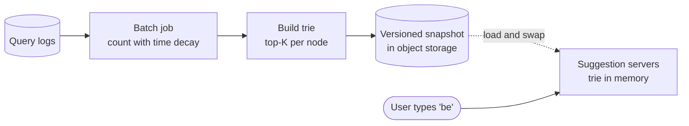

# Trie

## The problem it solves

A search box suggests completions on every keystroke: type "be" and see "beer", "bear", "best". You have 100M distinct past queries, ~10 ms to answer, and very high request rates. Scanning all queries for ones starting with "be" is O(total phrases) per keystroke. A sorted list with binary search finds the range of matches in O(log n), but the range for a short prefix can hold millions of phrases, and you still need to sort them by popularity on every request.

A trie (prefix tree) organizes strings by their characters so that finding everything under a prefix costs O(prefix length), and with precomputed top-K lists at each node, the answer is ready the moment you arrive.

## How it works

1. Each node represents a prefix; each edge is one character. The root is the empty string.
2. **Insert** "beer": walk or create nodes `b` → `be` → `bee` → `beer`, and mark the last node as the end of a word (with its count or score).
3. **Lookup prefix** "be": follow `b` then `e`. Two steps, regardless of how many words exist.
4. **Collect completions:** a plain trie then walks the whole subtree below the prefix node and sorts by score. That's slow for short prefixes, whose subtrees contain most of the data.
5. **Optimization for autocomplete:** store at **every node the top-K completions** under it, precomputed at build time. A lookup becomes O(prefix length) and returns the stored list without traversing anything.

```
class Node:
    children = {}        # char -> Node
    top = []             # min-heap of (score, phrase), size <= K

def build(phrases):                            # phrases: (text, score)
    root = Node()
    for text, score in phrases:
        node = root
        for ch in text:
            node = node.children.setdefault(ch, Node())
            offer(node.top, (score, text), K)  # keep the best K
    return root

def suggest(root, prefix):
    node = root
    for ch in prefix:
        node = node.children.get(ch)
        if node is None: return []
    return sorted(node.top, reverse=True)
```



Because updating top-K lists along every path on each search is expensive and contended, production systems rebuild the trie offline (hourly or daily) as an immutable snapshot and swap it in atomically, adding a separate fast path for trending queries.

**Compressed (radix) tries** merge chains of single-child nodes into one edge labeled with a substring ("b" → "e" → "s" → "t" becomes "best"), which cuts node count and memory significantly for long, sparse strings.

## Worked example

Aggregated counts: `bee` 20, `beer` 50, `best` 35, `bet` 15, `bear` 40, with **K = 3**.

| Node | Phrases beneath it | Stored top-3 |
|---|---|---|
| `b` | all 5 | beer 50, bear 40, best 35 |
| `be` | all 5 | beer 50, bear 40, best 35 |
| `bee` | bee, beer | beer 50, bee 20 |
| `bea` | bear | bear 40 |
| `bes` | best | best 35 |
| `bet` | bet | bet 15 |

- Query "be": 2 steps, returns `[beer, bear, best]`. `bee` and `bet` exist but didn't make the top 3 for this prefix.
- Query "bee": 3 steps, returns `[beer, bee]`.
- Build cost: each phrase updates one heap per character, so building is O(total characters × log K).

Memory estimate: 100M phrases averaging 20 characters, with shared prefixes, might produce on the order of 1B nodes before compression. Storing 10 suggestions as 4-byte phrase IDs adds 40 bytes per node, so capping depth (e.g. 20 characters), dropping rare phrases and using a radix trie matter.

## Trade-offs

- **Pros:** lookup cost depends on prefix length, not dataset size; precomputed top-K makes reads constant work; shared prefixes are stored once; natural support for prefix-based features (spell-check with small edit distance, IP routing longest-prefix match).
- **Cons:** memory-hungry (pointers per node plus K suggestions per node); updates are awkward, so most systems rebuild offline; harder to shard than a flat map (shard by first character or two, which can be uneven).
- **Alternatives:** **hash map from prefix → top-K** for every prefix up to N characters (simpler, easy to shard and to store in Redis, more memory); **Elasticsearch completion suggester** (an in-memory FST, good at moderate scale with easier updates); **sorted array + binary search** for small static lists.

## When to use it (and when not)

- **Use it** for typeahead / search autocomplete (Google, Amazon, Twitter search), contact search in a phone app, word games and spell-checkers, IP routing tables (longest-prefix match).
- **Not needed** when the dataset is small (a few thousand items: filter in memory or in the client), or when you need matches in the middle of words or fuzzy relevance (use an inverted index with n-grams in Elasticsearch).

## In an interview

Say: "I'll serve suggestions from an in-memory trie where every node stores its precomputed top 10 completions, so a lookup is just walking the prefix, and I rebuild it hourly from decayed query counts and swap the snapshot atomically." Be ready to explain how top-K is maintained at build time, how you cut memory, and how trending queries get in between rebuilds.

## Common follow-up questions

### Why not walk the subtree at query time?
For a one- or two-character prefix the subtree holds a large fraction of all phrases, so collecting and sorting them takes far longer than 10 ms. Precomputing top-K moves that work to build time, where it happens once instead of on every keystroke.

### How do you keep suggestions fresh?
Rebuild periodically from logs with time-decayed scores so last week's spike fades. For breaking news, a streaming job detects rapidly rising queries and merges a trending boost into the served results between rebuilds.

### How would you shard a trie that doesn't fit on one machine?
Shard by prefix range (e.g. a–f, g–m), splitting hot ranges further, or use the prefix-to-top-K hash map and shard it by hash of the prefix. Since the data is read-only between rebuilds, replicate each shard heavily for throughput.

### How do you reduce memory?
Use a radix trie to collapse single-child chains, store phrase IDs instead of strings in top-K lists, cap depth, and prune low-score phrases. These together typically shrink the structure by a large factor.
