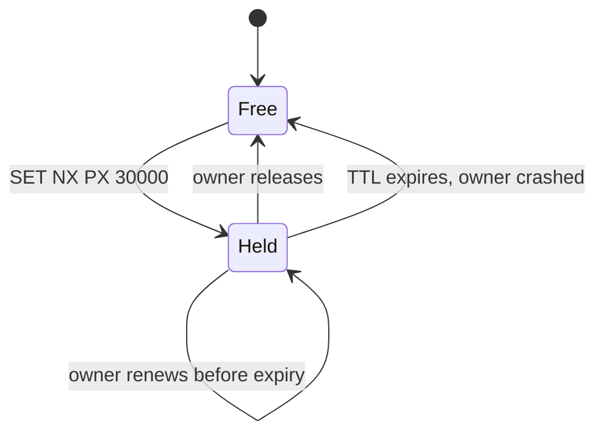

# TTL / Expiry

## The problem it solves

Lots of data is only meant to live for a while: a login session, a cached product page, a one-time password, a seat held during checkout, a lock taken by a worker. Without an expiry, you need a cleanup job to find and delete stale entries, and if it lags or crashes, they pile up. Worse, a worker that crashes while holding a lock holds it forever, and a seat "held for 10 minutes" stays held until someone notices.

A time to live (TTL) attaches an expiry time to a piece of data when you write it. After that time, the system treats it as gone, automatically. This bounds staleness in caches, frees memory, and makes temporary claims (locks, holds, leases) self-releasing when their owner disappears.

## How it works

1. On write, store the value with either a duration (`TTL 600 s`) or an absolute expiry timestamp.
2. On read, if `now >= expires_at`, the entry is treated as missing.
3. Physically removing the entry happens separately, either lazily on access or by a background sweep.

```
SET session:abc123 "{user_id: 42}" EX 1800      # Redis: expires in 30 min
SET lock:job:77 worker-9 NX PX 30000            # lock only if free, 30 s lease
EXPIRE cart:42 86400                            # add or reset expiry on an existing key
TTL session:abc123                              # seconds remaining
```

**How stores implement it:**

- **Redis** removes expired keys lazily when they are accessed, plus an active cycle that samples keys with TTLs and deletes expired ones. A read never returns an expired key even if it hasn't been physically deleted yet.
- **DynamoDB TTL** uses an attribute holding an epoch timestamp. Deletion happens in the background and can lag significantly (AWS documents it as typically within a few days), so reads must filter on the timestamp if exactness matters.
- **Cassandra** supports per-write TTLs; expired cells become tombstones that are purged during compaction.
- **MongoDB** has TTL indexes with a background deletion task that runs about once a minute.
- **DNS records and HTTP caches** use TTLs (`max-age`) to bound how long copies can be served.

**Leases and locks.** A lock with a TTL is a lease: the holder must finish or renew before it expires. If the holder crashes, the lock frees itself. The catch is that a holder paused longer than the TTL (by a GC pause or network stall) may still think it holds the lock after someone else acquired it. Use **fencing tokens**: each acquisition gets an increasing number, and the protected resource rejects writes carrying an older token.



**Sliding vs absolute expiry.** A sliding TTL is reset on each access ("log out after 30 minutes of inactivity"). An absolute TTL is fixed from creation ("tokens expire 24 hours after issue"). Many systems use both.

**Jitter.** If you cache 100,000 keys at startup with the same 1-hour TTL, they all expire in the same second and stampede the database. Add random jitter, such as `3600 + random(0, 300)` seconds.

## Worked example

A ticketing site holds seats for 10 minutes during checkout using `SET hold:seat:A12 user42 NX EX 600`.

| Time | Event | Key state | Seat available to others? |
|---|---|---|---|
| 12:00:00 | user42 selects A12 | `hold:seat:A12 = user42`, TTL 600 s | No |
| 12:04:00 | user77 tries A12, `SET NX` fails | TTL 360 s remaining | No |
| 12:10:00 | user42 never paid, key expires | gone | Yes |
| 12:10:05 | user77 retries, `SET NX` succeeds | `= user77`, TTL 600 s | No |

No cleanup job was needed; the expiry released the abandoned seat at exactly 12:00:00 + 600 s.

## Trade-offs

- **Pros:** automatic cleanup; bounded staleness; self-healing locks and holds; simple to reason about.
- **Cons:** physical deletion may lag (DynamoDB, Cassandra tombstones), so storage and reads must allow for it; picking the duration is a trade-off between freshness and load; TTL locks are unsafe without fencing if holders can pause; relies on reasonably synchronized clocks when timestamps are absolute.
- **Alternatives:** explicit deletion on events (precise, but misses crashes); scheduled cleanup jobs; partition-by-time tables you drop wholesale, which is far cheaper than deleting rows one by one for large time-series data.

## When to use it (and when not)

- **Use it** for caches, sessions and tokens, OTPs and verification links, idempotency keys (keep 24 hours), rate-limit counters, ticket or inventory holds (Ticketmaster), distributed lock leases, presence in chat ("online" heartbeats with a 30 s TTL), and DNS and CDN content.
- **Don't use it** as the only mechanism when exact expiry is a business rule enforced elsewhere (e.g. a legal retention deadline needs an audited process), or for data that must never silently disappear.

## In an interview

Say: "Seat holds are Redis keys set with NX and a 10-minute TTL, so an abandoned checkout releases the seat automatically, and the booking write checks that the hold still belongs to this user." Then be ready to explain lazy vs active expiry, what happens if a lock holder pauses past its TTL, and how you'd pick the duration.

## Common follow-up questions

### Does an expired key get deleted immediately?
Not necessarily. Redis hides it from reads immediately but may delete it physically later; DynamoDB can take much longer. Design reads to check the expiry time, and don't count on storage being reclaimed instantly.

### How do you keep a long job's lock from expiring?
The holder renews the lease periodically, for example every 10 seconds on a 30-second TTL, from a background heartbeat. If renewal fails, the worker stops work, because someone else may now hold the lock.

### What are fencing tokens?
A number that increases on every lock acquisition. The holder sends it with each write, and the storage rejects writes with a token lower than the highest it has seen, so a paused old holder can't corrupt data.

### How do you choose a cache TTL?
Start from how stale the data can be for users, then balance against hit rate and database load. Prices might get 30 seconds, profiles 10 minutes, static reference data hours, with jitter added in all cases.
