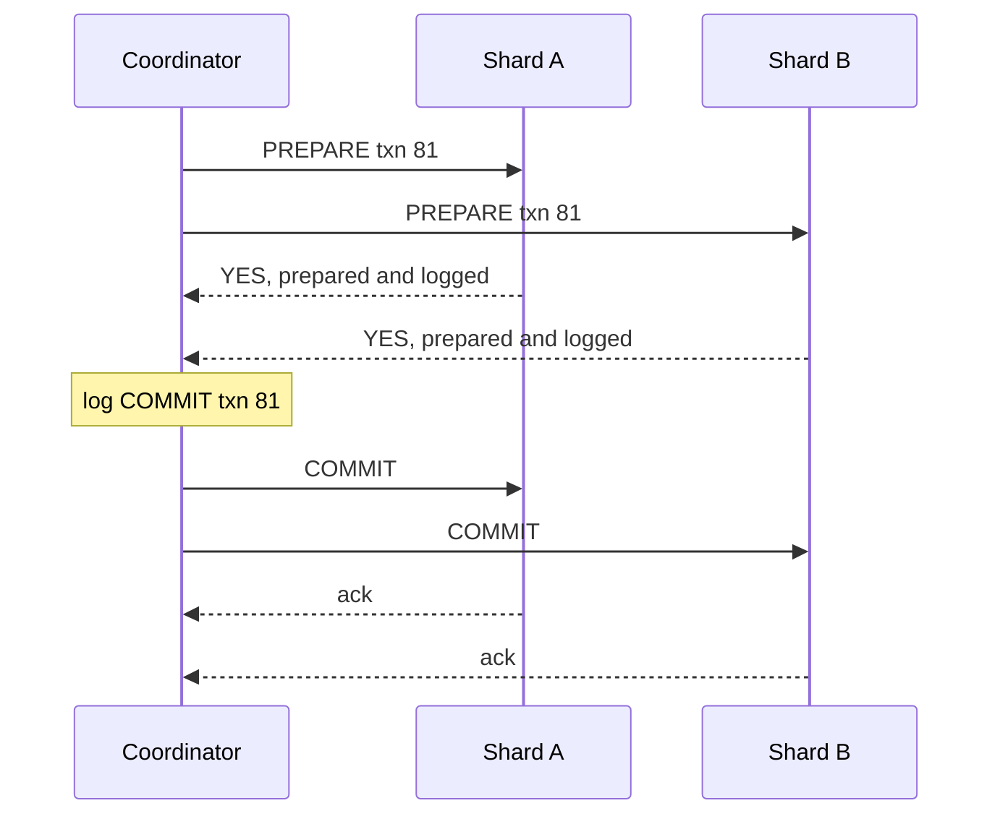

# Two-phase Commit

## The problem it solves

A user's account lives on shard A and the merchant's account on shard B. A transfer must debit one and credit the other. If you commit on A and then B fails (constraint violation, crash, timeout), money has left one account and arrived nowhere. Each database can make its own write atomic, but nothing makes the two commits atomic together.

Two-phase commit (2PC) is a protocol that makes several participants either all commit or all abort a transaction.

## How it works

A **coordinator** (often the service or database node that started the transaction) talks to every **participant** (the shards or databases involved).

**Phase 1: prepare (voting).**

1. The coordinator sends `PREPARE` to every participant.
2. Each participant does all the work needed to be certain it can commit: checks constraints, writes the changes and a prepare record to its durable log, and keeps holding the row locks.
3. It replies `YES` (a promise: "I will commit if told to, even after a crash") or `NO`.

**Phase 2: commit or abort.**

4. If every participant voted YES, the coordinator durably logs `COMMIT` for the transaction. **This log write is the commit point.** It then sends `COMMIT` to all participants.
5. If any participant voted NO or timed out, the coordinator logs and sends `ABORT`.
6. Participants apply the decision, release locks, and acknowledge. The coordinator retries until every participant acknowledges.



In SQL databases that support it (Postgres here):

```sql
-- on each participant
BEGIN;
UPDATE accounts SET balance = balance - 100 WHERE id = 'alice';
PREPARE TRANSACTION 'txn81';      -- phase 1: durable, locks held

-- later, on each participant, after the coordinator decides
COMMIT PREPARED 'txn81';          -- or ROLLBACK PREPARED 'txn81'
```

XA is the standard interface for 2PC across heterogeneous resources (databases, message brokers).

**The blocking problem.** Once a participant votes YES, it has given up the right to decide on its own. If the coordinator crashes after collecting votes but before sending the decision, prepared participants can't commit (another participant may have voted NO) and can't abort (the coordinator may have logged COMMIT). They wait, holding locks, until the coordinator recovers and reads its log. Rows stay locked and other transactions touching them block. This is why 2PC is called a blocking protocol.

**Mitigations.** Make the coordinator highly available by replicating its decision log with consensus. Spanner does this: each participant is a Paxos group and the coordinator's state is replicated, so coordinator failure doesn't block indefinitely. Three-phase commit tries to avoid blocking but assumes bounded network delays, so it's rarely used in practice.

## Worked example

Transfer $100 from Alice (shard A, balance $500) to Bob (shard B, balance $200).

| Step | Shard A | Shard B | Coordinator log |
|---|---|---|---|
| 1. Prepare | Alice 400 written, prepared, row locked | Bob 300 written, prepared, row locked | |
| 2. Votes | YES | YES | |
| 3. Decide | | | COMMIT txn 81 |
| 4a. Normal | commits, unlocks: 400 | commits, unlocks: 300 | done |
| 4b. Coordinator crashes after step 3 | prepared, locked, waiting | prepared, locked, waiting | COMMIT on disk |
| 5b. Coordinator restarts after 2 min | commits: 400 | commits: 300 | done |

The total stays $700 in every outcome. In case 4b, Alice's and Bob's rows were locked for 2 minutes, so any other transaction touching them waited. If shard B had voted NO in step 2 (say, Bob's account was frozen), the coordinator would log ABORT and both shards would roll back to 500 and 200.

## Trade-offs

- **Pros:** true atomicity across participants; isolation is preserved because locks are held until the decision; applications see a normal transaction.
- **Cons:** blocking if the coordinator fails; at least two round trips plus durable log writes per transaction, so higher latency; locks held across the network reduce throughput; every participant must support prepare, which most external APIs and many NoSQL stores don't; availability is limited by the least available participant.
- **Alternatives:** sagas (local transactions plus compensations, eventual consistency, no cross-service locks); designing the data model so related data lives on one shard; the transactional outbox pattern for "update the database and publish an event" atomically; distributed databases that run 2PC internally over consensus groups (Spanner, CockroachDB).

## When to use it (and when not)

- **Use it** inside a single system you control, such as a distributed database committing across its own shards, or between a database and a message broker that both support XA. Interview questions: design a distributed database or key-value store with transactions, cross-shard transfers in a payment or banking system, why Spanner can offer distributed ACID transactions.
- **Avoid it** across microservices and third-party APIs (payment gateways, email providers), across regions where latency multiplies, and in high-throughput paths with hot rows. Use sagas or the outbox pattern there.

## In an interview

Say: "For cross-shard transfers inside our own database, a coordinator runs two-phase commit: shards prepare and lock, the coordinator logs the decision, then commits everywhere; across microservices I'd use a saga instead, because 2PC blocks if the coordinator dies and holds locks across the network." Be ready to walk through the blocking scenario and explain why the coordinator's log write is the commit point.

## Common follow-up questions

### What happens if a participant crashes after voting YES?
On restart it reads its log, sees the transaction is prepared, and must ask the coordinator for the decision. It can't decide on its own, and it keeps the locks until it learns the outcome.

### Why not just commit on each shard one after another?
If the second commit fails after the first succeeded, you have a partial transaction and no way to roll back the first, which is already committed and visible. The prepare phase ensures everyone can commit before anyone does.

### How does 2PC differ from consensus like Raft?
Raft replicates the same log across nodes and needs only a majority to make progress. 2PC coordinates different work across different participants and needs every one of them to agree, so a single failure can block it. Systems like Spanner combine both: Paxos for each participant's durability, 2PC across participants.

### Why do microservices avoid 2PC?
Services own separate databases and often call external APIs that can't prepare. Holding locks across service calls couples their availability and latency, so a slow service stalls the others. Sagas trade isolation for loose coupling.
