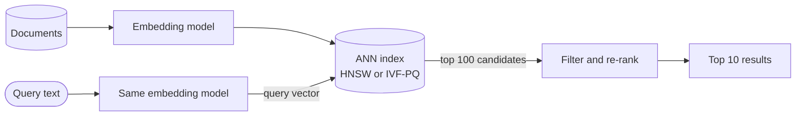

# Vector Search / ANN

## The problem it solves

A user searches a help center for "my card got declined" and the best article is titled "Payment failed at checkout". They share no keywords, so an inverted index finds nothing useful. Similar problems show up in "more like this" recommendations, image search and retrieval for LLM apps (RAG): you want items that **mean** the same thing.

Embedding models turn text, images or users into vectors where similar meaning lands close together. But comparing a query against 100M vectors of 768 dimensions is 100M × 768 ≈ 77B multiply-adds per query, far too slow for a 50 ms budget. Approximate nearest neighbor (ANN) indexes find the closest vectors by examining a tiny fraction of them, trading a little recall for orders of magnitude in speed.

## How it works

**1. Embeddings.** A model (a sentence transformer, CLIP for images, or a two-tower recommendation model) maps each item to a fixed-length vector, e.g. 768 floats. Items are embedded offline at ingest; the query is embedded at request time with the same model.

**2. Similarity.** The usual measure is **cosine similarity**: the cosine of the angle between two vectors, from −1 to 1.

```
cos(a, b) = (a · b) / (|a| × |b|)
```

If vectors are normalized to length 1, cosine similarity equals the dot product, which is cheaper. Some models use plain dot product or Euclidean (L2) distance instead; use what the model was trained for.

**3. ANN indexes.** The two families interviewers ask about:

**HNSW (hierarchical navigable small world).** A multi-layer graph. Every vector is a node in the bottom layer, linked to its M nearest neighbors (e.g. M = 16). Each higher layer contains an exponentially smaller random subset of nodes, like express lanes. A search enters at the top layer, greedily moves to whichever neighbor is closest to the query, drops down a layer when it can't improve, and at the bottom runs a wider best-first search (size `ef_search`) to collect the top K. Searches touch a few thousand nodes instead of millions. HNSW gives excellent recall and latency but keeps full vectors plus graph links in memory, and deletes are awkward.

**IVF (inverted file index).** Run k-means to group vectors into `nlist` clusters (e.g. 10,000). Each vector is stored in the list of its nearest centroid. A query finds the `nprobe` nearest centroids (e.g. 10) and scans only those lists. Recall improves as `nprobe` grows. IVF is often combined with **product quantization (PQ)**, which splits each vector into sub-vectors and replaces each with a 1-byte code, shrinking a 3 KB vector to tens of bytes at some cost in accuracy.



```
# HNSW search, simplified
node = entry_point
for layer in top_layer down to 1:
    node = greedy_closest(node, query, layer)     # walk while a neighbor is closer
candidates = best_first_search(node, query, layer=0, ef=ef_search)
return top_k(candidates, k)
```

**Filtering** ("similar products, in stock, under $50") is a real challenge: filtering after ANN can leave too few results, so engines support filtering during the graph or list traversal, or oversample candidates before filtering.

## Worked example

Cosine similarity with toy 3-dimensional vectors. Query q = (1, 1, 0), |q| = √2 ≈ 1.414.

| Item | Vector | Dot with q | Length | Cosine | Rank |
|---|---|---|---|---|---|
| A | (2, 2, 1) | 2 + 2 + 0 = 4 | √9 = 3 | 4 / (1.414 × 3) ≈ 0.943 | 1 |
| C | (1, 0, 0) | 1 | 1 | 1 / 1.414 ≈ 0.707 | 2 |
| B | (0, 1, 1) | 1 | √2 ≈ 1.414 | 1 / 2 = 0.5 | 3 |

A is longer than C, but cosine ignores length and measures direction, so A wins because it points almost the same way as q.

Now scale: 100M vectors × 768 dimensions × 4 bytes = ~307 GB of raw floats.

| Method | Vectors compared per query | Memory |
|---|---|---|
| Brute force | 100M | ~307 GB |
| IVF, nlist = 10,000, nprobe = 10 | 10,000 centroids + ~100,000 vectors ≈ 0.11% of brute force | ~307 GB, or ~10 GB with 96-byte PQ codes |
| HNSW, M = 16 | typically a few thousand | ~307 GB plus graph links (16 neighbors × 4 bytes × 2 at layer 0 ≈ 128 bytes per vector) |

## Trade-offs

- **Pros:** semantic matching across wording, languages and even modalities; one mechanism for search, recommendations, dedupe and RAG retrieval.
- **Cons:** approximate (recall of 95–99% is typical, tunable); memory-hungry; changing the embedding model means re-embedding everything; results are hard to explain; poor at exact matches like product codes or names.
- **HNSW vs IVF:** HNSW gives better recall at low latency but uses more memory and is slow to build; IVF-PQ is far more compact and suits billion-scale on limited RAM, with lower recall.
- **Alternatives and complements:** **inverted index / BM25** for keywords (most production systems run **hybrid search**, merging both result lists); **exact brute force** on a GPU or for under ~1M vectors; **LSH** (locality-sensitive hashing), simpler but generally less accurate than HNSW.

## When to use it (and when not)

- **Use it** for semantic search, RAG for chatbots, "similar items" and recommendation candidate generation (YouTube, Spotify, Pinterest), image or face similarity, near-duplicate detection.
- **Don't use it** when users search for exact identifiers, when keyword precision matters more than recall (legal discovery), or at a scale where brute force over a few thousand vectors is already fast.

## In an interview

Say: "I'll embed documents offline and store the vectors in an HNSW index; a query is embedded with the same model, we fetch the top 100 by cosine similarity, apply filters and re-rank, and combine with BM25 results for exact-term matches." Be ready to explain cosine similarity, how HNSW navigates its layers, the recall-latency knobs (`ef_search`, `nprobe`) and the memory math.

## Common follow-up questions

### Why approximate instead of exact search?
Exact search compares the query with every vector, which is linear in collection size and too slow at 100M+ items. ANN indexes examine a tiny fraction and typically still return 95–99% of the true top results, and the knobs let you trade more latency for higher recall.

### How do you shard a vector index?
Split vectors across shards (randomly or by tenant), build an index on each, query all shards in parallel and merge the per-shard top K. Replicate shards for throughput. Partitioning by cluster is possible but risks missing neighbors near cluster boundaries.

### What happens when you change the embedding model?
Vectors from different models aren't comparable, so you must re-embed the whole corpus and build a new index, then switch over (blue/green). Keep the model version alongside each vector so nothing mixes during the transition.

### How do you combine vector and keyword results?
Run both searches and merge with a rank fusion method like reciprocal rank fusion (score = Σ 1 / (k + rank) across lists), or use vector search for candidates and a cross-encoder or learned ranker to re-rank. Hybrid search covers both meaning and exact terms.
