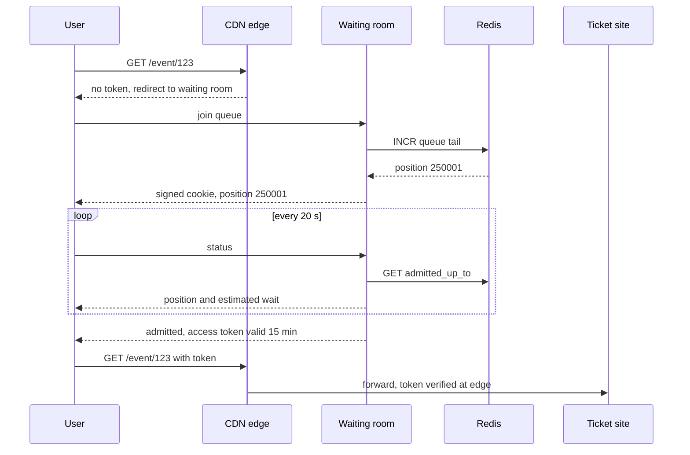

# Virtual Waiting Queue

## The problem it solves

Tickets for a stadium tour go on sale at 10:00. One million fans hit the site in the first minute, but the booking backend (seat selection, holds, payments) can safely serve about 10,000 active shoppers at a time. Autoscaling can't react in seconds, and the real bottleneck is often a resource that doesn't scale at all: 50,000 seats and the database rows that represent them. Without protection, everyone gets timeouts and errors, people refresh harder, and the site goes down for all of them, including fans who had already reached checkout.

A **virtual waiting queue** (waiting room) holds excess users in a cheap, static holding page at the edge and **admits them to the real site gradually**, at a rate the backend can handle. Users see their position and an estimated wait instead of errors.

## How it works

1. **Gate at the edge.** A CDN rule or lightweight gateway checks every request to protected paths (`/event/123/*`) for a valid **access token**. No token means redirect to the waiting room.
2. **Join the queue.** The waiting room service assigns a queue position. For people who arrive before the sale starts, many systems randomize the order at opening time, so being there at 09:59:59.9 doesn't beat being there at 09:55. After opening, order is first come, first served.
3. **Store the queue cheaply.** A counter per event: `position = INCR queue:123:tail` in Redis, stored in a signed cookie with a queue ID. The queue itself is just two numbers: the tail (last position issued) and the **admitted-up-to** pointer.
4. **Admit at a controlled rate.** A controller advances `admitted_up_to` by N every few seconds, based on the backend's capacity and live health (error rate, latency, active sessions). Users whose position ≤ `admitted_up_to` get an access token.
5. **Poll for status.** The waiting page polls every 10–30 seconds (or uses SSE) and shows position and estimated wait: `(position − admitted_up_to) / admit_rate`.
6. **Access token.** A short-lived signed token (e.g. JWT with event ID, user ID, expiry of 10–15 minutes) that the edge verifies without a database lookup. Bind it to the session so it can't be shared.
7. **Leave.** When the user buys, abandons, or the token expires, their slot frees up, and the controller can admit more.



```
# controller, runs every 5 seconds
active = metrics.active_sessions("event:123")
healthy = metrics.p99_ms < 800 and metrics.error_rate < 0.01
room = max(0, TARGET_ACTIVE - active) if healthy else 0
redis.incrby("queue:123:admitted_up_to", min(room, MAX_STEP))
```

The waiting room itself must withstand the full spike, so it's mostly static content served from the CDN, with tiny status calls hitting an in-memory store.

## Worked example

1,000,000 users join in the first minutes. The backend can hold 10,000 active shoppers, and each shopper stays about 10 minutes, so it frees roughly 10,000 / 10 = 1,000 slots per minute. Admit rate: 1,000 users/minute.

| Position | Users ahead | Estimated wait |
|---|---|---|
| 5,000 | within first 10,000 | Admitted immediately |
| 25,000 | 15,000 beyond the first 10,000 | 15,000 / 1,000 = 15 min |
| 250,000 | 240,000 | 240 min = 4 hours |
| 1,000,000 | 990,000 | 990 min ≈ 16.5 hours |

With 50,000 seats and each buyer taking up to 4, tickets may sell out long before position 1,000,000 is reached. The waiting room should show "sold out" to everyone remaining as soon as inventory hits zero, instead of making them wait 16 hours. Admitting faster wouldn't sell more tickets; it would just overload the system that has to sell them.

Status polling load: 1,000,000 users polling every 20 s is 50,000 requests/s, which must be served from Redis or edge workers, not the ticket database.

## Trade-offs

- **Pros:** protects the backend with a hard cap on concurrent users; turns errors into a predictable wait; fair ordering (and randomization of early arrivals) reduces the advantage of refresh-spamming; the waiting room is cheap to scale since it's static plus counters.
- **Cons:** users wait, sometimes for nothing if inventory runs out; bots can join many times (need CAPTCHA, account verification, one queue spot per account); token sharing and replay must be prevented; extra infrastructure and an edge integration.
- **Alternatives:** **rate limiting** (rejects excess requests with 429, which feels random and unfair to users); **autoscaling** (doesn't help with a fixed inventory bottleneck or a spike in seconds); **lottery or pre-registration** (a "verified fan" style draw before the sale), which avoids a spike entirely.

## When to use it (and when not)

- **Use it** for "design Ticketmaster" and concert or sports on-sales, limited-edition product drops ("design a flash sale system"), vaccine or visa appointment booking, and government sites during deadlines.
- **Not needed** for normal traffic that autoscaling handles, or for read-heavy spikes that a CDN cache absorbs (a viral blog post doesn't need a queue).

## In an interview

Say: "I'll put a waiting room at the CDN edge: users get a Redis-issued queue position in a signed cookie, a controller admits about 1,000 users a minute based on backend health, and admitted users receive a 15-minute signed token the edge checks without hitting our database." Be ready to explain how the admit rate is chosen, how you stop bots and token sharing, and what happens when inventory sells out.

## Common follow-up questions

### How do you decide how many users to admit?
Start from backend capacity: target concurrent shoppers divided by average session time gives the steady admit rate. Then adjust in a feedback loop on live metrics like p99 latency, error rate and active sessions, pausing admission if they degrade.

### How do you stop bots from taking queue spots?
Require a logged-in, verified account and allow one queue position per account, add CAPTCHA or proof-of-work at join time, and detect abnormal patterns. Bind the access token to the session and device so it can't be passed around.

### What if the waiting room service itself goes down?
Its state is tiny (two counters per event plus signed cookies), so it's easy to replicate, and the waiting page is static on the CDN. Because positions live in signed cookies, a restarted service can keep honoring them as long as the counters are persisted.

### Why not just rate-limit instead?
A rate limiter drops excess requests at random, so users get errors, retry aggressively, and luck decides who gets through. A queue gives each user a stable position and a clear wait, which is fairer and reduces retry storms.
