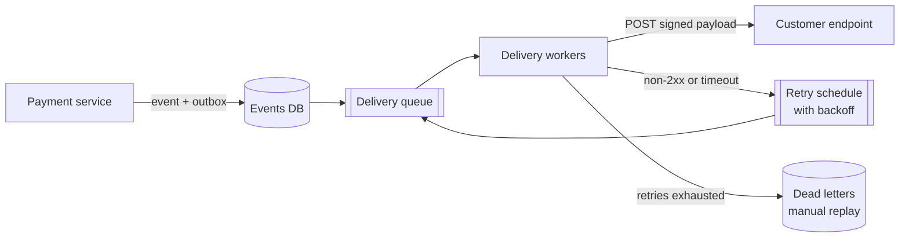

# Webhooks

## The problem it solves

A merchant integrates with a payment provider and needs to know when a payment succeeds, which might be seconds or days later (bank transfers, disputes). Without webhooks, the merchant polls `GET /payments/{id}` for every pending payment. With 100,000 pending payments polled once a minute, that's about 1,667 requests per second to the provider, nearly all answering "still pending", and the merchant still learns about changes up to a minute late.

A **webhook** inverts this: the merchant registers a URL, and the provider sends an HTTP POST to it when the event happens. The hard parts are doing that reliably and securely when the receiver is someone else's server that may be slow, down, or an attacker's.

## How it works

1. **Registration.** The customer registers an endpoint URL and the event types they want (`payment.succeeded`). The provider generates a per-endpoint **signing secret**.
2. **Event creation.** When something happens, the provider writes the event to its database and enqueues a delivery job (transactional outbox, so no event is lost if the process crashes).
3. **Delivery workers** POST the JSON payload with a signature header and a short timeout (for example 10 seconds).
4. **Success** is any 2xx response. Anything else, or a timeout, schedules a **retry with exponential backoff and jitter**.
5. After the final retry fails, the event goes to a **dead-letter** state, the customer is alerted, and they can replay it from a dashboard or fetch missed events from an events API.



**Signing.** The provider computes an HMAC over the timestamp and the raw body with the endpoint's secret and sends it in a header. The receiver recomputes it and compares in constant time, and rejects timestamps older than a few minutes to stop replays.

```
# sender
ts  = now_unix()
sig = hex(hmac_sha256(secret, f"{ts}.{raw_body}"))
headers["Webhook-Signature"] = f"t={ts},v1={sig}"

# receiver
t, v1 = parse(headers["Webhook-Signature"])
expected = hex(hmac_sha256(secret, f"{t}.{raw_body}"))
if not constant_time_equal(expected, v1) or abs(now_unix() - t) > 300:
    return 400
```

**Receiver best practices:**

- **Respond fast.** Verify, store the event, return 200, and process asynchronously. Slow handlers cause timeouts and duplicate deliveries.
- **Be idempotent.** Deliveries are at-least-once. Dedupe on the event ID (a unique constraint on `processed_events.event_id`).
- **Don't trust ordering.** Retries can deliver `payment.refunded` before `payment.succeeded`. Include a timestamp or version, or fetch the latest state from the API when an event arrives.

**Sender protections:**

- Isolate endpoints so one slow customer doesn't block deliveries for everyone (per-endpoint queues or concurrency limits, and a circuit breaker that pauses failing endpoints).
- Block **SSRF**: resolve the URL and refuse private IP ranges and cloud metadata addresses, since customers choose the URL.
- Disable endpoints that fail continuously for days and notify the owner.

## Worked example

Retry schedule: first attempt at t=0, then 6 retries with delay `1 min × 2^(n−1)` (plus random jitter in practice). The customer's server is down for 20 minutes.

| Attempt | Delay before it | Time since event | Result |
|---|---|---|---|
| 1 | — | 0 min | Timeout |
| 2 | 1 min | 1 min | 503 |
| 3 | 2 min | 3 min | 503 |
| 4 | 4 min | 7 min | Connection refused |
| 5 | 8 min | 15 min | 503 |
| 6 | 16 min | 31 min | 200 OK, done |
| 7 | 32 min | 63 min | Not needed |

Delivered 31 minutes after the event, 11 minutes after the server recovered, using 6 requests instead of 20 polls. Real providers usually retry over a much longer window (hours to days) with capped delays.

## Trade-offs

- **Pros:** near-real-time notification without polling; simple for receivers (just an HTTP endpoint); works across organizations and firewalls on the receiver's side.
- **Cons:** delivery is at-least-once and unordered; receivers must be publicly reachable; you depend on infrastructure you don't control; senders must manage retries, backoff, signing, SSRF protection and per-tenant isolation; debugging needs delivery logs visible to customers.
- **Alternatives:** **polling** an events API (`GET /events?after=cursor`), which is reliable and ordered and pairs well with webhooks as a backfill; **streaming** via WebSockets or SSE for connected clients; managed event buses (EventBridge, Pub/Sub) when both sides are on the same cloud.

## When to use it (and when not)

- **Use it** to notify external systems: payment status ("design Stripe" or "design a payment system"), Git push events triggering CI, e-commerce order updates to partners, form submissions, and "design a webhook delivery service" itself.
- **Not ideal** for internal service-to-service events (use a message queue or pub/sub, which give durable buffering and consumer groups), or for receivers that can't expose a public endpoint (offer polling or streaming instead).

## In an interview

Say: "Events go into an outbox, delivery workers POST them with an HMAC signature and timestamp, retry non-2xx responses with exponential backoff and jitter for up to a few days, and then dead-letter them for replay; receivers dedupe on event ID." Be ready to explain signing, idempotency, isolating slow endpoints, and SSRF protection.

## Common follow-up questions

### How does the receiver know the webhook really came from you?
Each endpoint has a secret, and every request carries an HMAC of the timestamp and raw body. The receiver recomputes it with the shared secret, compares in constant time, and rejects old timestamps to stop replay attacks. Support two active secrets during rotation.

### What happens if a customer's endpoint is slow and backs up deliveries?
Give each endpoint its own queue or concurrency limit so its backlog only delays its own events. A circuit breaker stops sending to an endpoint that keeps failing and resumes with a probe later, and long-dead endpoints are disabled with a notification.

### How do you handle events arriving out of order?
Don't promise ordering. Include an event timestamp or resource version so the receiver can ignore stale updates, or tell receivers to treat a webhook as a hint and fetch the current resource state from the API.

### Why must webhook handlers be idempotent?
The sender retries whenever it doesn't see a 2xx in time, including when the receiver processed the event but the response was lost. Store processed event IDs with a unique constraint so a duplicate is acknowledged without being applied twice.
