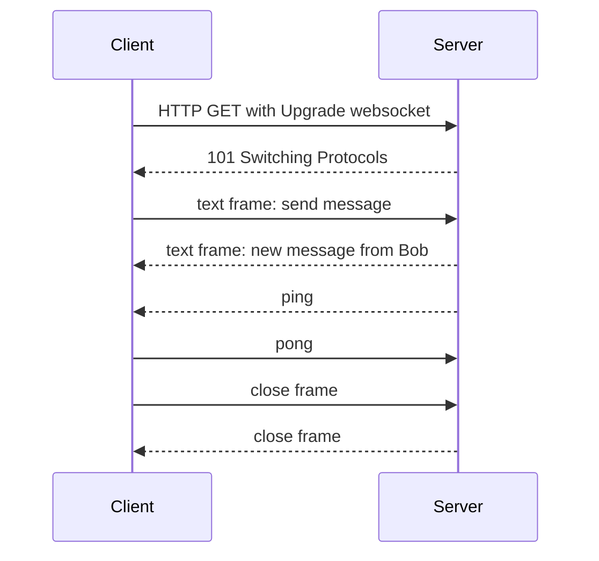
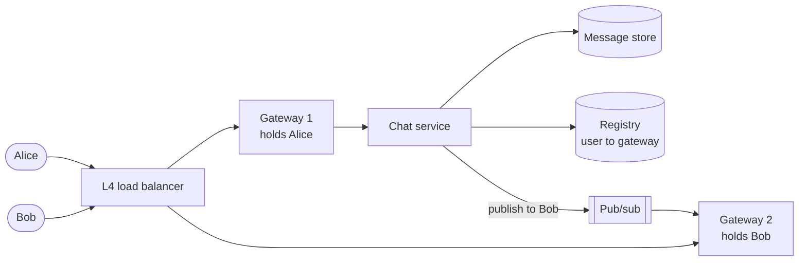

# WebSockets

## The problem it solves

A chat app needs to show a new message within a few hundred milliseconds. Over plain HTTP, the client has to ask. Polling every 2 seconds means an average delay of 1 second, and with 1 million online users it's 500,000 requests per second, almost all returning "nothing new", each carrying hundreds of bytes of headers. Long polling cuts the empty responses but still tears down and re-creates a request after every message.

A **WebSocket** is a single long-lived TCP connection, opened with an HTTP handshake, over which **both sides can send messages at any time** with only a few bytes of framing overhead.

## How it works

**1. The upgrade handshake.** The client sends a normal HTTP/1.1 GET asking to switch protocols:

```
GET /chat HTTP/1.1
Host: chat.example.com
Upgrade: websocket
Connection: Upgrade
Sec-WebSocket-Key: dGhlIHNhbXBsZSBub25jZQ==
Sec-WebSocket-Version: 13
```

The server replies `101 Switching Protocols` with `Sec-WebSocket-Accept`, which is `base64(SHA-1(key + fixed GUID))`. That proves the server understood the WebSocket request (it isn't a security feature). From then on, the TCP connection carries WebSocket frames instead of HTTP. Use `wss://` (TLS) in production, which also helps get through proxies.

**2. Framing.** Each message is sent as one or more frames. A frame header is 2 bytes minimum: a FIN bit (last fragment?), an opcode (text, binary, close, ping, pong, continuation), a mask bit and a payload length (extended to 2 or 8 more bytes for larger payloads). Frames from client to server are masked with a 4-byte key, to stop poisoning of intermediary caches. Ping/pong frames act as heartbeats so both sides notice dead connections.



**3. Scaling stateful connections.** The hard part isn't the protocol, it's that each connection is pinned to one server process.

- **Connection gateway tier.** Dedicated servers hold the sockets and do little else. Business logic lives in stateless services behind them.
- **Routing messages to the right server.** When Alice sends to Bob, the system must find which gateway holds Bob's socket. Options: a **connection registry** (Redis map `user → gateway`, with TTL refreshed by heartbeats) plus direct gateway-to-gateway calls, or **pub/sub** where each gateway subscribes to channels for its connected users.
- **Load balancing.** L4 load balancers or L7 ones that support upgrades. Connections are long-lived, so new servers only get new connections; rebalancing means asking clients to reconnect.
- **Reconnects.** Deploys and failures drop connections. Clients reconnect with exponential backoff and jitter, and send the last message ID they saw so the server can replay what they missed from durable storage. Without jitter, a gateway restart creates a thundering herd.
- **Limits per server.** Each connection costs a file descriptor and some memory for buffers; raise `ulimit` and tune kernel buffers.



## Worked example

Planning for 10 million concurrent users, assuming each gateway holds 100,000 connections (a planning assumption; the real number depends on memory and message rate):

| Quantity | Calculation | Result |
|---|---|---|
| Gateways needed | 10,000,000 / 100,000 | 100 servers (plus headroom, e.g. 130) |
| Heartbeats per second, ping every 30 s | 10,000,000 / 30 | ~333,000 pings/s across the fleet, ~3,300 per server |
| Polling every 2 s instead | 10,000,000 / 2 | 5,000,000 HTTP requests/s |
| One gateway crashes | 100,000 clients reconnect | Spread with jitter over 30 s ≈ 3,300 reconnects/s, rather than 100,000 at once |

## Trade-offs

- **Pros:** true bidirectional, low-latency messaging; tiny per-message overhead after the handshake; works in every modern browser.
- **Cons:** stateful servers complicate deploys, autoscaling and load balancing; you need your own heartbeat, reconnect, resume and backpressure logic; some corporate proxies interfere; no built-in HTTP semantics (caching, status codes per message).
- **Alternatives:** **Server-Sent Events** when only the server pushes (simpler, plain HTTP, auto-reconnect); **long polling** as a fallback; **HTTP/2 or HTTP/3 streaming**; **WebTransport** for newer use cases; mobile push notifications for users who aren't connected.

## When to use it (and when not)

- **Use it** for chat ("design WhatsApp/Slack/Messenger"), multiplayer games, collaborative editors ("design Google Docs"), live trading screens, and driver location updates in "design Uber" where the client sends and receives frequently.
- **Not needed** for one-way feeds like live scores, notifications or LLM token streaming (SSE is simpler), or for updates every few minutes (polling is fine and stateless).

## In an interview

Say: "Clients hold a WebSocket to a gateway tier; a Redis registry maps user to gateway, and the chat service publishes to the recipient's gateway, which pushes over the socket; on reconnect the client sends its last message ID to resync." Be ready to explain the handshake, heartbeats, how messages find the right server, and what happens when a gateway dies.

## Common follow-up questions

### How does a message reach a user connected to a different server?
Look up the recipient's gateway in a registry and forward to it, or have every gateway subscribe to a pub/sub channel per connected user (or per gateway) and publish there. The message is also persisted first, so if the user is offline it's delivered on reconnect or via push notification.

### How do you deploy a new version without dropping everyone at once?
Drain gateways gradually: stop sending new connections to a server, then close existing sockets in batches with a close frame. Clients reconnect with jittered backoff to other servers and resume from their last seen message ID.

### Why do you need application-level heartbeats if TCP already has keepalive?
TCP keepalive defaults are measured in hours and are often stripped by middleboxes. Pings every 20–60 seconds detect half-open connections quickly so the server can clean up the registry, and they keep NAT and load balancer idle timeouts from closing the connection.

### How do you authenticate a WebSocket?
Authenticate during the handshake, typically with a cookie or a short-lived token in the query string or the first message, since browsers can't set custom headers on the WebSocket constructor. Re-check authorization when subscribing to channels, and close the socket if the token is revoked.
