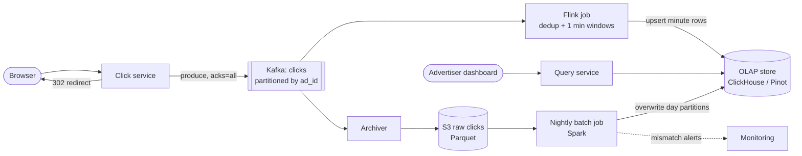
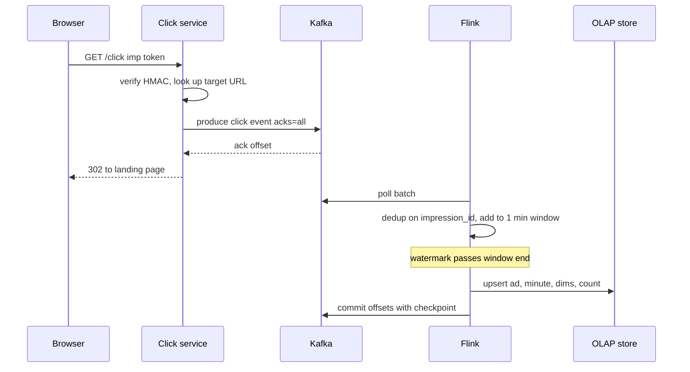

# Design an Ad Click Aggregator

## Requirements

**Functional**
1. When a user clicks an ad, record the click and redirect the user to the advertiser's landing page.
2. Advertisers query click metrics for their ads over a time range, at minute, hour or day granularity, optionally grouped by dimensions such as country or device.

**Non-functional**
- **No lost clicks, no double counting:** advertisers are billed on these numbers, so every valid click is counted exactly once in the final figures.
- **Near real time:** a click shows up in dashboards within ~1 minute.
- **Throughput:** ~10k clicks/s at peak, ~100M clicks/day.
- **Fast queries:** dashboard queries return in under ~1 s, even over months of data.
- **Redirect latency:** the redirect adds under ~50 ms; recording must never block it for long.

**Out of scope:** ad serving and auction, billing and invoicing, conversion tracking.

### Back-of-envelope estimates

| Quantity | Estimate | Implication |
|---|---|---|
| Average click rate | 100M / 86,400 s ≈ 1,160 clicks/s | Peak of 10k/s is ~9× average; size for peak |
| Raw event size | ~500 bytes (ids, timestamp, IP, user agent, dimensions) | 10k/s × 500 B = 5 MB/s into Kafka, small for a cluster |
| Raw storage | 100M × 500 B = 50 GB/day ≈ 18 TB/year | Raw events go to cheap object storage (S3), not the query store |
| Minute aggregates | at most 10k/s × 60 = 600k clicks per minute, so ≤ 600k (ad, minute) rows per minute even in the worst case; far fewer in practice since clicks repeat per ad | Pre-aggregated rows are orders of magnitude smaller than raw events |
| Kafka retention | 7 days × 50 GB × replication 3 ≈ 1 TB | Allows replaying a week of clicks to fix bugs |

## Core entities

| Entity | Key fields | Store/Notes |
|---|---|---|
| Ad | `ad_id`, `advertiser_id`, `campaign_id`, `target_url` | Postgres; cached in the click service |
| Click event | `click_id` (UUID), `ad_id`, `impression_id`, `user_id?`, `ip`, `user_agent`, `country`, `device`, `ts` | Kafka topic `clicks`, partitioned by `ad_id`; archived to S3 as Parquet |
| Minute aggregate | (`ad_id`, `minute`, `country`, `device`) → `clicks`, `unique_users` (sketch) | OLAP store (ClickHouse / Druid / Pinot), partitioned by day, sorted by `ad_id, minute` |
| Dedup state | `click_id` or `impression_id` seen set | Flink keyed state with TTL (~1 h) |

## API

```
GET /click?imp={signedImpressionToken}
    → 302 Location: https://advertiser.example/landing
    → 400 if the token signature is invalid (still redirect to a safe default if ad is known)

GET /v1/ads/{adId}/metrics?from=2026-11-01T00:00Z&to=2026-11-01T06:00Z&granularity=minute|hour|day&groupBy=country
    → 200 { adId, granularity, series: [ { bucket: "2026-11-01T00:00Z", country: "US", clicks: 1234 } ] }
    → 403 if adId does not belong to the caller's advertiser account
```

- The click URL carries a **signed impression token** created by the ad server when the ad was shown: `{impression_id, ad_id, ts}` plus an HMAC. The click service can verify it without a database lookup, and `impression_id` becomes the natural deduplication key (one impression can produce at most one billable click).
- The redirect is a 302, not a 301, so browsers don't cache it and skip our tracking on later clicks.
- The advertiser ID comes from the auth token; the service checks the ad belongs to it.

## High-level design



**Click flow**
1. The browser hits `/click?imp=...`. The click service verifies the HMAC, looks up the target URL from an in-memory cache, and builds a click event with a fresh `click_id`.
2. It produces the event to Kafka with `acks=all` and waits for the acknowledgment (a few ms), then returns the 302. If Kafka is unreachable, it writes the event to a local disk buffer and redirects anyway; a sidecar drains the buffer later.

**Aggregation flow**
3. Flink reads `clicks`, drops duplicates by `impression_id`, assigns each click to a one-minute event-time window, and emits a row per (ad, minute, country, device) when the window closes.
4. Rows are upserted into the OLAP store keyed by (ad, minute, dims), so a replayed write overwrites rather than adds.

**Reconciliation flow**
5. An archiver writes raw events to S3 hourly. A nightly Spark job recomputes exact daily aggregates from S3 and replaces the corresponding OLAP partitions. Differences above a threshold raise an alert.

**Query flow**
6. The query service turns a request into SQL against the OLAP store, using hourly or daily rollups for long ranges.



## Deep dives

### Streaming aggregation with Kafka and Flink

- **Weak:** write each click as a row in Postgres and run `COUNT(*) GROUP BY` at query time. At 10k writes/s and billions of rows, queries take minutes.
- **Better:** increment counters (`INCR clicks:{ad}:{minute}` in Redis) per click. Fast, but a retry after a timeout double counts, and there is no way to recompute if a bug is found.
- **Best:** an append-only log (Kafka) plus a stream processor (Flink) that aggregates into windows and writes idempotent results. The log is the source of truth and can be replayed.

#### How tumbling windows with watermarks work

A **tumbling window** is a fixed, non-overlapping time bucket: [12:00, 12:01), [12:01, 12:02) and so on. Flink assigns each click to a bucket by its **event time** (when the click happened, set by the click service), not by when Flink sees it, so a delayed click still lands in the right minute.

The question is when a window is "done". Flink uses a **watermark**: a marker that says "no events older than T are expected any more". A common strategy is `watermark = max event time seen − allowed lateness`. With 10 s lateness:

| Wall clock | Event arriving (event time) | Max seen | Watermark | Action |
|---|---|---|---|---|
| 12:01:02 | click at 12:00:58 | 12:00:58 | 12:00:48 | add to window 12:00 |
| 12:01:05 | click at 12:01:04 | 12:01:04 | 12:00:54 | add to window 12:01 |
| 12:01:08 | click at 12:00:59 (late) | 12:01:04 | 12:00:54 | still added to window 12:00 |
| 12:01:12 | click at 12:01:11 | 12:01:11 | 12:01:01 | watermark passed 12:01:00, so window 12:00 fires and its count is emitted |
| 12:01:20 | click at 12:00:50 (late) | 12:01:11 | 12:01:01 | window already fired, but within allowed lateness: window re-fires with the new total, which overwrites the row |
| 12:09:00 | click at 12:00:40 (very late) | 12:08:55 | 12:08:45 | more than 5 min past the window: sent to a side output |

Clicks that arrive after a window fired but within the allowed lateness (5 min below) make the window fire again with the corrected total, which the sink upserts. Anything later goes to a side output topic and is picked up by the nightly batch. This gives ~70 s end-to-end latency, inside the 1 minute target for most clicks plus the configured lateness.

```java
clicks
  .assignTimestampsAndWatermarks(
      WatermarkStrategy.<Click>forBoundedOutOfOrderness(Duration.ofSeconds(10))
                       .withTimestampAssigner((c, t) -> c.ts))
  .keyBy(c -> c.impressionId).process(new Dedup())          // see next section
  .keyBy(c -> c.adId + "|" + c.country + "|" + c.device)
  .window(TumblingEventTimeWindows.of(Time.minutes(1)))
  .allowedLateness(Time.minutes(5))                          // re-fire with updated count
  .sideOutputLateData(lateTag)
  .aggregate(new CountAgg())
  .addSink(olapUpsertSink);
```

#### How exactly-once counting works end to end

"Exactly once" is really "at least once delivery plus idempotent or transactional effects":

1. **Producer:** Kafka's idempotent producer (`enable.idempotence=true`) attaches a producer ID and sequence number to each batch, so a retried send is not written twice.
2. **Flink:** every ~30 s Flink takes a **checkpoint**: it snapshots all operator state (window counts, dedup sets) together with the Kafka offsets it has consumed. If a task crashes, Flink restores the last checkpoint and re-reads Kafka from those offsets. State and offsets always agree, so no click is counted twice in Flink state.
3. **Sink:** after a restore, Flink may re-emit window results it already wrote. Because the sink writes `(ad, minute, dims) → count` as an **upsert** (ClickHouse `ReplacingMergeTree`, Pinot upsert tables), the re-emitted row overwrites the old one with the same value. Writing an increment instead of a total would break this.

### Deduplication and click fraud

Duplicates come from three places: the user double-clicks, the client or a proxy retries the request, and our own pipeline replays after a failure. The third is handled by checkpoints and upserts above. The first two need deduplication on a business key.

#### How the dedup operator works

Key the stream by `impression_id` and keep a small piece of state per key: "seen". Flink stores keyed state in RocksDB on local disk, included in checkpoints, with a TTL so it doesn't grow forever.

```
on click c (keyed by c.impression_id):
    if state.seen: drop c; metric("duplicate")
    else: state.seen = true; state.ttl = 1h; emit c
```

Worked example: impression `imp-77` is clicked at 12:00:03, the browser retries at 12:00:04, and a bot replays the URL at 12:40. The first is emitted, the second and third are dropped because the key is still in state. A replay at 14:00 would get past the 1 h TTL, which is why the HMAC token also carries a timestamp and the click service rejects tokens older than, say, 1 hour. State size: at 10k clicks/s and a 1 h TTL, 36M keys × ~50 bytes ≈ 1.8 GB spread across the Flink cluster, which is fine.

#### Fraud filtering

- **Online rules** in the stream: drop clicks from known bot user agents and data-center IP ranges, and cap clicks per (IP, ad) per minute with a keyed counter.
- **Offline models** in the nightly batch: look for click farms (many users, same device fingerprint), click-through rates far above normal, and clicks with no landing-page dwell time. Invalid clicks are removed in the reconciled numbers, and advertisers are credited.

### Lambda versus Kappa, and reconciliation

| Architecture | How it works | Pros | Cons |
|---|---|---|---|
| Lambda | Streaming layer for fast approximate numbers, batch layer recomputes exact numbers from raw data; serving merges them | Batch is a safety net for streaming bugs and late data | Two codebases to keep in sync |
| Kappa | Only streaming; to fix a bug, replay the Kafka log through a new job version | One codebase | Requires long log retention; replay of months is slow |
| **Chosen: Kappa plus a reconciliation batch** | Flink produces the numbers; a nightly Spark job over S3 recomputes daily totals and overwrites the day partitions | Fast numbers, exact final billing numbers, simple serving | Some duplicated logic (keep it small: dedup and count) |

How reconciliation works: Spark reads yesterday's Parquet files from S3, applies the same dedup and fraud rules, computes per (ad, hour, dims) counts, and atomically replaces yesterday's partition in the OLAP store. It also diffs against the streaming totals. A difference over 0.1% for any large advertiser triggers an alert, since it usually means a bug or an outage in the streaming path. Billing reads only reconciled partitions.

### OLAP storage and queries

- **Weak:** a row store (Postgres) with an index on `(ad_id, minute)`. Works until the table holds billions of rows and group-bys over months scan too much.
- **Best:** a columnar OLAP store such as ClickHouse, Druid or Pinot. Columns are stored separately and compressed, so a query reading `clicks` and `country` for one ad reads only those columns and only the blocks for that ad.

```sql
CREATE TABLE ad_clicks_minute (
  ad_id UInt64, minute DateTime, country LowCardinality(String),
  device LowCardinality(String), clicks UInt64
) ENGINE = ReplacingMergeTree
PARTITION BY toDate(minute)
ORDER BY (ad_id, minute, country, device);

SELECT toStartOfHour(minute) AS hour, sum(clicks)
FROM ad_clicks_minute FINAL
WHERE ad_id = 42 AND minute >= '2026-10-01' AND minute < '2026-11-01'
GROUP BY hour ORDER BY hour;
```

`ORDER BY (ad_id, minute, ...)` makes all rows for one ad contiguous on disk, so the query reads a narrow range. For long ranges, materialized views maintain hourly and daily rollups, so a one-year daily chart reads 365 rows per dimension combination instead of 525,600 minute rows. `FINAL` forces deduplication of upserted rows at read time; for very hot dashboards, query rollups that are merged in the background instead.

## Production readiness

### Database choice and consistency

- **Postgres for ads and advertisers.** Ownership (`ad_id` → `advertiser_id`) drives authorization and billing, so it needs ACID and foreign keys. It's tiny, and the click service only reads it through an in-memory cache.
- **Kafka as the system of record for clicks:** replayable, ordered, durable appends; a database would add nothing at 10k writes/s.
- **Columnar OLAP for aggregates**, for the reasons in the deep dive. Its writes are idempotent upserts rather than transactions; the only atomic operation needed is the nightly **partition replace**, so readers see either the old day or the reconciled day, never a mix.
- **Consistency per path:** click capture is **AP**: always redirect and buffer locally, because a failed redirect loses the advertiser's visitor. Dashboards are **eventually consistent** (~70 s, then corrected by late re-fires and the nightly batch). Billing is effectively **CP**: it reads only reconciled partitions, and if reconciliation fails, invoicing waits rather than bill on unverified numbers.

### Service boundaries and communication

- **Click service** is public, unauthenticated, stateless and latency-critical. **Query service** is authenticated, read-heavy and tolerant of a second of latency. Splitting them keeps different SLOs, scaling and attack surfaces apart.
- **Don't split further:** dedup, fraud rules and windowing stay in one Flink job. A separate dedup service called per click would add a network hop and a second state store to keep consistent.
- **Sync vs async:** the only synchronous dependency on the click path is the Kafka produce, with a ~20 ms timeout inside the 50 ms budget, then the disk-buffer fallback. Ad lookups come from a cache refreshed in the background, never a per-click DB call. Everything downstream of Kafka is async.

### Failure modes and reliability

| Failure | Effect | Mitigation |
|---|---|---|
| Kafka slow or unreachable | Produce latency threatens the 50 ms redirect | 20 ms timeout, then local WAL (follow-up); a circuit breaker skips Kafka while it's open so every click doesn't wait out the timeout |
| Flink task crash or failed checkpoints | Dashboards stall; lag grows | Restore from the last checkpoint; Kafka holds 7 days; alert on checkpoint age and consumer lag |
| OLAP store down | Sink backpressures Flink; dashboards fail | Flink buffers via Kafka lag; query service serves cached results with a "data as of" note (graceful degradation) |
| Bot flood (10× peak of forged or replayed URLs) | Click service and Flink overloaded, inflated counts | HMAC rejects forged tokens before producing; per-IP rate limits at the edge; dedup and fraud rules drop replays; shed recording, never the redirect |
| Hot ad | One Flink task lags | Salted key with a second aggregation stage (follow-up) |
| Bad deploy changes counts | Wrong numbers reach billing | Reconciliation diff over 0.1% blocks the partition swap and pages; replay from Kafka or S3 after the fix |

### High availability and disaster recovery

- **SPOFs:** click service in at least 2 regions behind latency-based DNS with health checks; each region runs its own Kafka (RF 3 across zones) and Flink job. Flink runs with HA for its job manager and checkpoints to object storage. Postgres runs with a standby.
- **Multi-region aggregation:** include `region` in the OLAP key so each region's Flink upserts its own rows and queries sum them. Rare cross-region duplicate clicks on the same impression are removed by the nightly global dedup.
- **Why multi-region for clicks:** at average load, a 10-minute regional outage is ~700k clicks (1,160/s × 600 s), which is direct lost revenue. Dashboards don't justify that, but the redirect does.
- **Targets:** redirect **RTO under 1 minute** (DNS failover). Acked clicks **RPO 0** for zone loss. For region loss, **RPO equals the async mirror lag of that region's Kafka (target under 1 minute)** plus any undrained click-host buffers. Dashboards **RTO 15 minutes**. Billing **RTO is hours**, since it runs nightly.
- **Backups:** S3 raw data is the real backup: versioned, replicated cross-region, with object lock for the billing-dispute period. The OLAP store can be rebuilt from it. Postgres uses PITR.

### Security

- **Click tokens:** HMAC with a key ID in the token; accept the current and previous key during rotation, and keep keys in a secrets manager or KMS.
- **Open redirects:** only ever redirect to the ad's stored `target_url`, never to a URL in the request.
- **Advertiser API:** OAuth tokens; the query service always adds `advertiser_id` to the predicate, so isolation doesn't depend on the client.
- **PII:** IP, user agent and `user_id` exist only in Kafka and raw S3. Pseudonymize `user_id` with a keyed hash, truncate IPs after the fraud-analysis window, and keep aggregates PII-free. Encrypt buckets and disks; use TLS everywhere.
- **Audit:** log access to raw click data, reconciliation overrides, and any manual credit to advertisers, since these affect money.
- **Abuse:** fraud rules (deep dive) plus per-advertiser query rate limits.

### Observability

**SLIs and SLOs (30 days):**
- 99.95% of valid clicks redirected within 50 ms server-side.
- 99% of minute buckets visible in dashboards within 90 s of the minute ending.
- Daily stream vs reconciled totals within 0.1% for every advertiser above a spend threshold.
- 99% of dashboard queries within 1 s.

**Metrics:** the per-stage counts from the "no clicks lost" follow-up, the duplicate and fraud drop rates, late side-output volume, Flink checkpoint duration, and the click hosts' disk-buffer depth.

**Tracing:** sample click requests; for the stream, stage counters beat per-event traces.

**Paging:** redirect error or latency burn rate, freshness burn, and a blocked reconciliation. A spike in the duplicate rate is a ticket (it may be a bot campaign or a client bug).

### Performance and cost

**Bottleneck:** redirect latency, not throughput (5 MB/s is small). Keep producer `linger.ms` at a few ms, which trades a little batching efficiency for latency, and use persistent pooled connections. In the OLAP store, the `(ad_id, minute)` sort key and rollups keep queries narrow. Avoid `FINAL` on hot dashboards by reading background-merged rollups.

**Cost drivers:**
- **Raw archive, ~18 TB/year growing without bound.** Move Parquet to infrequent-access storage after 90 days and delete after the contractual dispute window. The trade-off is that older reprocessing becomes slower and costs retrieval fees.
- **OLAP minute rows.** Keep minute granularity for ~30 days and hour/day rollups for years. Advertisers lose minute detail on old campaigns.
- **Kafka and mirroring** (1 TB, ~50 GB/day) are small.
- **The real cost risk is incorrect billing**, not infrastructure. Reconciliation and the duplicate Spark logic are worth their operational cost; this is the wrong place to economize.

## Follow-up questions

### What happens if Kafka is down when a click arrives?
The click service still redirects, because a broken redirect costs the advertiser the visit and us the click. It appends the event to a local write-ahead file on disk and a sidecar replays it to Kafka when the cluster recovers. Event time is set at the click service, so the replayed clicks land in the correct minute, either as late data or in the nightly reconciliation.

### How would you handle a hot ad that gets a huge share of clicks?
Partitioning by `ad_id` sends all of its clicks to one Kafka partition and one Flink task. For a known hot ad, salt the key (`ad_id#0..7`) so clicks spread across 8 tasks, aggregate each sub-key, then sum the 8 partial counts in a second small stage. At 10k clicks/s total this is rarely needed, but it matters at 100× the scale.

### How do you count unique users per ad?
Exact distinct counts across arbitrary time ranges require keeping every user ID. Instead, store a HyperLogLog sketch per (ad, minute) row; sketches can be merged to get hourly or monthly uniques with about 1% error using a few KB each. ClickHouse's `uniqCombined` and Druid's HLL and theta sketches do this natively.

### Why not let the browser send the click directly to the advertiser and report it to us asynchronously?
Asynchronous beacons get lost when the page navigates away, and the client can't be trusted for billing data. Routing the click through our redirect means we see every click before the user reaches the advertiser. The trade-off is a few milliseconds of extra latency on the redirect.

### How would you change the aggregation logic for past data, say a new fraud rule?
Deploy a new version of the batch job and rerun it over the S3 archive for the affected days, overwriting those partitions. For recent data still in Kafka retention, you can also run a second Flink job from an earlier offset into a shadow table, compare, and switch. The raw immutable log is what makes this possible.

### How do you make dashboards fast for an advertiser with 10,000 ads?
Add an `advertiser_id` column and a rollup ordered by `(advertiser_id, day)`, so "all my ads last month" is one range scan over pre-summed rows. Cache popular dashboard queries for 30–60 s in Redis, since the data only changes once a minute anyway.

### What latency does the advertiser actually see, and can it be lower?
About window size plus allowed lateness plus sink delay: roughly 1 minute plus 10 s plus a few seconds. Lower latency is possible with 10 s windows or by querying an in-progress partial count, at the cost of more rows and more re-emitted updates. One minute is a common standard for advertiser dashboards.

### How do you monitor that no clicks are lost?
Count events at every stage: clicks redirected (from click service logs), events produced to Kafka, events consumed and deduplicated by Flink, and the summed counts in the OLAP store, per minute. Alert when adjacent stages diverge by more than the expected duplicate rate. The nightly reconciliation diff is the final end-to-end check.
