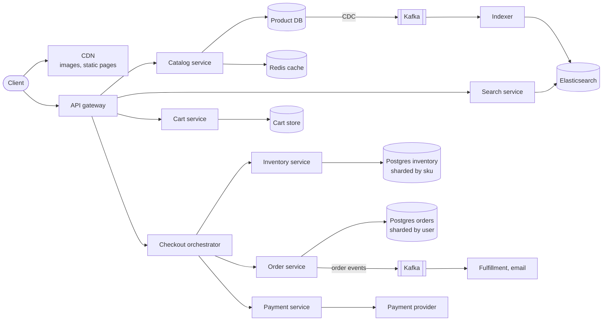
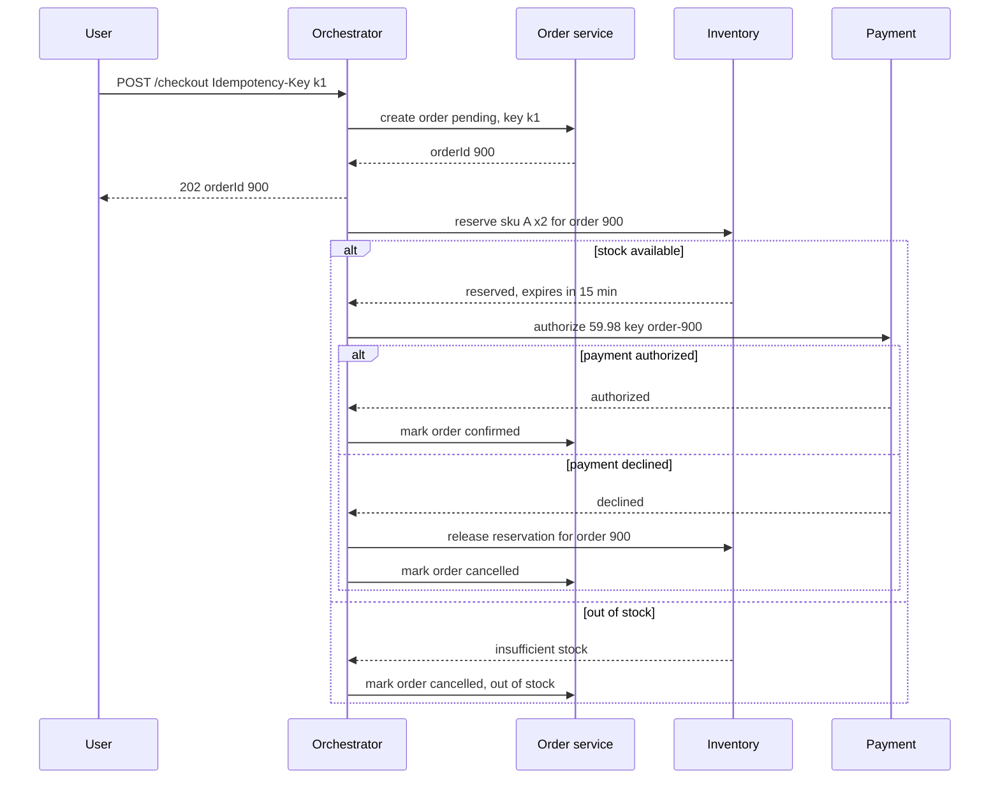
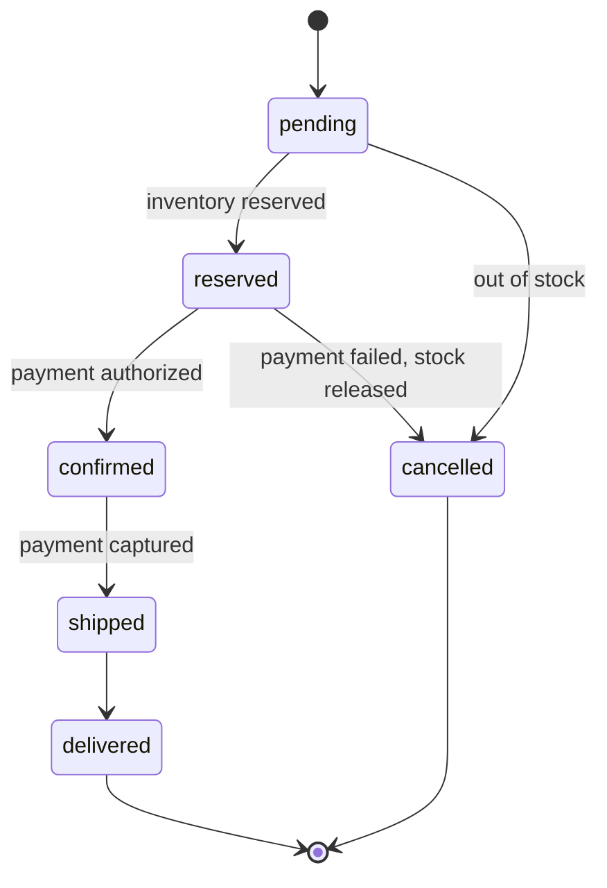

# Design an E-commerce Platform (Amazon)

## Requirements

**Functional**
1. Browse and search products by keyword, category, price and other filters.
2. Add, update and remove items in a cart that persists across devices.
3. Check out: reserve inventory, take payment and create an order.
4. Sellers and warehouse staff manage inventory levels; customers see order status.

**Non-functional**
- **High availability for browsing and search:** 99.99%; stale prices or stock counts for a few seconds are acceptable on product pages.
- **Strong consistency for inventory and payments:** never sell more units than exist, never charge twice.
- **Flash-sale spikes:** a deal can bring 100× normal traffic to one product within seconds.
- **Latency:** product pages under ~200 ms p99, search under ~300 ms, checkout under ~2 s.
- **Scale:** ~100M DAU, ~500M products, ~10M orders/day.

**Out of scope:** recommendations, reviews, seller onboarding, shipping logistics.

### Back-of-envelope estimates

| Quantity | Estimate | Implication |
|---|---|---|
| Page views | 100M DAU × 20 = 2B/day ≈ 23k/s average, ~100k/s peak | Serve from CDN and caches; the catalog DB must not see this traffic |
| Orders | 10M/day ≈ 116/s average; ~10× at peak ≈ 1,200/s | Order writes are modest; contention on hot SKUs is the hard part |
| Flash sale | 1M users try to buy 10k units in a minute ≈ 17k attempts/s on one SKU | One inventory row can't take this directly; needs gating and a pre-check in memory |
| Catalog size | 500M products × ~10 KB = 5 TB | Sharded document store; search index is a separate copy |
| Order storage | 10M × ~2 KB = 20 GB/day ≈ 7.3 TB/year | Shard orders by `user_id`; archive old orders |

## Core entities

| Entity | Key fields | Store/Notes |
|---|---|---|
| Product | `product_id`, `title`, `description`, `attributes`, `price`, `seller_id`, `images` | DynamoDB or MongoDB, PK `product_id`; mirrored to Elasticsearch |
| Inventory | `sku_id`, `warehouse_id`, `available`, `reserved`, `version` | Postgres, PK (`sku_id`, `warehouse_id`); sharded by `sku_id` |
| Reservation | `reservation_id`, `order_id`, `sku_id`, `qty`, `expires_at`, `status` | Postgres, same shard as the SKU |
| Cart | `user_id` → list of (`sku_id`, `qty`, `added_price`) | DynamoDB or Redis with persistence, PK `user_id` |
| Order | `order_id`, `user_id`, `items`, `total`, `status`, `payment_id`, `idempotency_key` | Postgres sharded by `user_id`; unique index on `idempotency_key` |
| Payment | `payment_id`, `order_id`, `amount`, `provider_ref`, `status` | Payment service DB |

## API

```
GET    /v1/products/{productId}                      → 200 { product, price, stockStatus: "in_stock" | "low" | "out" }
GET    /v1/search?q=headphones&category=&minPrice=&cursor=
                                                      → 200 { results: [...], facets: {...}, nextCursor }
GET    /v1/cart                                       → 200 { items: [{ skuId, qty, price }], subtotal }
PUT    /v1/cart/items/{skuId}   { qty }               → 200 cart   (qty 0 removes)
POST   /v1/checkout             Idempotency-Key: <uuid>
       { addressId, paymentMethodToken }              → 202 { orderId, status: "pending" }
                                                      → 409 { outOfStock: [skuId] }
GET    /v1/orders/{orderId}                           → 200 { status, items, total }
PATCH  /v1/inventory/{skuId}    { warehouseId, delta } (seller/warehouse, authenticated) → 200
```

- **Idempotency key on checkout:** a double click or a client retry after a timeout returns the same order instead of creating a second one and charging twice.
- **Checkout returns 202:** the saga below takes a second or two; the client polls `GET /orders/{id}` or receives a push.
- **Cursor pagination** for search, since offsets get slow and inconsistent deep in result sets.
- The user ID comes from the auth token; prices are recomputed on the server at checkout, never trusted from the client.

## High-level design



**Browse flow**
1. Product pages are assembled from the catalog service, which reads Redis first (cache-aside) and falls back to the product DB. Images come from the CDN.
2. Stock status on the page is a cached, coarse value ("in stock", "only 3 left"), refreshed from inventory events.

**Search flow**
3. Catalog changes stream through CDC into Kafka; an indexer updates Elasticsearch. The search service queries Elasticsearch and caches popular queries for ~60 s.

**Checkout flow**
4. The orchestrator loads the cart, reprices it, creates an order in `pending`, reserves inventory, authorizes payment, then confirms the order. Each step is a local transaction in its own service, coordinated as a saga.
5. The confirmed order emits an event; fulfillment converts the reservation into a deduction when the item ships, and email sends a receipt.





## Deep dives

### Inventory reservation without overselling

**The race:** two buyers see "1 left" and both click buy. Each reads `available = 1`, each decides it's enough, each writes `available = 0`. One unit, two orders.

- **Weak:** read, check, write in application code. Lost update, as above.
- **Weak:** decrement stock only when the item ships. Thousands of orders could be accepted for 10 units.
- **Better:** pessimistic lock: `SELECT ... FOR UPDATE` on the inventory row, check, update, commit. Correct, but on a hot SKU every buyer queues on one row lock.
- **Best:** a **conditional update** that folds the check into the write, plus a reservation with an expiry so abandoned checkouts free their stock.

#### How the conditional reservation works

```sql
BEGIN;
UPDATE inventory
   SET available = available - 2, reserved = reserved + 2
 WHERE sku_id = 'A' AND warehouse_id = 7 AND available >= 2;
-- rows affected = 1 → we got the stock; 0 → not enough, roll back and return 409
INSERT INTO reservations (reservation_id, order_id, sku_id, warehouse_id, qty, expires_at, status)
VALUES ('r-1', 900, 'A', 7, 2, now() + interval '15 minutes', 'active');
COMMIT;
```

The database evaluates `available >= 2` and applies the update while holding the row lock for a few microseconds, so two concurrent statements are serialized and the second sees the reduced value. Worked example with 3 units:

| Time | Request | Before (available / reserved) | Condition | After |
|---|---|---|---|---|
| t1 | order 900 wants 2 | 3 / 0 | 3 ≥ 2, true | 1 / 2 |
| t2 | order 901 wants 2 | 1 / 2 | 1 ≥ 2, false (0 rows) | 1 / 2, return 409 |
| t3 | order 902 wants 1 | 1 / 2 | 1 ≥ 1, true | 0 / 3 |
| t4 | order 900 payment fails, release | 0 / 3 | — | 2 / 1 |
| t5 | order 902 ships, deduct | 2 / 1 | — | 2 / 0 (reserved −1) |

A sweeper job runs every minute: for reservations with `status = 'active' AND expires_at < now()`, it moves the quantity from `reserved` back to `available` in one transaction and marks them `expired`. A `CHECK (available >= 0)` constraint is a last line of defense.

#### Handling flash sales on one hot SKU

At ~17k attempts/s on one row, even microsecond locks queue up, and most requests are going to fail anyway. Shield the database:

1. **Pre-check counter in Redis:** load `stock:A = 10000` before the sale. Each attempt runs `DECRBY stock:A 2`; if the result is negative, `INCRBY` it back and return "sold out" immediately. Redis handles ~100k simple ops/s per shard, so only requests that will probably succeed reach Postgres. Postgres remains the source of truth: if the Redis counter and the DB disagree, the DB conditional update decides.
2. **Waiting room / admission token** for advertised deals, admitting buyers at a rate Postgres can handle.
3. **Split the inventory row:** store the SKU's stock as 10 sub-rows of 1,000 units each and pick one at random per request, so locks are spread over 10 rows. When a sub-row hits zero, try another.

### Distributed checkout with the saga pattern

Inventory, orders and payments are separate services with separate databases, so one ACID transaction across them isn't available.

| Option | How it works | Verdict |
|---|---|---|
| Two-phase commit | A coordinator asks all participants to prepare (lock resources), then commit | **Weak:** blocks if the coordinator dies mid-protocol; external payment providers don't support it |
| Choreography saga | Each service listens for the previous service's event and emits its own | **Better:** loosely coupled, but the flow is hard to see and debug across many services |
| **Orchestration saga** | A central orchestrator calls each step and, on failure, calls compensating actions in reverse | **Best** for checkout: the flow is explicit, state is in one place, timeouts are easy |

#### How an orchestrated saga works

A saga is a sequence of local transactions, each with a **compensating action** that semantically undoes it:

| Step | Action | Compensation |
|---|---|---|
| 1 | Create order `pending` | Mark order `cancelled` |
| 2 | Reserve inventory | Release reservation |
| 3 | Authorize payment (hold funds) | Void authorization |
| 4 | Confirm order | (no compensation: the saga is complete) |

The orchestrator persists its state after every step, e.g. a row `saga(order_id=900, step=3, status=running)`. If it crashes after step 2, a new instance reads the row and resumes at step 3. This means every step can run more than once, so every step must be **idempotent**: the reserve call carries `order_id` and the inventory service has a unique constraint on `(order_id, sku_id)` in reservations, so a retry finds the existing reservation and returns success. The payment call passes `order-900` as the provider's idempotency key (Stripe and Adyen both support this), so a retried authorization does not create a second hold.

Authorizing at checkout and **capturing** at shipment is deliberate: if an item turns out to be unavailable in the warehouse, the order is cancelled and the authorization voided, so no refund is needed. Workflow engines such as Temporal or AWS Step Functions implement this durable orchestration so you don't hand-roll the state table.

### Catalog caching and search

- **Product pages:** cache-aside in Redis keyed by `product:{id}` with a TTL of ~10 minutes, invalidated on catalog change events. Full HTML for popular pages can be cached at the CDN for short periods with a separate, uncached call for price and stock.
- **Stock status** is the most volatile field, so it's a separate small cache entry updated by inventory events rather than part of the product blob.
- **Hot keys:** a deal page read 100k times per second overloads one Redis shard. Keep a small in-process cache (a few seconds TTL) in catalog service instances for the top products.
- **Cache stampede:** when a hot entry expires, thousands of requests miss at once. Use a per-key lock so one request refills while others serve the stale value, or refresh popular entries early, before expiry.

#### How the search index stays in sync

Dual writes (app writes the DB, then Elasticsearch) lose updates when the second write fails. Instead, **change data capture** reads the database's replication log (Debezium on the Postgres WAL or a DynamoDB stream), publishes each row change to Kafka keyed by `product_id`, and an indexer applies it to Elasticsearch with the product's version as the external version, so an older event arriving late can't overwrite newer data. Elasticsearch handles full-text relevance (BM25), filters and facets via aggregations; results are re-ranked by sales and conversion signals. The index lags the DB by a second or two, which is acceptable for browsing.

## Follow-up questions

### Where do you store the cart, and what happens for guest users?
A key-value store keyed by `user_id` (DynamoDB, or Redis with persistence) since access is always by user and the data is small. Guests get a cart keyed by a cookie ID; at login, merge the guest cart into the user's cart. The cart stores the price seen when added only for display; checkout always reprices.

### Should adding to cart reserve inventory?
No. Most carts are abandoned, so reserving at add-to-cart would lock up stock that never sells. Reserve at checkout with a short expiry. For flash sales, some sites reserve for a few minutes after "buy now" as part of the checkout flow, which is the same mechanism with a shorter TTL.

### How do you handle the payment provider timing out?
The authorization status is unknown, so don't guess. Retry with the same idempotency key, which returns the original result if the first call went through. If it keeps failing, leave the saga in a `payment_unknown` state and let a reconciliation job query the provider and either continue or compensate.

### How do you split inventory across warehouses?
Inventory rows are per (SKU, warehouse). At checkout, a sourcing step picks the warehouse closest to the shipping address that has stock and reserves there; if none has enough, it can split the order across warehouses. The product page shows the sum across warehouses, cached.

### How would you scale the orders database?
Shard by `user_id` so a customer's order history is on one shard and "my orders" is a single-shard query. Seller and analytics views come from Kafka order events written into separate read stores. Old orders move to cheaper storage after a year or two.

### How do you keep prices consistent between the page and checkout?
Prices live in a pricing service with versioned prices. Checkout reprices every item; if the price changed since it was added to the cart, the client shows the new price and asks the user to confirm before placing the order. This prevents both stale-cache bugs and client tampering.

### What happens if the order service is down during a flash sale?
Browsing and search stay up because they run on separate services and caches. Checkout returns errors or queues requests behind the waiting room. Bulkheads (separate thread pools and capacity per dependency) and circuit breakers keep the failure from spreading to catalog and cart.

### How do you prevent bots from buying out limited stock?
Per-account and per-payment-method purchase limits enforced in the order service, CAPTCHA or a waiting room at the start of the sale, device fingerprinting, and rate limits per IP and account. Randomizing admission order among users who arrive before the start time removes the advantage of the fastest scripts.
