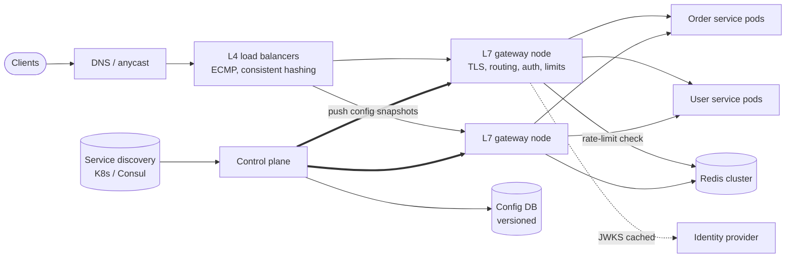
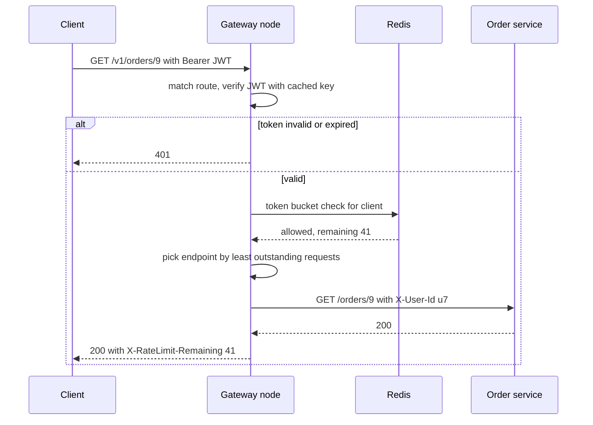

# Design an API Gateway / Load Balancer

## Requirements

**Functional**
1. Route each request to a backend service by host, path, method or header (e.g. `/v1/orders/*` → order service).
2. Authenticate requests (JWT or API key) and pass the verified identity to backends.
3. Rate-limit per client and per route.
4. Health-check backends and stop sending traffic to unhealthy instances.
5. Load-balance across the healthy instances of each service.

**Non-functional**
- **Minimal overhead:** under ~2 ms p50 and ~5 ms p99 added per request.
- **Highly available:** 99.99% (about 52 minutes of downtime a year); no single point of failure.
- **Scale:** ~1M requests/s at peak, ~5M concurrent client connections, ~500 backend services.
- **Fast config changes:** a route or rule change reaches every node within ~10 s, without restarts or dropped connections.

**Out of scope**
- Request/response transformation pipelines, GraphQL federation, the developer portal.

### Back-of-envelope estimates

| Quantity | Estimate | Implication |
|---|---|---|
| Peak traffic | 1M req/s | One L7 node handles ~20k–50k req/s with TLS, so ~20–50 nodes plus headroom; plan ~60 across 3 zones |
| Concurrent connections | 5M / 60 nodes ≈ 83k per node | Event-driven proxies (Envoy, NGINX) hold this with a few GB of memory |
| Rate-limit checks | 1M/s Redis ops | ~10 Redis shards at ~100k ops/s each, or local token batching |
| Config size | 500 services × ~20 routes × ~1 KB ≈ 10 MB | Every node keeps the full config in memory |
| Availability budget | 99.99% of 525,600 min ≈ 53 min/year | Deploys and config changes must be zero-downtime |

## Core entities

| Entity | Key fields | Store/Notes |
|---|---|---|
| Route | `route_id`, match (host, path prefix, method, headers), `cluster`, timeouts, retry policy, auth policy, rate-limit rule | Control-plane DB (Postgres/etcd), versioned; pushed to all nodes |
| Cluster | `cluster_id` (service name), LB algorithm, health-check config, circuit-breaker limits | Control plane |
| Endpoint | `cluster_id`, `ip:port`, zone, weight, health status | From service discovery (Kubernetes endpoints, Consul); changes constantly |
| Rate-limit rule | `rule_id`, key (API key / user / IP), limit, window | Control plane; counters in Redis |
| Config snapshot | `version`, full set of routes, clusters, endpoints | Immutable; nodes report the version they run |

## API

```
Data plane (what clients see):
  ANY https://api.example.com/{path}
      → proxied response from the backend
      → 401 missing or invalid credentials
      → 403 authenticated but not allowed
      → 404 no matching route
      → 429 rate limited (Retry-After header)
      → 502 backend returned garbage or reset, 503 no healthy backend, 504 backend timeout

  Headers added toward backends:
      X-Request-Id, X-User-Id, X-Client-Id, traceparent

Control plane (admin, internal only):
  PUT  /admin/routes/{routeId}   { match, cluster, authPolicy, rateLimit, timeoutMs }  → 200 { version }
  POST /admin/config/rollback    { toVersion }                                       → 200
  GET  /admin/config/status      → { latestVersion, nodes: [{ id, version, healthy }] }
```

Notes:
- The gateway strips any client-supplied `X-User-Id` and sets it only from a verified token, so backends can trust it.
- `X-Request-Id` is generated if absent and logged everywhere, so one request can be traced across services.
- Admin writes create a new immutable config version; rollback is just pointing at an older one.

## High-level design



1. **Connection:** DNS (or anycast) sends the client to the nearest region. An L4 tier spreads TCP connections across L7 gateway nodes; L7 nodes terminate TLS.
2. **Request pipeline on the L7 node:** match the route from the in-memory routing table → authenticate (verify JWT signature locally) → authorize the route's scopes → rate-limit check → pick a healthy endpoint with the cluster's LB algorithm → forward over a pooled, keep-alive connection → return the response, recording metrics and logs.
3. **Health:** each node actively probes endpoints and passively ejects ones that return errors (outlier detection).
4. **Config:** operators change routes through the control plane, which validates, versions and streams the new snapshot to every node; nodes swap it in atomically.



## Deep dives

### L4 vs L7 load balancing, explained

#### How an L4 balancer works

An L4 balancer sees only IP addresses, ports and TCP/UDP packets. It picks a backend when a connection starts and forwards every packet of that connection to the same backend, typically by hashing the 5-tuple (src IP, src port, dst IP, dst port, protocol). It never decrypts TLS or parses HTTP.

- Fast and cheap: millions of packets per second per machine, often in the kernel (IPVS) or with kernel-bypass/XDP. Google's Maglev and Meta's Katran work this way.
- With **direct server return**, responses go straight from the backend to the client, so the balancer only handles the small inbound side.
- Limitation: one long-lived HTTP/2 or gRPC connection carrying thousands of requests always lands on one backend, so load can be very uneven.

#### How an L7 balancer works

An L7 proxy terminates the TCP and TLS connection, parses each HTTP request, and opens (or reuses) a separate connection to a backend. Because it sees every request, it can route by path or header, authenticate, rate-limit, retry, and balance per request rather than per connection.

| | L4 | L7 |
|---|---|---|
| Sees | IPs, ports, packets | Full HTTP: path, headers, body |
| Balances | Per connection | Per request |
| TLS | Passes through | Terminates (needs certificates) |
| Cost | Very low | Higher CPU (TLS, parsing) |
| Features | Forwarding only | Routing, auth, limits, retries, observability |

**Best:** use both. An L4 tier (ECMP routers plus Maglev-style balancers) spreads connections across a horizontally scalable L7 gateway fleet, and the L7 tier does everything request-aware. The L4 tier is what makes the L7 tier replaceable node by node.

### Load-balancing algorithms, explained

All examples use 3 backends: A, B, C.

#### Round robin and weighted round robin

Send request 1 to A, 2 to B, 3 to C, 4 to A, and so on. Weighted round robin repeats each backend in proportion to its weight: with weights A=3, B=1, C=1, five requests go A, B, A, C, A (NGINX's "smooth" weighted round robin interleaves them like this instead of sending three to A in a row). Good when requests cost about the same and machines differ in size. It ignores current load: a backend stuck on slow requests keeps receiving its share.

#### Least connections / least outstanding requests

Track how many requests are in flight to each backend and pick the smallest.

| Time | In flight (A, B, C) | New request goes to | Why |
|---|---|---|---|
| t0 | 0, 0, 0 | A | tie, pick first |
| t1 | 1, 0, 0 | B | |
| t2 | 1, 1, 0 | C | |
| t3 | A finished: 0, 1, 1 | A | |
| t4 | B is slow (GC pause): 1, 6, 1 | A or C | B is avoided automatically |

This adapts to slow backends without any latency measurement. The catch at scale: every gateway node only sees its own in-flight counts, and if all nodes scan for the global minimum they can all pick the same "best" backend at once (herding).

#### Power of two random choices

Pick 2 backends at random and send to the one with fewer outstanding requests. It needs no global scan, and the maximum load is exponentially better than picking one at random: with n backends, the most-loaded one's excess drops from about log n / log log n to about log log n. Because each node's choice includes randomness, nodes don't herd onto one backend. Envoy's default `LEAST_REQUEST` balancer uses this approach.

```
def pick(endpoints):
    a, b = random.sample(endpoints, 2)
    return a if a.in_flight <= b.in_flight else b
```

#### Consistent hashing (ring hash, Maglev)

Hash a key (user ID, session cookie) to choose the backend, so the same key keeps going to the same instance, which helps caches and sticky sessions. Place each backend at many points on a hash ring (e.g. 100 virtual nodes each); a key goes to the first backend point clockwise from `hash(key)`. Removing one of 3 backends remaps only about one third of the keys (those that were on it), whereas `hash(key) % n` going from 3 to 2 remaps about two thirds. Maglev hashing builds a fixed-size lookup table for faster and more even placement.

| Algorithm | Uses load info | Best for |
|---|---|---|
| Round robin / weighted | No | Uniform requests, simple setups |
| Least outstanding requests | Yes, local | Variable request cost |
| Power of two choices | Yes, sampled | Large fleets, many balancer nodes (default choice) |
| Consistent hashing | No | Cache affinity, sticky sessions |

### Authentication without adding latency

- **Weak:** call the auth service to validate a session token on every request. That adds a network hop and makes the auth service a single point of failure for all traffic.
- **Better:** opaque tokens with introspection results cached for ~60 s in the gateway. Fewer calls, but revocation is delayed by the cache TTL.
- **Best:** short-lived signed **JWTs** verified locally.

#### How local JWT verification works

1. The identity provider signs tokens with a private key (e.g. RS256 or ES256) and publishes the public keys at a JWKS URL, each with a `kid`.
2. Each gateway node fetches the JWKS at startup and refreshes every few minutes, or immediately when it sees an unknown `kid` (key rotation).
3. Per request: base64-decode the header, look up the key by `kid`, verify the signature, then check `exp`, `nbf`, `iss` and `aud`. A signature verification takes microseconds of CPU and no network.
4. Copy claims (`sub`, scopes) into `X-User-Id`/`X-Scopes` for the backend; check the route's required scopes.

Keep access tokens short-lived (5–15 minutes) so revocation is bounded; for urgent revocation, push a small deny-list of token IDs to gateways through the config channel. API keys are hashed and looked up in a local cache that the control plane keeps in sync.

### Rate limiting at the gateway

- Use a **token bucket** per (client, rule) stored in Redis and updated with an atomic Lua script: refill based on elapsed time, then take a token. One round trip, ~1 ms in the same zone.
- For very high-volume clients, each node claims tokens in batches (e.g. 100 at a time) and spends them locally, cutting Redis calls ~100× in exchange for slight overshoot.
- **Fail open** when Redis is unavailable, with a coarse per-node local limit as a backstop, so the limiter never takes the API down.

### Health checks and config propagation

#### How health checking works

- **Active:** every node probes each endpoint (`GET /healthz` every 5 s). Mark unhealthy after 3 consecutive failures, healthy again after 2 successes; the thresholds stop flapping.
- **Passive (outlier detection):** if an endpoint returns 5 consecutive 5xx responses or times out, eject it for 30 s, doubling on repeat. This reacts within seconds to real traffic, faster than probes.
- **Panic threshold:** if more than ~50% of a cluster looks unhealthy, it's more likely the checks are wrong than the service; keep balancing across all endpoints instead of overloading the few left.

#### How config propagation works

Separate a **control plane** (stores config, validates it, computes snapshots) from the **data plane** (gateway nodes that only serve traffic). Envoy's xDS protocol is the standard model:

1. An operator change or a service-discovery update (pods scaled up) produces a new snapshot, version N+1.
2. The control plane validates it (schema, no route conflicts, referenced clusters exist) and stores it.
3. Each node holds a long-lived gRPC stream to the control plane; the new snapshot is pushed within a second or two.
4. The node builds the new routing table off to the side, swaps a pointer atomically, and ACKs version N+1 (or NACKs with an error and keeps N). In-flight requests finish on the old config.
5. The status endpoint shows which nodes run which version; roll out to a canary group first, and roll back by re-pushing version N.

If the control plane goes down, nodes keep serving the last good snapshot; only changes stop. That's the key availability property: the control plane is not on the request path.

## Production readiness

### Database choice and consistency

- **Config DB (routes, clusters, rules): relational, ACID, CP.** A change usually touches several rows at once: a new route, the cluster it points at, its rate-limit rule. They must commit together as one version, or a node could receive a route pointing at a cluster that doesn't exist. Postgres gives transactions, foreign keys for that validation, and queryable version history; etcd would fit 10 MB and has watches, but is weaker for "who changed what". During a partition the control plane should **reject** admin writes rather than fork the config; operators can wait, traffic isn't affected.
- **Rate-limit counters (Redis): BASE, AP.** Losing a shard resets some buckets, which means a few seconds of over-admission. Acceptable; blocking traffic because the limiter is unreachable isn't, hence fail-open (deep dive).
- **Endpoints from service discovery: eventually consistent.** Endpoint lists lag pod changes by a few seconds; passive outlier detection covers the gap.
- **Access logs** never touch a database on the request path. Nodes buffer them locally and ship them to a log pipeline (a Kafka topic, then object storage and a search index).

### Service boundaries and communication

- **L4 tier, L7 gateway fleet, control plane, Redis, identity provider, log pipeline.** Split by failure domain and change rate.
- **Keep the gateway thin.** No business logic: every line of gateway code runs for all 500 services, so a bug there is a company-wide outage.
- **Synchronous:** client → gateway → backend, and the Redis token check (with a ~2 ms timeout so it can't eat the 5 ms budget). **Asynchronous:** config pushes over xDS streams, JWKS refresh, deny-list updates, and log and metric shipping.

### Failure modes and reliability

| Failure | Effect | Mitigation |
|---|---|---|
| Redis shard slow or down | Rate-limit checks blow the latency budget | ~2 ms timeout, fail open to a per-node local limiter, circuit breaker stops calling Redis until it recovers |
| One backend service is slow | Requests pile up and hold gateway memory and connections | Per-route timeouts; **bulkheads**: separate connection pools and pending-request caps per cluster, so one slow service can't starve the other 499; circuit breaker returns 503 fast |
| Bad config pushed | Routes 404 or misroute everywhere | Validation before storing, node-side NACK, canary group first, automatic rollback if the canary's error rate rises |
| Identity provider / JWKS down | Can't fetch new keys | Keep using cached keys; existing tokens verify until `exp`. Only new logins fail, which is the IdP's outage, not the gateway's |
| Zone loss | A third of gateway capacity gone | Size so two zones carry peak: 40 surviving nodes at 25k req/s each, inside the 20k–50k per-node range |
| Traffic spike or retry storm | Backends and gateway overload | Retry budgets (follow-ups), priority-based load shedding, 429 with `Retry-After` so well-behaved clients back off with jitter |

### High availability and disaster recovery

- **SPOFs removed:** the L4 tier is redundant via ECMP; L7 nodes are stateless and spread across 3 zones; the control plane is off the request path, so its outage only freezes changes.
- **Every node is a config backup.** Each holds the full 10 MB snapshot, and versions are immutable in the config DB (synchronously replicated, with point-in-time recovery). Config **RPO ≈ 0**; also export each version to object storage so a bad DB migration can't destroy history.
- **Region:** run active-active in at least two regions behind anycast or latency-based DNS. Withdrawing an anycast route shifts traffic in seconds; DNS failover takes about the TTL (keep it around 60 s).
- **RTO targets from the budget:** 99.99% allows 53 minutes a year, so a zone loss must cause **zero** downtime and a region failover must complete in under ~5 minutes. Rate-limit state has no RPO; it rebuilds itself within a window.

### Security

- **TLS at the edge:** certificates for every public hostname, private keys in a secrets manager or HSM, renewed automatically well before expiry.
- **Gateway → backend mTLS.** Stripping client-supplied `X-User-Id` only matters if backends accept traffic *only* from the gateway. mTLS with service identities enforces that
- **JWT hardening:** pin the allowed algorithms per issuer (never accept `alg: none` or let a token pick HMAC against a public key), check `aud` per route.
- **Admin plane:** private network, SSO with MFA, RBAC so a team edits only its own routes, two-person review for global rules. Every change is audited with who, when, the diff and the resulting version.
- **Abuse:** per-API-key and per-IP limits for anonymous routes, body and header size limits, header-read timeouts against slowloris, WAF rules for common injection patterns, and volumetric DDoS absorbed at the anycast/L4 layer before it reaches L7.
- **PII in logs:** access logs contain IPs and user IDs. Redact `Authorization`, cookies and token-bearing query parameters before shipping, and apply a retention limit.

### Observability

**SLIs and SLOs (30 days):**
- **Availability:** 99.99% of requests not failed by the gateway itself (gateway errors, plus 503s from no healthy endpoint; backend 5xx count against the backend's SLO).
- **Overhead:** 99% of requests add under 5 ms of gateway time, measured separately from backend time.
- **Config propagation:** 99% of changes ACKed by all nodes within 10 s.

**Dashboards:** per-route rate, errors and duration (the gateway is where every service's golden signals come from), Redis latency and fail-open count, ejected endpoints per cluster, config version skew across nodes, connections and TLS handshakes per node, certificate days-to-expiry. **Tracing:** the gateway starts the trace (`traceparent`) and makes the sampling decision, e.g. 1% of successes and all errors. **Paging:** burn-rate alerts on the gateway SLOs page the gateway team; a backend's error burn pages that backend's owners, not the gateway on-call. Certificate expiry under 7 days also pages.

### Performance and cost

**Bottleneck: TLS and connection handling.** TLS 1.3 with session resumption and ECDSA certificates cuts handshake CPU; HTTP/2 and keep-alive spread one handshake over many requests. Routing uses a prefix trie, not a list of regexes. For hot clients, batching rate-limit tokens cuts Redis calls ~100×.

**Cost drivers:**
- **Gateway compute:** ~60 nodes, of which roughly a third is zone-failure headroom. Cutting headroom saves nodes but turns a zone loss into overload.
- **Access logs:** 1M req/s × ~500 bytes ≈ 500 MB/s, about 43 TB/day raw, often the largest gateway bill. Log all errors and a sample of successes, compress, and keep only days in the hot search index. Trade-off: less detail for forensic investigations of old incidents.
- **Redis:** ~10 shards for 1M checks/s; token batching shrinks that, trading slight overshoot.
- **Cross-zone traffic:** forwarding to backends in another zone is billed per GB. Zone-aware routing prefers local endpoints, at the risk of imbalance when one zone has fewer pods.

## Follow-up questions

### How do you avoid the gateway being a single point of failure?
Run many stateless L7 nodes across at least three zones behind redundant L4 balancers and anycast or DNS failover. Nodes cache config locally, so a control-plane outage doesn't stop traffic. Deploy gateway changes gradually, since a bad gateway release can break every service at once.

### Should the gateway retry failed requests?
Only idempotent requests (GET, or ones with idempotency keys), only on connection errors or 503s, and with a retry budget (e.g. retries capped at 20% of requests) so retries can't multiply load during an outage. Retry on a different endpoint and respect the overall request deadline.

### How do you handle long-lived connections like WebSockets?
The L7 node proxies the upgraded connection for its lifetime, so least-connections balancing matters more than per-request algorithms. During deploys, drain nodes by stopping new connections and asking clients to reconnect gradually, to avoid a reconnect storm.

### How would you do a canary release through the gateway?
Add a weighted route: 1% of traffic to the new version's cluster, 99% to the old. Increase the weight while watching error rate and latency, and roll back by setting it to 0. Header-based routing can send internal users to the canary first.

### What's the difference between an API gateway and a service mesh?
The gateway handles north-south traffic: external clients entering the system, with auth, public rate limits and API versioning. A service mesh (sidecars or node proxies) handles east-west traffic between services, with mTLS, retries and per-service balancing. They often use the same proxy software and control-plane protocol.

### How do you keep the gateway's latency overhead low?
Do everything in memory: routing table, JWT keys, API-key cache. Keep pooled keep-alive connections to backends, avoid a network call except the rate-limit check (and batch that for hot clients), and use an event-driven proxy. Measure the gateway's own time separately from backend time.

### How does consistent hashing behave when a backend is added?
The new backend takes over the ring segments just before its virtual nodes, about 1/(n+1) of keys, all taken from existing backends; every other key stays put. That limits cache misses to the moved fraction, while modulo hashing would reshuffle almost every key.

### How do you protect backends from overload beyond rate limits?
Circuit breakers cap concurrent requests and pending requests per cluster and fail fast with 503 when exceeded. Adaptive concurrency limits and load shedding by priority (drop analytics before checkout) keep critical paths alive. Timeouts on every route stop slow backends from tying up gateway resources.
