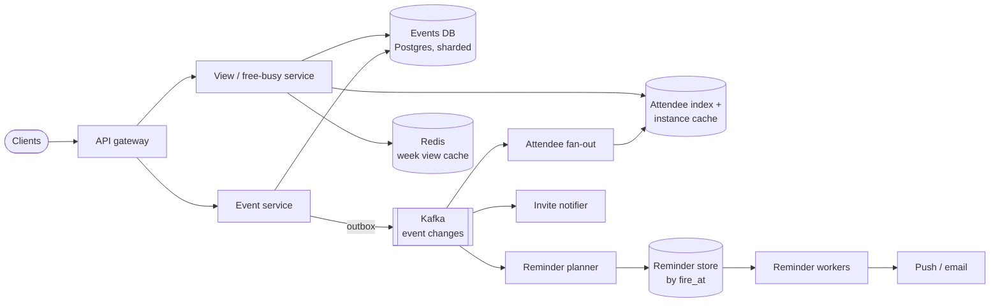
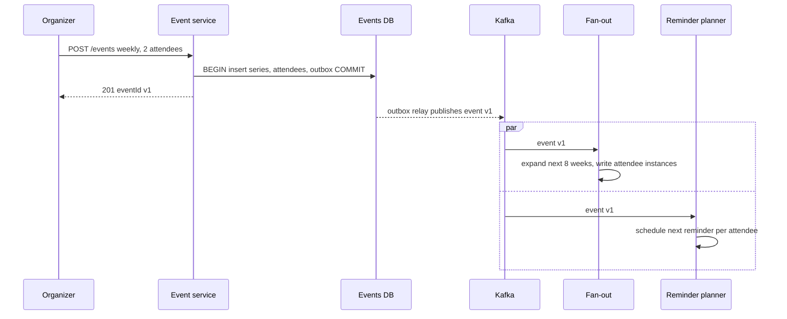

# Design a Calendar System (Google Calendar)

## Requirements

**Functional**
1. Create, edit and delete events with a title, time range, time zone and location; invite other users, who can accept, decline or reply maybe.
2. Recurring events ("every Monday and Wednesday at 9:00 until June"), including editing or cancelling a single occurrence or "this and all following".
3. Reminders (e.g. 10 minutes before) delivered by push notification or email.
4. Free/busy lookup: show when a set of people are busy in a time range, to find a meeting slot.
5. View a calendar by day, week or month.

**Non-functional**
- **Consistency for invites:** once an organizer saves an event, every attendee sees the same version; RSVPs are never lost.
- **Timely reminders:** delivered within ~30 s of the scheduled time, at least once, ideally exactly once.
- **Low latency views:** week view loads in under 200 ms at p99.
- **Correct across time zones and DST.**
- **Scale:** ~500M users, ~100M DAU.

**Out of scope**
- Room booking optimization, CalDAV sync protocol details, video-call creation.

### Back-of-envelope estimates

| Quantity | Estimate | Implication |
|---|---|---|
| Event writes | 100M DAU × 0.5 = 50M/day ≈ 580/s | Modest; a sharded relational DB handles it |
| Calendar views | 100M × 10 = 1B/day ≈ 11.6k/s average, ~35k/s at peak | Cache expanded week views; read replicas |
| Stored series | 500M users × ~20 series ≈ 10B rows × ~1 KB ≈ 10 TB | Sharded DB; store each recurring series once, not per occurrence |
| Materialized instances | 100M active users × 20 series × 8 weeks ≈ 16B rows × ~40 B ≈ 640 GB | Only feasible for a short rolling window and active users; expand on the fly beyond it |
| Reminders | 100M × 3 = 300M/day ≈ 3.5k/s average | Most fire just before :00 and :30, so peaks are ~10× ≈ 35k/s |
| Free/busy | A 10-person query over one week | Must not expand every recurring event of every person from scratch |

## Core entities

| Entity | Key fields | Store/Notes |
|---|---|---|
| Calendar | `calendar_id` (PK), `owner_id`, default time zone | Postgres, sharded by `owner_id` |
| Event (series master) | `event_id` (PK), `calendar_id`, `organizer_id`, title, `start_local`, `end_local`, `tzid`, `rrule`, `exdates`, `version` | Postgres, sharded by organizer's calendar; one row per series |
| Event exception | `event_id`, `recurrence_id` (original start), overridden fields or `cancelled` | Same shard as the master |
| Attendee | `event_id`, `user_id`, `rsvp` (needs_action / accepted / declined / tentative) | Same shard as the event; PK (`event_id`, `user_id`) |
| Attendee index | `user_id`, `event_id`, `window_start`, `window_end` | Sharded by `user_id`; lets "my week" find events organized by others |
| Instance cache | `user_id`, `start_utc`, `end_utc`, `event_id`, `recurrence_id` | Materialized occurrences for a rolling window (next ~8 weeks) for active users; powers views and free/busy |
| Reminder | `reminder_id`, `fire_at_utc`, `user_id`, `event_id`, `recurrence_id`, channel, `status` | Scheduler store, indexed by `fire_at_utc` |

## API

```
POST   /v1/events      { title, start: "2026-11-02T09:00", end: "2026-11-02T09:30", tzid: "America/New_York",
                         rrule: "FREQ=WEEKLY;BYDAY=MO,WE;UNTIL=20270601T000000Z",
                         attendees: ["u2","u3"], reminders: [{ minutesBefore: 10, channel: "push" }] }
                       Idempotency-Key: <uuid>          → 201 { eventId, version }
GET    /v1/calendars/{id}/instances?from=2026-11-02T00:00Z&to=2026-11-09T00:00Z
                       → 200 { instances: [{ eventId, recurrenceId, startUtc, endUtc, title, rsvp }] }
PATCH  /v1/events/{eventId}?scope=this|following|all&recurrenceId=2026-11-09T14:00Z
                       If-Match: <version>  { start?, title?, ... }   → 200 | 412 version conflict
POST   /v1/events/{eventId}/rsvp   { recurrenceId?, response: "accepted" }   → 200
POST   /v1/freebusy    { userIds: ["u1","u2"], from, to }  → 200 { busy: { u1: [[s,e], ...], u2: [...] } }
```

Notes:
- `If-Match` with the event version gives optimistic concurrency: two people editing the same event can't silently overwrite each other.
- `recurrenceId` (the occurrence's original start time) identifies one occurrence of a series, as in iCalendar.
- Free/busy returns only time ranges, never titles, so it respects privacy.

## High-level design



1. **Create/edit:** the event service writes the series row, attendees and an outbox record in one transaction on the organizer's shard. A relay publishes the outbox to Kafka.
2. **Fan-out:** consumers update each attendee's index and instance cache, send invite emails/pushes, and (re)plan reminders. All are idempotent on `(event_id, version)`.
3. **View:** for a week, the view service reads the user's instances from the instance cache (or expands series on the fly for ranges beyond it), applies exceptions, converts to the viewer's time zone, and caches the result.
4. **Free/busy:** union of busy intervals from each user's instance cache for the range.
5. **Reminders:** workers poll due reminders and send them; see deep dives.



## Deep dives

### Recurring events: store the rule or the instances?

#### How RRULE works

iCalendar (RFC 5545) describes repetition with a rule string. `FREQ=WEEKLY;BYDAY=MO,WE;UNTIL=20270601T000000Z` with `DTSTART` Monday 2026-11-02 09:00 America/New_York means: every week, on Mondays and Wednesdays, at 09:00 New York time, through May 2027. Other parts include `INTERVAL=2` (every other week), `COUNT=10`, `BYMONTHDAY=-1` (last day of the month) and `BYSETPOS=-1;BYDAY=FR` with `FREQ=MONTHLY` (last Friday of each month). Exceptions are expressed as `EXDATE` (skip this occurrence) and override instances keyed by `RECURRENCE-ID` (this occurrence moved or renamed). Libraries such as `python-dateutil` (rrule) and `rrule.js` expand rules into dates.

| Option | How | Problem |
|---|---|---|
| **Weak:** materialize every occurrence | Insert one row per occurrence | Rules with no end are infinite; editing the series rewrites thousands of rows |
| **Better:** store only the rule, expand on read | One series row; expand for the requested range at query time | Free/busy across 10 people expands many rules per request; range queries can't use an index on start time |
| **Best:** rule is the source of truth, plus a materialized rolling window | Store series + exceptions; a background job expands the next ~8 weeks into an instance table, extended daily | Two representations to keep in sync, handled by the change stream |

#### How expansion with exceptions works

Series: weekly Monday 09:00 New York, 30 minutes. Exceptions: 2026-11-16 cancelled (EXDATE); 2026-11-23 moved to 11:00 (override row with `recurrence_id` = 2026-11-23 09:00).

```
def instances(series, frm, to):
    out = []
    for local_start in rrule_expand(series.rrule, series.start_local, frm, to):   # wall-clock times
        rid = to_utc(local_start, series.tzid)                                     # recurrence id
        if rid in series.exdates: continue
        ov = series.overrides.get(rid)
        start = ov.start if ov else rid
        out.append(Instance(series.id, rid, start, start + series.duration))
    return out
```

| Monday | Rule says | Exception | Shown |
|---|---|---|---|
| Nov 9 | 09:00 | none | 09:00 |
| Nov 16 | 09:00 | EXDATE | not shown |
| Nov 23 | 09:00 | override → 11:00 | 11:00 |
| Nov 30 | 09:00 | none | 09:00 |

**"This and following" edits** split the series: set `UNTIL` on the old series to just before the chosen occurrence and create a new series starting there with the changes. Editing "all" changes the master; overrides that conflict with the new time are usually dropped or kept per product policy.

### Time zones and DST

#### Why "store everything in UTC" breaks recurring events

A weekly 09:00 New York meeting is 13:00 UTC in summer (EDT, UTC−4) and 14:00 UTC in winter (EST, UTC−5). If you store "13:00 UTC weekly", after the November change the meeting shows at 08:00 in New York. The rule: **store recurring events as local wall-clock time plus an IANA zone ID** (`America/New_York`, never a fixed offset like `-05:00`), and convert to UTC per occurrence during expansion. One-off events can store UTC plus the zone for display.

#### Worked example across two DST schedules

In 2026, Europe leaves summer time on Sunday Oct 25 and the US on Sunday Nov 1. A London attendee sees the New York meeting move:

| Monday | New York | NY offset | UTC | London offset | London time |
|---|---|---|---|---|---|
| Oct 19 | 09:00 | −4 | 13:00 | +1 | 14:00 |
| Oct 26 | 09:00 | −4 | 13:00 | 0 | 13:00 |
| Nov 2 | 09:00 | −5 | 14:00 | 0 | 14:00 |

The meeting is anchored to New York, so for one week it's an hour earlier in London. That's correct behavior, and it only falls out if you expand in the organizer's zone and convert per occurrence.

#### Other pitfalls

- **Nonexistent times:** 02:30 on a spring-forward day doesn't exist in New York (2026-03-08). Policy: shift forward to 03:30, as RFC 5545 specifies for nonexistent local times.
- **Ambiguous times:** 01:30 on 2026-11-01 happens twice. Pick the first occurrence (the earlier, daylight-time offset) consistently.
- **Rule changes:** governments change DST laws. Keep the tz database (tzdata) updated on servers and regenerate materialized instances for affected zones when it changes; that's another reason to keep the rule, not just UTC instances, as the source of truth.
- **All-day events** are dates, not times: a birthday on Nov 5 is Nov 5 in every zone, so store a date without a zone.

### Reminder scheduling

#### Weak: scan the events table

A cron job every minute runs "events starting in the next 10 minutes" over all events. With recurring rules, it would have to expand every series every minute: far too expensive, and a slow scan delays reminders.

#### Better: a reminder table indexed by fire time, polled with SKIP LOCKED

```sql
-- each worker, every second:
BEGIN;
SELECT reminder_id, user_id, event_id FROM reminders
WHERE status = 'pending' AND fire_at_utc <= now()
ORDER BY fire_at_utc LIMIT 500
FOR UPDATE SKIP LOCKED;            -- workers grab disjoint batches without blocking each other
-- enqueue sends, then:
UPDATE reminders SET status = 'sent' WHERE reminder_id = ANY(:ids);
COMMIT;
```

Only the **next** occurrence of each recurring event gets a reminder row. When it fires, the worker computes the following occurrence from the rule and inserts the next reminder. That keeps the table small (one row per (attendee, series, reminder setting)) and picks up rule changes automatically.

#### Best at peak scale: time-bucketed scheduling

At ~35k reminders/s around :25 and :55, partition reminders by fire minute and by shard: key `rem:{yyyyMMddHHmm}:{shard}` (a Redis sorted set or a DB partition). Shortly before each minute, workers claim the buckets for that minute (one lease per shard) and load their entries; a worker sends each reminder at its second, using an idempotency key `(reminder_id, occurrence)` so a retried send is dropped by the notification service.

**Worked example:** a meeting at 2026-11-02 14:00 UTC with a 10-minute reminder for 3 attendees creates 3 rows with `fire_at` = 13:50:00, landing in bucket `202611021350`. At 13:49:50 a worker leases that bucket's shards, and at 13:50:00 it sends 3 pushes. When the organizer moves the meeting to 15:00, the planner consumer (from the change stream) deletes those rows and inserts new ones at 14:50, using the event version so a late, older change can't resurrect the old reminders.

Delivery is at least once (a worker can crash after sending but before marking sent); the idempotency key makes duplicates rare and harmless.

### Invite consistency and free/busy

- The organizer's shard holds the authoritative event and attendee rows. RSVPs are written there with a conditional update on `(event_id, user_id)`, so they can't be lost, and the version number increments on any change.
- Attendee calendars are updated asynchronously from the transactional outbox. An attendee may see a new invite a second late, but never a version that wasn't committed, and consumers ignore versions older than what they have.
- **Free/busy** reads the instance cache of each requested user for the range, merges overlapping intervals per user, and returns the busy lists. For ranges beyond the materialized window, expand rules on the fly. Cache per (user, week) and invalidate on change events.

## Follow-up questions

### How do you find a meeting time for 10 people?
Fetch each person's busy intervals for the range, merge them into one sorted list, and walk it to find gaps at least as long as the meeting within everyone's working hours (each in their own zone). This is a sort plus sweep, O(n log n) in the number of intervals. Rank candidate slots by preferences such as avoiding early mornings for remote attendees.

### How do you sync with external calendars (Outlook, iCloud)?
Expose CalDAV and iCalendar (.ics) feeds and import with RRULE support, keyed by the event's `UID`. Incremental sync uses sync tokens or ETags so clients fetch only changes. Conflicts are resolved by version, with the organizer's copy authoritative.

### Why not store recurring events as UTC instances only?
Because DST and tz rule changes shift the UTC time of a wall-clock-anchored meeting. Without the original local time and zone you can't recompute occurrences when the rules change. Instances are a derived cache; the rule and zone are the truth.

### How do you handle an attendee editing their own copy?
Personal fields (color, reminders, RSVP) live on the attendee row. Core fields (time, title) can only be changed by the organizer or delegates; an attendee "proposing a new time" sends a request the organizer accepts. This keeps one authoritative event.

### What if the reminder system falls behind?
Alert on lag (now minus oldest pending `fire_at`) and scale workers horizontally, since buckets and shards are independent. Reminders more than a few minutes late after the event started should be dropped rather than sent. Precomputing buckets ahead of :00 and :30 smooths the spikes.

### How do you shard the data?
Shard events by the organizer's calendar so a series, its exceptions and attendees are in one shard and edits are single-shard transactions. Shard the attendee index and instance cache by `user_id` so a person's views and free/busy hit one shard. The change stream connects the two.

### How do you handle a series with thousands of attendees, like an all-company meeting?
Don't fan out instance rows to every attendee synchronously. Store a reference to the shared event in a group membership, expand once, and let views join it in. RSVP counts are aggregated rather than listed in every notification.

### How do you cache week views?
Cache the expanded, timezone-converted instance list per (user, week) in Redis with a short TTL, invalidated by the change stream when any event affecting that user changes. Most users view the current and next week, so hit rates are high.
