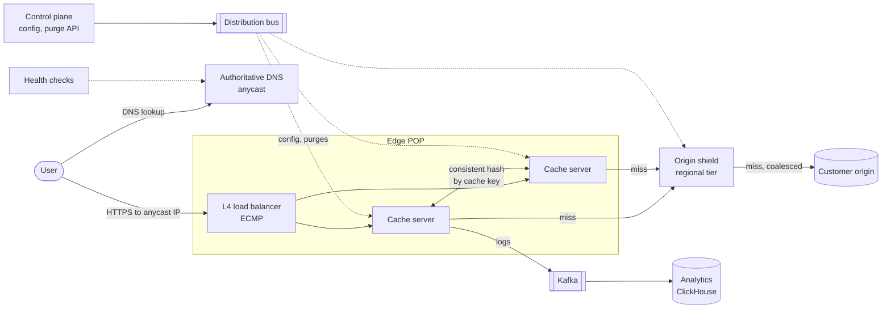
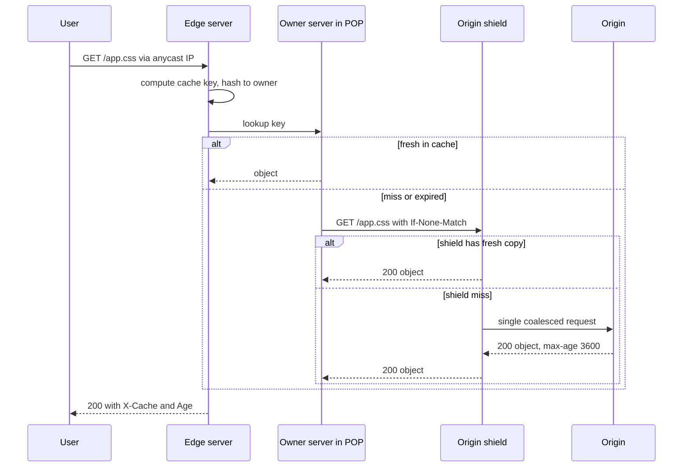

# Design a Content Delivery Network (CDN)

## Requirements

**Functional**
1. Customers point a hostname (e.g. `static.shop.com`) at the CDN and configure an origin; the CDN serves their content from edge locations, fetching from the origin on a miss.
2. Caching follows the origin's HTTP headers (`Cache-Control`, `ETag`, `Vary`) with per-customer overrides for cache keys and TTLs.
3. Customers purge content by URL, by prefix, or by tag, and the purge takes effect globally within seconds.
4. Customers see basic analytics: requests, bandwidth, hit ratio.

**Non-functional**
- **Low latency globally:** most users within ~20–30 ms round trip of a POP; cache hits served in a few ms of server time.
- **High availability:** losing a server, a POP or a whole region is invisible to users apart from slightly higher latency.
- **Origin protection:** the origin sees a small fraction of traffic, even during spikes or after a purge.
- **Scale:** ~200 POPs, ~10M requests/s and ~8 Tbps at peak.

**Out of scope:** DDoS scrubbing details, edge compute, video packaging, TLS certificate issuance.

### Back-of-envelope estimates

| Quantity | Estimate | Implication |
|---|---|---|
| Peak egress | 10M req/s × 100 KB average ≈ 1 TB/s ≈ 8 Tbps | Spread over many POPs and ISP peering links |
| Per POP | 10M ÷ 200 ≈ 50k req/s, ~40 Gbps average (busy POPs several times more) | Each POP is a cluster of tens of servers behind load balancers |
| Origin load, no shield | 5% misses × 10M ≈ 500k req/s, each POP missing independently | Too much for most origins, so add a shield tier |
| Origin load, with shield | shield hits 80% of edge misses → 100k req/s, and each object fetched about once per shield | Origin load falls 5× more, and spikes are coalesced |
| Purge fan-out | 200 POPs × ~20 cache servers = 4,000 servers | Purges need a reliable broadcast with acknowledgments |
| Edge storage | ~100 TB SSD per POP | Holds the hot working set; the long tail lives at shields |

## Core entities

| Entity | Key fields | Store/Notes |
|---|---|---|
| Customer config | `hostname`, `origin`, cache key rules, TTL overrides, TLS cert ref, `version` | Control-plane DB (Postgres); pushed to every POP as a versioned snapshot |
| Cache object | cache key → headers, body, `stored_at`, `ttl`, `etag`, tags, tag generations | Edge server memory (hot) + SSD; evicted by LRU-like policy |
| Purge request | `purge_id`, `customer_id`, type (url / prefix / tag), value, `seq`, `created_at` | Control-plane DB + durable log; status tracked per POP |
| POP | `pop_id`, location, anycast prefixes, capacity, health | Routing control plane |
| Log record | ts, `pop_id`, hostname, path, status, bytes, cache status (hit / miss / stale) | Shipped to Kafka → analytics store (ClickHouse) |

## API

```
# Customer control plane
PUT    /v1/zones/{hostname}
       { origin: "origin.shop.com", cacheKey: { ignoreQuery: ["utm_*"] },
         defaultTtl: 3600, honorOriginHeaders: true }
       → 200 { version: 42 }
POST   /v1/zones/{hostname}/purge
       Idempotency-Key: 9a1c...
       { urls: ["https://static.shop.com/app.css"] }
     | { prefix: "/images/2026/" }
     | { tags: ["product-123"] }
       → 202 { purgeId, status: "propagating" }
       429 purge rate limit exceeded
GET    /v1/purges/{purgeId}  → { status: "complete", popsAcked: 200, popsTotal: 200 }

# Data plane (what end users hit)
GET https://static.shop.com/app.css
  → 200, headers: Cache-Control, ETag, Age: 120, X-Cache: HIT
  → 304 when If-None-Match matches
```

- **Purge is asynchronous (202)** with a status endpoint, because it must reach every POP; customers can wait for `complete` in deploy scripts.
- **Idempotency key on purges** so a retried CI job doesn't queue duplicate work.
- **Config is versioned:** every POP reports which version it serves, so rollouts and rollbacks are observable.
- **Response headers** (`Age`, `X-Cache`) make cache behavior debuggable for customers.

## High-level design



**Request flow**
1. The user's resolver looks up `static.shop.com`, a CNAME to the CDN. The CDN's DNS (or anycast) steers the user to a nearby, healthy POP.
2. The POP's load balancer spreads connections across servers; the receiving server terminates TLS, computes the cache key, and hashes it to the server in the POP that owns that key.
3. On a hit, the owner returns the object. On a miss, it asks the regional shield, which serves from its cache or fetches once from the origin.
4. The response is cached at each tier according to its TTL and returned to the user.

**Purge flow**
1. The customer calls the purge API; the control plane assigns a sequence number, stores it, and publishes it to the distribution bus.
2. Every edge and shield server applies it and acknowledges; the purge is `complete` when all POPs ack.



## Deep dives

### Request routing: DNS vs anycast

#### How DNS-based routing works

1. The customer CNAMEs `static.shop.com` to `shop.cdn.net`.
2. The user's recursive resolver queries the CDN's authoritative DNS. The DNS server sees the resolver's IP (and, if the resolver sends it, the **EDNS Client Subnet**, a truncated client prefix such as a /24).
3. It maps that location to the best POP using a latency map built from measurements, current POP load and health, and returns that POP's IP with a short TTL (e.g. 30–60 s).
4. If a POP fails, health checks remove it, and new answers point elsewhere within one TTL.

Drawbacks: the resolver may be far from the user (public resolvers without client subnet), and some resolvers and clients cache answers longer than the TTL, which slows failover. Akamai is the classic example of DNS-based mapping.

#### How anycast works

1. Every POP announces the **same IP prefix** (e.g. 203.0.113.0/24) via BGP to its ISPs and peers.
2. Internet routers pick the "best" path to that prefix by BGP policy, usually the fewest AS hops, so packets go to a topologically nearby POP.
3. If a POP fails, it withdraws its announcement and routers converge on the next nearest POP, typically within seconds, with no DNS caching involved.
4. Load is shifted by withdrawing or prepending routes at a busy POP. Cloudflare uses anycast for its whole network.

Worked example: a user in Lyon whose ISP peers with the CDN in Paris (1 AS hop) and reaches Frankfurt via a transit provider (2 hops) is routed to Paris. If Paris withdraws the prefix, the same packets go to Frankfurt after BGP convergence, while the IP address the user connects to stays the same.

| | DNS-based | Anycast |
|---|---|---|
| Granularity | per resolver or client subnet | per network path |
| Failover speed | bounded by DNS TTL and resolver caching | BGP convergence, seconds |
| Control over load | precise, per answer | coarse, via route announcements |
| Risk | resolver far from user | BGP path change can move a long-lived TCP connection to another POP mid-flow |

- **Weak:** a single origin region with round-robin DNS.
- **Better:** GeoDNS by resolver location.
- **Best:** anycast for the DNS servers and edge IPs, with DNS steering on top for precise load management (many CDNs combine both). Mid-flow route changes are rare in practice and affect short HTTP connections little.

#### How traffic is spread inside a POP

Routers spread packets across load balancers with ECMP (hashing the connection 5-tuple so one connection always hits the same machine). Then the server that terminates TLS **consistent-hashes the cache key** to an owner server in the POP. Each object is stored once per POP instead of on every server, so the POP's effective cache is the sum of its disks. Very hot objects are additionally cached in every server's memory so one owner isn't overloaded.

### Cache hierarchy and origin shield

- **Weak: single tier.** Every POP misses independently. A new object requested worldwide causes ~200 origin fetches, and the long tail rarely stays cached at any single POP.
- **Better: edge + origin with request coalescing at each POP.** Concurrent misses for the same key in one POP become one fetch, but different POPs still all hit the origin.
- **Best: edge → regional shield → origin.** Each customer origin is assigned one shield POP near it (or one per continent). Edges send misses to the shield, which has a much larger cache, coalesces requests, and is the only tier that talks to the origin.

#### How request coalescing works

```
def get(key):
    obj = cache.get(key)
    if obj and obj.fresh(): return obj
    with lock(key):                         # one in-flight fetch per key
        if key in inflight: return inflight[key].wait()
        inflight[key] = fetch_upstream(key)  # others wait on this future
    obj = inflight.pop(key).result()
    cache.put(key, obj); return obj
```

Worked example: a new homepage image goes live and 5,000 users request it in the same second.

| Setup | Origin requests in that second |
|---|---|
| No coalescing, no shield | up to 5,000 |
| Coalescing per POP, 200 POPs, no shield | up to 200 |
| Coalescing + one shield | **1** |

The same mechanism prevents a **thundering herd** when a popular object expires or is purged.

### Cache keys

The cache key decides which requests share a cached response. Too specific and the hit ratio collapses; too broad and users get the wrong content.

#### How a cache key is built

1. Start with scheme + host + path.
2. Normalize the query string: drop parameters that don't change the content (tracking parameters like `utm_source`, `fbclid`) and sort the rest.
3. Add the values of request headers listed in the response's `Vary` header, normalized.
4. Apply customer rules (include a cookie or device class only if they explicitly opt in).

| Request | Raw | Normalized cache key |
|---|---|---|
| 1 | `/app.js?v=7&utm_source=mail` | `https://static.shop.com/app.js?v=7` |
| 2 | `/app.js?utm_source=ad&v=7` | `https://static.shop.com/app.js?v=7` (same object, a hit) |
| 3 | `/app.js?v=8` | `https://static.shop.com/app.js?v=8` (new version) |

**`Vary` pitfalls:** `Vary: Accept-Encoding` with raw header values creates dozens of variants (`gzip, deflate, br` vs `br, gzip`). Normalize to a few buckets (`br`, `gzip`, identity). `Vary: User-Agent` would create thousands of variants and effectively disable caching, so CDNs map it to a small device class or ignore it. Never include cookies in the key by default, and never cache responses that set cookies or carry `Cache-Control: private`.

### TTLs and revalidation

#### How freshness is decided

- The edge uses `s-maxage` if present, else `max-age`, else a customer default; `Age` tracks how long the object has been cached.
- When an object goes stale, the edge **revalidates** with a conditional request (`If-None-Match: "<etag>"`). If unchanged, the origin answers `304 Not Modified` with no body, and the TTL restarts.
- `stale-while-revalidate=60` lets the edge serve the stale copy immediately while refreshing in the background; `stale-if-error=86400` serves stale content if the origin is down.

Timeline for `Cache-Control: max-age=300, stale-while-revalidate=60`:

| Time | Event | Edge behavior | User latency |
|---|---|---|---|
| 0 s | first request, miss | fetch from shield/origin, store | ~150 ms |
| 120 s | request | fresh hit, `Age: 120` | ~5 ms |
| 330 s | request, stale by 30 s | serve stale, revalidate in background, origin returns 304 | ~5 ms |
| 400 s | request | fresh again (TTL restarted at ~330 s) | ~5 ms |
| 2 h, origin down | request, stale | `stale-if-error` serves cached copy | ~5 ms |

**TTL strategy:** fingerprinted static assets (`app.3f9a1c.js`) get `max-age=31536000, immutable`; HTML gets a short TTL (60 s) or `no-cache` with revalidation; API responses usually aren't cached unless explicitly marked.

### Invalidation and purge propagation

- **Weak:** wait for TTLs to expire. Simple, but a bad file stays live for the full TTL.
- **Better:** purge by URL, broadcast to every server. Precise, but a product change may affect hundreds of URLs and variants.
- **Best:** **versioned URLs** for static assets (no purge needed: deploy `app.4b2e.js` and the HTML points to it), plus **tag-based purge** for dynamic content, propagated through a reliable, acknowledged broadcast.

#### How tag-based purge works

The origin labels responses with tags, e.g. `Cache-Tag: product-123, category-shoes` (Fastly calls these surrogate keys). Deleting every matching object across 4,000 servers would require an index from tag to keys on every server. A cheaper method is **generation counters**:

1. Each server keeps `tag → generation`, all starting at 0.
2. When it caches an object, it stores the tags with their current generations.
3. A purge of `product-123` just increments that tag's generation.
4. On lookup, if any stored tag generation is lower than the current one, the object counts as a miss. The stale bytes are evicted lazily.

| Step | `product-123` gen | Cached object `/p/123` (tags at fill) | Lookup result |
|---|---|---|---|
| Cache fill | 0 | {product-123: 0, shoes: 0} | hit |
| Purge `product-123` | 1 | unchanged | miss (0 < 1), refetch |
| Refill | 1 | {product-123: 1, shoes: 0} | hit |

A purge becomes an O(1) operation per server.

#### How purges propagate reliably

1. The control plane writes the purge with a global sequence number to a durable log.
2. It fans out over a distribution tree (control plane → regional relays → POPs → servers); each server applies it and acknowledges.
3. Servers track the last applied `seq`. A server that was partitioned asks for everything after its `seq` on reconnect; if it was gone too long, it treats its cache as stale and revalidates everything.
4. The purge is reported `complete` when all POPs ack. Shields must be purged too, or edges would refill from the shield's stale copy; serving purges to the shield first, then edges, avoids that race.

Major CDNs advertise global purge times from well under a second to a few seconds; the mechanism above is what makes that possible. Purge APIs are rate-limited per customer, since a "purge everything" storm would send all traffic to origins.

## Follow-up questions

### How do you handle TLS for millions of customer hostnames?
Edge servers select certificates by SNI from a distributed store, with hot certificates cached in memory and private keys protected (some CDNs offer keyless SSL, where the customer keeps the key and the edge calls out for the signing step). TLS session resumption and HTTP/2 or HTTP/3 connection reuse cut handshake cost.

### What eviction policy do edge caches use?
LRU variants with admission control: many one-hit-wonder objects would push out useful ones, so an object is often cached only on its second request (or using a frequency sketch like TinyLFU). Memory holds the hottest objects and SSD holds the rest.

### How do you serve dynamic or personalized content?
Don't cache it, or cache only shared fragments. The CDN still helps by terminating TLS close to the user and keeping warm, multiplexed connections to the origin over an optimized backbone, which cuts round trips. Edge compute can assemble personalized pages from cached pieces.

### How do you handle very large files like video or software downloads?
Cache them in chunks (byte ranges of a few MB) keyed by range, so a user seeking into the middle doesn't require fetching the whole file, and popular chunks stay cached independently. Origin fetches are also done by range.

### What happens when a whole POP goes down?
Anycast withdraws its routes and DNS removes it after health checks fail, so users go to the next nearest POP. That POP sees a cold-ish cache for the extra traffic, but the shield absorbs the misses, so the origin barely notices.

### How do you protect the origin from being hit directly?
Restrict the origin to accept connections only from CDN IP ranges, or require a secret header or mutual TLS from the CDN. Otherwise attackers bypass the CDN and its caching and protections entirely.

### How do you collect analytics from 200 POPs?
Each server writes access logs locally and ships them in batches to regional Kafka clusters, which feed a columnar store like ClickHouse. Dashboards query pre-aggregated rollups (per customer, per minute) rather than raw logs.

### How would you roll out a configuration change safely?
Push the new versioned config to a canary set of servers or one POP, watch error rates and hit ratio, then roll out progressively. Every server reports its config version, and rollback is pushing the previous version.
