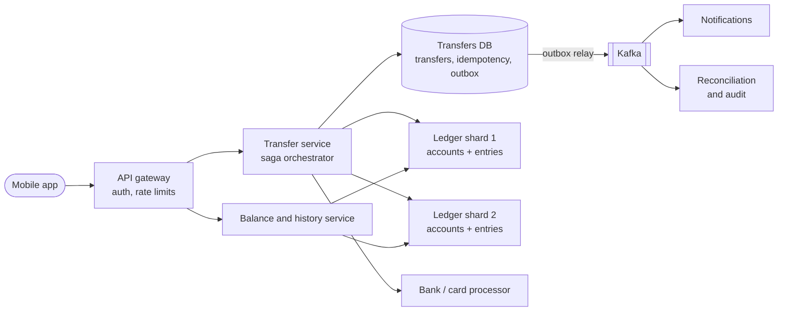
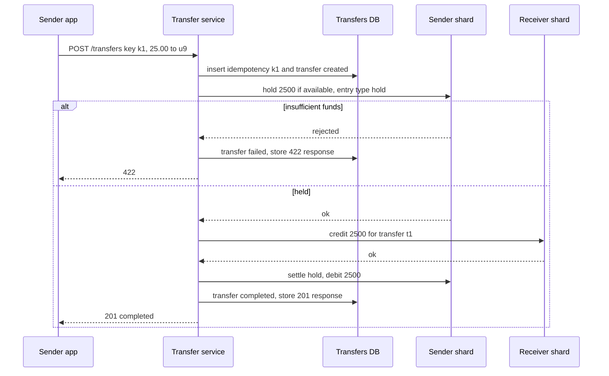
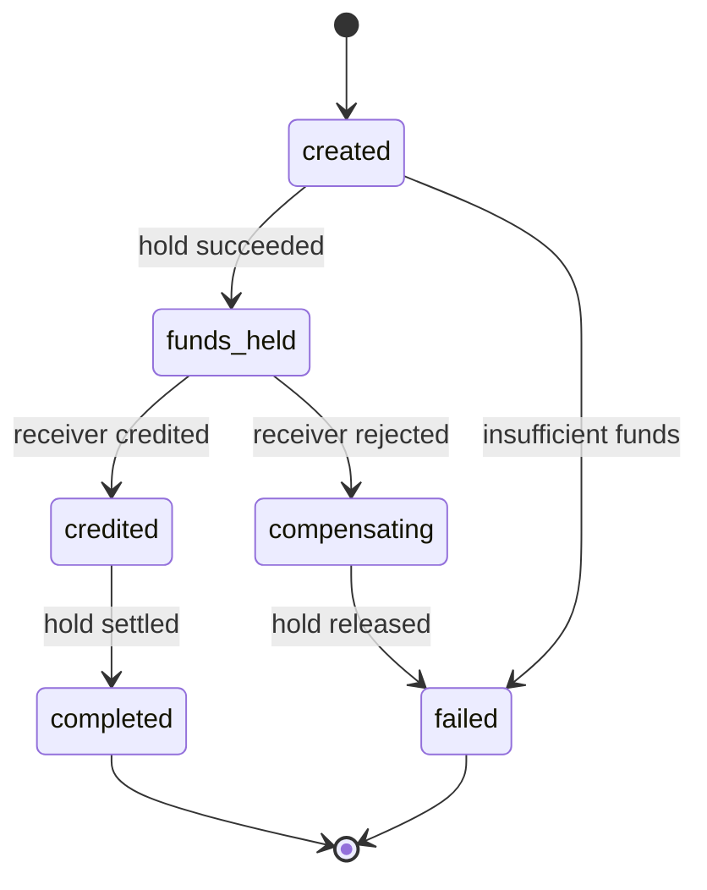

# Design a Digital Wallet / Money Transfer (Venmo)

## Requirements

**Functional**
1. Check the current balance of a wallet.
2. Transfer money to another user; the sender's balance can never go negative.
3. View transaction history, newest first, with pagination.
4. Top up from and withdraw to a bank account or card (via external payment processors).

**Non-functional**
- **Strong consistency:** a balance read after a transfer completes reflects it; money is never created or destroyed.
- **Auditability:** every balance change is traceable to an immutable record; balances can be recomputed from history.
- **Exactly-once effect:** a retried request (network timeout, double tap) moves money at most once.
- **Availability:** 99.99% for transfers; correctness wins over availability when they conflict.
- **Scale:** ~100M users, ~10M transfers/day, peaks ~10× average.

**Out of scope**
- Fraud/risk models, KYC, currency conversion, card issuing.

### Back-of-envelope estimates

| Quantity | Estimate | Implication |
|---|---|---|
| Transfers | 10M/day ≈ 116/s average, ~1.2k/s at peak | Modest write rate; correctness is the hard part, not throughput |
| Ledger entries | 2 per transfer (more with fees) → 20M/day × ~200 B ≈ 4 GB/day ≈ 1.5 TB/year | Append-only table, partitioned by time; archive old partitions |
| Balance reads | 100M/day ≈ 1.2k/s average | Read the stored balance row, not a sum over history |
| Accounts | 100M × ~200 B ≈ 20 GB | Fits on one node, but shard for write throughput and blast radius |
| Cross-shard share | With 16 shards, a random pair is on different shards 15/16 ≈ 94% of the time | Cross-shard transfers are the normal case, not an edge case |

## Core entities

| Entity | Key fields | Store/Notes |
|---|---|---|
| Account | `account_id` (PK), `user_id`, currency, `balance` (integer cents), `held` (cents), `version` | Postgres, sharded by `account_id`; `CHECK (balance - held >= 0)` |
| Transfer | `transfer_id` (PK), `from_account`, `to_account`, `amount`, `status`, `idempotency_key`, timestamps | Coordinator DB; the saga's durable state machine |
| Ledger entry | `entry_id`, `transfer_id`, `account_id`, `amount` (signed cents), `balance_after`, `created_at` | Append-only, on the account's shard; never updated or deleted |
| Idempotency record | (`user_id`, `idempotency_key`) PK, request hash, `transfer_id`, response, `expires_at` | Same DB as Transfer, unique constraint |
| Outbox | `id`, `aggregate_id`, payload | Same transaction as state changes; relayed to Kafka |

## API

```
GET  /v1/wallet                       → 200 { accountId, balance: 12050, available: 11050, currency: "USD" }
POST /v1/transfers
     Idempotency-Key: 6f1c2e...       { toUserId: "u9", amount: 2500, currency: "USD", note: "pizza" }
     → 201 { transferId, status: "completed" }      (same response replayed on retry)
     → 202 { transferId, status: "pending" }        (cross-shard saga still running)
     → 409 idempotency key reused with a different body
     → 422 insufficient funds
GET  /v1/transfers/{id}               → 200 { status, amount, createdAt }
GET  /v1/wallet/history?cursor=&limit=50
     → 200 { entries: [{ transferId, amount: -2500, counterparty, balanceAfter, createdAt }], nextCursor }
```

Notes:
- Amounts are integers in minor units (cents). Floating point can't represent 0.10 exactly.
- The sender is the authenticated user from the token, never a field in the body.
- History uses a cursor on `(created_at, entry_id)` so new entries don't shift pages.

## High-level design



1. **Transfer request:** the transfer service checks the idempotency key; if new, it creates a Transfer row (`created`) and the idempotency record in one transaction.
2. **Same shard:** if both accounts live on one ledger shard, one ACID transaction debits, credits and writes both ledger entries. Done.
3. **Cross shard:** a saga runs: hold funds on the sender's shard, credit the receiver's shard, then finalize the hold. Each step is a local transaction that's idempotent on `transfer_id`.
4. **Reads:** balance is a single-row read on the account's shard; history is an index range scan over that account's ledger entries.
5. **Events:** status changes go through the outbox to Kafka for notifications, search and audit.



## Deep dives

### The double-entry ledger, explained

#### How double-entry works

Every transfer writes at least two ledger entries whose amounts sum to zero: money leaves one account and enters another. Balances are never edited directly without a matching entry. This gives two invariants you can check at any time:

1. The sum of all entries in the system is zero (money is conserved).
2. Each account's stored balance equals the sum of its entries.

**Worked example.** Alice has $100.00, Bob $20.00. Alice sends Bob $30.00, then Bob pays a $0.50 fee on a withdrawal of $10.00 to his bank.

| Entry | Transfer | Account | Amount (cents) | Balance after |
|---|---|---|---|---|
| 1 | t1 | Alice | −3,000 | 7,000 |
| 2 | t1 | Bob | +3,000 | 5,000 |
| 3 | t2 | Bob | −1,050 | 3,950 |
| 4 | t2 | Bank settlement (external clearing account) | +1,000 | — |
| 5 | t2 | Fee revenue | +50 | — |

t1 sums to 0; t2 sums to −1,050 + 1,000 + 50 = 0. External money flows go through system-owned accounts (bank settlement, fee revenue), so even top-ups and withdrawals balance. Storing `balance_after` on each entry makes any statement line verifiable and lets you spot the exact entry where a discrepancy started.

```sql
BEGIN;
UPDATE accounts SET balance = balance - 3000, version = version + 1
  WHERE account_id = 'alice' AND balance - held >= 3000;      -- 0 rows → insufficient funds, ROLLBACK
UPDATE accounts SET balance = balance + 3000, version = version + 1 WHERE account_id = 'bob';
INSERT INTO ledger_entries (transfer_id, account_id, amount, balance_after) VALUES
  ('t1', 'alice', -3000, 7000), ('t1', 'bob', 3000, 5000);
COMMIT;
```

The conditional `WHERE balance - held >= 3000` folds the funds check into the write, so two concurrent transfers can't both spend the same $30 (the second sees the updated balance after the first commits, because the row is locked by the first update).

#### Event sourcing vs a balance column

Event sourcing makes the log of events (the ledger entries) the source of truth and derives balances by replaying them. A ledger is already an event log, so the practical design is a hybrid:

- **Weak:** compute the balance as `SUM(amount)` over all entries on every read. Correct but slow for an account with 50k entries.
- **Better:** pure event sourcing with periodic snapshots: balance = snapshot + entries since the snapshot.
- **Best for a wallet:** keep the append-only ledger as the audit source **and** a `balance` column updated in the same transaction. Reads are one row; a nightly job recomputes `SUM(amount)` per account and alerts on any mismatch. The ledger can rebuild balances from scratch if needed.

### Cross-shard transfers: 2PC vs saga

When Alice is on shard 1 and Bob on shard 3, no single database transaction covers both rows.

#### How two-phase commit works

A coordinator runs the transaction across participants:

1. **Prepare:** the coordinator asks each shard "can you commit?" Shard 1 debits Alice inside an open transaction, writes it durably as *prepared* (Postgres `PREPARE TRANSACTION 't1'`), keeps the row locks, and votes yes. Shard 3 does the same for Bob's credit.
2. **Decision:** the coordinator writes "commit t1" to its own durable log.
3. **Commit:** it tells both shards `COMMIT PREPARED 't1'`; they apply and release locks. If any vote was no, it sends `ROLLBACK PREPARED` to all.

| Failure | Result |
|---|---|
| A shard votes no | Everyone rolls back; clean |
| Coordinator crashes after prepare, before the decision | Shards are stuck holding locks on Alice's and Bob's rows until the coordinator recovers; they can't decide alone |
| Coordinator crashes after logging commit | On recovery it re-sends commit; prepared shards must wait until then |

2PC gives atomicity, but it's **blocking**: locks are held across network round trips and through coordinator outages, and throughput is limited by the slowest participant. It suits a small number of databases you fully control, and needs careful operation (orphaned prepared transactions block vacuum in Postgres).

#### How a saga works

A saga splits the transfer into a sequence of local transactions, each committed immediately, with a **compensating** transaction for each step if a later step fails. An orchestrator (the transfer service) stores the saga state in the Transfer row and drives it.

| Step | Local transaction | Compensation |
|---|---|---|
| 1 | Shard 1: `held += 2500` on Alice if `balance - held >= 2500`; write a hold entry | Release the hold |
| 2 | Shard 3: credit Bob 2,500; write entry | (rarely needed) debit Bob |
| 3 | Shard 1: `balance -= 2500, held -= 2500`; write debit entry | — |

**Worked timeline, with a failure:**

| Time | Transfer status | Alice balance / held | Bob balance | Notes |
|---|---|---|---|---|
| 0 | created | 10,000 / 0 | 2,000 | |
| 1 | funds_held | 10,000 / 2,500 | 2,000 | Alice's available is 7,500; she can't double-spend |
| 2 | credit attempt times out | 10,000 / 2,500 | ? | Orchestrator doesn't know if the credit applied |
| 3 | retry credit for t1 | 10,000 / 2,500 | 4,500 | Shard 3 dedupes on `transfer_id`, so a duplicate retry is a no-op |
| 4 | completed | 7,500 / 0 | 4,500 | Hold settled |

If Bob's account had been frozen at step 3 (a permanent failure), the orchestrator runs the compensation: release Alice's hold, mark the transfer `failed`. Using a **hold** first is what makes this safe: Alice never sees money vanish and come back, and Bob is credited only after funds are reserved.

The trade-off is that intermediate states are visible (a transfer is `pending` for a moment) and every step plus compensation must be idempotent. Orchestrator crashes are fine: the saga state is in the database, and a recovery worker resumes any transfer not in a terminal state.

- **Weak:** debit then credit with no durable state; a crash in between loses money.
- **Better:** 2PC across shards; atomic but blocking and operationally fragile.
- **Best:** orchestrated saga with holds and idempotent steps, plus co-locating accounts where possible so many transfers are single-shard (e.g. a user's accounts on one shard).



### Idempotency and exactly-once effects

Networks give you at-least-once delivery, so the system makes repeated requests harmless.

#### How idempotency keys work

1. The client generates a UUID per user intent ("send Bob $25") and reuses it on every retry.
2. The server inserts `(user_id, key, request_hash)` with a unique constraint, in the same transaction that creates the transfer.
3. If the insert conflicts: same hash → return the stored response (or the current status if still processing); different hash → 409.
4. Keys expire after e.g. 24 hours.

```sql
INSERT INTO idempotency (user_id, key, request_hash, transfer_id)
VALUES ('alice', '6f1c2e...', 'h1', 't1')
ON CONFLICT (user_id, key) DO NOTHING
RETURNING transfer_id;             -- no row returned → it's a retry; load and replay the stored response
```

**Example:** Alice taps send; the 201 is lost on a flaky connection. The app retries with the same key; the server finds `t1`, sees `completed`, and returns the same 201. Bob is credited once.

Internally, every saga step carries `transfer_id`, and each shard enforces `UNIQUE (transfer_id, account_id, entry_type)` on ledger entries, so a retried step can't apply twice. Kafka consumers likewise dedupe on event ID. That combination (at-least-once delivery plus idempotent processing) is what "exactly-once" means in practice.

### Reconciliation and audit

- Daily: verify the sum of all ledger entries is zero and each account balance equals its entry sum.
- Match settlement-account entries against bank and processor reports; mismatches go to an operations queue.
- Ledger entries are immutable: mistakes are fixed with new reversing entries, never edits, so the history tells the full story.

## Production readiness

### Database choice and consistency

- **Ledger shards and transfers DB (Postgres): ACID, CP.** Every money invariant here is enforced by the database: the conditional debit, `CHECK (balance - held >= 0)`, `UNIQUE (transfer_id, account_id, entry_type)`, and the idempotency insert in the same transaction as the transfer. An eventually consistent store was rejected: two replicas accepting debits for one account during a partition is a double spend, real money plus regulatory exposure. In a partition, transfers touching the unreachable shard fail; correctness wins.
- **Alternative worth naming: distributed SQL** (Spanner-style). It would make cross-shard transfers a single transaction and remove the saga between shards. Throughput at ~1.2k/s is fine; it wasn't chosen because external processors need a saga anyway and consensus on every commit adds latency and cost. Still defensible in an interview.
- **Where BASE is fine:** notifications, search over transfers, analytics and counterparty-name enrichment, all fed from the outbox.
- **Read paths:** balance reads go to the shard primary, because "a balance read after a transfer reflects it" is a requirement. Older history pages can use replicas.

### Service boundaries and communication

- **Ledger service** is the only writer of `accounts` and `ledger_entries`, enforced with database grants, not convention.
- **Transfer service** orchestrates sagas; **balance/history service** scales reads separately; a **processor integration service** handles top-ups, withdrawals and webhooks, keeping external failures away from peer-to-peer transfers.
- **Synchronous:** app → transfer service → ledger shards, each call with a timeout. Same-shard transfers return `201`; a cross-shard saga that doesn't finish within ~1–2 s returns `202` and the app polls. Processor calls are synchronous to request, but confirmation is asynchronous via webhooks.
- **Asynchronous:** notifications, reconciliation, audit export, all through the outbox.

### Failure modes and reliability

| Failure | Effect | Mitigation |
|---|---|---|
| One ledger shard's primary fails | With 16 shards, about 12% of transfers touch it (1 − (15/16)² ≈ 0.12) and fail or stall | Circuit breaker fails those fast while other shards continue; after failover (~30–60 s) the recovery worker resumes held transfers (deep dive) |
| Credit step times out, outcome unknown | Funds held, receiver state unknown | Retry the same step with the same `transfer_id` using backoff and jitter; the unique constraint makes it a no-op if it already applied |
| Card or bank processor slow or down | Top-ups and withdrawals stall | Separate connection and worker pools for processor calls (bulkhead) so P2P transfers are untouched; circuit breaker; requests stay `pending` and reconciliation queries the processor later |
| Duplicate or out-of-order webhooks | Wallet credited twice, or status moves backwards | Verify the signature, dedupe on the processor's event ID, and let the state machine ignore transitions out of terminal states |
| Notification consumer hits a poison event | Users aren't notified | Retry with backoff, then dead-letter queue with an alert; money state is already final |
| Reconciliation finds a mismatch | Possible lost or created money | Never auto-correct. Alert, freeze outbound transfers on the affected accounts, fix with reversing entries after review |

### High availability and disaster recovery

- **Within a region:** each ledger shard and the transfers DB has a synchronous standby in another AZ, with automated failover that **fences** the old primary. Two primaries accepting debits would double-spend, so failover needs a quorum decision.
- **Region loss: RPO 0 is the target**, because "money is never created or destroyed" also applies to disasters. That means a synchronous replica in a second region; each commit pays a cross-region round trip (tens of ms), affordable at 1.2k/s peak and invisible to a human tapping "send".
- **RTO:** ~30–60 s for an AZ failover and ~15 minutes for a region, deliberately with a human confirming the old region is fenced. 99.99% (~52 min/year) leaves room for one region event.
- **Backups:** daily snapshots plus continuous WAL archiving, in write-once storage under a separate account so a compromised admin can't delete them. Retain for the years financial regulation requires. Restores are verified with the reconciliation invariant checks.

### Security

- **AuthN:** OAuth tokens bound to a registered device; step-up authentication (PIN or biometric) for new payees, large amounts and withdrawals to a new bank account.
- **AuthZ:** sender always comes from the token (API notes); history reads check account ownership. Service-to-service calls use mTLS, and the ledger DB role has **no UPDATE or DELETE permission on `ledger_entries`**, so append-only is enforced by the database.
- **Encryption and secrets:** TLS in transit, KMS-backed encryption at rest. Bank account numbers get field-level encryption with a separate key; card data stays with the processor as tokens. Processor API keys and webhook signing secrets live in a secrets manager, rotated with an overlap window.
- **Audit:** the ledger is the audit trail for money. Staff actions go in a separate access log, and manual adjustments need two-person approval and post as ledger entries from an operations account, never as direct balance edits.
- **PII:** transfer notes and counterparties reveal relationships and habits. Restrict who can search them and set retention for notes separately from the ledger.
- **Abuse:** per-user and per-device rate limits on transfers, daily amount limits that start low for new accounts, and velocity checks for account takeover. A risk check before the hold should fail **closed** for large amounts and may fail open for small ones, a trade-off between fraud loss and availability.

### Observability

**SLIs and SLOs (30 days):**
- 99.99% of valid transfer requests get a non-5xx response.
- 99% of transfers reach a terminal state within 2 s, and 99.99% within 1 minute.
- Ledger invariants hold: zero violations of "sum of entries = 0" and "balance = sum of entries". Any violation pages immediately.

**Dashboards:** transfers by outcome (completed, failed, 422), saga step latency per shard, non-terminal transfers by age, total outstanding holds, idempotency replay rate, processor latency and errors, webhook lag, outbox lag, daily reconciliation differences. **Tracing:** `transfer_id` on every span across orchestrator, shards and processor; keep all failed or slow traces. **Paging:** SLO burn rates, any invariant violation, any transfer non-terminal for more than 5 minutes, and transfer volume per minute far off baseline in either direction.

### Performance and cost

**Bottleneck: commit latency, not throughput.** A same-shard transfer is one transaction; a cross-shard one is about five commits (transfer row, hold, credit, settle, final status), each waiting on synchronous replication. Co-locating a user's accounts and frequent counterparties raises the same-shard share, which helps more than any tuning. Add a connection pooler per shard, a partial index on non-terminal transfers for the recovery worker, and monthly ledger partitions.

**Cost drivers:**
- **The database fleet, not storage.** 16 shards × three copies is 48 Postgres instances for a workload one node could handle; 20 GB of accounts fits anywhere. Fewer shards cut cost but widen the blast radius of a shard failure.
- **Ledger growth:** ~1.5 TB/year × 3 copies ≈ 4.5 TB/year, kept for years. Move old partitions to cheaper storage, keeping them queryable for audits.
- **Cross-region sync replication:** little bandwidth (a few GB of ledger a day plus WAL overhead), but latency on every commit.
- **Processor fees** are usually the largest variable cost: card top-ups cost more per transaction than bank transfers, so the product nudges users toward bank funding.

## Follow-up questions

### Why not let the client send the new balance or do the math?
The client is untrusted and may be stale. The server computes balances inside a transaction with a conditional update, so concurrent transfers from two devices can't both spend the same funds.

### How do you prevent a user from overdrawing with two simultaneous transfers?
The debit (or hold) is a single conditional update, `WHERE balance - held >= amount`, on one row. The database serializes updates to that row, so the second transfer sees the reduced available balance and fails. A `CHECK` constraint backs it up.

### How would you handle a very hot account, like a merchant receiving thousands of payments per second?
Credits commute, so split the merchant into N sub-accounts (sharded counters) and credit a random one; the balance is the sum. Alternatively batch incoming credits every few hundred milliseconds into one ledger posting. Debits from such accounts are rare and can lock all sub-accounts.

### What happens if the orchestrator crashes mid-saga?
The saga state is persisted in the Transfer row after every step. A recovery worker scans for transfers stuck in non-terminal states longer than a timeout and resumes them; because each step is idempotent, re-running a step that already happened is safe.

### How do top-ups from a card work?
Create a pending top-up, call the processor with our idempotency key, and credit the wallet (from the card-settlement account) only when the processor confirms, usually via webhook. Webhooks are deduped on the processor's event ID, and a reconciliation job queries the processor for top-ups stuck pending.

### How do you show transaction history quickly?
Ledger entries are indexed by `(account_id, created_at DESC)` on the account's shard, so history is a single-shard range scan with a cursor. Enrich counterparty names from a cache, and keep old partitions in cheaper storage.

### When would you choose 2PC over a saga?
When you need all-or-nothing visibility with no intermediate states, the participants are few databases you control, and transactions are short. Google Spanner, for example, uses two-phase commit across Paxos groups to offer distributed transactions. For a microservice wallet, sagas with holds are more available and easier to scale.

### How do you support multiple currencies?
Each account has one currency, and entries within a transfer must balance per currency. A conversion is two balanced legs through an FX account per currency at a quoted rate stored on the transfer, so the ledger still sums to zero in each currency.
