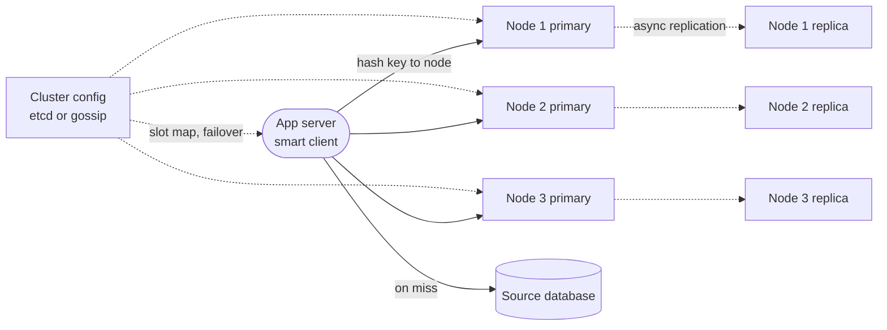
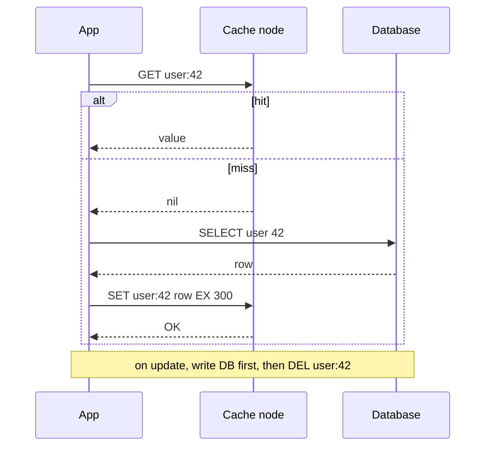

# Design a Distributed Cache (Redis / Memcached)

## Requirements

**Functional**
1. `get(key)`, `set(key, value, ttl)`, `delete(key)`; keys expire after their TTL.
2. When memory is full, evict entries according to a policy (LRU by default) instead of rejecting writes.

**Non-functional**
- **Latency:** sub-millisecond server-side; ~1 ms p99 round trip within a data center.
- **Throughput:** ~1M operations/s overall, read-heavy (~10:1).
- **Horizontal scale:** add nodes to add memory and throughput, moving only a small share of keys.
- **Availability:** a node failure loses at most a few seconds of writes and recovers within ~10–30 s; the cache is not the source of truth.
- **Data size:** ~1 TB of cached data, average value ~1 KB.

**Out of scope:** durable storage guarantees, rich data structures, cross-region strong consistency.

### Back-of-envelope estimates

| Quantity | Estimate | Implication |
|---|---|---|
| Number of keys | 1 TB / 1 KB ≈ 1B keys | Per-key overhead matters: 50 extra bytes per key is another 50 GB |
| Memory per node | 64 GB RAM, ~50 GB usable for data | 1 TB / 50 GB = 20 primary nodes |
| With one replica each | 20 × 2 = 40 nodes | Replicas double memory cost but give fast failover |
| Ops per primary | 1M / 20 = 50k ops/s | Comfortable: one Redis process handles ~100k+ simple ops/s |
| Network | 1M ops × 1 KB = 1 GB/s total ≈ 50 MB/s per node | Well under a 10 Gbit/s NIC (~1.25 GB/s), unless one key is very hot |

## Core entities

| Entity | Key fields | Store/Notes |
|---|---|---|
| Entry | `key`, `value` (bytes), `expires_at`, LRU pointers (`prev`, `next`) | In memory on the owning node; hash table plus LRU list |
| Node | `node_id`, `address`, `role` (primary / replica), `status` | Cluster membership, gossip or a coordinator (ZooKeeper / etcd) |
| Ring / slot map | hash range or slot → primary node, replicas | Cached by every client; versioned with an epoch number |

## API

```
GET    key                    → value | nil
SET    key value [EX seconds] [NX|XX]
                              → OK | nil (NX: only if absent, XX: only if present)
DEL    key                    → number of keys removed
EXPIRE key seconds            → 1 | 0
MGET   key1 key2 ...          → [value | nil, ...]

Error replies:
MOVED 3999 10.0.0.12:6379     (this node does not own the key's slot; refresh the map)
OOM command not allowed       (noeviction policy and memory full)
```

- A compact binary or text protocol over persistent TCP connections, not HTTP: JSON parsing and connection setup would cost more than the lookup itself.
- `SET NX` with a TTL doubles as a building block for locks and for "only one request refills this key".
- `MGET` batches lookups to cut round trips; the client groups keys by node and sends one request per node.

## High-level design



**Read flow (cache-aside)**
1. The client library hashes the key, looks up the owning node in its cached ring, and sends `GET` over a pooled connection.
2. On a hit the node finds the entry in its hash table, checks `expires_at`, moves the entry to the head of its LRU list and returns it.
3. On a miss the application reads the database and calls `SET key value EX ttl`.

**Write and eviction flow**
4. `SET` inserts or replaces the entry. If memory is above the limit, the node evicts from the tail of the LRU list until it fits.
5. The primary streams the write to its replica asynchronously.

**Failure flow**
6. Nodes and the coordinator detect a dead primary by missed heartbeats, promote its replica, bump the config epoch, and clients refresh their maps (or learn through a `MOVED` reply).



## Deep dives

### LRU eviction, explained

**Goal:** when memory is full, remove the entry used least recently, and do every operation in O(1).

#### How a hash map plus doubly linked list works

- A **hash map** from key to a list node gives O(1) lookup.
- A **doubly linked list** orders entries by recency: head = most recently used, tail = least. Each node has `prev` and `next` pointers, so it can be unlinked in O(1) given a pointer to it.
- `get`: look up the node, unlink it, and relink it at the head.
- `set`: if present, update and move to head; otherwise insert at head and, if over capacity, remove the tail node from both the list and the map.

```python
class LRU:
    def __init__(self, cap):
        self.cap, self.map = cap, {}
        self.head, self.tail = Node(), Node()        # sentinels
        self.head.next, self.tail.prev = self.tail, self.head

    def _unlink(self, n): n.prev.next, n.next.prev = n.next, n.prev
    def _push_front(self, n):
        n.next, n.prev = self.head.next, self.head
        self.head.next.prev = n; self.head.next = n

    def get(self, k):
        n = self.map.get(k)
        if not n or n.expires_at < now(): return None
        self._unlink(n); self._push_front(n); return n.val

    def set(self, k, v, ttl):
        if k in self.map: self._unlink(self.map[k])
        n = Node(k, v, now() + ttl); self.map[k] = n; self._push_front(n)
        if len(self.map) > self.cap:
            lru = self.tail.prev; self._unlink(lru); del self.map[lru.key]
```

**Worked example (capacity 3):**

| Operation | List after (head → tail) | Evicted |
|---|---|---|
| set A | A | |
| set B | B, A | |
| set C | C, B, A | |
| get A | A, C, B | |
| set D | D, A, C | B (tail) |
| get C | C, D, A | |
| set E | E, C, D | A |

#### What real systems do

- **Redis** does not keep a full linked list (two pointers per key would cost 16 bytes × 1B keys = 16 GB). It stores a 24-bit last-access clock per object and, when it must evict, **samples** a few random keys (`maxmemory-samples`, default 5), keeping a small pool of the best candidates, and evicts the one idle longest. This approximates true LRU closely with almost no memory overhead. It also offers LFU (`allkeys-lfu`), which keeps a small logarithmic access counter that decays over time, and `volatile-*` policies that evict only keys with a TTL.
- **Memcached** divides memory into **slab classes** of fixed chunk sizes (e.g. 96 B, 120 B, 152 B, ...) to avoid fragmentation, and keeps an LRU per slab class. A new item evicts from the LRU of its own size class.
- **Expiry:** checking `expires_at` on access (lazy) leaves expired-but-unread keys in memory, so Redis also runs an active cycle that samples keys with TTLs and deletes expired ones.

### Partitioning with consistent hashing

- **Weak:** `node = hash(key) % N`. Going from 20 to 21 nodes changes the result for about 20/21 ≈ 95% of keys, so almost the whole cache misses at once and the database takes the full load.
- **Better:** consistent hashing with one point per node. Only ~1/N of keys move, but load is uneven.
- **Best:** consistent hashing with **virtual nodes**, or fixed hash slots (Redis Cluster).

#### How consistent hashing works

1. Map the hash space to a ring, e.g. 0 to 2³²−1.
2. Hash each node's ID to a position on the ring.
3. Hash each key to a position and walk clockwise: the first node you meet owns the key.
4. Adding a node takes over only the keys between it and its counter-clockwise neighbor; removing a node hands its keys to the next node clockwise. Everything else stays put.

Worked example on a ring of 0–99: nodes A at 10, B at 45, C at 80. Key hashes: k1 = 30 → B, k2 = 50 → C, k3 = 90 → wraps to A, k4 = 5 → A. Add node D at 60: only keys in (45, 60] move from C to D, so k2 (50) moves and k1, k3, k4 stay. With three nodes, one node's arc might cover 35% of the ring and another 20%, which is why **virtual nodes** exist: each physical node is placed at, say, 100–200 points (`hash("A#0")`, `hash("A#1")`, ...). Arcs average out, and when a node dies its keys spread across all remaining nodes instead of piling onto one neighbor. Stronger machines can get more virtual nodes.

#### Hash slots (Redis Cluster)

Redis Cluster uses a fixed **16,384 slots**: `slot = CRC16(key) mod 16384`, and each primary owns a set of slots. Rebalancing moves whole slots between nodes with `MIGRATE`; clients that hit the wrong node get `MOVED slot host:port` and update their map. Hash tags put related keys together: only the text inside `{}` is hashed, so `user:{42}:profile` and `user:{42}:cart` share a slot and can be used in one multi-key command.

### Replication, failover and hot keys

#### How failover works

Each primary asynchronously streams its writes to one or more replicas. Replication is asynchronous to keep writes sub-millisecond, so acknowledged writes in the last few milliseconds before a crash can be lost; acceptable for a cache.

1. Nodes ping each other (Redis Cluster gossip) every second or so.
2. If a majority of primaries can't reach node 2 for longer than `cluster-node-timeout` (e.g. 15 s), they mark it failed.
3. Its replica requests promotion; a majority of primaries vote, and the replica becomes primary with a higher config epoch.
4. Clients see `MOVED` or connection errors, refresh the slot map, and continue. The old primary rejoins as a replica when it returns.

Requiring a majority avoids split brain where both sides of a network partition promote a primary. For example, with 3 primaries a minority side of 1 cannot elect anything.

#### Hot keys

A celebrity profile or a flash-sale product might take 200k reads/s, all on one node, beyond its CPU and NIC.

| Option | How | Trade-off |
|---|---|---|
| Read from replicas | Client sends reads for the hot key to replicas round-robin | Adds read capacity per replica; reads may be slightly stale |
| **Local near cache** | App servers keep the hottest keys in process memory for 1–5 s | Removes most remote reads; brief staleness; needs hot-key detection (sampling or client counters) |
| Key splitting | Store copies under `product:7#0` .. `#9`; readers pick a random suffix | Spreads across 10 nodes; writes must update all copies |

Hot-key detection: the client samples requests and keeps a count-min sketch or top-K counter, or an operator scans the server (`redis-cli --hotkeys` works when an LFU eviction policy is set).

### Cache invalidation strategies

| Strategy | How it works | Good for | Risk |
|---|---|---|---|
| **Cache-aside** with delete on write | Read: try cache, else DB and fill. Write: update DB, then `DEL key` | Default for most apps | Race below; short TTL as a safety net |
| Write-through | Writes go to the cache, which synchronously writes the DB | Read-after-write consistency | Every write pays both latencies; caches data never read |
| Write-behind | Writes go to the cache; DB is updated asynchronously in batches | Write-heavy counters | Data loss if the cache node dies before flushing |
| TTL only | Entries just expire | Data that tolerates staleness | Stale for up to the TTL |
| CDC-driven invalidation | A consumer of the DB change log deletes affected keys | Many writers, multiple services | More infrastructure; small delay |

**Why delete instead of update on write:** if two writers update the DB in order X then Y but their cache `SET`s arrive as Y then X, the cache holds stale X forever. Deleting makes the next reader refill from the DB.

**The remaining race:** reader R misses and reads old value v1 from the DB; writer W updates the DB to v2 and deletes the key; then R writes v1 into the cache. The cache is stale until the TTL. Fixes: always set a TTL, delete again after a short delay ("delayed double delete"), or use leases. Facebook's memcache paper describes **leases**: on a miss the server hands out a token, and a `set` is accepted only with a still-valid token; a `delete` invalidates outstanding tokens, so R's late write is rejected. Leases also limit the **thundering herd**: only one client per key gets a token at a time, while others wait briefly and retry.

## Production readiness

### Database choice and consistency

- **An in-memory key-value store** is the only thing that hits ~1 ms p99 at 1M ops/s. Disk-backed KV stores and relational databases add milliseconds of I/O and query overhead that defeat the purpose.
- **The source database owns ACID; the cache is BASE.** Replication is async, cache-aside leaves stale windows bounded by the TTL, and a failover can drop seconds of writes. That's fine because every entry can be regenerated.
- **Decide what must bypass the cache.** Reads that drive money or security (balance at checkout, a revoked permission, an inventory decrement) go to the database or use very short TTLs with explicit invalidation. Product pages and profiles tolerate seconds of staleness.
- **CAP stance: AP.** Clients prefer an answer now, and on a cache error they treat it as a miss and fall back to the database. Majority voting on failover prevents split-brain *promotions*, but it doesn't make the cache linearizable, and nothing should rely on it as a lock of record without fencing.

### Service boundaries and communication

- **Smart client vs proxy:** the smart client hashes straight to the owning node, avoiding a hop that would eat a large part of the 1 ms budget. A proxy (follow-up) is worth it only when there are many languages or very high connection counts.
- **Shared vs per-domain clusters:** one shared 40-node cluster gets the best memory utilization, but one team's hot key or `KEYS *` then hurts everyone. Split clusters by domain or criticality (session cache vs recommendations) as a bulkhead, accepting some stranded memory.
- **Sync vs async:** `GET`/`SET` are synchronous with tight client timeouts (a few ms). Replication is async. Invalidation is synchronous `DEL` after the DB write for single-service data, and async through CDC when many services write the same tables (deep dive).

### Failure modes and reliability

| Failure | Effect | Mitigation |
|---|---|---|
| Primary crash | 1/20 of keys unreachable for ~15–30 s; ~45k reads/s (1/20 of ~909k) fall through to the DB | Fast replica promotion; client timeouts treat errors as misses; request coalescing so each key is fetched once; read from replicas meanwhile |
| Whole cluster cold or down | DB receives up to ~909k reads/s and falls over | Rate-limit miss traffic to the DB, shed non-critical reads (recommendations off), serve stale from near caches, warm before cutover (follow-up) |
| Slow node (huge value, `KEYS`, swapping) | p99 spikes for that shard | Per-node timeouts and circuit breakers; block dangerous commands via ACLs; cap value size in the client; no swap on cache hosts |
| Popular key expires | Stampede on the DB | Locks, early refresh and TTL jitter (follow-up) |
| Hot key | One node's CPU/NIC saturates | Near cache or key splitting (deep dive) |
| CDC invalidation consumer lags | Stale reads beyond expectations | TTL as the safety net; alert on consumer lag in seconds |

### High availability and disaster recovery

- **SPOFs:** every primary has a replica **in a different zone**, and primaries are spread across 3 zones. Losing a zone takes out ~7 of 20 primaries, leaving 13 of 20, still a majority to vote promotions, and every affected shard has its replica elsewhere.
- **Zone loss capacity:** after promotion the shard count is unchanged, but those shards run without replicas until rebuilt. Rebuilding is a full sync of ~50 GB per replica, so throttle resyncs to protect the 1 ms p99.
- **Region:** one independent cluster per region (follow-up). After a regional failover, the surviving region's cache is cold for the moved users, so its DB must be sized for the extra misses, or the cache pre-warmed.
- **Targets:** **RTO 10–30 s** per node (the requirement) and **RPO of a few seconds of writes**. The real RPO is that of the source database: the cache's data is always rebuildable, so what matters is how fast the DB can absorb the refill.
- **Backups:** not needed for correctness. Optional RDB snapshots let a node restart warm, at the cost of fork-time latency spikes on 50 GB processes.

### Security

- **AuthN/AuthZ:** Redis ACL users per service, restricted to their key prefix patterns and to safe commands (no `FLUSHALL`, `KEYS` or `CONFIG`). Passwords come from a secrets manager and rotate by adding a new ACL password before removing the old one.
- **Network:** cache nodes live in a private subnet reachable only from app servers. TLS protects data in transit but costs CPU and some latency, so measure against the 1 ms budget; it's required where cached data includes PII.
- **At rest:** snapshot/AOF files sit on encrypted volumes.
- **PII:** cached copies extend PII lifetime, so a user deletion must also delete their keys (the TTL bounds the worst case). Never cache raw secrets or session tokens; cache by token hash.
- **Audit:** admin commands, ACL changes and failovers.
- **Abuse:** cap clients per node and value size per request, so one misbehaving service can't exhaust connections or a NIC.

### Observability

**SLIs and SLOs (30 days):**
- 99.9% of client operations succeed (no timeout or error).
- p99 client-side latency ≤ 1 ms in 99.5% of 5-minute windows.
- Hit ratio above the level the DB can absorb. With ~909k reads/s and an assumed DB budget of 100k reads/s, misses must stay under ~11%, so hits above ~89%.

**Dashboards:** hit ratio per keyspace, evictions/s, used memory vs `maxmemory`, fragmentation ratio, ops/s and network per node (to find hot shards), replication offset lag, connected clients, slow log.

**Tracing:** sampled cache spans in application traces, tagged hit or miss.

**Paging:** client error/latency burn rate, and hit ratio falling toward the DB-safe threshold. A completed failover is a notification.

### Performance and cost

**Bottleneck:** network and per-node hot spots, not CPU (50k ops/s per primary is well inside one process). Use `MGET` and pipelining to cut round trips, pooled or multiplexed connections (thousands of app servers × 20 nodes is a lot of sockets), and client-side compression for values above a few KB, trading app CPU for memory and bandwidth.

**Cost drivers:**
- **RAM: 40 × 64 GB ≈ 2.5 TB to hold 1 TB of data.** Dropping replicas for low-value keyspaces halves that, but a node failure then means a cold shard and a miss spike. Remove per-key overhead with packed hashes (follow-up): 50 B/key across 1B keys is 50 GB, about one node. Evict keyspaces with low hit ratios, which use memory and give little back.
- **Cross-zone traffic.** 1 GB/s of client traffic is ~86 TB/day; with primaries in 3 zones about two thirds, ~58 TB/day, crosses zones. Replication adds ~8 TB/day (≈91k writes/s × 1 KB). Zone-local read replicas or near caches cut this, at the price of staleness.
- **The cache's value is DB cost avoided:** without it the database would need to serve ~909k reads/s. Size the cache by the working set that keeps the hit ratio high, not by total data.

## Follow-up questions

### Why is Redis single-threaded for commands, and does that limit throughput?
Executing commands on one thread avoids locks and makes every command atomic, and the work per command is tiny, so the bottleneck is usually network I/O, not CPU. Redis 6 added I/O threads for reading and writing sockets while keeping execution single-threaded. To use more cores, run several instances per machine, each owning its own slots.

### How do you prevent a cache stampede when a popular key expires?
Only one request should recompute: take `SET lock:key 1 NX EX 5`, refill, then release; others serve the stale value or wait briefly. Alternatively refresh early with probability that grows as expiry approaches, or add random jitter to TTLs so many keys don't expire at the same moment.

### How would you handle cold start after adding a new cluster or losing a node?
Replicas avoid cold starts on failover because the promoted node already has the data. For a brand-new cluster, warm it by replaying recent keys from the old cluster or by shadow-reading through it before switching. Rate-limit cache-miss traffic to the database so it doesn't fall over while the hit rate recovers.

### Memcached or Redis?
Memcached is a simple multi-threaded key-value cache with slab allocation, good for plain object caching at high throughput. Redis adds data structures (hashes, sorted sets, streams), persistence, replication and clustering built in. Most new systems pick Redis unless they need only plain values and want Memcached's multi-threaded simplicity.

### What happens to memory with many small keys?
Per-key overhead (hash table entry, object header, key string, TTL) can exceed the value size. Pack small related fields into one hash per entity; Redis stores small hashes in a compact listpack encoding. Shorter key names and integer-encoded values also help.

### Should the cache persist to disk?
For a pure cache, persistence is optional; replicas are enough to survive a single failure. Redis offers RDB snapshots and an append-only file if a faster restart with warm data is worth the I/O. Never treat the cache as the only copy of data you cannot regenerate.

### How do clients learn about topology changes?
Smart clients cache the slot map and refresh it when they get `MOVED` or connection errors, and periodically. Alternatively, a proxy layer (Twemproxy, Envoy, or a managed endpoint) hides topology from applications at the cost of an extra hop.

### How would you cache across multiple regions?
Run an independent cache cluster in each region next to the application, filled from the regional database replica. Invalidate across regions by publishing delete events from the database change stream to every region. Cross-region synchronous replication would add tens of milliseconds and defeat the purpose.
