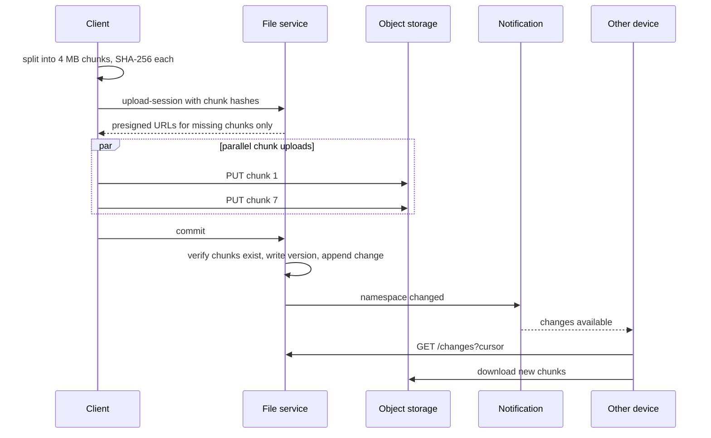

# Design Dropbox / Google Drive

## Requirements

**Functional**
1. Upload files from any device.
2. Download files.
3. Files sync automatically across a user's devices.
4. Share files and folders with other users (view/edit permissions).
5. Version history (restore earlier versions).

**Non-functional**
- **Large files:** up to 50 GB; uploads and downloads can be resumed.
- **Durability:** no file is ever lost (target 11 nines).
- **Fast sync:** changes appear on other devices within seconds.
- **Bandwidth efficient:** editing a byte of a 1 GB file must not re-upload 1 GB.
- **Scale:** ~500M users, ~100M DAU, exabyte-scale total storage.

### Back-of-envelope estimates

| Quantity | Estimate | Implication |
|---|---|---|
| Storage | 500M users × ~200 GB average allowance (~20 GB used) ≈ 10 EB | Object storage, with dedupe and tiering |
| Uploads | 100M DAU × ~5 files ≈ 500M/day ≈ 6k/s | Bytes must bypass app servers |
| Metadata | Billions of files × ~1 KB | Sharded relational or KV store |
| Chunk size | 4 MB → a 50 GB file = 12,500 chunks | Parallel, resumable transfer |

## Core entities

| Entity | Key fields | Notes |
|---|---|---|
| File | `file_id`, `owner_id`, `parent_folder_id`, `name`, `size`, `latest_version`, `status` | Metadata DB, sharded by `owner_id` / namespace |
| FileVersion | `file_id`, `version`, `chunk_hashes[]`, `created_at`, `device_id` | Versions are immutable lists of chunks |
| Chunk | `hash` (SHA-256), `size`, `storage_key`, `ref_count` | Content-addressed, so deduplicated |
| Share | `resource_id`, `grantee_id`, `permission` | ACLs checked before any URL is issued |
| Change log | `namespace_id`, `cursor` (monotonic), change record | Drives sync |

## API

```
POST /files/upload-session   { name, parentId, size, chunkHashes[] }
     → { sessionId, missingChunks: [{hash, uploadUrl}] }      (presigned URLs only for unseen chunks)
PUT  {uploadUrl}                                                  (client → object storage directly)
POST /files/upload-session/{id}/commit                           → { fileId, version }
GET  /files/{id}?version=                                        → { metadata, chunks: [{hash, downloadUrl}] }
GET  /changes?cursor={c}                                         → { changes: [...], nextCursor, hasMore }
POST /files/{id}/shares      { userIds, permission }
```

## High-level design




**Key principle:** file bytes never pass through app servers. The metadata service decides *what* to transfer and authorizes it; clients move bytes directly to and from object storage and the CDN.

## Deep dives

### Large files, resumable uploads and bandwidth

- **Weak:** a single HTTP upload through the app servers. That needs huge timeouts, restarts from zero on failure, and app servers become a bandwidth bottleneck.
- **Better:** a presigned S3 multipart upload: parallel parts, retry per part.
- **Best:** client-side **chunking + content hashing**. The upload session returns URLs only for chunks the server lacks, so:
  - **Resume** = re-run the session and skip completed chunks.
  - **Delta sync** = an edit changes a few chunks; only those upload.
  - **Dedupe** = identical chunks (the same file in many accounts, or unchanged parts) are stored once.
- **Content-defined chunking** keeps chunk boundaries stable when bytes are inserted, so delta sync still works (explained below).

#### Why fixed-size chunks fail, and how content-defined chunking fixes it

With fixed 4 MB chunks, inserting a single byte at the start of a file shifts **every** byte after it, so every chunk's content (and hash) changes, and the whole file re-uploads.

**Content-defined chunking (CDC)** picks boundaries based on the *content*, not on byte offsets:

1. Slide a small window (e.g. 48 bytes) across the file and compute a **rolling hash** of the window (Rabin fingerprint or Gear hash). A rolling hash updates in O(1) as the window moves one byte: add the new byte, remove the old one.
2. Declare a chunk boundary wherever `hash mod 2^k == 0`. Matches occur on average every 2^k bytes, so k = 22 gives ~4 MB average chunks. Enforce a minimum and maximum chunk size to avoid tiny or giant chunks.
3. Hash each chunk's bytes (SHA-256) to get its content address.

Inserting a byte only changes the hashes of windows near the edit, so only the chunk containing it (and occasionally its neighbor) changes. Every other boundary is found at the same content as before, and those chunks keep their hashes: **only one or two chunks re-upload**. This is the same idea rsync, restic and Dropbox use.

#### What "content-addressed" storage means

Chunks are stored under their own hash (`chunks/ab/3f9c…`). That gives three properties for free:
- **Dedupe:** identical bytes mean an identical key, so they're stored once.
- **Integrity:** after download, recompute the hash; a mismatch means corruption.
- **Immutability:** a key's content never changes, so chunks cache forever on CDNs and never need invalidation.

### Sync protocol

- Every change appends to a **per-namespace change log** with a monotonic cursor.
- The client keeps its last cursor. A notification (WebSocket, or long-poll as a fallback) says "something changed"; the client calls `GET /changes?cursor=` and applies the changes in order.
- Notifications carry no data, so a missed notification only delays sync; periodic polling is the safety net.
- The local index (path → version, chunk hashes) lets the client compute what changed locally without rescanning file contents.

### Conflicts

- Each commit includes the `base_version` the client edited. The service does a conditional write: if `latest_version != base_version`, reject.
- The losing client saves its copy as `report (Alice's conflicted copy).docx`. No silent data loss; the user resolves it.
- Real-time collaborative editing (Google Docs) is a different problem: OT/CRDTs, not file sync.

### Metadata scaling

- Shard by namespace (user root or shared folder), so a folder's listing and change log live on one shard and commits are single-shard transactions.
- Folder moves and renames update metadata only, never bytes.

### Durability, storage cost and security

- Object storage replicates across availability zones (11 nines); add cross-region replication for disaster recovery.
- **Tiering:** chunks not accessed for months move to infrequent-access or archive classes.
- **Garbage collection:** decrement chunk `ref_count` when versions expire; delete unreferenced chunks after a grace period.
- Encrypt at rest (per-chunk keys wrapped by a KMS) and in transit; presigned URLs are short-lived and scoped to one object, and permission checks happen before they're issued.

## Production readiness

### Database choice and consistency

- **Metadata DB (files, versions, chunk refs, shares, change log): sharded relational (MySQL/Postgres-style).** A commit must atomically check `latest_version == base_version`, insert the FileVersion, bump `ref_count` on its chunks and append to the change log. That is a multi-row ACID transaction, and sharding by namespace keeps it on one shard. A wide-column KV store was rejected: it would force us to build conditional multi-row writes and a monotonic cursor ourselves, and getting those wrong means lost edits or a skipped change on some device.
- **Object storage for chunk bytes.** Immutable, content-addressed blobs need no transactions; they need cheap, durable capacity at 10 EB. A database would be absurdly expensive for this.
- **CP vs AP per path.** Commits, sharing changes and the change log are **CP**: if a namespace's primary is unreachable, reject the commit and let the client retry rather than accept a write that could fork history. Reads of chunks are effectively AP and trivially safe because content never changes. Notifications are BASE by design: a lost hint only delays sync. Chunk `ref_count` decrements and garbage collection are eventually consistent, which is why deletion waits out a grace period.

### Service boundaries and communication

- **File service** (metadata, upload sessions, commits, ACL checks), **Notification service** (holds millions of long-lived WebSockets), plus background **GC/tiering workers** and **sharing**. Notification is split out because its scaling unit is open connections, not requests per second, and a deploy that drops connections must not touch commits.
- **Synchronous:** upload-session, commit, `GET /changes` and share checks. The client needs the answer to proceed, and the commit must be durable before we say "saved".
- **Asynchronous:** commit → change log → Notification service; object-storage upload events → File service; version expiry → GC; tiering. None of these sit on the user's critical path, and they can lag without breaking correctness because the change log is the source of truth.
- Bytes go client ↔ object storage/CDN directly, so no service is a bandwidth hop.

### Failure modes and reliability

| Failure | Effect | Mitigation |
|---|---|---|
| Metadata shard primary dies | Commits for its namespaces fail | Automatic failover to a synchronous replica in another zone; clients retry commit with exponential backoff + jitter; commit is idempotent on `(session_id)` |
| Object storage slow or erroring in one region | Chunk PUTs time out | Per-chunk timeouts and independent retries; resumable session means no progress is lost; client caps parallel uploads |
| Notification service down | Devices stop hearing about changes | Graceful degradation to polling `/changes` every 30–60 s (already in follow-ups) |
| Reconnect storm after an outage (millions of clients) | `/changes` and session endpoints overloaded | Jittered reconnect delays, server-sent `retry-after`, load shedding that favours commits over background sync |
| GC bug deletes a chunk still referenced | Permanent data loss | Grace period before deletion, soft-delete with a recovery window, and a mark-and-sweep audit that recomputes references before any physical delete |
| Poison upload event (malformed object, unknown session) | Consumer stuck retrying | Bounded retries, then a dead-letter queue with alerting; the commit path re-verifies chunk existence anyway |

### High availability and disaster recovery

- **SPOFs:** metadata shard primaries and the change-log cursor. Each shard runs a primary with a synchronous standby in a second zone and async replicas in a third; the API gateway and stateless services run in at least three zones behind load balancers.
- **Region strategy:** the durability target (11 nines) is met within a region by object storage spread across zones. Add **cross-region replication** of chunks and async replication of metadata for disaster recovery rather than active-active writes, because active-active commits would need cross-region conflict handling on every version.
- **Targets:** metadata **RPO 0 within a region** (synchronous standby) and **RPO ≤ 1 minute across regions**; **RTO ≤ 15 minutes** for a regional failover. Uploads are resumable and clients keep local copies, so a short outage is annoying but losing a committed version is not acceptable.
- **Backups:** snapshots plus continuous log archiving of metadata, with regular restore drills. Version history covers user mistakes and ransomware.

### Security

- **Authn:** OAuth tokens per device, revocable individually when a laptop is lost. **Authz:** the File service checks owner/Share ACLs before issuing any presigned URL; URLs are scoped to one object and expire in minutes.
- **Tenant isolation:** every metadata query is keyed by namespace ID; dedupe only within an account or team (see follow-ups).
- **Encryption:** TLS everywhere; per-chunk data keys wrapped by a KMS master key. Rotating the master key re-wraps data keys, not exabytes of data.
- **Secrets:** presigned-URL signing keys and DB credentials live in a secret manager and rotate on a schedule, with two keys valid during rotation.
- **Audit log:** shares, permission changes, downloads of shared files and admin access, written append-only and retained for enterprise compliance.
- **Abuse:** per-user and per-device rate limits on sessions and shares, malware scanning of public share links, quota enforcement at session creation.

### Observability

- **SLIs/SLOs (30 days):**
  - 99.9% of commits succeed (excluding conflicts, which are correct behaviour).
  - 99% of changes visible on another online device within 10 s of commit (measured with synthetic canary devices).
  - 99.95% of chunk downloads succeed, and zero chunks fail hash verification without being repaired.
- **Dashboards:** commit latency and errors per shard, change-log lag, WebSocket count, dedupe ratio, GC backlog.
- **Traces:** upload-session → chunk PUTs → commit → notification → remote `GET /changes`, tagged with namespace and device, to find where sync latency goes.
- **Paging:** fast burn on the commit or sync-latency SLO (e.g. 2% of the monthly error budget in an hour). Hash-verification failures page immediately because they signal corruption. Replica lag or a single slow node is a ticket, not a page.

### Performance and cost

- **Bottleneck:** metadata, not bytes. 6k uploads/s are each a commit transaction plus change-log append; hot shared namespaces concentrate load. Tune with batched commits for many small files, connection pooling per shard, indexes on `(namespace_id, cursor)` for `/changes`, and splitting very large team namespaces.
- **Storage (by far the largest cost):** ~10 EB logical. Plain 3× replication would be 30 EB raw; **erasure coding** (around 1.5× overhead) cuts that to ~15 EB, at the cost of more CPU and slower repair. Cross-region DR copies add another full copy, so reserve that for erasure-coded cold storage.
- **Dedupe and tiering:** content addressing already avoids storing unchanged chunks; moving untouched chunks to archive classes trades cheaper bytes for slower first access. At this scale owning storage hardware can beat a public cloud's per-GB price, at the price of a large operations team.
- **Egress:** downloads through the CDN are the second cost driver; immutable chunks cache well, and compression helps documents but not already-compressed media. Metadata (billions of files × ~1 KB, only terabytes) is cheap, so spend on its replicas freely.

## Follow-up questions

### How do you handle a 50 GB upload on a flaky mobile connection?
4 MB chunks, a few uploaded in parallel, each retried independently with backoff. The client stores session progress locally; after a crash or network change it re-requests the session, gets the still-missing chunks, and continues. The commit happens only when all chunks are verified.

### Two devices edit the same file offline. What happens when they reconnect?
The first to commit wins (version N+1). The second commit's `base_version` is stale, so it's rejected, and the client keeps its edit as a conflicted copy alongside. Both versions are preserved in history.

### Is cross-user deduplication safe?
It leaks information: by uploading a file and noticing that no bytes were transferred, an attacker can learn whether someone already has it. Mitigations: dedupe only within a user or team, or always "upload" a small proof. Many providers restrict dedupe to within-account for this reason. Client-side encryption makes cross-user dedupe impossible by design.

### How does sharing a folder work with sync?
Make the shared folder its own namespace with its own change log; each member's client subscribes to that namespace's cursor too. Permission changes are also log entries, so clients add or remove the folder accordingly.

### How would you implement version history and restore?
Versions are immutable lists of chunk hashes, so a new version only stores the new chunks. Restoring creates a new version pointing at the old chunk list (no byte copying). A retention policy (e.g. 30 or 180 days) expires old versions, and garbage collection reclaims unreferenced chunks.

### What if the notification service is down?
Clients fall back to polling `/changes` every 30–60 s, so sync is slower but correct, because the change log is the source of truth and notifications are only hints.

### How do you make downloads of a popular shared file fast?
Serve chunks through a CDN with presigned or CDN-signed URLs; chunks are immutable and content-addressed, so they cache perfectly. Clients download chunks in parallel and can start using media files before the download completes.

### How would you detect corrupted chunks?
Content addressing gives you verification for free: the client recomputes SHA-256 after download and compares it to the expected hash. Background scrubbing on the storage side re-verifies checksums and repairs from replicas.
