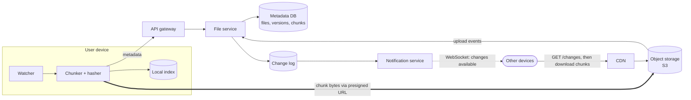
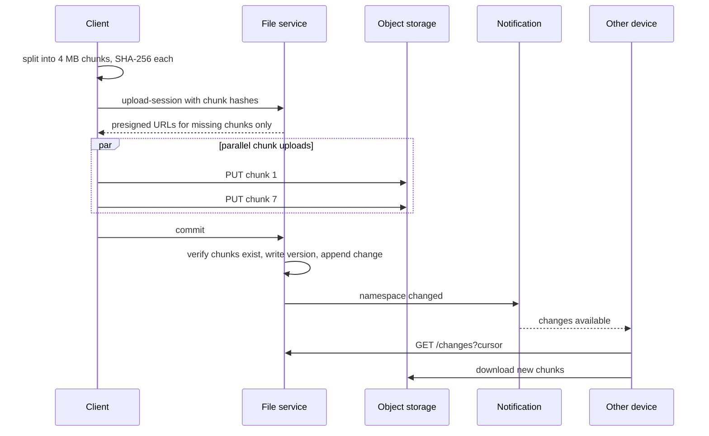

# Design Dropbox / Google Drive

## Requirements

**Functional**
1. Upload files from any device.
2. Download files.
3. Files sync automatically across a user's devices.
4. Share files and folders with other users (view/edit permissions).
5. Version history (restore earlier versions).

**Non-functional**
- **Large files:** up to 50 GB; uploads and downloads can be resumed.
- **Durability:** no file is ever lost (target 11 nines).
- **Fast sync:** changes appear on other devices within seconds.
- **Bandwidth efficient:** editing a byte of a 1 GB file must not re-upload 1 GB.
- **Scale:** ~500M users, ~100M DAU, exabyte-scale total storage.

### Back-of-envelope estimates

| Quantity | Estimate | Implication |
|---|---|---|
| Storage | 500M users × ~200 GB average allowance (~20 GB used) ≈ 10 EB | Object storage, with dedupe and tiering |
| Uploads | 100M DAU × ~5 files ≈ 500M/day ≈ 6k/s | Bytes must bypass app servers |
| Metadata | Billions of files × ~1 KB | Sharded relational or KV store |
| Chunk size | 4 MB → a 50 GB file = 12,500 chunks | Parallel, resumable transfer |

## Core entities

| Entity | Key fields | Notes |
|---|---|---|
| File | `file_id`, `owner_id`, `parent_folder_id`, `name`, `size`, `latest_version`, `status` | Metadata DB, sharded by `owner_id` / namespace |
| FileVersion | `file_id`, `version`, `chunk_hashes[]`, `created_at`, `device_id` | Versions are immutable lists of chunks |
| Chunk | `hash` (SHA-256), `size`, `storage_key`, `ref_count` | Content-addressed, so deduplicated |
| Share | `resource_id`, `grantee_id`, `permission` | ACLs checked before any URL is issued |
| Change log | `namespace_id`, `cursor` (monotonic), change record | Drives sync |

## API

```
POST /files/upload-session   { name, parentId, size, chunkHashes[] }
     → { sessionId, missingChunks: [{hash, uploadUrl}] }      (presigned URLs only for unseen chunks)
PUT  {uploadUrl}                                                  (client → object storage directly)
POST /files/upload-session/{id}/commit                           → { fileId, version }
GET  /files/{id}?version=                                        → { metadata, chunks: [{hash, downloadUrl}] }
GET  /changes?cursor={c}                                         → { changes: [...], nextCursor, hasMore }
POST /files/{id}/shares      { userIds, permission }
```

## High-level design





**Key principle:** file bytes never pass through app servers. The metadata service decides *what* to transfer and authorizes it; clients move bytes directly to and from object storage and the CDN.

## Deep dives

### Large files, resumable uploads and bandwidth

- **Weak:** a single HTTP upload through the app servers. That needs huge timeouts, restarts from zero on failure, and app servers become a bandwidth bottleneck.
- **Better:** a presigned S3 multipart upload: parallel parts, retry per part.
- **Best:** client-side **chunking + content hashing**. The upload session returns URLs only for chunks the server lacks, so:
  - **Resume** = re-run the session and skip completed chunks.
  - **Delta sync** = an edit changes a few chunks; only those upload.
  - **Dedupe** = identical chunks (the same file in many accounts, or unchanged parts) are stored once.
- **Content-defined chunking** keeps chunk boundaries stable when bytes are inserted, so delta sync still works (explained below).

#### Why fixed-size chunks fail, and how content-defined chunking fixes it

With fixed 4 MB chunks, inserting a single byte at the start of a file shifts **every** byte after it, so every chunk's content (and hash) changes, and the whole file re-uploads.

**Content-defined chunking (CDC)** picks boundaries based on the *content*, not on byte offsets:

1. Slide a small window (e.g. 48 bytes) across the file and compute a **rolling hash** of the window (Rabin fingerprint or Gear hash). A rolling hash updates in O(1) as the window moves one byte: add the new byte, remove the old one.
2. Declare a chunk boundary wherever `hash mod 2^k == 0`. Matches occur on average every 2^k bytes, so k = 22 gives ~4 MB average chunks. Enforce a minimum and maximum chunk size to avoid tiny or giant chunks.
3. Hash each chunk's bytes (SHA-256) to get its content address.

Inserting a byte only changes the hashes of windows near the edit, so only the chunk containing it (and occasionally its neighbor) changes. Every other boundary is found at the same content as before, and those chunks keep their hashes: **only one or two chunks re-upload**. This is the same idea rsync, restic and Dropbox use.

#### What "content-addressed" storage means

Chunks are stored under their own hash (`chunks/ab/3f9c…`). That gives three properties for free:
- **Dedupe:** identical bytes mean an identical key, so they're stored once.
- **Integrity:** after download, recompute the hash; a mismatch means corruption.
- **Immutability:** a key's content never changes, so chunks cache forever on CDNs and never need invalidation.

### Sync protocol

- Every change appends to a **per-namespace change log** with a monotonic cursor.
- The client keeps its last cursor. A notification (WebSocket, or long-poll as a fallback) says "something changed"; the client calls `GET /changes?cursor=` and applies the changes in order.
- Notifications carry no data, so a missed notification only delays sync; periodic polling is the safety net.
- The local index (path → version, chunk hashes) lets the client compute what changed locally without rescanning file contents.

### Conflicts

- Each commit includes the `base_version` the client edited. The service does a conditional write: if `latest_version != base_version`, reject.
- The losing client saves its copy as `report (Alice's conflicted copy).docx`. No silent data loss; the user resolves it.
- Real-time collaborative editing (Google Docs) is a different problem: OT/CRDTs, not file sync.

### Metadata scaling

- Shard by namespace (user root or shared folder), so a folder's listing and change log live on one shard and commits are single-shard transactions.
- Folder moves and renames update metadata only, never bytes.

### Durability, storage cost and security

- Object storage replicates across availability zones (11 nines); add cross-region replication for disaster recovery.
- **Tiering:** chunks not accessed for months move to infrequent-access or archive classes.
- **Garbage collection:** decrement chunk `ref_count` when versions expire; delete unreferenced chunks after a grace period.
- Encrypt at rest (per-chunk keys wrapped by a KMS) and in transit; presigned URLs are short-lived and scoped to one object, and permission checks happen before they're issued.

## Follow-up questions

### How do you handle a 50 GB upload on a flaky mobile connection?
4 MB chunks, a few uploaded in parallel, each retried independently with backoff. The client stores session progress locally; after a crash or network change it re-requests the session, gets the still-missing chunks, and continues. The commit happens only when all chunks are verified.

### Two devices edit the same file offline. What happens when they reconnect?
The first to commit wins (version N+1). The second commit's `base_version` is stale, so it's rejected, and the client keeps its edit as a conflicted copy alongside. Both versions are preserved in history.

### Is cross-user deduplication safe?
It leaks information: by uploading a file and noticing that no bytes were transferred, an attacker can learn whether someone already has it. Mitigations: dedupe only within a user or team, or always "upload" a small proof. Many providers restrict dedupe to within-account for this reason. Client-side encryption makes cross-user dedupe impossible by design.

### How does sharing a folder work with sync?
Make the shared folder its own namespace with its own change log; each member's client subscribes to that namespace's cursor too. Permission changes are also log entries, so clients add or remove the folder accordingly.

### How would you implement version history and restore?
Versions are immutable lists of chunk hashes, so a new version only stores the new chunks. Restoring creates a new version pointing at the old chunk list (no byte copying). A retention policy (e.g. 30 or 180 days) expires old versions, and garbage collection reclaims unreferenced chunks.

### What if the notification service is down?
Clients fall back to polling `/changes` every 30–60 s, so sync is slower but correct, because the change log is the source of truth and notifications are only hints.

### How do you make downloads of a popular shared file fast?
Serve chunks through a CDN with presigned or CDN-signed URLs; chunks are immutable and content-addressed, so they cache perfectly. Clients download chunks in parallel and can start using media files before the download completes.

### How would you detect corrupted chunks?
Content addressing gives you verification for free: the client recomputes SHA-256 after download and compares it to the expected hash. Background scrubbing on the storage side re-verifies checksums and repairs from replicas.
