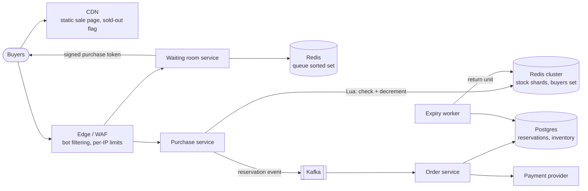
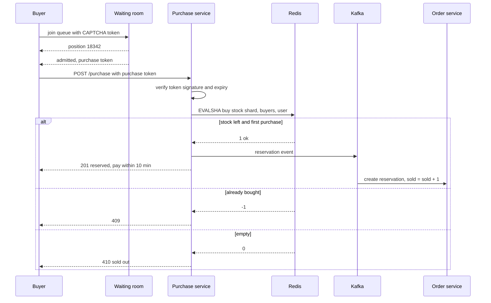

# Design a Flash Sale System

## Requirements

**Functional**
1. At a scheduled start time, users can buy a limited-stock item (e.g. 10,000 units of a phone at a discount).
2. Each user may buy at most N units (usually 1).
3. A successful buyer gets a reservation and must pay within a time limit (e.g. 10 minutes); unpaid units return to stock.
4. Users see clear outcomes quickly: "you got one, pay now", "you're in the queue", or "sold out".

**Non-functional**
- **No oversell:** units sold never exceed stock, under any failure or retry.
- **Handle bursts of 1M+ requests/s** in the first seconds, then drop to near zero once sold out.
- **Fairness:** first-come or random among early arrivals; bots shouldn't win most units.
- **Isolation:** the rest of the store keeps working during a sale.
- **Low latency:** buyers get an answer within a second or two.

**Out of scope**
- Shipping, the product catalog, general checkout beyond the sale item.

### Back-of-envelope estimates

| Quantity | Estimate | Implication |
|---|---|---|
| Peak requests | 5M users clicking within ~5 s ≈ 1M req/s | Must be filtered at the edge; no database sees this |
| Stock | 10,000 units | Fewer than 1% of requests can succeed; most should be rejected cheaply |
| Redis capacity | ~100k simple ops/s per shard (lower for Lua scripts) | One stock key can't take 1M req/s; admission control and stock sharding |
| Order writes | 10,000 orders over ~1 minute ≈ 170/s average | The order DB is fine if only winners reach it |
| Waiting-room drain | Admit ~20k users/s to the purchase step | Purchase tier sized for 20k req/s, not 1M |
| Sale page | 5M users × ~500 KB of page assets ≈ 2.5 TB | Static page from the CDN, preloaded before the start |

## Core entities

| Entity | Key fields | Store/Notes |
|---|---|---|
| Sale | `sale_id` (PK), `sku`, `total_stock`, `per_user_limit`, `starts_at`, `ends_at`, `price` | Postgres; cached everywhere before start |
| Stock counter | `stock:{sale_id}:{shard}` → remaining units | Redis; the fast gate |
| Buyers set | `buyers:{sale_id}` → set of user IDs | Redis; enforces per-user limit atomically with stock |
| Reservation | `reservation_id`, `sale_id`, `user_id`, `status` (reserved / paid / expired), `expires_at` | Postgres; `UNIQUE (sale_id, user_id)` |
| Inventory (DB) | `sale_id` (PK), `total`, `sold` | Postgres; `CHECK (sold <= total)` as the final guard |
| Queue ticket | `user_id`, `sale_id`, position, `admitted_at` | Redis sorted set / signed token |

## API

```
GET  /v1/sales/{saleId}                → 200 { startsAt, serverTime, price, status: "upcoming|live|sold_out" }  (CDN cached)
POST /v1/sales/{saleId}/queue          → 202 { ticket, position }   (requires CAPTCHA token, logged-in user)
GET  /v1/sales/{saleId}/queue/{ticket} → 200 { status: "waiting|admitted|sold_out", position, purchaseToken? }
POST /v1/sales/{saleId}/purchase
     Authorization: user token, X-Purchase-Token: <signed, 2-min expiry>
     Idempotency-Key: <uuid>           { quantity: 1 }
     → 201 { reservationId, payBy }
     → 409 already purchased   → 410 sold out   → 403 missing/invalid purchase token   → 429
POST /v1/reservations/{id}/pay         { paymentMethodToken } → 200 { status: "paid" }
```

Notes:
- The purchase endpoint requires a short-lived, signed **purchase token** issued only to admitted users, so traffic that skipped the queue is rejected with a signature check and no backend calls.
- `serverTime` lets clients count down against server time rather than their own clocks.
- Sold-out status is published to the CDN so late arrivals never reach origin.

## High-level design



1. **Before the sale:** the page and assets are pushed to the CDN; stock is loaded into Redis shards; the sale config is cached in every service.
2. **Start:** users join the waiting room (CAPTCHA plus login required). The waiting room admits users at the rate the purchase tier can handle, issuing signed purchase tokens.
3. **Purchase:** the purchase service verifies the token, then runs one Lua script that checks the per-user limit and decrements stock atomically. Success emits a reservation event to Kafka and returns `201` with a pay-by time.
4. **Order creation:** the order service consumes events and writes the reservation with a conditional inventory update in Postgres (the second guard). Users then pay.
5. **Expiry:** unpaid reservations expire; the worker marks them expired in the DB and returns the unit to Redis stock.
6. **Sold out:** when all shards hit zero, a flag is published to the CDN and waiting room, and everyone left is told immediately.



## Deep dives

### Preventing oversell with an atomic decrement

#### Why the naive version oversells

```
stock = GET stock           # both requests read 1
if stock > 0:
    SET stock (stock - 1)   # both write 0
    create_order()          # two orders for one unit
```

Two requests interleave between the read and the write: a check-then-act race. At 1M req/s this happens constantly.

#### Options

- **Weak:** decrement in the database per request: `UPDATE inventory SET sold = sold + 1 WHERE sale_id = ? AND sold < total`. Correct, but every request locks the same row, so throughput is a few thousand per second at best, and the DB melts.
- **Better:** Redis `DECR stock`; if the result is negative, `INCR` it back and reject. Atomic and fast, but it can't enforce the per-user limit in the same step, and the counter briefly goes negative.
- **Best:** a **Lua script** that checks the per-user limit and the stock and updates both atomically. Redis runs a script to completion without interleaving other commands, so the check and the write are one indivisible step.

#### How the Lua script works

```lua
-- KEYS[1] = stock:{s42}:3    KEYS[2] = buyers:{s42}    ARGV[1] = user id
if redis.call('SISMEMBER', KEYS[2], ARGV[1]) == 1 then
  return -1                                  -- already bought
end
local left = tonumber(redis.call('GET', KEYS[1]) or '0')
if left <= 0 then
  return 0                                   -- this shard is empty
end
redis.call('DECR', KEYS[1])
redis.call('SADD', KEYS[2], ARGV[1])
return 1                                     -- reserved
```

The `{s42}` hash tag puts both keys in the same Redis Cluster slot, which a multi-key script requires.

**Worked example** (one shard holding 2 units; four requests arrive in the same millisecond):

| Order Redis runs them | User | Shard stock before | Buyers set | Result | Stock after |
|---|---|---|---|---|---|
| 1 | u1 | 2 | {} | 1 (reserved) | 1 |
| 2 | u2 | 1 | {u1} | 1 (reserved) | 0 |
| 3 | u1 (double tap) | 0 | {u1, u2} | −1 (already bought) | 0 |
| 4 | u3 | 0 | {u1, u2} | 0 (try another shard or sold out) | 0 |

No interleaving is possible, so stock can't go below zero.

#### Defense in depth

Redis is fast but not the system of record (a failover can lose the last writes if replication is asynchronous). So the order service applies a second, durable guard:

```sql
BEGIN;
UPDATE inventory SET sold = sold + 1 WHERE sale_id = 's42' AND sold < total;   -- 0 rows → reject
INSERT INTO reservations (sale_id, user_id, status, expires_at)
VALUES ('s42', 'u1', 'reserved', now() + interval '10 minutes');               -- UNIQUE (sale_id, user_id)
COMMIT;
```

At ~170 orders/s (only winners reach it), this row update is no bottleneck. If Redis ever over-admits after a failover, the DB rejects the extras and those users get an apology instead of an oversold order. Configuring Redis with `WAIT`/AOF `appendfsync always` on the stock shards reduces that window further at some latency cost.

### Scaling the hot stock key

A single key lives on one Redis shard, which handles on the order of 100k simple operations per second (and fewer Lua executions). Two techniques fix this:

1. **Admission control** keeps the purchase rate at ~20k/s (below).
2. **Stock sharding:** split 10,000 units across 10 keys, `stock:{s42}:0` … `stock:{s42}:9`, 1,000 each.

But the hash tag `{s42}` would put all ten keys on one slot. So use the tag per shard (`stock:{s42-3}`) and keep a separate buyers set per shard, or enforce the per-user limit by routing each user to a fixed shard: `shard = hash(user_id) % 10`. A fixed shard means a user's repeat attempts always hit the same buyers set, so the limit holds. When a user's shard is empty, the user is told to retry, and the service may route them to a shard that still has stock (tracked in a small "non-empty shards" bitmap), checking a global buyers set in the DB guard to keep the per-user limit.

**Example:** 10 shards × 1,000 units. At 20k admitted req/s spread evenly, each shard sees ~2k scripts/s, comfortably within one Redis node. Shards drain at slightly different times; the last few units are found through the non-empty bitmap.

### Admission control and the virtual queue

Adding servers doesn't help when 5M people compete for 10,000 units; you need to stop most of the traffic early and cheaply.

#### How the waiting room works

1. **Join:** at or before the start, a user with a valid login and CAPTCHA calls `/queue`. The service adds them: `ZADD queue:s42 <score> u1`. Users who joined before the start get a random score within the pre-start window (fair lottery, no advantage to the fastest script); later arrivals are scored by arrival time.
2. **Drain:** a controller runs every 100 ms and pops the next batch, `ZPOPMIN queue:s42 2000` (20k/s), sized to the purchase tier's capacity. Each admitted user gets a purchase token: an HMAC- or JWT-signed `{user, sale, exp: now+2min}`.
3. **Notify:** clients poll the ticket status every few seconds with jitter (or hold an SSE connection); admitted users receive their token.
4. **Stop early:** the controller tracks remaining stock. Once remaining stock plus outstanding unexpired tokens shows the sale is effectively over, it stops admitting and broadcasts "sold out", so millions of users don't wait for nothing.

| Time | Queue length | Admitted so far | Stock left | Action |
|---|---|---|---|---|
| 10:00:00 | 3,000,000 | 0 | 10,000 | Start draining 20k/s |
| 10:00:01 | 2,980,000 | 20,000 | ~2,000 | Most admitted users buy instantly |
| 10:00:02 | 2,960,000 | 40,000 | 0 | All shards empty: publish sold out |
| 10:10:02 | — | — | 37 | Unpaid reservations expire; admit a small batch for the returned units |

#### Rejecting cheaply at each layer

- **CDN:** static page and the sold-out flag; no origin hits for page loads.
- **Edge/WAF:** per-IP and per-device rate limits (token bucket), known bot signatures, reject requests without a valid signed token by checking the signature at the edge.
- **Purchase service:** in-memory "sold out" flag per process, checked before any Redis call once Redis returns 0 on all shards.

### Bot protection and fairness

- Require login with an account older than some threshold and a verified phone or payment method; pre-registration for the sale lets you vet accounts ahead of time.
- CAPTCHA or proof-of-work at queue entry, not at purchase time, so humans solve it before the rush.
- Randomized ordering for everyone who arrives before the start removes the benefit of sending requests at the exact millisecond.
- Per-user, per-card, per-address and per-device limits; detect clusters of accounts sharing devices or IPs.
- Don't reveal the purchase endpoint's validity until admission: without a token, a request is rejected at the edge.

### Reservations, payment and expiry

- A reservation holds the unit for 10 minutes. The expiry worker finds rows with `status = 'reserved' AND expires_at < now()`, marks them `expired` with a conditional update (so a payment that just succeeded wins), decrements `sold` in the DB, and `INCR`s a Redis shard and removes the user from the buyers set.
- Payment uses the reservation ID as the idempotency key with the provider; webhooks are deduped on the provider's event ID.

## Follow-up questions

### Why not just use the database with row locking?
Every purchase would contend on one inventory row; a single row lock serializes them at a few thousand per second, and the connection pool would be exhausted long before that under 1M req/s. The database stays the durable guard for the ~10,000 winners, while Redis and admission control absorb the burst.

### What happens if Redis fails over mid-sale?
With asynchronous replication, the new primary may be missing the last few decrements, so it could admit a few extra buyers. The conditional DB update with `sold < total` rejects them. You can also pause admission briefly during failover and reload stock from the DB (`total − sold − active reservations`).

### How do you make the purchase request idempotent?
The buyers set makes a repeat purchase return "already bought", and the client sends an idempotency key so a retry after a timeout returns the original reservation. In the DB, `UNIQUE (sale_id, user_id)` prevents duplicates even if events are delivered twice.

### Why put Kafka between the purchase service and the order database?
It decouples the burst from the database: the purchase service answers in milliseconds after the Redis script, and the order service writes at a steady rate. Kafka retains events durably, so a slow or restarting order service doesn't lose winners. The user is shown "reserved" immediately because Redis already decided.

### How do you keep the rest of the store healthy during the sale?
Run the sale on separate infrastructure: dedicated waiting room, purchase service and Redis cluster, with its own rate limits at the edge. Normal browsing and checkout use different services and pools, so a sale overload can't exhaust them.

### How do you make the countdown fair across clients?
Clients get server time from the API and compute an offset from their local clock, so everyone's button activates at the same real moment. The server, not the client, decides if the sale is open; requests before `starts_at` are rejected.

### How do you handle returned units after expiry?
The expiry worker returns units to Redis and the waiting room admits a small batch of the remaining queue, or offers them to a waitlist in order. If the queue has been dismissed, re-open briefly with a notification to waitlisted users.

### How would you test this before a real sale?
Load-test with a replay of expected traffic (millions of simulated clients) against a staging copy, assert that orders never exceed stock, and run chaos tests: kill Redis primaries, delay Kafka, crash order consumers. Run a small real "dress rehearsal" sale to validate CDN, queue and bot defenses end to end.
