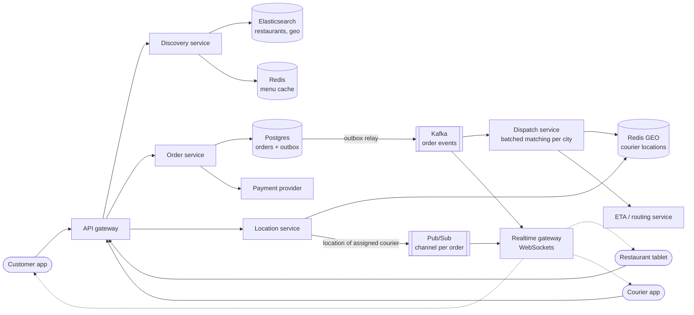
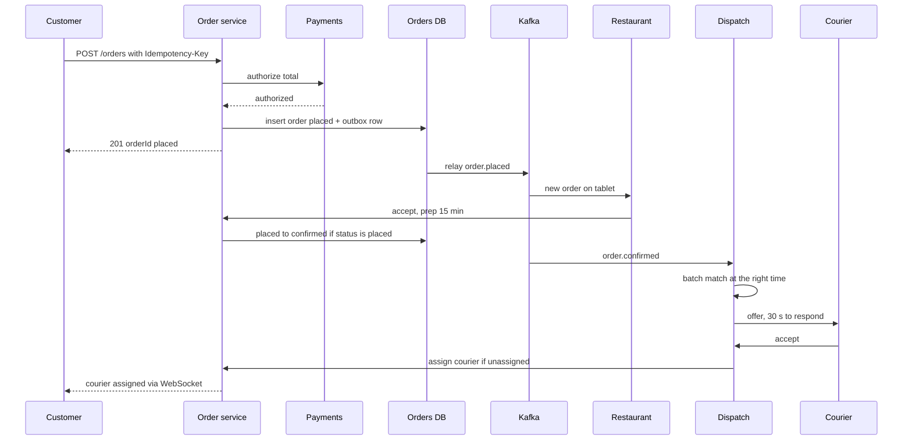
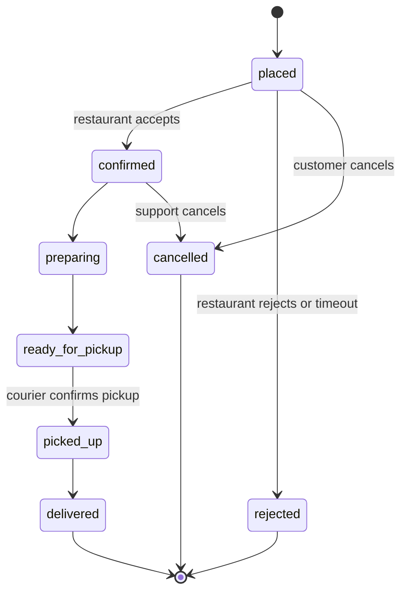

# Design DoorDash / Food Delivery

## Requirements

**Functional**
1. Customers browse restaurants that deliver to their address, and view menus with prices and availability.
2. Customers place an order and pay; the restaurant accepts or rejects it.
3. The system assigns a courier to pick up the order and deliver it.
4. Customers, restaurants and couriers track the order's status and the courier's live location.

**Non-functional**
- **Order consistency:** an order is charged once, moves through valid states only, and is never assigned to two couriers.
- **Real-time tracking:** status changes and courier location reach the customer within ~2 s.
- **Peak-hour spikes:** dinner peaks are 3–5× the daily average, and local spikes (rain, big games) are sharper.
- **Availability:** browsing must stay up even if dispatch degrades; ordering degrades gracefully.
- **Scale:** ~5M orders/day, ~500k restaurants, ~500k couriers online at peak.

**Out of scope:** restaurant onboarding, courier payouts, promotions, reviews.

### Back-of-envelope estimates

| Quantity | Estimate | Implication |
|---|---|---|
| Orders | 5M/day ≈ 58/s average; peak hour holds ~15% of daily orders = 750k/h ≈ 210/s | Order writes are modest; a sharded relational DB is fine |
| Active orders at peak | 750k/h × ~40 min lifetime ≈ 500k (Little's law) | 500k tracking connections plus ~500k courier connections |
| Courier location updates | 500k couriers / every 5 s = 100k writes/s | Keep only the latest position, in memory (Redis GEO) |
| Menu data | 500k restaurants × ~50 KB = 25 GB | Fits in a cache; serve menus from cache and CDN |
| Order storage | 5M × ~2 KB = 10 GB/day ≈ 3.65 TB/year | Partition by time or region; archive old orders |

## Core entities

| Entity | Key fields | Store/Notes |
|---|---|---|
| Restaurant | `restaurant_id`, location, delivery zone polygon, hours, `is_open`, prep time estimate | Postgres; indexed in Elasticsearch with geo fields |
| Menu item | `item_id`, `restaurant_id`, name, price, `available` | Postgres, partition key `restaurant_id`; cached per restaurant |
| Order | `order_id`, `customer_id`, `restaurant_id`, items, total, `status`, `courier_id?`, `version`, `payment_intent_id` | Postgres sharded by `order_id`; the state machine lives here |
| Order event | `order_id`, `seq`, `from_status`, `to_status`, actor, ts | Append-only audit log; also published to Kafka |
| Courier | `courier_id`, vehicle, `status` (offline / available / offered / on_delivery), active order IDs | Postgres for durable status |
| Courier location | `courier_id` → (lat, lng, ts) | Redis GEO, keyed by city; latest only |

## API

```
GET   /restaurants?lat=&lng=&cuisine=&cursor=      → { restaurants: [{id, name, etaMinutes, deliveryFee}], nextCursor }
GET   /restaurants/{id}/menu                      → { items: [{id, name, price, available}] }
POST  /orders     Idempotency-Key: <uuid>
      { restaurantId, items: [{itemId, qty}], addressId, paymentMethodId }
                                                  → 201 { orderId, status: "placed", total }
                                                    409 item unavailable | 402 payment declined
GET   /orders/{id}                                → { status, courier: {name, location}, etaMinutes }
POST  /orders/{id}/cancel                         → 200 | 409 too late to cancel
PATCH /restaurant/orders/{id}  { action: "accept" | "reject" | "ready" }
POST  /courier/location        { lat, lng, heading }        (every ~5 s while online)
PATCH /courier/offers/{offerId} { action: "accept" | "decline" }
WS    /ws/orders/{id}                             (status and courier location pushes)
```

- `Idempotency-Key` on order creation: a client retry after a timeout returns the original order instead of charging twice.
- Prices and the total are computed on the server from the menu, never trusted from the client.
- Customer, restaurant and courier identity comes from the auth token, and every endpoint checks that the caller owns the order.
- Restaurant lists use cursor pagination because ranking changes as restaurants open and close.

## High-level design



**Browse flow**
1. The customer app sends its location; the discovery service finds open restaurants whose delivery zone contains that point (Elasticsearch geo query), ranks them, and returns a page.
2. Menus come from a Redis cache keyed by `restaurant_id`, refreshed when the restaurant edits its menu.

**Order flow**
1. The order service validates items and prices, authorizes the payment (no capture yet), and inserts the order in `placed` status plus an outbox row in the same transaction.
2. The outbox relay publishes `order.placed` to Kafka. The realtime gateway pushes the order to the restaurant tablet.
3. The restaurant accepts and gives a prep time; the order moves to `confirmed`.
4. Dispatch consumes the event and plans when to assign a courier so they arrive about when the food is ready.

**Tracking flow**
1. Couriers send location every 5 s; the location service overwrites their entry in Redis GEO.
2. For couriers on a delivery, it also publishes to the order's pub/sub channel; the customer's WebSocket server is subscribed and pushes the update.





Courier assignment is a separate field rather than a state, because a courier can be assigned before or after the food is ready.

## Deep dives

### The order state machine

The order touches four parties (customer, restaurant, courier, payments) who act concurrently. A customer can tap cancel at the same moment the restaurant taps accept. The state machine makes those races safe.

- **Weak:** each service writes `status` directly. A late "preparing" update can overwrite "cancelled", and nobody knows which transitions are legal.
- **Better:** a central order service with an explicit transition table, enforced in code.
- **Best:** the transition table plus a **conditional update** in the database, an append-only event log, and a **transactional outbox** so other services learn about every transition exactly when it commits.

#### How a guarded transition works

```
ALLOWED = {
  "placed":           {"confirmed", "rejected", "cancelled"},
  "confirmed":        {"preparing", "cancelled"},
  "preparing":        {"ready_for_pickup"},
  "ready_for_pickup": {"picked_up"},
  "picked_up":        {"delivered"},
}

def transition(order_id, expected_from, to, actor):
    assert to in ALLOWED[expected_from]
    BEGIN
      rows = UPDATE orders SET status = :to, version = version + 1
             WHERE order_id = :order_id AND status = :expected_from
      if rows == 0: ROLLBACK; raise Conflict      # someone else moved it first
      INSERT INTO order_events (order_id, from_status, to_status, actor, ts) ...
      INSERT INTO outbox (topic, key, payload) VALUES ('orders', :order_id, ...)
    COMMIT
```

**Worked example, cancel vs accept race:**

| Time | Customer request | Restaurant request | Row status |
|---|---|---|---|
| t0 | | | placed |
| t1 | `UPDATE ... SET cancelled WHERE status='placed'` → 1 row | | cancelled |
| t2 | | `UPDATE ... SET confirmed WHERE status='placed'` → 0 rows | cancelled |
| t3 | 200 cancelled; payment authorization voided | 409; tablet shows "order cancelled" | cancelled |

Exactly one of them wins, and the loser gets a clear error.

#### How the transactional outbox works

Writing to the DB and then publishing to Kafka is a dual write: if the process crashes between the two, the order changes but dispatch never hears about it. Instead, the event row is inserted into an `outbox` table in the same transaction as the status change. A relay (a poller, or CDC such as Debezium reading the write-ahead log) publishes outbox rows to Kafka and marks them sent. Delivery is at least once, so consumers dedupe on `(order_id, version)`.

#### Payments inside the lifecycle

Authorize at `placed`, capture at `delivered` (or at pickup), and void on `rejected` or early `cancelled`. Each call carries the order ID as the payment provider's idempotency key, so retries never double-charge. This is a small saga: every step has a compensating action.

### Dispatch and matching

Dispatch decides which courier gets which order and when. Food delivery differs from ride hailing because the food is not ready yet: a courier who arrives 15 minutes early wastes 15 minutes, and one who arrives late lets the food go cold.

| Option | How | Problem |
|---|---|---|
| **Weak:** nearest courier at order time | Redis `GEOSEARCH`, offer to the closest | Couriers wait at restaurants; greedy picks hurt later orders |
| **Better:** delayed greedy | Wait until `ready_time − courier_travel_time`, then pick the best courier by ETA | Still one order at a time |
| **Best:** batched assignment | Every ~30 s per city zone, build a cost matrix of all unassigned orders × available couriers and solve it globally; allow stacking two orders on one route | More compute, needs a solver |

#### How batched assignment works

1. Collect orders due for assignment in this window and couriers who are available (or finishing soon nearby).
2. For each pair, compute a cost from the routing service, e.g. `cost = travel_time_to_restaurant + max(0, arrival − ready_time) × w_wait + max(0, ready_time − arrival) × w_food_waiting`.
3. Solve the assignment problem (the Hungarian algorithm, O(n³), or a min-cost-flow solver) to minimize total cost.
4. Send offers. Declines and timeouts return the order to the next window.

**Worked example** (cost = minutes until pickup):

| | Order 1 | Order 2 | Order 3 |
|---|---|---|---|
| Courier A | 2 | 3 | 9 |
| Courier B | 3 | 8 | 7 |
| Courier C | 9 | 6 | 4 |

Greedy in order-arrival order: Order 1 takes A (2), Order 2 takes C (6), Order 3 gets B (7). Total **15**. The optimal assignment is A→2 (3), B→1 (3), C→3 (4), total **10**. The global solve saves a third of the courier time by giving Order 1 its second-best courier.

#### Never double-assigning

The offer reserves the courier with `SET lock:courier:{id} {orderId} NX EX 30`, and the accept runs `UPDATE orders SET courier_id = ? WHERE order_id = ? AND courier_id IS NULL`. If the update returns 0 rows, the courier is told the order was taken.

### Geospatial queries

There are two different geo problems with different data shapes.

**Restaurants (static points with delivery areas): "who delivers to me?"** Each restaurant has a delivery polygon (often a radius or a drive-time area). Index it in Elasticsearch as a `geo_shape` and query with the customer's point:

```json
{ "query": { "bool": {
    "filter": [
      { "term": { "is_open": true } },
      { "geo_shape": { "delivery_zone": {
          "shape": { "type": "point", "coordinates": [-122.4194, 37.7749] },
          "relation": "intersects" } } } ] } } }
```

Because restaurants and zones change rarely, a cheaper alternative is to **precompute per geohash cell**: for every 6-character cell (about 1.2 km × 0.6 km), store the list of restaurant IDs whose zone covers it. Browsing becomes one cache lookup, `restaurants_by_cell:9q8yyk`, followed by filtering on `is_open` and ranking. Recompute a restaurant's cells when its zone changes.

**Couriers (moving points): "who is near this restaurant?"** At 100k updates/s, use Redis GEO, which stores members in a sorted set scored by a 52-bit geohash so that nearby couriers sort next to each other:

```
GEOADD couriers:sf -122.4100 37.7800 courier:77
GEOSEARCH couriers:sf FROMLONLAT -122.4194 37.7749 BYRADIUS 3 km ASC COUNT 50 WITHDIST
```

The search checks the cell containing the point plus its neighbors, so couriers just across a cell border aren't missed. Straight-line distance only narrows the candidates; the routing service's ETA ranks them.

### Real-time tracking

- Customers hold a WebSocket to a realtime gateway. The gateway subscribes to `order:{id}` on a pub/sub system (Redis Pub/Sub or a Kafka-backed service) for each connected customer.
- Status events come from Kafka; courier positions are published by the location service only for couriers on a delivery, so the channel carries one update per 5 s.
- The client interpolates the courier's marker between updates. On reconnect it calls `GET /orders/{id}` to resync, so a missed push is never fatal.
- Push notifications (APNs/FCM) cover key transitions when the app is in the background.

### Peak-hour spikes

- Browsing is read-only and cacheable: restaurant lists by geohash cell and menus are cached with short TTLs, so a spike hits Redis and the CDN rather than Postgres.
- Order placement is protected by rate limits per customer and by admission control per city if dispatch falls behind.
- Dispatch is partitioned by city, so a storm in one city doesn't slow others. When couriers are scarce, quoted ETAs rise, delivery radius shrinks, and peak pay attracts more couriers.
- Restaurants can be auto-paused when their open-order queue exceeds what their kitchen can handle.

## Follow-up questions

### What happens if the restaurant never responds to a new order?
A timer (a delayed message or a workflow engine such as Temporal) fires after a few minutes. It retries the notification, then calls the restaurant, and finally moves the order to `rejected` with a conditional update and voids the payment authorization. The customer is told immediately and offered alternatives.

### How do you keep menu availability accurate when an item sells out?
The restaurant marks the item unavailable, which updates Postgres and invalidates the menu cache. Order creation re-checks availability on the server, so a stale cached menu can't produce an order for a sold-out item; it returns 409 and the app refreshes the cart.

### How would you estimate delivery time shown before ordering?
ETA = expected time to assign a courier + travel to the restaurant or prep time, whichever is longer + travel to the customer. Prep time comes from the restaurant's history by hour and order size, and travel times come from the routing service with live traffic. A model trained on past orders corrects for systematic bias.

### How do you stack two orders on one courier?
In the batch solve, add candidate "bundles" of two orders from the same or nearby restaurants heading in a similar direction. A bundle is accepted only if neither customer's delivery time worsens by more than a threshold. The cost function compares the bundle's total cost against assigning the orders separately.

### Which database for orders, and how do you shard it?
Postgres, because orders need transactional state changes and conditional updates. Shard by `order_id` (hash) for even load, with secondary lookup tables by customer and by restaurant for listing. Completed orders older than a few months move to a warehouse or archive table.

### A courier's phone dies mid-delivery. What happens?
Their location goes stale; after a missed-heartbeat threshold the customer sees "location unavailable" while the order stays `picked_up`. Support tooling or an automated policy contacts the courier, and if the order isn't delivered within a limit it is refunded. The courier's app resyncs its state from the server on restart.

### How do you prevent the same order being placed twice when the app retries?
The client generates an idempotency key per checkout attempt. The order service stores the key with the resulting order ID under a unique constraint; a retry with the same key returns the existing order instead of creating and charging a new one.

### Why use Kafka between the order service and dispatch instead of direct calls?
It decouples them: if dispatch is slow or restarting, orders are still accepted and the events wait in Kafka. Multiple consumers (dispatch, notifications, analytics, the realtime gateway) read the same events independently. Partitioning by city keeps each city's events ordered for its dispatcher.
